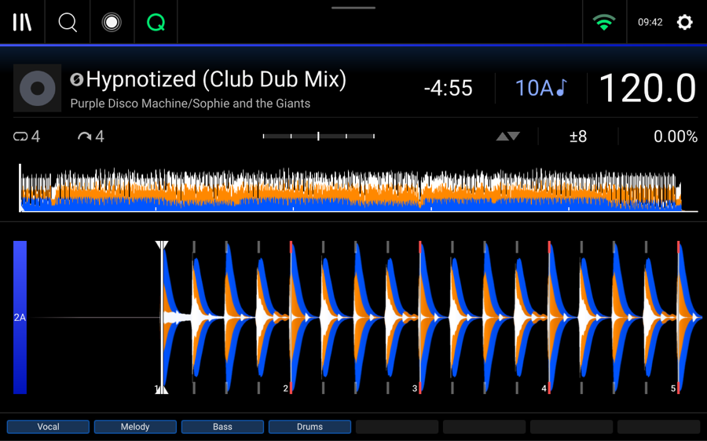
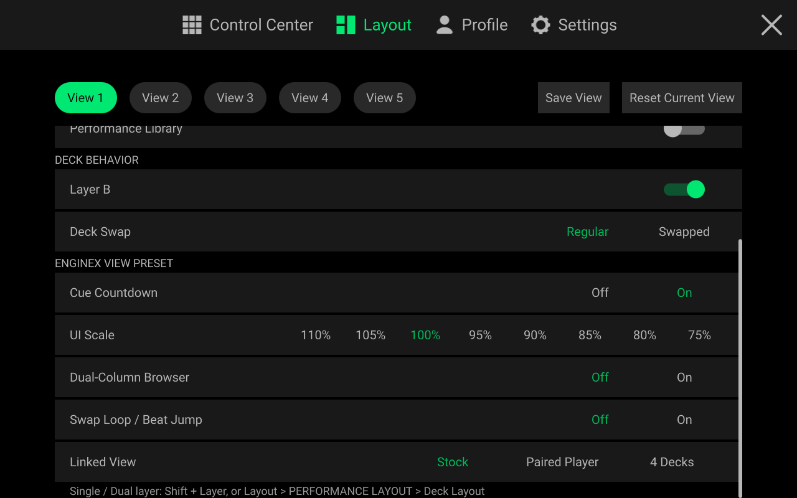
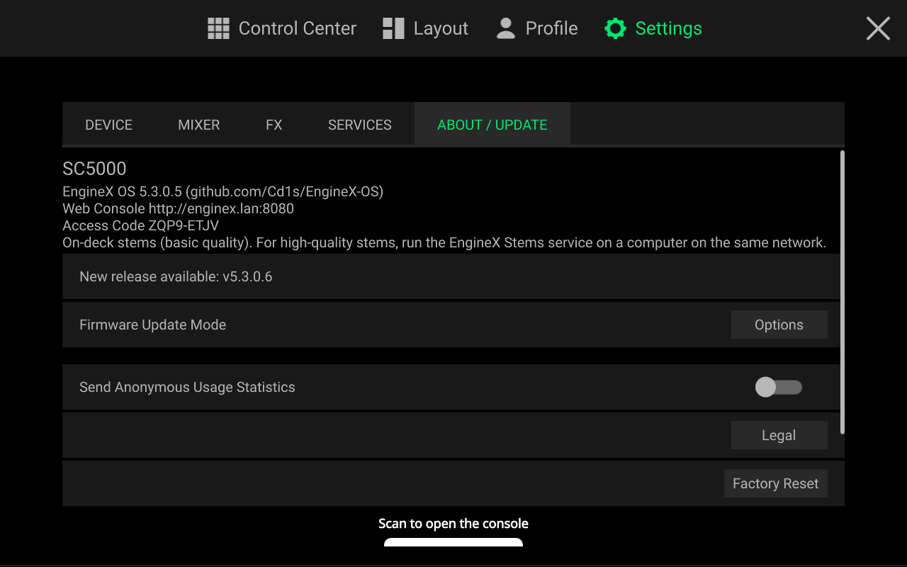
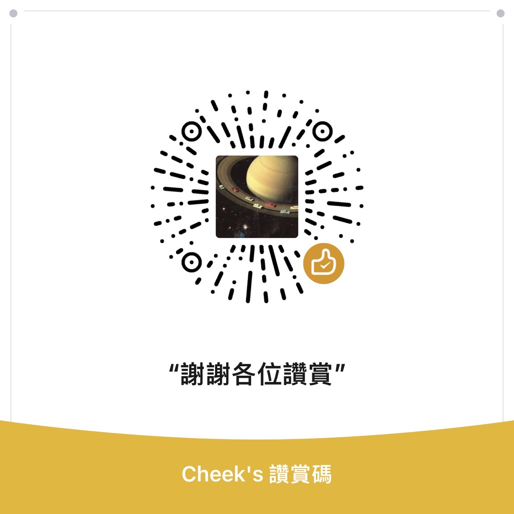

 

 

**[Features](#features)** · **[Download & Install](#install)** · **[Screenshots](#gallery)** · **[Benchmarks](#benchmarks)** · **[Sponsor](#sponsor)**

**Online User Guide**: <https://enginexdj.com> · **Roadmap**: <https://enginexdj.com/#roadmap>

 

**EngineX OS 5.3.0.5** is a custom system built on the official Engine OS 5.3.0+ base for all 16 Denon DJ, Numark, and Rane standalone units:

| Generation | Architecture | Models (board) |
| :--- | :--- | :--- |
| First generation, 8 models | 32-bit (ARM) | `SC5000 Prime` (JP07) · `SC5000M Prime` (JP08) · `PRIME GO` (JP11) · `SC6000 Prime` (JP13) · `SC6000M Prime` (JP14) · `PRIME 4` (JC11) · `PRIME 2` (JC16) · `Mixstream Pro` (NH08) |
| Second generation, 6 models | 32-bit (ARM) | `PRIME 4+` (JC11S) · `PRIME GO+` (JP11S) · `SC LIVE 2` (JP20) · `SC LIVE 4` (JP21) · `Mixstream Pro Go` (NH10) · `Mixstream Pro+` (NH08S) |
| Second generation, 2 models | 64-bit (ARM64) | `PRIME 4 G2` (JP24) · `Rane SYSTEM ONE` (RMZ2) |

All 16 models use unified `*-Update.img` packages. First-generation units install directly from a USB drive; second-generation units run `EngineX-Installer` over USB once to unlock the `.img` update chain and update from a USB drive or on-screen OTA from then on (see [How to Install & Update](#install)).

---

## Core Features

- **4-Part Stems**: swipe left on a local or streaming track to split Vocals, Melody, Bass, and Drums into the sidebar `Stems` list. Control stems from the Performance Pads or with the channel EQ knobs (`Profile → Playback → Stems EQ Mode` or `Shift + Cue`). Works on the deck alone (basic quality) or through a computer on the same LAN running `htdemucs` (`PRIME 4 G2` and `SYSTEM ONE` keep official Stems).
- **7 Streaming Services**: TIDAL, NetEase Cloud Music, Spotify, Deezer, SoundCloud, Beatport, and Apple Music appear in the Source menu with phone QR sign-in, FLAC / 320 kbps selection (`Settings → Services → Streaming Quality`), per-service local caching, and cross-source search in `Profile → Library → OmniSource (Drives in Streaming)`.
- **Rekordbox USB & Pro DJ Link**: reads rekordbox 5/6/7 USB drives (`FAT32`, `exFAT`, `NTFS`, and Mac `HFS+` read-write; `APFS` is not supported) with playlists, Hot Cues, Memory Cues, Loops, and beat grids. `Settings → Services → Pro DJ Link` connects to CDJs and computer rekordbox 7 (`Export` mode with `LINK` on), shares USB/SD drives, hands over `MASTER`, and shows CDJ waveforms on shadow decks or `Line In` channels.
- **Views, Waveforms & 4 Languages**: `Layout → ENGINEX VIEW PRESET → Linked View` switches standalone players between `Stock`, `Paired Player`, and `4 Decks` (`Stock` and `4 Decks` on 4-deck consoles), with five saved views (`View 1`–`View 5`), `UI Scale`, `Cue Countdown`, `Denon` / `RGB` / `3-Band` waveforms (`Profile → Display → Waveform Style`), and live switching between English, 简体中文, 繁體中文, and Español (`Settings → Device → Language`).
- **Audio, Console FX & Web Console**: includes `Master Soft Clipper`, `Auto-Gain`, `Hi-Fi Output` on Gen-1 players (`Profile → Playback → Hi-Fi Output`), `Fader Echo`, `PRIME 4` `(PX)` hardware effects, channel `FILTER` knob effects (`Profile → Playback → Color FX Style`), a double tap on an effect's `Frequency` bar to return it to `All Bands` on all-in-one consoles, `PX Delay Time Mode`, `Smart Sync` in the Control Center, 1 Gbps Ethernet, and the `:8080` web console for file uploads, track relocation, WAV `Live Stream`, and Mod Hub.

---

## What's New in 5.3.0.5

- **Native installer & signed updates**: `EngineX-Installer` flashes over USB without Python, fastboot, libusb, or WSL, recognizes `PRIME 4 G2` in Firmware Update Mode on Windows, and verifies signed `SHA256SUMS.txt.sig` manifests alongside the on-screen updater (#255, #239).
- **Restore official firmware**: `Restore-Official-Firmware` returns a deck to stock Engine OS 5.3.0; boot 5.3.0.5 once and shut down normally before returning to stock.
- **Writable HFS+ drives**: clean Mac-formatted (`HFS+`) USB drives and SD cards mount read-write on all 16 models so Engine saves libraries, cues, and loops directly on the drive.
- **Computer rekordbox Link & unified Pro DJ Link**: `Settings → Services → Pro DJ Link` replaces the two old switches, pairs with CDJ-3000 without firmware warnings, and lists computer rekordbox 7 (`Export` mode) as a source with instant grids, cues, and artwork (#198, #300).
- **Shadow lane**: shows the other deck's track at once with matching overview colors, follows the source position without playing audio to reduce CPU load, and falls back automatically where a model is not supported.
- **Fast large rekordbox USB import**: large rekordbox sticks open playlists and cues within seconds while waveforms convert in the background and publish automatically after 30 seconds of idle time (#301).
- **Rekordbox beat grids**: applies one start-offset rule across Pro DJ Link, USB drives, and the shadow lane for MP3 and AAC/M4A, realigning older converted tracks once while keeping deck edits.
- **Rekordbox cue write-back**: exports Hot Cues, Memory Cues, and Loops edited on the deck back to the rekordbox USB drive with a backup in `/.enginex-backup/` (`:8080` web console `Extras → Write cues back to rekordbox USB`, #271).
- **USB library safety**: aborts library updates without changing anything if many file names cannot be read due to a wrong character set, and retries on the next mount.
- **Channel FILTER Color FX**: assigns `Spiral`, `Pitch Echo`, `Slip Roll`, `Dub Echo`, or `Space` to each channel's `FILTER` knob on all-in-one consoles (`Profile → Playback → Color FX Style`).
- **Hi-Fi Output**: adds optional high-frequency compensation for 1st-gen SC5000 / SC6000 standalone players, off by default in `Profile → Playback → Hi-Fi Output` (#172).
- **Auto-Gain**: lifts quiet tracks to about `-4.4 dBFS` with clip protection and less pumping, and renames the switch in `Profile → Playback` to `Auto-Gain`.
- **Apple Music helper & Spotify audio source**: supports lossless Apple Music caching via `enginex-amd` on 2nd-gen decks (`/m/applemusic`) and lets you pick the fallback audio service for Spotify tracks in the `:8080` web console.
- **Bluetooth speaker output**: selects which deck layer or mixer bus feeds a paired Bluetooth speaker (`Settings → Device → Bluetooth → Output Source`).
- **Copy settings between decks**: copies preferences over the network with confirmation on both decks and includes EngineX settings in USB profile saves (`Settings → Device → Copy settings from another deck`, #205).
- **Mixstream & 4-pad controls**: adds pitch-bend Beat Jump, four assignable hardware FX slots, a clean pad bar, and a per-channel Stems EQ switch on Mixstream Pro / Pro+ / Pro Go (`Settings → Device` and `Profile → Playback`, #261, #286), while keeping Stems on pad page 1 and returning `CUE` to the cue page on Mixstream and `PRIME GO`.
- **PRIME 4 FX & console controls**: keeps the `PRIME 4` FX carousel open while browsing, adds `Jet Flanger (PX)` and a longer `Reverb` tail, enables `Fader Echo` on all consoles, and supports motorized platters in 4-deck views (#195, #207, #258, #263, #285).
- **Per-deck Reverse Jog Wheel**: reverses jog direction per player or per side on 2-jog consoles (`Settings → Device → Reverse Jog Wheel`, #213).
- **Pitch plateaus & cue countdown**: adds whole-BPM pitch fader plateaus when `Profile → Display → BPM Decimals` is `2` and aligns hot cue countdown with the beat grid (#151).
- **On-deck & streaming Stems**: uses stereo spectral separation on the deck without a computer, tags streaming Stems as "Artist - Title" on a private save partition, and supports RTX 50-series GPUs (#238, #243).
- **Web console, remote access & LAN tools**: redesigns the `:8080` console with an About QR code, Cloudflare Quick Tunnel (`Settings → Device → Remote access`), optional HTTPS (`:8443`), set tracklist CSV/text export, `Remote Load (LAN API)`, `cpu-ram-monitor` Mod, and `deploy/one-click-backend.sh` (#242, #268, #281, #296).
- **Spanish UI & high-speed SD**: adds `Español` (`Settings → Device → Language`, #282) and an experimental 50 MHz SD mode on RK3288 decks (`Settings → Device → High-speed SD card`).
- **Playback, streaming & hardware fixes**: fixes track-load audio stutter on `PRIME 4` (#298), disables Wi-Fi power saving on all decks (#309), persists 2nd-gen SSH passwords (#299), keeps streaming signed in when using an Engine DJ profile (#304), shows the active streaming icon in the deck header (#305), restores `Shift + View` on controllers, and asks before importing a USB profile.
- **Start-up single-drive browse**: automatically browses the deck's only local drive at start-up on all 16 models (including late-mounting drives) instead of opening the Sources list. Thanks to @sklempert (#315).

---

## On-Deck Screenshots

<table>
<tr>
<td width="50%" align="center" valign="top">
 
<b>Linked 4-Deck View & Shadow Waveforms</b> 
Local dual-layer decks paired with live shadow waveforms from a linked player
</td>
<td width="50%" align="center" valign="top">
 
<b>Paired Player 2-Deck View (SC5000 / SC6000)</b> 
Your active layer on top and the partner player's active layer below
</td>
</tr>
<tr>
<td width="50%" align="center" valign="top">
 
<b>4-Part Stems & 3-Band Waveforms</b> 
Vocal, Melody, Bass, and Drums pad controls on the main view
</td>
<td width="50%" align="center" valign="top">
 
<b>Stems List in the Library</b> 
Split tracks organized in the sidebar
</td>
</tr>
<tr>
<td width="50%" align="center" valign="top">
 
<b>7 Streaming Services in the Source Menu</b> 
TIDAL · NetEase · Spotify · Deezer · SoundCloud · Beatport · Apple Music
</td>
<td width="50%" align="center" valign="top">
 
<b>Phone QR Code Login</b> 
Scan with your phone to sign in and sync playlists
</td>
</tr>
<tr>
<td width="50%" align="center" valign="top">
 
<b>Control Center</b> 
Quantize, Smart Scratch, Waveform Style, and Smart Sync
</td>
<td width="50%" align="center" valign="top">
 
<b>Layout Tab (Views 1–5 & EngineX View Preset)</b> 
Saved views, Cue Countdown, UI Scale, Linked View, 4-Deck Role, and Shadow Deck Mode
</td>
</tr>
<tr>
<td width="50%" align="center" valign="top">
 
<b>BPM & Key Preview + Swipe Left for Stems</b> 
Track BPM and key before loading; swipe left to split Stems
</td>
<td width="50%" align="center" valign="top">
 
<b>Device Settings Menu</b> 
Language, Pad LED Brightness, Player #, Time Sync, and Power
</td>
</tr>
<tr>
<td width="50%" align="center" valign="top">
 
<b>Settings → About / Update: Online Upgrade</b> 
Tap Update on screen to download and install new releases
</td>
<td width="50%" align="center" valign="top">
 
<b>Bluetooth Audio Input & Output</b> 
Stream from a phone or route deck audio to a Bluetooth speaker
</td>
</tr>
</table>

---

## Performance & Footprint (Measured on SC5000)

| Metric | Stock / Earlier Build | `EngineX OS 5.3.0.5` (measured on SC5000) | Practical Result |
| :--- | :--- | :--- | :--- |
| **Firmware Image Size (`*-Update.img`)** | Stock 5.3.0: `147.79 MB` | **`151.44 MB`** (SC6000 `151.58 MB`, PRIME 4 `151.52 MB`) | `3.64 MB` larger than stock |
| **Internal `/data` Used After Flash** | `~243 MB` on older builds | **`17.2 MB` core + UI** (`45.6 MB` with filesystem drivers) | About `200 MB` more free flash space |
| **Free RAM (out of `2 GB`)** | `~680 – 780 MB` free | **`1,042 MB` free** (background services use `29.2 MB`) | `~260 MB` more free memory |
| **Rekordbox USB Read Time** | ~8 min first import, 15–24 s re-plug | **`< 2 s` first insert**, **`0.03 s`** re-insert | Play from a rekordbox USB drive right away |
| **Gen-1 `Hi-Fi Output` (`48 kHz` @ `20 kHz`)** | `-3.23 dB` roll-off (Stock `Off`) | **`-0.01 dB`** (`Profile → Playback → Hi-Fi Output`) | Compensates the `48 → 96 kHz` output stage roll-off |
| **Ethernet Speed** | Limited to `100 Mbps` | **`1 Gbps`** full duplex (Wi-Fi `~9–10 MB/s`) | Faster track transfers over Ethernet |

---

## How to Install & Update

### 1. Command-Line `EngineX-Installer` (All 16 Models — Required Once on Stock 2nd-Gen)

- [Windows 10/11 x64](https://github.com/Cd1s/EngineX-OS/releases/latest/download/EngineX-Installer-5.3.0.5-windows-amd64.zip)
- [macOS Apple Silicon M1–M4](https://github.com/Cd1s/EngineX-OS/releases/latest/download/EngineX-Installer-5.3.0.5-macos-arm64.zip)
- [macOS Intel](https://github.com/Cd1s/EngineX-OS/releases/latest/download/EngineX-Installer-5.3.0.5-macos-amd64.zip)
- [Linux x86_64](https://github.com/Cd1s/EngineX-OS/releases/latest/download/EngineX-Installer-5.3.0.5-linux-amd64.tar.gz)

Extract the archive and run `Install-EngineX.bat` (Windows), `Install-EngineX.command` (macOS), or `./install-enginex.sh` (Linux) in a terminal. The installer finds decks over LAN or in USB Firmware Update Mode, verifies `SHA256SUMS.txt.sig`, and flashes `*-Update.img` natively without Python, fastboot, libusb, or WSL (Windows binds Microsoft's signed WinUSB driver when prompted; Linux USB may need `sudo`).
**Warning**: update stock 2nd-gen decks to official Engine OS 5.3.0 or newer first with Engine DJ's official updater (check the version in `Settings → About / Update`: a deck still on older stock firmware such as 5.0.x does not boot after the install, and the installer stops below 5.3.0, #311), unplug USB/SD drives, and back up your deck while it is running—first-time USB unlock on 2nd-gen erases internal `/data` storage (LAN install via root SSH preserves `/data`). On `PRIME 4 G2` and `SYSTEM ONE`, power the unit off and back on after USB writing finishes. Never interrupt power or USB during a flash.

### 2. First-Generation Models — Direct USB Stick (`*-Update.img`)

Copy the matching `*-Update.img` unrenamed to the root of a FAT32 or exFAT USB drive, plug it into the deck, and choose **Settings → About / Update → Firmware Update Mode → Options → USB/SD**:

- **Denon DJ SC5000 Prime**: [`SC5000-5.3.0.5-EngineX-OS-Denon-SC5000-Prime-JP07-Update.img`](https://github.com/Cd1s/EngineX-OS/releases/latest/download/SC5000-5.3.0.5-EngineX-OS-Denon-SC5000-Prime-JP07-Update.img)
- **Denon DJ SC5000M Prime**: [`SC5000M-5.3.0.5-EngineX-OS-Denon-SC5000M-Prime-JP08-Update.img`](https://github.com/Cd1s/EngineX-OS/releases/latest/download/SC5000M-5.3.0.5-EngineX-OS-Denon-SC5000M-Prime-JP08-Update.img)
- **Denon DJ SC6000 Prime**: [`SC6000-5.3.0.5-EngineX-OS-Denon-SC6000-Prime-JP13-Update.img`](https://github.com/Cd1s/EngineX-OS/releases/latest/download/SC6000-5.3.0.5-EngineX-OS-Denon-SC6000-Prime-JP13-Update.img)
- **Denon DJ SC6000M Prime**: [`SC6000M-5.3.0.5-EngineX-OS-Denon-SC6000M-Prime-JP14-Update.img`](https://github.com/Cd1s/EngineX-OS/releases/latest/download/SC6000M-5.3.0.5-EngineX-OS-Denon-SC6000M-Prime-JP14-Update.img)
- **Denon DJ PRIME 4**: [`PRIME4-5.3.0.5-EngineX-OS-Denon-PRIME-4-JC11-Update.img`](https://github.com/Cd1s/EngineX-OS/releases/latest/download/PRIME4-5.3.0.5-EngineX-OS-Denon-PRIME-4-JC11-Update.img)
- **Denon DJ PRIME 2**: [`PRIME2-5.3.0.5-EngineX-OS-Denon-PRIME-2-JC16-Update.img`](https://github.com/Cd1s/EngineX-OS/releases/latest/download/PRIME2-5.3.0.5-EngineX-OS-Denon-PRIME-2-JC16-Update.img)
- **Denon DJ PRIME GO**: [`PRIMEGO-5.3.0.5-EngineX-OS-Denon-PRIME-GO-JP11-Update.img`](https://github.com/Cd1s/EngineX-OS/releases/latest/download/PRIMEGO-5.3.0.5-EngineX-OS-Denon-PRIME-GO-JP11-Update.img)
- **Numark Mixstream Pro**: [`MIXSTREAMPRO-5.3.0.5-EngineX-OS-Numark-Mixstream-Pro-NH08-Update.img`](https://github.com/Cd1s/EngineX-OS/releases/latest/download/MIXSTREAMPRO-5.3.0.5-EngineX-OS-Numark-Mixstream-Pro-NH08-Update.img)

### 3. Second-Generation Models — Unified `*-Update.img` & On-Deck OTA

After a 2nd-gen deck has been unlocked once with `EngineX-Installer` (or booted on an existing EngineX install), update it from a FAT32/exFAT USB drive with `*-Update.img` below, or tap **Settings → About / Update → Update** over Wi-Fi/Ethernet (this Release also includes `*-Data-Bundle.tar.gz` one last time so 2nd-gen decks on `5.3.0.2` / `5.3.0.3` can OTA upgrade and unlock `.img` updates; update decks on 5.3.0.4 or earlier to 5.3.0.5 first so future updates verify signatures):

- **Denon DJ SC LIVE 4**: [`SCLIVE4-5.3.0.5-EngineX-OS-Denon-SC-LIVE-4-JP21-Update.img`](https://github.com/Cd1s/EngineX-OS/releases/latest/download/SCLIVE4-5.3.0.5-EngineX-OS-Denon-SC-LIVE-4-JP21-Update.img)
- **Denon DJ SC LIVE 2**: [`SCLIVE2-5.3.0.5-EngineX-OS-Denon-SC-LIVE-2-JP20-Update.img`](https://github.com/Cd1s/EngineX-OS/releases/latest/download/SCLIVE2-5.3.0.5-EngineX-OS-Denon-SC-LIVE-2-JP20-Update.img)
- **Denon DJ PRIME 4+**: [`PRIME4PLUS-5.3.0.5-EngineX-OS-Denon-PRIME-4-Plus-JC11S-Update.img`](https://github.com/Cd1s/EngineX-OS/releases/latest/download/PRIME4PLUS-5.3.0.5-EngineX-OS-Denon-PRIME-4-Plus-JC11S-Update.img)
- **Denon DJ PRIME GO+**: [`PRIMEGOPLUS-5.3.0.5-EngineX-OS-Denon-PRIME-GO-Plus-JP11S-Update.img`](https://github.com/Cd1s/EngineX-OS/releases/latest/download/PRIMEGOPLUS-5.3.0.5-EngineX-OS-Denon-PRIME-GO-Plus-JP11S-Update.img)
- **Numark Mixstream Pro+**: [`MIXSTREAMPROPLUS-5.3.0.5-EngineX-OS-Numark-Mixstream-Pro-Plus-NH08S-Update.img`](https://github.com/Cd1s/EngineX-OS/releases/latest/download/MIXSTREAMPROPLUS-5.3.0.5-EngineX-OS-Numark-Mixstream-Pro-Plus-NH08S-Update.img)
- **Numark Mixstream Pro Go**: [`MIXSTREAMPROGO-5.3.0.5-EngineX-OS-Numark-Mixstream-Pro-Go-NH10-Update.img`](https://github.com/Cd1s/EngineX-OS/releases/latest/download/MIXSTREAMPROGO-5.3.0.5-EngineX-OS-Numark-Mixstream-Pro-Go-NH10-Update.img)
- **Denon DJ PRIME 4 G2**: [`PRIME4G2-5.3.0.5-EngineX-OS-Denon-PRIME-4-G2-JP24-Update.img`](https://github.com/Cd1s/EngineX-OS/releases/latest/download/PRIME4G2-5.3.0.5-EngineX-OS-Denon-PRIME-4-G2-JP24-Update.img)
- **Rane SYSTEM ONE**: [`SYSTEMONE-5.3.0.5-EngineX-OS-Rane-SYSTEM-ONE-RMZ2-Update.img`](https://github.com/Cd1s/EngineX-OS/releases/latest/download/SYSTEMONE-5.3.0.5-EngineX-OS-Rane-SYSTEM-ONE-RMZ2-Update.img)

### 4. Restore Official Firmware & Optional Companion Services

- **Restore official Engine OS 5.3.0**: boot 5.3.0.5 on the deck once, connect it to the same LAN as your computer, and run `Restore-Official-Firmware.bat` / `.command` / `.sh` (`enginex-installer --restore-stock`). On 1st-gen units, confirm the cache cleanup, remove drives with update files, enter Computer Update mode (on SC5000/SC6000 hold `MEDIA EJECT + SOURCE + LAYER` while powering on; on other 1st-gen models follow the [official update guide](https://support.enginedj.com/support/solutions/articles/69000797882)), and keep power and USB connected while it flashes official 5.3.0; if a 1st-gen deck already hangs at the stock logo, flash EngineX and boot it once first. On 2nd-gen units, click `Revert to Stock` in the `:8080` console or run `enginex-installer --uninstall` over LAN (keeps your library and settings).
- **Computer Stems, Streaming & Relay**: for LAN `htdemucs` Stems, run `./stems/run-home-worker.sh` (macOS/Linux) or `powershell -ExecutionPolicy Bypass -File .\stems\run-home-worker.ps1` (Windows) from the unzipped installer folder. For 4G/5G QR logins, enable `Cloudflare Quick Tunnel` in `http://<deck-ip>:8080` (`Settings → Device → Remote access`), or deploy a self-hosted relay, Stems, and `enginex-amd` Apple Music backend on Debian 12+ / Ubuntu 24.04+ with `sudo bash deploy/one-click-backend.sh` and link the deck via `enginex-installer --setup-backend`. See [`deploy/relay-host/README.md`](./deploy/relay-host/README.md), the [Online User Guide](https://enginexdj.com), and [`CONTRIBUTING.md`](./CONTRIBUTING.md).

---

## Sponsor & Support

<table>
<tr>
<td width="33%" align="center" valign="top">
 
<b>WeChat Pay</b> 
Scan with WeChat
</td>
<td width="33%" align="center" valign="top">
 
<b>Binance Pay</b> 
Binance ID: <code>565380652</code> (0 fee)
</td>
<td width="33%" align="center" valign="top">
 
<b>USDT / USDC (EVM Chains)</b> 
<code>0x35e0c53dd887b37cd5db0064291f7c5a7442bc91</code>
</td>
</tr>
</table>

MIT License · EngineX OS is an independent open-source project not affiliated with inMusic Brands, Denon DJ, Numark, or Rane. No stock firmware binaries are distributed in this repository.

