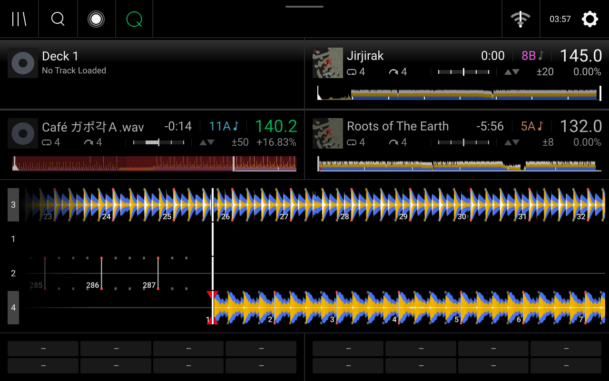
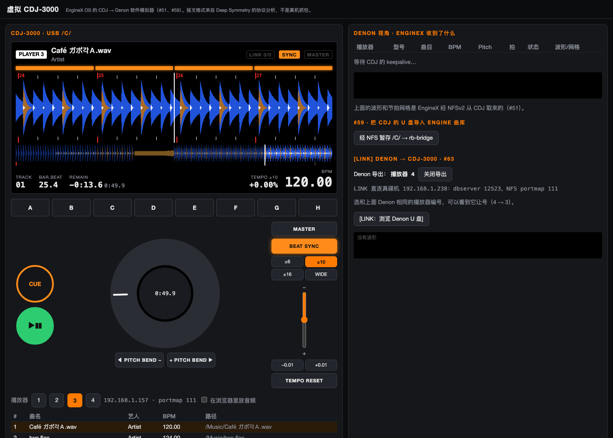

<div align="center">


<br>

<a href="./README.md"></a>
<a href="./README.zh-CN.md"></a>
<a href="./README.zh-TW.md"></a>

<br>

**[Unlocked Features](#features)** · **[Download Firmware](#install)** · **[Screenshots](#gallery)** · **[Before vs. After](#benchmarks)** · **[Sponsor](#sponsor)**

📖 **Online User Guide**: <https://enginexdj.com>

</div>

<br>

**EngineX OS 5.3.0.2** is a custom system rebuilt on the official Engine OS 5.3.0+ base, for 16 Denon DJ, Numark and Rane standalone units:
`SC5000` · `SC5000M` · `SC6000` · `SC6000M` · `PRIME 4` · `PRIME 2` · `PRIME GO` · `Mixstream Pro` · `SC LIVE 4` · `SC LIVE 2` · `PRIME 4+` · `PRIME GO+` · `Mixstream Pro+` · `Mixstream Pro Go` · `PRIME 4 G2` · `Rane SYSTEM ONE`.

The first eight take a USB-stick `.img`; the eight second-generation units, whose firmware is signed, take a `/data` bundle (Beta, see [How to Install](#install)).

Everything works right inside the stock Denon interface — flash it from a USB stick and unlock the features below.

---

<a id="features"></a>

## Unlocked Features

### 1. 4-Part Stems on Every Model (Vocals / Melody / Bass / Drums)
Official firmware locks standalone Stems to select hardware. EngineX OS unlocks the native `Stems` playlist and Performance Pads 4-part mute/unmute across **all SC5000, SC6000, and PRIME models**:
- Swipe left on any USB or streaming track to split **Vocals, Melody, Bass, and Drums** right on the deck;
- Hit the Performance Pads to mute vocals for live mashups or isolate drums for transitions;
- Splits tracks directly on the deck with no computer required, or automatically uses your home PC / cloud GPU for high-speed AI separation when on the same Wi-Fi.

### 2. 7 Streaming Services Built In (Phone QR Login)
No need to copy tracks to a USB drive before every set:
- **NetEase Cloud Music, Spotify, Deezer, SoundCloud, TIDAL, Beatport, and Apple Music** sit right next to your USB and SD drives in the Source menu;
- Scan the on-screen QR code with your phone to log in and browse your playlists, liked tracks, and search results;
- Switch between **Lossless FLAC and 320 kbps MP3**. Tracks you play are cached locally on the deck so loading them again is instant without re-downloading.
- **Beatport** uses your own account and plan: Professional downloads FLAC or 256k AAC, Advanced downloads 128k AAC, and Essential streams 128k AAC. Beatport tracks split into Stems like any other track.
- **Apple Music**: paste any playlist or album link on your phone, no account needed; add your `media-user-token` to browse your own library too. Apple Music audio is protected, so each track plays from Deezer (lossless FLAC) or NetEase, matched by ISRC or by title and artist.

### 3. Pioneer Rekordbox USB Plug & Play (No Desktop Conversion)
Bring the Rekordbox USB stick you exported for CDJs and plug it straight into your Denon deck:
- Reads all your playlists, Hot Cues, Memory Cues, Loops, and beat grids in **under 2 seconds** — no need to convert your library in Engine DJ Desktop;
- Works with any drive format: Windows `FAT32` / `exFAT` / `NTFS` and Mac `HFS+` / `APFS`;
- Automatically repairs corrupted databases from unmounted drives and removes the "improper eject" warning popup.

### 4. Pioneer-Style 3-Band Waveforms, 3 Languages & BPM Jog Lights
- **3 Waveform Styles**: Switch between stock Denon green, high-contrast **RGB**, and Pioneer-style **3-Band (Blue / Orange / White)** waveforms;
- **Jog Wheel Lighting**: Static color, rainbow cycle, fast strobe, or **BPM-synced beat pulse**;
- **3 Languages**: Switch between **English, Simplified Chinese (简体中文), and Traditional Chinese (繁體中文)**.

### 5. Click-Free FX Switching & Smoother Long Sets
- Eliminates the audible clicks/pops that happen on stock firmware when toggling or switching DJ effects, even when triggering FX on both decks at once;
- Defaults anonymous usage statistics to off and disables background telemetry disk writes so all memory and CPU power stay focused on audio playback and touchscreen response.

### 6. Smart Sync & Gigabit Ethernet
- **Smart Sync**: pull down the Control Center and switch the Sync mode between **Bar / Beat / Tempo** with one tap. With Sync on, when the BPM gap between two tracks is wider than the current pitch range, the deck steps Pitch Range up until it fits (up to `±100%`);
- **Gigabit Ethernet**: the wired port runs at **1 Gbps (1000 Mbps) full duplex** instead of the stock `100 Mbps` limit, with 8 MiB TCP buffers for large transfers;
- **Wi-Fi**: the deck's built-in Wi-Fi module is limited by the board's 25 MHz SDR12 SDIO bus to about `9–10 MB/s` in practice. Use the Gigabit port to copy large libraries.


### 7. New in 5.3.0.2
- **Zoom further out on the waveform (#77)**: the all-in-ones (PRIME 4, PRIME 2, PRIME GO, Mixstream Pro, SC LIVE) zoom out to 30 seconds like the SC5000 / SC6000, instead of Engine's 10 s, so more of the upcoming beat grid is on screen. Turn the Browse knob on the deck screen to zoom when `Settings → Device → Encoder Behavior` is `Waveform Zoom`;
- **Turn Off from the screen (#78)**: `Settings → Device → Power → Turn Off` opens Engine's own "Turn Off" confirmation, so a deck in a booth can be shut down without reaching for the rear power button;
- **Relocate Missing Tracks (#74)**: after files were moved or renamed on the same drive, the web console finds each missing track's new place (same name and size, then the name ignoring case, then a cleaned-up name). `Scan` only previews; `Relocate` backs up `m.db` first, then rewrites the paths. Reload the drive on the deck afterwards;
- **Apple Music sign-in (#75)**: the phone page signs in with Apple Music (MusicKit JS). Where Apple does not allow that, it offers a bookmarklet that copies your token from music.apple.com;
- **Console Access Code on the deck (#79)**: `Settings → About` shows the web console address and access code. A streaming QR code logs in only that service and never opens the console, so guests who scan the screen in a club get no control of your deck;
- **Silent Cue and Master Limiter**: the Censor button can be set to `Silent Cue` (`Settings → Playback → Censor Button Behavior`), and PRIME GO / Mixstream Pro get Engine's own `Master Limiter` (`Settings → Mixer`, Off / 0–18 dB), next to the EngineX `Master Soft Clipper`;
- **Apple Music** joins the streaming services (7 in total), logged in with the deck QR code like the others;
- **Wi-Fi Music Drop**: drag MP3 / FLAC / WAV / AIFF / M4A / AAC / OGG / OPUS files from a computer onto the deck's web console (`http://<deck IP>:8080`) and they are saved to the internal drive, SD card or USB of your choice under `Wi-Fi Drop/<playlist>/`. FLAC / MP3 on the library drive are analysed and added to that playlist; existing files are never overwritten and 256 MiB always stays free;
- **OmniSource**: the playlists and tracks on your USB / SD drives appear right inside the streaming browser, next to your streaming playlists, and one search finds both. Drive tracks play straight from the drive at full quality (`Settings → OmniSource`, off by default);
- **Pioneer CDJ / Pro DJ Link (Beta)**: read a CDJ's rekordbox USB library over LAN / Wi-Fi (`Pro DJ Link Library`) and share the deck's own library with CDJs (experimental). There is one tempo master across the SC5000 and the CDJs: MASTER is handed over either way, and as master the deck sends its BPM and beats for the CDJs' BEAT SYNC. All off by default;
- **Cleaner sound**: `Master Soft Clipper` keeps the master output under -0.1 dBFS with a smooth curve and zero latency, untouched below -1.5 dBFS; the Flanger no longer dips the volume (level matched to the dry track, up to +6 dB); `Upfader Echo Out` leaves an echo tail when you pull a fader down; `Auto-Gain (0 dB Normalize)` brings quiet tracks up toward 0 dBFS (at most +9 dB, slow and smooth, never lifts silence below -42 dBFS) and always ends in the soft limiter, so it cannot clip (off by default). 21 real-time DSP hooks in total, with no added latency;
- **Native 4-deck layout on SC5000 / SC6000**: Engine's own 4-deck view on a standalone player, with the sound card left at 2 channels. Each player plays the two decks of its role (`Auto`, `1+3`, `2+4`, `1+2`, `1`, `2`, set in `Settings → Device → 4-Deck Role` or the web console). The other decks are silent **shadow decks** that follow a second EngineX player or a CDJ: track, play / CUE, position, pitch, master and sync;
- **Live Stream** to Shoutcast / Icecast servers;
- **Library**: `Auto-Analyze Drives` analyses every unanalysed track on an inserted USB / SD in the background, at idle priority so playback is never affected; a rekordbox export (6.8.5 included) still imports when a few of its files are damaged, and those tracks are analysed when loaded; Engine 5.3.0's "Connect to your Engine DJ Profile to use Tidal" popup no longer appears while another service is selected;
- **Spotify with your own app**: Spotify limits how many users and requests one app may have, so there is no shared built-in app any more. Create a free app at `developer.spotify.com/dashboard`, add the Redirect URI shown in the web console, and paste its Client ID there (`#70`);
- **Steadier streaming and shadow decks**: a streaming playlist left open on the deck keeps loading after the background service restarts, instead of failing with "Track not found" (`#73`); shadow decks show the real track name, also for files without tags, and follow tracks the other player loaded from its streaming browser; the pads stay in HOT CUE when a track loads (`#71`).

> **Pioneer interop status**: the link with the Pioneer CDJ-3000 (library sharing, 3-band waveforms, 60 fps playhead, Master / Beat Sync) was tested between a real Denon SC5000 and [**OpenProLink**](https://github.com/Cd1s/OpenProLink), the maintainer's Pro DJ Link toolkit (a built-in Virtual CDJ-3000 simulator, plus `prolink-probe` to capture the protocol of Pioneer CDJ / XDJ players and DJM mixers). No real Pioneer CDJ-3000 has been on hand yet, so how real Pioneer players behave still needs testing. If you own a Pioneer CDJ-3000, CDJ-2000NXS2, XDJ-AZ / XZ or a DJM-A9 / DJM-V10 / DJM-900NXS2 mixer, real-hardware test reports and device / mixer protocol captures are very welcome at [Cd1s/OpenProLink](https://github.com/Cd1s/OpenProLink) or here, to improve cross-brand libraries, the mixer's Beat FX tempo sync, Quantize and On-Air linking!


---

<a id="gallery"></a>

## On-Deck Screenshots

<table>
<tr>
<td colspan="2" align="center" valign="top">
 <br>
<b>Native 4-Deck View: Two SC5000s + a CDJ-3000 on One LAN</b><br>
<sub>Right SC5000 plays decks 2 and 4; deck 3 is a CDJ-3000 (OpenProLink simulator) in BEAT SYNC, its waveform and tempo followed live over Pro DJ Link</sub>
</td>
</tr>
<tr>
<td width="50%" align="center" valign="top">
<br>
<b>4-Part Stems & 3-Band Waveforms</b><br>
<sub>Vocal, Melody, Bass, and Drums pad controls on the main view</sub>
</td>
<td width="50%" align="center" valign="top">
<br>
<b>Dedicated Stems List in the Library</b><br>
<sub>All split tracks are organized automatically in the sidebar</sub>
</td>
</tr>
<tr>
<td width="50%" align="center" valign="top">
<br>
<b>5 Streaming Services in the Source Menu</b><br>
<sub>NetEase · Spotify · Deezer · SoundCloud · TIDAL alongside USB & SD</sub>
</td>
<td width="50%" align="center" valign="top">
<br>
<b>Phone QR Code Login</b><br>
<sub>Scan with your phone to sync playlists without typing passwords</sub>
</td>
</tr>
<tr>
<td width="50%" align="center" valign="top">
<br>
<b>BPM & Key Preview + Swipe Left for Stems</b><br>
<sub>See track BPM and key before loading, and swipe left to split Stems</sub>
</td>
<td width="50%" align="center" valign="top">
<br>
<b>Device Settings Menu</b><br>
<sub>Switch language, waveform style, audio quality, and jog lights</sub>
</td>
</tr>
<tr>
<td width="50%" align="center" valign="top">
<br>
<b>Settings → About / Update: One-Click Online Upgrade</b><br>
<sub>Tap "Update" on the screen to download and flash new releases with the native progress screen</sub>
</td>
<td width="50%" align="center" valign="top">
<br>
<b>Native Bluetooth Audio Input & Playback Controls</b><br>
<sub>Stream from your phone with track info, play/pause and skip on the deck</sub>
</td>
</tr>
</table>

---

<a id="benchmarks"></a>

## Before vs. After Refactoring (Measured on SC5000)

The entire system has been refactored and slimmed down so all extra features take minimal space and leave more free memory than stock firmware:

| Metric | Stock / Before Refactoring | `EngineX OS 5.3.0.2` (Measured on SC5000) | What It Means for DJs |
| :--- | :--- | :--- | :--- |
| **Firmware Image Size (`*-Update.img`)** | Official stock 5.3.0: `147.79 MB`<br>Earlier custom build: `~210 MB` | **`151.44 MB`** (SC6000 `151.58 MB`, PRIME 4 `151.52 MB`) | **Only `3.64 MB` larger than stock firmware** |
| **Internal Storage Used After Clean Flash** | `~243 MB` left behind by older builds | **`17.2 MB` for core app + 3-language UI** (`45.6 MB` including extra drive format drivers) | Frees up **nearly `200 MB`** of internal flash space |
| **Free RAM Available (out of `2 GB`)** | `~680 – 780 MB` free | **`1,042 MB` free** (main player uses `~150 MB` less RAM; all background services use just **`29.2 MB`**) | **`~260 MB` more free memory** — zero lag during long sets |
| **Audio Core Interruption by Downloads** | `5% – 25%` spikes when downloading or indexing | **`0.0%`**: all downloads and Stems splitting run on a separate background core | **96 kHz audio playback is never interrupted** |
| **Rekordbox USB Reading Speed** | ~8 min first import, 15–24 s every re-plug | **`< 2 seconds` first plug**, **`0.03 seconds`** after that | Plug in your Rekordbox stick and play right away |
| **4-Minute Track Stems Split Time** | Locked / unavailable on SC5000 | **`~35 seconds`** via PC / cloud; **`1.4×` faster than playback** on the deck alone | Split vocals on the fly even mid-set |
| **Sync Across Large BPM Gaps** | Sync cannot reach the other tempo once the gap is wider than the pitch range; widen Pitch Range by hand | **Smart Sync** steps Pitch Range up automatically (up to `±100%`); Bar / Beat / Tempo switch in the Control Center | Sync tracks far apart in tempo without opening settings |
| **Network Speed** | Ethernet limited to `100 Mbps` | Ethernet **`1 Gbps` (1000 Mbps)** full duplex, 8 MiB TCP buffers; Wi-Fi about `9–10 MB/s` (25 MHz SDR12 SDIO bus) | Copy large libraries over the wired port |

---

<a id="install"></a>

## How to Install & Update

### Option 0: EngineX-Installer for All 16 Models

EngineX-Installer discovers supported first- and second-generation decks without entering an IP or selecting a model. It downloads the matching `.img` or data bundle and offers Wi-Fi SSH or USB Fastboot installation.

- [Windows 10/11 x64](https://github.com/Cd1s/EngineX-OS/releases/latest/download/EngineX-Installer-5.3.0.2-windows-amd64.zip)
- [macOS Apple Silicon M1–M4](https://github.com/Cd1s/EngineX-OS/releases/latest/download/EngineX-Installer-5.3.0.2-macos-arm64.zip)
- [macOS Intel](https://github.com/Cd1s/EngineX-OS/releases/latest/download/EngineX-Installer-5.3.0.2-macos-amd64.zip)
- [Linux x86_64](https://github.com/Cd1s/EngineX-OS/releases/latest/download/EngineX-Installer-5.3.0.2-linux-amd64.tar.gz)

Extract the archive and start `Install-EngineX.bat`, `Install-EngineX.command`, or `./install-enginex.sh` respectively. Network discovery depends on StageLinQ or the EngineX Web UI; SSH requires root access. Fastboot requires separate tools, including `fastboot` and Python 3; second-generation image creation also needs e2fsprogs. On Windows use the Linux package in WSL with USB access for that path. Back up your deck first: Fastboot can destroy data, particularly when creating a new second-generation `/data` image. First-generation rootfs flashing is experimental and has not been validated across all models.

### Option 1: USB Stick Install (First-Time Setup)
1. Click the link for your exact player model below to download the `.img` file directly (or visit [**Releases**](https://github.com/Cd1s/EngineX-OS/releases/latest)):
   - **Denon DJ SC5000 Prime**: [`SC5000-5.3.0.2-EngineX-OS-Denon-SC5000-Prime-JP07-Update.img`](https://github.com/Cd1s/EngineX-OS/releases/latest/download/SC5000-5.3.0.2-EngineX-OS-Denon-SC5000-Prime-JP07-Update.img)
   - **Denon DJ SC5000M Prime**: [`SC5000M-5.3.0.2-EngineX-OS-Denon-SC5000M-Prime-JP08-Update.img`](https://github.com/Cd1s/EngineX-OS/releases/latest/download/SC5000M-5.3.0.2-EngineX-OS-Denon-SC5000M-Prime-JP08-Update.img)
   - **Denon DJ SC6000 Prime**: [`SC6000-5.3.0.2-EngineX-OS-Denon-SC6000-Prime-JP13-Update.img`](https://github.com/Cd1s/EngineX-OS/releases/latest/download/SC6000-5.3.0.2-EngineX-OS-Denon-SC6000-Prime-JP13-Update.img)
   - **Denon DJ SC6000M Prime**: [`SC6000M-5.3.0.2-EngineX-OS-Denon-SC6000M-Prime-JP14-Update.img`](https://github.com/Cd1s/EngineX-OS/releases/latest/download/SC6000M-5.3.0.2-EngineX-OS-Denon-SC6000M-Prime-JP14-Update.img)
   - **Denon DJ PRIME 4**: [`PRIME4-5.3.0.2-EngineX-OS-Denon-PRIME-4-JC11-Update.img`](https://github.com/Cd1s/EngineX-OS/releases/latest/download/PRIME4-5.3.0.2-EngineX-OS-Denon-PRIME-4-JC11-Update.img)
   - **Denon DJ PRIME 2**: [`PRIME2-5.3.0.2-EngineX-OS-Denon-PRIME-2-JC16-Update.img`](https://github.com/Cd1s/EngineX-OS/releases/latest/download/PRIME2-5.3.0.2-EngineX-OS-Denon-PRIME-2-JC16-Update.img)
   - **Denon DJ PRIME GO**: [`PRIMEGO-5.3.0.2-EngineX-OS-Denon-PRIME-GO-JP11-Update.img`](https://github.com/Cd1s/EngineX-OS/releases/latest/download/PRIMEGO-5.3.0.2-EngineX-OS-Denon-PRIME-GO-JP11-Update.img)
   - **Numark Mixstream Pro**: [`MIXSTREAMPRO-5.3.0.2-EngineX-OS-Numark-Mixstream-Pro-NH08-Update.img`](https://github.com/Cd1s/EngineX-OS/releases/latest/download/MIXSTREAMPRO-5.3.0.2-EngineX-OS-Numark-Mixstream-Pro-NH08-Update.img)
2. Copy the `.img` file to the **root folder of a FAT32 or exFAT USB drive**.
3. Plug the USB drive into your deck (stock Engine OS 4.3.x and 5.0.x both work), open **Settings → About / Update → Firmware Update Mode**, choose **USB/SD** when the deck shows `Found 5.3.0.2 on USB/SD`, and let the player install and reboot. If it only asks *Reboot into firmware update mode?*, the deck did not see the file: check the model, keep the original file name in the root folder, then unplug and replug the drive.

### Option 1b: Second-Generation Models (`/data` Bundle, Beta)

**EngineX-Installer automatic installer (recommended):** finds the deck without entering its IP or choosing its model, using Wi-Fi SSH or USB Fastboot. Download the package for your computer:

- [Windows 10/11 x64](https://github.com/Cd1s/EngineX-OS/releases/latest/download/EngineX-Installer-5.3.0.2-windows-amd64.zip)
- [macOS Apple Silicon M1–M4](https://github.com/Cd1s/EngineX-OS/releases/latest/download/EngineX-Installer-5.3.0.2-macos-arm64.zip)
- [macOS Intel](https://github.com/Cd1s/EngineX-OS/releases/latest/download/EngineX-Installer-5.3.0.2-macos-amd64.zip)
- [Linux x64](https://github.com/Cd1s/EngineX-OS/releases/latest/download/EngineX-Installer-5.3.0.2-linux-amd64.tar.gz)

1. Update the deck to official **Engine OS 5.3.0**.
2. Extract the package and start `Install-EngineX.bat` on Windows, `Install-EngineX.command` on macOS, or `./install-enginex.sh` on Linux.
3. The installer looks for your deck and downloads its matching bundle. For a stock deck, select **Settings → About / Update → Firmware Update Mode**, reboot and connect USB; Fastboot identifies the model and flashes `/data` after confirmation. For a deck with root SSH enabled, connect both devices to the same network: StageLinQ (UDP 51337) and an EngineX Web UI scan discover it, then the bundle is installed under `/data/sc5000-custom` while preserving your library and settings. Discovery may depend on network configuration and StageLinQ availability.
4. After installation, future releases can be installed on the deck using **Settings → About / Update → Update** over Wi-Fi (#86).

SSH requires root access. USB Fastboot requires `fastboot`, Python 3 and e2fsprogs installed separately; on Windows, use the Linux package in WSL with USB access. **Flashing a new `/data` image erases the data on that partition, including its music, library and settings.** Back up the deck first and disconnect USB drives and SD cards before installation. To preserve `/data`, use `--userdata-backup` with a full image from the same deck. This Beta has not been tested on real hardware.

**SC LIVE 4, SC LIVE 2, PRIME 4+, PRIME GO+, Mixstream Pro+, Mixstream Pro Go, PRIME 4 G2 and Rane SYSTEM ONE** run signed firmware. **Never flash a `PRIME4` / `PRIMEGO` / `MIXSTREAMPRO` `.img` on these units.**

<details>
<summary>Advanced: manual installation and removal</summary>

Download the bundle for your model and check its SHA-256 against `SHA256SUMS.txt` on the Release page:
   - **Denon DJ SC LIVE 4** (JP21): [`SCLIVE4-5.3.0.2-EngineX-OS-Data-Bundle.tar.gz`](https://github.com/Cd1s/EngineX-OS/releases/latest/download/SCLIVE4-5.3.0.2-EngineX-OS-Data-Bundle.tar.gz)
   - **Denon DJ SC LIVE 2** (JP20): [`SCLIVE2-5.3.0.2-EngineX-OS-Data-Bundle.tar.gz`](https://github.com/Cd1s/EngineX-OS/releases/latest/download/SCLIVE2-5.3.0.2-EngineX-OS-Data-Bundle.tar.gz)
   - **Denon DJ PRIME 4+** (JC11S): [`PRIME4PLUS-5.3.0.2-EngineX-OS-Data-Bundle.tar.gz`](https://github.com/Cd1s/EngineX-OS/releases/latest/download/PRIME4PLUS-5.3.0.2-EngineX-OS-Data-Bundle.tar.gz)
   - **Denon DJ PRIME GO+** (JP11S): [`PRIMEGOPLUS-5.3.0.2-EngineX-OS-Data-Bundle.tar.gz`](https://github.com/Cd1s/EngineX-OS/releases/latest/download/PRIMEGOPLUS-5.3.0.2-EngineX-OS-Data-Bundle.tar.gz)
   - **Numark Mixstream Pro+** (NH08S): [`MIXSTREAMPROPLUS-5.3.0.2-EngineX-OS-Data-Bundle.tar.gz`](https://github.com/Cd1s/EngineX-OS/releases/latest/download/MIXSTREAMPROPLUS-5.3.0.2-EngineX-OS-Data-Bundle.tar.gz)
   - **Numark Mixstream Pro Go** (NH10): [`MIXSTREAMPROGO-5.3.0.2-EngineX-OS-Data-Bundle.tar.gz`](https://github.com/Cd1s/EngineX-OS/releases/latest/download/MIXSTREAMPROGO-5.3.0.2-EngineX-OS-Data-Bundle.tar.gz)
   - **Denon DJ PRIME 4 G2** (JP24): [`PRIME4G2-5.3.0.2-EngineX-OS-Data-Bundle.tar.gz`](https://github.com/Cd1s/EngineX-OS/releases/latest/download/PRIME4G2-5.3.0.2-EngineX-OS-Data-Bundle.tar.gz)
   - **Rane SYSTEM ONE** (RMZ2): [`SYSTEMONE-5.3.0.2-EngineX-OS-Data-Bundle.tar.gz`](https://github.com/Cd1s/EngineX-OS/releases/latest/download/SYSTEMONE-5.3.0.2-EngineX-OS-Data-Bundle.tar.gz)

**Method 1 (recommended): install on the unit.** Keeps your music, settings and library. Needs a root shell on the unit (SSH or serial console).

1. Copy the `.tar.gz` to a USB drive and plug it into the unit (or copy it over the network).
2. In the unit's shell, unpack and install it (replace `<model>` and the drive name):
   ```sh
   cp "/media/<USB drive>/<model>-5.3.0.2-EngineX-OS-Data-Bundle.tar.gz" /tmp/
   tar -xzf /tmp/<model>-5.3.0.2-EngineX-OS-Data-Bundle.tar.gz -C /tmp
   sh /tmp/<model>-5.3.0.2-EngineX-OS-Data-Bundle/install.sh
   reboot
   ```
3. After the reboot Engine starts once in stock form, then restarts by itself with EngineX OS. `Settings → Device` then shows the EngineX entries (`Language`, `Power → Turn Off`, …).

**Method 2: inject into a userdata image on a computer (fastboot).** Only if you have no shell on the unit. Needs a Linux computer with `python3`, `e2fsprogs` (`debugfs`) and `fastboot`, and **a full image of your own `/data` partition**. Flashing replaces the whole `/data` partition, so never use an empty image or someone else's.

1. Keep your backup untouched and work on a copy: `cp my-userdata-backup.img userdata-enginex.img`
2. Unpack the bundle on the computer and inject it into the copy (the two helper scripts are inside the bundle):
   ```sh
   tar -xzf <model>-5.3.0.2-EngineX-OS-Data-Bundle.tar.gz
   python3 <model>-5.3.0.2-EngineX-OS-Data-Bundle/host-install-userdata.py userdata-enginex.img --bundle <model>-5.3.0.2-EngineX-OS-Data-Bundle.tar.gz
   ```
3. Put the unit into fastboot mode, connect it over USB, then flash and reboot:
   ```sh
   sh <model>-5.3.0.2-EngineX-OS-Data-Bundle/host-install-fastboot.sh userdata-enginex.img
   ```

**Uninstall**: `sh /data/sc5000-custom/bundle/uninstall.sh && reboot` removes only what the bundle added.

</details>

> **PRIME 4 G2 / SYSTEM ONE (64-bit Engine)**: the UI packs, the streaming gateway (Deezer, SoundCloud, Beatport) and the EngineX services are in. The DSP guards, Master Soft Clipper and auto gain, SQLite tuning and the 4-deck unlock are not ported to the 64-bit Engine yet, and Stems stay as the official firmware has them. This Engine needs the unit's secure element (OP-TEE) to start, so the sandbox checked the hook, the edits and the pack loading but not the screens.

### Option 2: One-Click On-Deck Update (When Already Running EngineX OS)
- Connect your deck to Wi-Fi or Ethernet and open **Settings → About / Update**;
- Tap **Update** on the screen and confirm — the deck will automatically launch the full-screen updater, download the new image, and reboot.
- **Second-generation models** (SC LIVE 4 / 2, PRIME 4+, PRIME GO+, Mixstream Pro+ / Pro Go, PRIME 4 G2, SYSTEM ONE): once the `/data` bundle is installed, later releases (for example `5.3.0.3`) are found and installed the same way from **Settings → About / Update**. The deck downloads that release's `Data-Bundle.tar.gz`, checks `SHA256SUMS`, swaps the files in one step and restarts the EngineX services; the system partition is never touched (#86).

### Optional: Use Your Computer to Speed Up Stems
If your Mac or PC is on the same Wi-Fi as your deck, run one command on your computer and the deck will automatically find it and use your computer's GPU/CPU for fast AI Stems separation (no IP address or password setup needed):
```sh
# macOS / Linux
tools/stems/run-home-worker.sh

# Windows (PowerShell)
powershell -ExecutionPolicy Bypass -File tools\stems\run-home-worker.ps1 demucs
```

### Streaming Login: the Deck Alone Is Enough
No computer and no server are needed. Put the deck and your phone on the same Wi-Fi, open a service in the Source menu and scan the QR code on the screen. The login page on your phone is in English by default and switches to 简体中文 or 繁體中文 at the top right; every page has a step-by-step guide.

| Service | What you do |
| --- | --- |
| NetEase Cloud Music | Scan the deck's QR code with the NetEase Cloud Music app and confirm. If the code expires, tap it for a new one. |
| Spotify | Step 1: tap **Open Spotify login** and agree. Step 2: Spotify then opens a `127.0.0.1` page that cannot load; copy its address and tap **Paste & Connect**. |
| Deezer | Paste your **ARL** (the guide shows how to copy it from deezer.com on a computer). The same login unlocks lossless FLAC downloads (Deemix) for Spotify, NetEase and Deezer tracks. A profile link alone shows public playlists without downloads. |
| SoundCloud | Enter your username or profile URL. No password, Artist Pro or API app needed. For private playlists, paste the `oauth_token` from soundcloud.com under *Advanced*. |
| Beatport | Enter your Beatport email and password. The deck keeps only the login token. |

### Optional: Your Own Login Relay
A relay lets a phone on mobile data finish logins and adds Deezer's in-browser login. Run it on any server with a public HTTPS address, then enter its address and password in the deck's web console (`http://<deck-ip>:8080`):
```sh
go build -o sc5000-relay ./cmd/sc5000-relay
./sc5000-relay -public https://relay.example.com -listen 0.0.0.0:6595
# the first console password is written to /var/lib/sc5000-relay/initial-password
```

---

## Security: Playing on Public Networks

EngineX OS is built to be safe on a club, bar or festival Wi-Fi shared with strangers.

- **No default SSH password.** Password login is switched off completely, and the public firmware ships with **no SSH key at all**, so SSH stays closed until you add your own key. Decks that ran an earlier public image have the key those images carried removed automatically when they update to 5.3.0.1.
- **Nobody on the same Wi-Fi can control your deck.** Everything the deck uses internally (playing, waveform and language settings, online update, streaming logins, Stems) only answers the deck itself (`127.0.0.1`). Someone else on the network cannot switch your tracks, change settings or restart the player.
- **The phone web console needs your deck's own access code.** The page at `http://<deck-ip>:8080` asks for a random code generated on your deck. The address and code are shown on the deck under `Settings → About`. Streaming QR logins use one-time links that expire and never open the console.

For advanced users:

- To use SSH, put your public key in `/data/sc5000-custom/authorized_keys` (for example with a private build of the image), then reboot. Key login only, no passwords.
- The console access code is stored in `/data/sc5000-custom/state/access-token`. Delete that file and restart the deck to get a new one.
- If you play on a network you do not trust, you do not need Wi-Fi for USB, SD or Bluetooth playback: leave the deck offline.

---

<details>
<summary><b>Developer & Build Notes (Not needed for DJs)</b></summary>

<br>

- Full 642-issue historical audit manifest: [`docs/OPEN-SOURCE-FULL-MANIFEST.md`](./docs/OPEN-SOURCE-FULL-MANIFEST.md)
- Stress test and fix log: [`docs/ISSUE-FIXES-2026-11-04.md`](./docs/ISSUE-FIXES-2026-11-04.md)
- Contribution and release guide: [`CONTRIBUTING.md`](./CONTRIBUTING.md)

```sh
# Run test suites
go test -race ./...
bash tests/test_rootfs_overlay.sh

# Build the 5-in-1 static ARMv7 suite and C hooks
GOOS=linux GOARCH=arm GOARM=7 CGO_ENABLED=0 go build -trimpath -ldflags="-s -w" -o out/sc5000-suite ./cmd/sc5000-suite
sh tools/ui-mod/build.sh
sh tools/edisksd-hook/build.sh
```

</details>

---

<a id="sponsor"></a>

## Sponsor & Support

If **EngineX OS** makes your decks more fun to play on or saves you prep time before a gig, consider supporting the project or leaving a **Star** on the repo!

<table>
<tr>
<td width="33%" align="center" valign="top">
<br>
<b>WeChat Pay</b><br>
<sub>Scan with WeChat (Cheek's 讚賞碼)</sub>
</td>
<td width="33%" align="center" valign="top">
<br>
<b>Binance Pay</b><br>
<sub>Scan QR or send to Binance ID: <code>565380652</code> (0 fee)</sub>
</td>
<td width="33%" align="center" valign="top">
<br>
<b>USDT / USDC (All Binance EVM Chains)</b><br>
<sub>BSC · ERC20 · Arbitrum · Optimism · Polygon · Base · opBNB</sub>
</td>
</tr>
</table>

> **Binance ID (UID — 0 fee via Binance Pay, click copy on the right):**
> ```text
> 565380652
> ```
>
> **USDT / USDC Wallet Address (Supports all Binance EVM networks: `BSC (BEP-20)` · `Ethereum (ERC-20)` · `Arbitrum One` · `Optimism` · `Polygon` · `Base` · `opBNB` · `Avalanche C-Chain` · `zkSync Era` · `Scroll` · `Linea`):**
> ```text
> 0x35e0c53dd887b37cd5db0064291f7c5a7442bc91
> ```

---

## Star History

<div align="center">
<a href="https://star-history.com/#Cd1s/EngineX-OS&Date">
  <picture>
    <source media="(prefers-color-scheme: dark)" srcset="https://api.star-history.com/svg?repos=Cd1s/EngineX-OS&type=Date&theme=dark" />
    <source media="(prefers-color-scheme: light)" srcset="https://api.star-history.com/svg?repos=Cd1s/EngineX-OS&type=Date" />
    
  </picture>
</a>
</div>

---

<div align="center">
<sub>MIT License · EngineX OS is an independent community open-source project and is not affiliated with or endorsed by inMusic Brands, Denon DJ, or Numark. No copyrighted stock firmware binaries are distributed in this repository.</sub>
</div>
