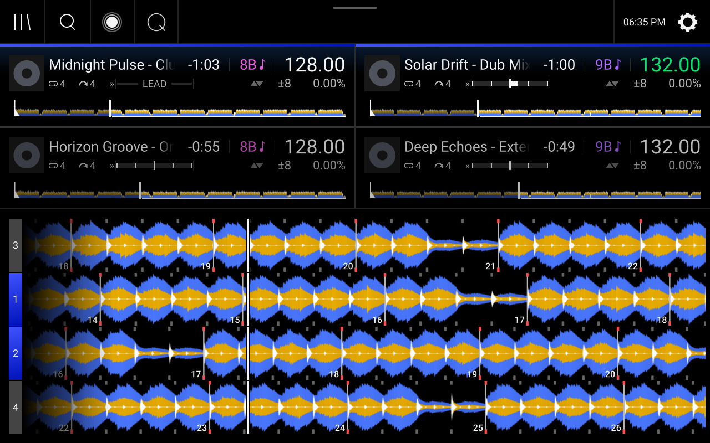
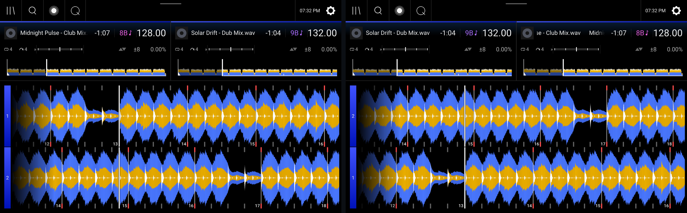
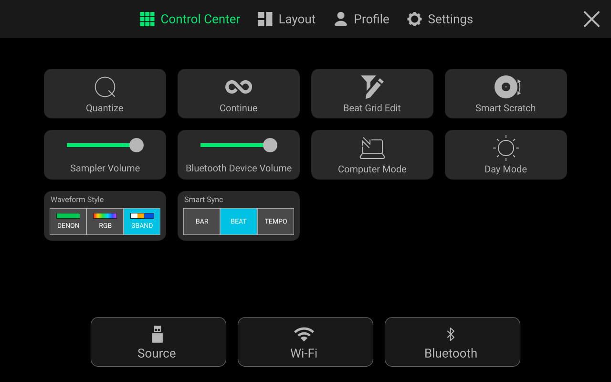
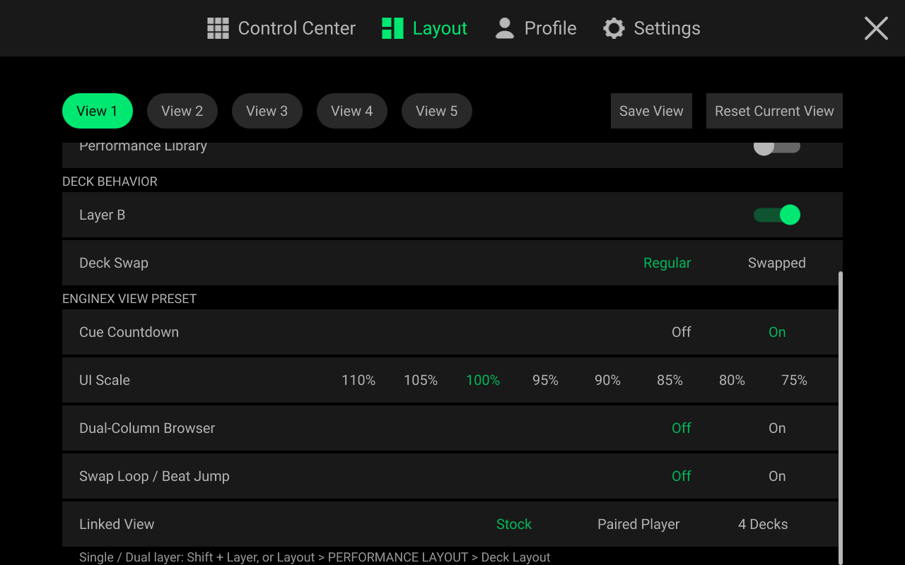
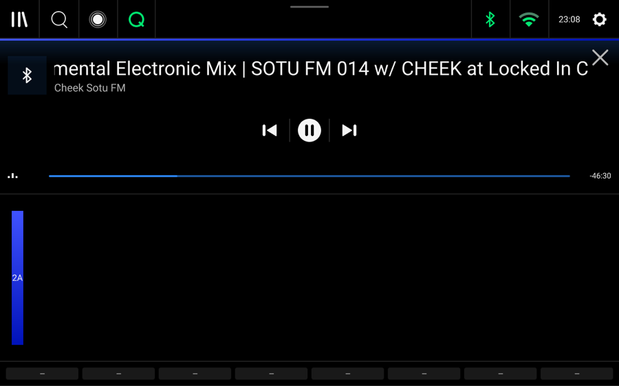

<div align="center">


<br>

<a href="./README.md"></a>
<a href="./README.zh-CN.md"></a>
<a href="./README.zh-TW.md"></a>

<br>

**[Features](#features)** · **[Download & Install](#install)** · **[Screenshots](#gallery)** · **[Benchmarks](#benchmarks)** · **[Sponsor](#sponsor)**

📖 **Online User Guide**: <https://enginexdj.com> · **Roadmap**: <https://enginexdj.com/#roadmap>

</div>

<br>

**EngineX OS 5.3.0.4** is a custom system rebuilt on the official Engine OS 5.3.0+ base for all 16 Denon DJ, Numark, and Rane standalone units:
`SC5000` · `SC5000M` · `SC6000` · `SC6000M` · `PRIME 4` · `PRIME 2` · `PRIME GO` · `Mixstream Pro` · `SC LIVE 4` · `SC LIVE 2` · `PRIME 4+` · `PRIME GO+` · `Mixstream Pro+` · `Mixstream Pro Go` · `PRIME 4 G2` · `Rane SYSTEM ONE`.

All 16 models now use unified `*-Update.img` packages: the 8 first-generation units flash directly from a USB stick, while the 8 second-generation units connect to a computer once with `EngineX-Installer` for a **one-click `.img` update-chain unlock + flash** and update from a USB stick or on-screen OTA just like 1st-gen units from then on (see [How to Install & Update](#install)).

Everything runs right inside the familiar Denon DJ interface — install it and unlock the features below while keeping stock controls and audio reliability.

---

<a id="features"></a>

## Core Features

### 1. 4-Part Stems on Every Model (Vocals / Melody / Bass / Drums)
- Swipe left on any local or streaming track to split **Vocals, Melody, Bass, and Drums**, organized automatically in the sidebar `Stems` list;
- Mute or solo individual stems from the Performance Pads, or press **Shift + Cue (PFL)** on supported mixer consoles (`Profile → Playback → Stems EQ Mode`) to turn channel `HIGH / MID / LOW` EQ knobs into smooth Stems level controls;
- Separates tracks standalone on the deck with no computer required, or automatically uses a Mac / PC on the same Wi-Fi / LAN for high-quality `htdemucs` neural separation (`PRIME 4 G2` and `SYSTEM ONE` keep their official Stems behavior).

### 2. 7 Built-In Streaming Services (Phone QR & One-Tap Login)
- **TIDAL, NetEase Cloud Music, Spotify, Deezer, SoundCloud, Beatport, and Apple Music** appear right alongside your USB and SD drives in the Source menu;
- Scan the on-screen QR code with your phone (or pick **`EngineX OS`** in Spotify Connect) to browse playlists, liked songs, and search results, with sorting by BPM, key, rating, title, or artist;
- Switch between **Lossless FLAC and 320 kbps** quality; played tracks are cached on the deck in separate per-service caches so reloading them is instant (when NetEase is set to `Deemix First`, NetEase and Deezer share lossless cached downloads);
- **OmniSource** (`Profile → Library → OmniSource (Drives in Streaming)`, off by default) lets one search span your streaming services, USB/SD drives, djay libraries, and mounted network shares while keeping each service's own playlist page clean.

### 3. Pioneer Rekordbox USB Plug & Play & CDJ Link
- Plug a CDJ-exported Rekordbox USB stick straight into your deck and read playlists, Hot Cues, Memory Cues, Loops, and beat grids in **under 2 seconds** (including legacy rekordbox 5 USB sticks) with no desktop conversion;
- Works with `FAT32` / `exFAT` / `NTFS` and Mac `HFS+` (`Mac OS Extended`; `APFS` is not supported: format the stick as `exFAT` or `Mac OS Extended`), aligns MP3 encoder start offsets so grids and cues sit right on the beat, repairs drive databases after an accidental unplug, and removes the "improper eject" popup;
- **Pro DJ Link (Beta)** under `Settings → Services` browses a CDJ's Rekordbox USB stick over LAN / Wi-Fi, shares your deck's library to CDJs, hands `MASTER` back and forth, and displays CDJ waveforms on shadow decks or all-in-one `Line In` channels.

### 4. Linked 4-Deck & Paired Player Views, Saved Layouts & 3 Languages
- **`Linked View` (`Layout → ENGINEX VIEW PRESET → Linked View`)**: switch standalone players between `Stock`, `Paired Player` (two full-height waveforms showing your active layer on top and the partner player's active layer below), and `4 Decks` (four stacked waveforms with silent shadow decks following another EngineX deck or CDJ); 4-deck all-in-one consoles switch between `Stock` and `4 Decks`;
- **5 Saved Views & UI Scale**: save up to five custom layouts (`View 1`–`View 5`) with per-view `Cue Countdown`, `UI Scale` (`110%`–`75%`), `Dual-Column Browser` with BPM, and `Swap Loop / Beat Jump`;
- **3 Waveform Styles & 3 Languages**: switch live between **English, 简体中文, and 繁體中文**, and toggle between `Denon`, `RGB`, and Pioneer-style `3-Band` waveforms from the Control Center or `Profile → Display → Waveform Style` across all 16 models.

### 5. Studio-Clean Audio, All-in-One FX & Gigabit Networking
- **21 Real-Time Audio Guards**: click-free FX switching, zero-latency `Master Soft Clipper` (-0.1 dBFS ceiling), `Auto-Gain (0 dB Normalize)`, Flanger volume drop compensation, and smooth `Fader Echo` / `Echo Out` tails on mixer consoles;
- **Pioneer-Style FX on Consoles**: `PRIME 4` adds `Spiral (PX)`, `Pitch Echo (PX)`, `Slip Roll (PX)`, `Dub Echo (PX)`, and `Space (PX)` to its hardware FX selector, while other all-in-one consoles offer `Profile → Playback → Color FX Style` plus optional BPM-independent **10–4000 ms** delay mode (`PX Delay Time Mode`; standalone players keep a pure player signal path without PX effects);
- **Smart Sync, Gigabit Ethernet & `:8080` Web Console**: one-tap `Bar / Beat / Tempo` sync in the Control Center with automatic Pitch Range widening on wide BPM gaps, unlocked **1 Gbps** wired Ethernet, Wi-Fi drag-and-drop music upload, missing-track relocation, Shoutcast / Icecast `Live Stream`, and optional Mod Hub add-ons (`tailscale-remote`, `dmx-studio`, `midi-controller-mapper`, `jog-logo-studio`, `sampler-pad-studio`, `minimal-club-mode`).

---

## What's New in 5.3.0.4

### New Features
- **Unified `*-Update.img` for all 8 second-generation models & one-click unlock**: all 16 models now ship a single `*-Update.img` file per model. On a stock 2nd-gen deck, run `EngineX-Installer` once over USB (`Firmware Update Mode`) to automatically perform **[1/2] One-Click Unlock** of the `.img` update chain and **[2/2] Flash `*-Update.img`**; from then on, 2nd-gen units update from a USB stick or one-tap on-screen OTA just like 1st-gen units, with no computer needed.
- **Native Spotify audio & zero-config login**: Spotify Premium streams native 320 kbps Ogg Vorbis directly from Spotify with full BPM, key, and waveform analysis and no cross-service fallback; pair in one tap via **`EngineX OS`** in Spotify Connect or scan the on-screen QR code with no Developer App setup.
- **Unified `Linked View` & `Paired Player` 2-deck view**: `Layout → ENGINEX VIEW PRESET → Linked View` puts `Stock`, `Paired Player`, and `4 Decks` in one row on `SC5000 / SC6000` (`Stock` and `4 Decks` on 4-deck consoles) so returning to `Stock` is always one step away. `Paired Player` gives two linked standalone players two clean full-height waveforms — your active layer on top and the partner player's active layer below — and switches to and from `4 Decks` without restarting Engine.
- **Live `Shadow Deck Mode` (`Auto` / `All Engine Mode` / `All CDJ Mode`)**: `Auto` loads copyable EngineX and CDJ USB/SD tracks locally (muted) so shadow waveforms, beat grids, `Slip` timelines, `Key Offset`, `Auto Loop`, `Stems` icons, `Sync`, and `LEAD` look identical to a local deck (with track info and a progress ring while loading), and falls back automatically to stock-styled CDJ waveforms when a CDJ source cannot be copied. Switching modes takes effect live without restarting Engine.
- **CDJ-3000 waveforms on all-in-one `Line In` channels**: switching a mixer channel to `Line In` on consoles such as `PRIME 4` displays connected Pioneer CDJ-3000 waveforms and playheads right on that channel.
- **`PRIME 4` hardware `(PX)` effects & `10–4000 ms` PX delay mode**: adds `Spiral (PX)`, `Pitch Echo (PX)`, `Slip Roll (PX)`, `Dub Echo (PX)`, and `Space (PX)` to the `PRIME 4` FX selector, plus optional `Profile → Playback → PX Delay Time Mode → Milliseconds (ms)` (`10–4000 ms`) across delay-based PX effects on all-in-one consoles.
- **`SC LIVE 4` AUX channel routing & `Mixstream` Sweep FX / Beat Jump pads**: routes `SC LIVE 4` `AUX` into Channel 3 or 4 via `Mixer Menu → Channels → Input` with full channel EQ, fader, `CUE`, and Sweep FX while keeping `MIC 2` intact; restores physical `FILTER` knob Sweep FX, touch Beat Jump, `Beat Jump Pad Bank`, and `EQ / STEMS` on `Mixstream Pro / Pro+ / Pro Go`.
- **High-quality `htdemucs` computer Stems & bundled scripts**: LAN computer Stems now defaults to the high-quality `htdemucs` neural model, shows live connection status under `Profile → Library` and `Settings → About / Update`, and includes ready-to-run `stems/` scripts inside every `EngineX-Installer` download.
- **USB MIDI controller Mod, verbose log export & Quick Tunnel**: adds the optional `midi-controller-mapper` Mod (with a Pioneer CDJ-400 preset for controlling Deck 3 / 4), one-click redacted log download in the `:8080` web console, a multi-deck status hub in `enginex-relay`, and domain-free Cloudflare Quick Tunnel support for remote mobile QR logins.

### Fixes & Refinements
- **Record with streaming tracks on all-in-ones**: consoles with a built-in recorder can now start recording while a streaming track is loaded and load streaming tracks while recording *(streaming services' terms may not allow keeping recordings of their tracks; keep them for personal use)*.
- **Rekordbox MP3 beat-grid alignment & rekordbox 5 USB sticks**: compensates for MP3 encoder delay (~26–51 ms) so imported Rekordbox beat grids, Hot Cues, Memory Cues, and Loops land right on the beat (updating affected MP3s on already-imported sticks automatically once), and supports legacy rekordbox 5 USB exports.
- **Official Mods `1.1.0` work out of the box on all 16 models**: replaces Python helpers with self-contained native helpers so all official Mods start cleanly on every deck, upgrades `1.0.0` Mods in place from `:8080` while keeping settings, preserves executable permissions on uploaded Mods, and fixes `403` errors when opening Mod Hub over LAN.
- **Boot safety net & power-cut recovery**: if startup ever stalls or crashes repeatedly, the deck falls back safely to stock Engine with Mods paused — never wiping your library or factory-resetting — and saves a redacted report to USB/SD; dirty UI caches after an abrupt power cut are cleaned automatically on next boot.
- **Standalone player `Sampler Output`, 4-deck controls & shadow `Sync`**: `SC5000 / SC6000` keep `Settings → Mixer → Sampler Output` (`Layer A` / `Layer B`), `Player #`, dual-layer `Deck Colors`, `Layer B`, and `Browse` press-to-load in both 2-deck and 4-deck views; shadow decks never steal `MASTER`, lock `Sync` cleanly even past `+100%` pitch, unload cleanly when a partner powers off, and keep compact deck header row 2 numbers steady without jitter.
- **Settings cleanup, full translations & reliable time sync**: unlocks Engine's stock `Profile → Cues/Loops → Link Beat Jump / Loop Size Controls` on all models without overwriting your choice; keeps RGB `Pad LED Brightness` smooth while leaving single-color buttons (`SYNC`, `KEYLOCK`, `SLIP`) at stock brightness; restores stock jog, zoom, and non-master `MASTER` LED behavior; hides Pioneer-style PX effects on standalone players; removes the unused `Auto-Analyze Drives` row; defaults stock `Engine Lighting` to Off and remembers your On or Off choice across restarts and power cuts; completes Simplified and Traditional Chinese settings translations (keeping `Layer A`, `Layer B`, and `3-Band` in English); and retains your `Time Zone` and clock across offline power cuts with global + mainland-China NTP sync.
- **Gen-2 Stems & command-line installer reliability**: fixes **Generate Stems** detection and graphics cache settings on `SC LIVE 4` and other 2nd-gen decks, embeds the EngineX boot splash and removes the first-boot Stems download prompt on 1st-gen `.img` firmware, and improves USB / LAN deck discovery across `SC LIVE 4`, `Mixstream Pro+ / Pro Go`, `PRIME 4+`, and 1st-gen units in `EngineX-Installer`.

> **In development for 5.3.0.5 — settings copy (#205):** `Settings → Device → Copy settings from another deck` asks the source to Allow, then shows a receiving-deck confirmation. Pause playback first: Link import and Undo cleanly restart Engine. Player number, role, colors, identity and accounts stay local. `Profile → Save to my drive` also saves EngineX preferences; the stock USB import adds **Include EngineX settings** and needs no forced restart. Unsupported model settings are listed and skipped. USB Undo restores the exact EngineX files and private native profile before restart, then uses the stock loader for allowed preferences; it keeps the native identity/state files saved at exit, so Player number cannot roll back. Undo is refused if local role, identity or account settings changed after the copy. MIDI maps and view files are excluded.

> **Pioneer CDJ interop note**: Pro DJ Link features (library browsing, 3-Band waveforms, playhead sync, and Master / Beat Sync handoff) were tested between real Denon SC5000 hardware and [**OpenProLink**](https://github.com/Cd1s/OpenProLink). Reports from physical Pioneer CDJ-3000, CDJ-2000NXS2, XDJ, and DJM setups are very welcome!

---

<a id="gallery"></a>

## On-Deck Screenshots

<table>
<tr>
<td width="50%" align="center" valign="top">
<br>
<b>Linked 4-Deck View & Shadow Waveforms</b><br>
<sub>Local dual-layer decks paired with live silent shadow waveforms from a linked player</sub>
</td>
<td width="50%" align="center" valign="top">
<br>
<b>Paired Player 2-Deck View (SC5000 / SC6000)</b><br>
<sub>Two full-height waveforms: your active layer on top and the partner player's active layer below</sub>
</td>
</tr>
<tr>
<td width="50%" align="center" valign="top">
<br>
<b>4-Part Stems & 3-Band Waveforms</b><br>
<sub>Vocal, Melody, Bass, and Drums pad controls on the main view</sub>
</td>
<td width="50%" align="center" valign="top">
<br>
<b>Dedicated Stems List in the Library</b><br>
<sub>All split tracks are organized automatically in the sidebar</sub>
</td>
</tr>
<tr>
<td width="50%" align="center" valign="top">
<br>
<b>7 Streaming Services in the Source Menu</b><br>
<sub>TIDAL · NetEase · Spotify · Deezer · SoundCloud · Beatport · Apple Music alongside USB & SD</sub>
</td>
<td width="50%" align="center" valign="top">
<br>
<b>Phone QR Code Login</b><br>
<sub>Scan with your phone to sync playlists without typing passwords</sub>
</td>
</tr>
<tr>
<td width="50%" align="center" valign="top">
<br>
<b>Control Center</b><br>
<sub>Quantize, Smart Scratch, Waveform Style, and Smart Sync on one pull-down page</sub>
</td>
<td width="50%" align="center" valign="top">
<br>
<b>Layout Tab (Views 1–5 & EngineX View Preset)</b><br>
<sub>Five saved layout views, Cue Countdown, UI Scale, Linked View, 4-Deck Role, and Shadow Deck Mode</sub>
</td>
</tr>
<tr>
<td width="50%" align="center" valign="top">
<br>
<b>BPM & Key Preview + Swipe Left for Stems</b><br>
<sub>See track BPM and key before loading, and swipe left to split Stems</sub>
</td>
<td width="50%" align="center" valign="top">
<br>
<b>Device Settings Menu</b><br>
<sub>Language, Pad LED Brightness, Player #, Time Sync, and Power</sub>
</td>
</tr>
<tr>
<td width="50%" align="center" valign="top">
<br>
<b>Settings → About / Update: One-Click Online Upgrade</b><br>
<sub>Tap "Update" on screen to download and install new releases</sub>
</td>
<td width="50%" align="center" valign="top">
<br>
<b>Native Bluetooth Audio Input & Playback Controls</b><br>
<sub>Stream from your phone with track info, play/pause, and skip on the deck</sub>
</td>
</tr>
</table>

---

<a id="benchmarks"></a>

## Before vs. After Refactoring (Measured on SC5000)

The system is slimmed down so all extra features use minimal storage and leave more free memory than stock firmware:

| Metric | Stock / Before Refactoring | `EngineX OS 5.3.0.4` (Measured on SC5000) | What It Means for DJs |
| :--- | :--- | :--- | :--- |
| **Firmware Image Size (`*-Update.img`)** | Official stock 5.3.0: `147.79 MB`<br>Earlier custom build: `~210 MB` | **`151.44 MB`** (SC6000 `151.58 MB`, PRIME 4 `151.52 MB`) | **Only `3.64 MB` larger than stock firmware** |
| **Internal Storage Used After Clean Flash** | `~243 MB` left behind by older builds | **`17.2 MB` for core app + 3-language UI** (`45.6 MB` including extra drive format drivers) | Frees up **nearly `200 MB`** of internal flash space |
| **Free RAM Available (out of `2 GB`)** | `~680 – 780 MB` free | **`1,042 MB` free** (main player uses `~150 MB` less RAM; all background services use just **`29.2 MB`**) | **`~260 MB` more free memory** — zero lag during long sets |
| **Audio Core Interruption by Downloads** | `5% – 25%` spikes when downloading or indexing | **`0.0%`**: all downloads and Stems splitting run on a separate background core | **96 kHz audio playback is never interrupted** |
| **Rekordbox USB Reading Speed** | ~8 min first import, 15–24 s every re-plug | **`< 2 seconds` first plug**, **`0.03 seconds`** after that | Plug in your Rekordbox stick and play right away |
| **4-Minute Track Stems Split Time** | Locked / unavailable on SC5000 | **`~35 seconds`** via PC / cloud; **`1.4×` faster than playback** on the deck alone | Split vocals on the fly even mid-set |
| **Sync Across Large BPM Gaps** | Sync cannot reach the other tempo once the gap is wider than the pitch range; widen Pitch Range by hand | **Smart Sync** steps Pitch Range up automatically (up to `±100%`); Bar / Beat / Tempo switch in the Control Center | Sync tracks far apart in tempo without opening settings |
| **Network Speed** | Ethernet limited to `100 Mbps` | Ethernet **`1 Gbps` (1000 Mbps)** full duplex; Wi-Fi about `9–10 MB/s` (hardware bus limit) | Copy large libraries fast over a network cable |

---

<a id="install"></a>

## How to Install & Update

### Option 0: Command-Line `EngineX-Installer` (All 16 Models — Required Once on Stock 2nd-Gen)

`EngineX-Installer` is a **command-line tool** (not a graphical desktop app) for Windows, macOS, and Linux. It automatically discovers supported first- and second-generation decks over LAN/Wi-Fi or USB Firmware Update Mode, downloads the matching `5.3.0.4` `*-Update.img` package, verifies its SHA-256 checksum, and walks you through installation in the terminal (on 2nd-gen decks, automatically running **[1/2] One-Click Unlock** of the `.img` update chain + **[2/2] Flash `*-Update.img`**).

- [Windows 10/11 x64](https://github.com/Cd1s/EngineX-OS/releases/latest/download/EngineX-Installer-5.3.0.4-windows-amd64.zip)
- [macOS Apple Silicon M1–M4](https://github.com/Cd1s/EngineX-OS/releases/latest/download/EngineX-Installer-5.3.0.4-macos-arm64.zip)
- [macOS Intel](https://github.com/Cd1s/EngineX-OS/releases/latest/download/EngineX-Installer-5.3.0.4-macos-amd64.zip)
- [Linux x86_64](https://github.com/Cd1s/EngineX-OS/releases/latest/download/EngineX-Installer-5.3.0.4-linux-amd64.tar.gz)

Extract the archive and run `Install-EngineX.bat` (Windows), `Install-EngineX.command` (macOS), or `./install-enginex.sh` (Linux) in a terminal. LAN installation requires root SSH on the deck and preserves your library and settings. **5.3.0.5 (unreleased):** the executable prepares images and transfers over USB natively, without Python, fastboot, e2fsprogs, libusb or WSL. Windows uses the system WinUSB driver; Linux USB access may require `sudo`. Existing Python/shell helpers remain manual fallbacks for this release; older installers still need their host tools. **Back up your deck first**: writing a fresh second-generation `/data` image over USB erases internal `/data` storage (unplug USB sticks and SD cards beforehand).

### Option 1: First-Generation Models — Direct USB Stick Install
1. Download the `*-Update.img` file for your exact model (or visit [**Releases**](https://github.com/Cd1s/EngineX-OS/releases/latest)):
   - **Denon DJ SC5000 Prime**: [`SC5000-5.3.0.4-EngineX-OS-Denon-SC5000-Prime-JP07-Update.img`](https://github.com/Cd1s/EngineX-OS/releases/latest/download/SC5000-5.3.0.4-EngineX-OS-Denon-SC5000-Prime-JP07-Update.img)
   - **Denon DJ SC5000M Prime**: [`SC5000M-5.3.0.4-EngineX-OS-Denon-SC5000M-Prime-JP08-Update.img`](https://github.com/Cd1s/EngineX-OS/releases/latest/download/SC5000M-5.3.0.4-EngineX-OS-Denon-SC5000M-Prime-JP08-Update.img)
   - **Denon DJ SC6000 Prime**: [`SC6000-5.3.0.4-EngineX-OS-Denon-SC6000-Prime-JP13-Update.img`](https://github.com/Cd1s/EngineX-OS/releases/latest/download/SC6000-5.3.0.4-EngineX-OS-Denon-SC6000-Prime-JP13-Update.img)
   - **Denon DJ SC6000M Prime**: [`SC6000M-5.3.0.4-EngineX-OS-Denon-SC6000M-Prime-JP14-Update.img`](https://github.com/Cd1s/EngineX-OS/releases/latest/download/SC6000M-5.3.0.4-EngineX-OS-Denon-SC6000M-Prime-JP14-Update.img)
   - **Denon DJ PRIME 4**: [`PRIME4-5.3.0.4-EngineX-OS-Denon-PRIME-4-JC11-Update.img`](https://github.com/Cd1s/EngineX-OS/releases/latest/download/PRIME4-5.3.0.4-EngineX-OS-Denon-PRIME-4-JC11-Update.img)
   - **Denon DJ PRIME 2**: [`PRIME2-5.3.0.4-EngineX-OS-Denon-PRIME-2-JC16-Update.img`](https://github.com/Cd1s/EngineX-OS/releases/latest/download/PRIME2-5.3.0.4-EngineX-OS-Denon-PRIME-2-JC16-Update.img)
   - **Denon DJ PRIME GO**: [`PRIMEGO-5.3.0.4-EngineX-OS-Denon-PRIME-GO-JP11-Update.img`](https://github.com/Cd1s/EngineX-OS/releases/latest/download/PRIMEGO-5.3.0.4-EngineX-OS-Denon-PRIME-GO-JP11-Update.img)
   - **Numark Mixstream Pro**: [`MIXSTREAMPRO-5.3.0.4-EngineX-OS-Numark-Mixstream-Pro-NH08-Update.img`](https://github.com/Cd1s/EngineX-OS/releases/latest/download/MIXSTREAMPRO-5.3.0.4-EngineX-OS-Numark-Mixstream-Pro-NH08-Update.img)
2. Copy the `.img` file unrenamed to the **root folder of a FAT32 or exFAT USB drive**.
3. Plug the USB drive into your deck (stock Engine OS 4.3.x and 5.0.x+ both work), open **Settings → About / Update → Firmware Update Mode → Options**, choose **USB/SD** when `Found 5.3.0.4 on USB/SD` appears, and let the deck update and reboot. If it only asks *Reboot into firmware update mode?*, verify the model matches, keep the original file name in the root folder, and re-insert the USB drive.

### Option 1b: Second-Generation Models — One-Click Unlock + Unified `*-Update.img`

Second-generation units (**SC LIVE 4, SC LIVE 2, PRIME 4+, PRIME GO+, Mixstream Pro+, Mixstream Pro Go, PRIME 4 G2, and Rane SYSTEM ONE**) verify firmware container signatures in software on stock firmware (there is no hardware eFuse lock — an un-unlocked stock deck simply declines a custom `.img` at the `Verifying` step without touching flash). Update the deck to official **Engine OS 5.3.0** first, then follow the two-stage lifecycle below:

1. **First-time install on a stock 2nd-gen unit (`EngineX-Installer` one-click unlock)**:
   - Extract **`EngineX-Installer`** above and run `Install-EngineX.bat` (Windows), `Install-EngineX.command` (macOS), or `./install-enginex.sh` (Linux) in a terminal.
   - On the stock deck, open **Settings → About / Update → Firmware Update Mode → Options** to enter USB update mode and connect a USB cable — `EngineX-Installer` automatically performs **[1/2] One-Click Unlock** of the `.img` update chain and **[2/2] Flashes `*-Update.img`** into `/data/enginex` without modifying the read-only system partition (for the older helper-based Windows installers, forward USB into WSL 2 with `usbipd-win` and run the Linux installer via `wsl -u root`; for `PRIME 4 G2` and `SYSTEM ONE`, press the power button off and back on after USB writing completes; if root SSH is already open on the deck, LAN mode installs directly without erasing `/data`).
2. **Every subsequent update (USB stick or one-tap OTA — no computer needed)**:
   - Once unlocked (existing 2nd-gen EngineX installs also unlock automatically on boot), 2nd-gen units work just like 1st-gen units: copy your model's `*-Update.img` below unrenamed to the **root of a FAT32 or exFAT USB drive** and update on the deck screen (**Settings → About / Update → Firmware Update Mode → Options → USB/SD**), or tap **Settings → About / Update → Update** for one-tap online OTA!
   - **Denon DJ SC LIVE 4**: [`SCLIVE4-5.3.0.4-EngineX-OS-Denon-SC-LIVE-4-JP21-Update.img`](https://github.com/Cd1s/EngineX-OS/releases/latest/download/SCLIVE4-5.3.0.4-EngineX-OS-Denon-SC-LIVE-4-JP21-Update.img)
   - **Denon DJ SC LIVE 2**: [`SCLIVE2-5.3.0.4-EngineX-OS-Denon-SC-LIVE-2-JP20-Update.img`](https://github.com/Cd1s/EngineX-OS/releases/latest/download/SCLIVE2-5.3.0.4-EngineX-OS-Denon-SC-LIVE-2-JP20-Update.img)
   - **Denon DJ PRIME 4+**: [`PRIME4PLUS-5.3.0.4-EngineX-OS-Denon-PRIME-4-Plus-JC11S-Update.img`](https://github.com/Cd1s/EngineX-OS/releases/latest/download/PRIME4PLUS-5.3.0.4-EngineX-OS-Denon-PRIME-4-Plus-JC11S-Update.img)
   - **Denon DJ PRIME GO+**: [`PRIMEGOPLUS-5.3.0.4-EngineX-OS-Denon-PRIME-GO-Plus-JP11S-Update.img`](https://github.com/Cd1s/EngineX-OS/releases/latest/download/PRIMEGOPLUS-5.3.0.4-EngineX-OS-Denon-PRIME-GO-Plus-JP11S-Update.img)
   - **Numark Mixstream Pro+**: [`MIXSTREAMPROPLUS-5.3.0.4-EngineX-OS-Numark-Mixstream-Pro-Plus-NH08S-Update.img`](https://github.com/Cd1s/EngineX-OS/releases/latest/download/MIXSTREAMPROPLUS-5.3.0.4-EngineX-OS-Numark-Mixstream-Pro-Plus-NH08S-Update.img)
   - **Numark Mixstream Pro Go**: [`MIXSTREAMPROGO-5.3.0.4-EngineX-OS-Numark-Mixstream-Pro-Go-NH10-Update.img`](https://github.com/Cd1s/EngineX-OS/releases/latest/download/MIXSTREAMPROGO-5.3.0.4-EngineX-OS-Numark-Mixstream-Pro-Go-NH10-Update.img)
   - **Denon DJ PRIME 4 G2**: [`PRIME4G2-5.3.0.4-EngineX-OS-Denon-PRIME-4-G2-JP24-Update.img`](https://github.com/Cd1s/EngineX-OS/releases/latest/download/PRIME4G2-5.3.0.4-EngineX-OS-Denon-PRIME-4-G2-JP24-Update.img)
   - **Rane SYSTEM ONE**: [`SYSTEMONE-5.3.0.4-EngineX-OS-Rane-SYSTEM-ONE-RMZ2-Update.img`](https://github.com/Cd1s/EngineX-OS/releases/latest/download/SYSTEMONE-5.3.0.4-EngineX-OS-Rane-SYSTEM-ONE-RMZ2-Update.img)

### Restore official firmware (5.3.0.5, unreleased)

Download the installer for your computer from [Releases](https://github.com/Cd1s/EngineX-OS/releases/latest). The link pattern is `https://github.com/Cd1s/EngineX-OS/releases/latest/download/EngineX-Installer-<VERSION>-<platform>.zip` (`.tar.gz` for `linux-amd64`; the ZIP platforms are `windows-amd64`, `macos-amd64` and `macos-arm64`).

1. Back up your data. Let the deck boot EngineX and connect it to the same LAN as the computer. Run `Restore-Official-Firmware.bat` on Windows, `.command` on macOS or `.sh` on Linux (USB access on Linux may need `sudo`). The equivalent command is `enginex-installer --restore-stock`.
2. On a first-generation deck, confirm the shared QML cache cleanup. The tool stops Engine, removes only its shared QML cache, syncs and powers the deck off; music and libraries are kept. This prevents the r5 cache from making stock hang at the logo. Second-generation decks use the existing LAN/SSH uninstall instead of firmware flashing.
3. Remove drives containing update files. On SC5000 / SC5000M / SC6000 / SC6000M, hold **MEDIA EJECT + SOURCE + LAYER** while powering on; release at **Computer Update** or the chip icon, then connect USB. Other first-generation models must follow the [official update guide](https://support.enginedj.com/support/solutions/articles/69000797882).
4. Confirm the official 5.3.0 restore and keep power and USB connected until flashing and reboot finish. The first-generation image comes directly from Engine DJ's official download URLs, or pass `--image "path/to/official.img"` to use the matching official 5.3.0 file from [Engine DJ Downloads](https://enginedj.com/downloads). AZ01 compatibility, integrity and the pinned official SHA-256 are checked; renamed EngineX and modified images are refused. No official firmware is included in our packages.

If stock already hangs at the logo and SSH is unavailable, first flash EngineX with the normal installer and let it boot, then run the restore tool again. A stock flash preserves `/data`, so flashing stock again alone does not remove the old QML cache.

<details>
<summary>Manual root-shell install & returning a 2nd-gen unit to stock</summary>

- **Install `*-Update.img` from a root shell on an already-unlocked / SSH-enabled unit (preserves music, library, and settings)**:
  ```sh
  sh /data/enginex/bundle/install.sh "/media/<USB drive>/<MODEL>-5.3.0.4-EngineX-OS-<Model>-Update.img"
  reboot
  ```
- **Uninstall and return to stock**: click **Revert to Stock** in the `:8080` web console, run `EngineX-Installer --uninstall` over LAN, or run `sh /data/enginex/bundle/uninstall.sh && reboot` on the deck (removes only `/data/enginex` and its boot hook while keeping your library and settings).

</details>

> **PRIME 4 G2 / Rane SYSTEM ONE (64-bit models)**: includes the 3-language UI, streaming services (including unlocked stock Apple Music, Spotify, Deezer, SoundCloud, Beatport, TIDAL, and NetEase), streaming recording, audio guards (`Master Soft Clipper`, `Auto-Gain`, `Echo Out`, `Color FX Style`, `PX Delay Time Mode`), Rekordbox USB direct-read, and `:8080` web console features; Stems remain as provided by official firmware.

### Option 2: One-Click On-Deck Update (Already Running EngineX OS)
- Connect your deck to Wi-Fi or Ethernet and open **Settings → About / Update**;
- Tap **Update** on the touchscreen — all 16 first- and second-generation models download, verify, and install `5.3.0.4` directly while keeping your library, logins, saved views, and Mods (`*-Data-Bundle.tar.gz` is also included in the GitHub Release alongside `*-Update.img` so older `5.3.0.2` / `5.3.0.3` 2nd-gen decks one-tap OTA upgrade seamlessly on screen and automatically unlock `.img` updates on boot).

### Optional: High-Quality Neural Stems on Your Computer
On-deck separation uses a fast lightweight split. For studio-grade neural Stems (`htdemucs` on GPU, Apple Silicon MPS, or CPU), unzip `EngineX-Installer` on a Mac or PC on the same Wi-Fi / LAN and double-click `stems/run-home-worker.command` on macOS, or run one command in a terminal (append `hpss` if you want lightweight mode without PyTorch). Your deck discovers the computer automatically with no IP or password setup and displays `High-quality stems: <host> (htdemucs)` under **Profile → Library** and **Settings → About / Update**:
```sh
# macOS (double-click stems/run-home-worker.command, or run in Terminal) / Linux
./stems/run-home-worker.sh

# Windows PowerShell (inside the unzipped EngineX-Installer folder)
powershell -ExecutionPolicy Bypass -File .\stems\run-home-worker.ps1
```

### Streaming Login Guide
No computer or external server is needed. Connect your deck and phone to the same Wi-Fi, open a service in the **Source** menu, and scan the QR code on screen:

| Service | How to Sign In |
| --- | --- |
| **NetEase Cloud Music** | Scan the QR code with the NetEase Cloud Music app and confirm (tap an expired code to refresh). Offers `Official` and `Deemix First` download modes under `Settings → Services → NetEase Download`. |
| **Spotify** | **Spotify Premium required for audio.** Pick **`EngineX OS`** in Spotify Connect on the same Wi-Fi / LAN, or scan the deck QR code to approve on Spotify's official device page — no custom Client ID needed. Streams native 320 kbps Ogg Vorbis (or 160 / 96 kbps) with BPM, key, and waveform analysis and never falls back to another service. |
| **Deezer** | Scan the QR code and paste your **ARL** (step-by-step instructions are on the phone page) to unlock your playlists and lossless FLAC downloads. |
| **SoundCloud** | Enter your username or profile link (no password or API key needed; paste `oauth_token` under *Advanced* for private playlists). Long DJ sets (>10 min) and Go+-linked accounts stream directly from SoundCloud; without Go+, single tracks match lossless / 320k audio across your signed-in Deezer / NetEase / Beatport accounts to avoid 30-second previews. |
| **Apple Music** | Plays directly from Engine 5.3.0's unlocked Apple Music source; paste a public playlist/album link on your phone or sign in to browse your personal library. |
| **TIDAL & Beatport** | Scan the QR code on screen to sign in with your account (Beatport keeps only your login token and supports Stems splitting like local tracks). |

### Optional: Remote Login Relay & Domain-Free Public Tunnel
To finish streaming QR logins when your phone is on 4G/5G mobile data (or manage multiple players from one dashboard):
1. **Zero-domain Quick Tunnel on the deck**: open `http://<deck-ip>:8080` and click **Enable domain-free public tunnel (Cloudflare Quick Tunnel)** to get an instant `https://*.trycloudflare.com` link for remote console access and QR login callbacks.
2. **Self-hosted `enginex-relay`**: run `enginex-relay -public https://your-domain.example` (or `enginex-relay -public auto` for an automatic Quick Tunnel) and enter its URL and password in `:8080`.

---

## Security on Club & Public Wi-Fi

- **No default SSH password or bundled SSH keys**: password login is disabled and public releases ship with no SSH keys, so SSH stays closed unless you add your own key.
- **Local-only deck controls**: internal playback, language, waveform, Stems, and update controls only answer the deck itself, so nobody else on the same Wi-Fi can switch tracks, change settings, or reboot your player.
- **Per-deck 8-character console code**: `http://<deck-ip>:8080` requires the random `XXXX-XXXX` code shown on your deck under **Settings → About / Update** (rate-limited after 5 wrong tries). Streaming QR codes only sign into that streaming service and never grant console access.

For contributors and source builds, see [`CONTRIBUTING.md`](./CONTRIBUTING.md).

---

<a id="sponsor"></a>

## Sponsor & Support

If **EngineX OS** makes your decks more fun to play on or saves you prep time before a gig, consider supporting the project or leaving a **Star** on the repo!

<table>
<tr>
<td width="33%" align="center" valign="top">
<br>
<b>WeChat Pay</b><br>
<sub>Scan with WeChat (Cheek's 讚賞碼)</sub>
</td>
<td width="33%" align="center" valign="top">
<br>
<b>Binance Pay</b><br>
<sub>Scan QR or send to Binance ID: <code>565380652</code> (0 fee)</sub>
</td>
<td width="33%" align="center" valign="top">
<br>
<b>USDT / USDC (All Binance EVM Chains)</b><br>
<sub>BSC · ERC20 · Arbitrum · Optimism · Polygon · Base · opBNB</sub>
</td>
</tr>
</table>

> **Binance ID (UID — 0 fee via Binance Pay, click copy on the right):**
> ```text
> 565380652
> ```
>
> **USDT / USDC Wallet Address (Supports all Binance EVM networks: `BSC (BEP-20)` · `Ethereum (ERC-20)` · `Arbitrum One` · `Optimism` · `Polygon` · `Base` · `opBNB` · `Avalanche C-Chain` · `zkSync Era` · `Scroll` · `Linea`):**
> ```text
> 0x35e0c53dd887b37cd5db0064291f7c5a7442bc91
> ```

---

## Star History

<div align="center">
<a href="https://star-history.com/#Cd1s/EngineX-OS&Date">
  <picture>
    <source media="(prefers-color-scheme: dark)" srcset="https://api.star-history.com/svg?repos=Cd1s/EngineX-OS&type=Date&theme=dark" />
    <source media="(prefers-color-scheme: light)" srcset="https://api.star-history.com/svg?repos=Cd1s/EngineX-OS&type=Date" />
    
  </picture>
</a>
</div>

---

<div align="center">
<sub>MIT License · EngineX OS is an independent community open-source project and is not affiliated with or endorsed by inMusic Brands, Denon DJ, Numark, or Rane. No copyrighted stock firmware binaries are distributed in this repository.</sub>
</div>
