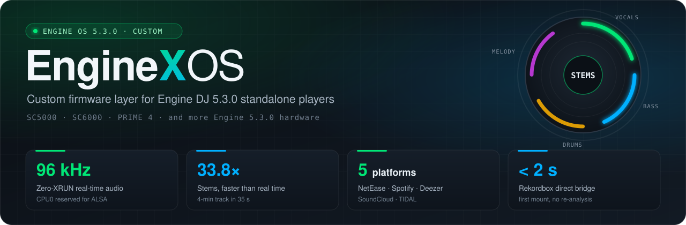
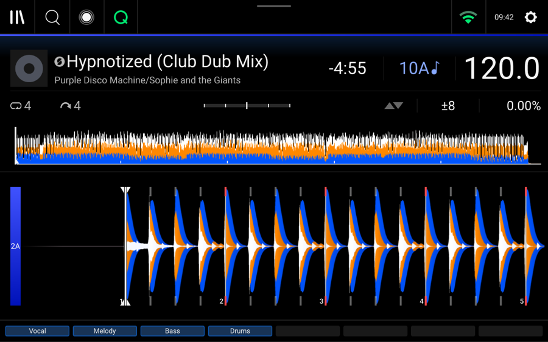
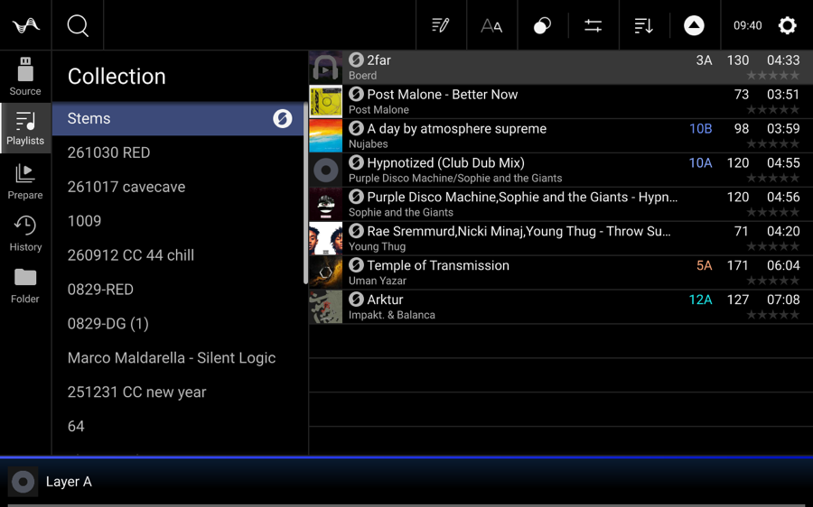
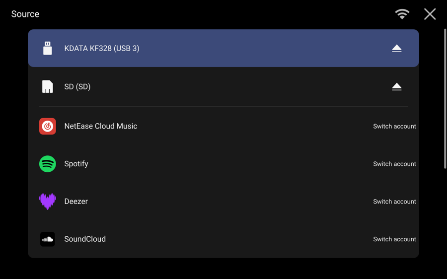
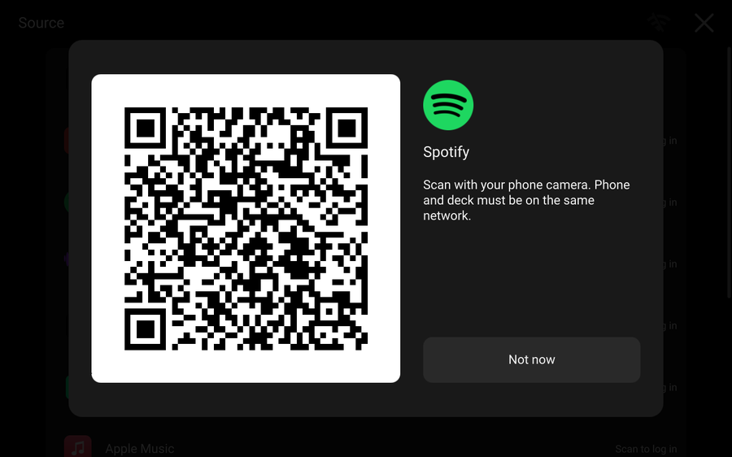
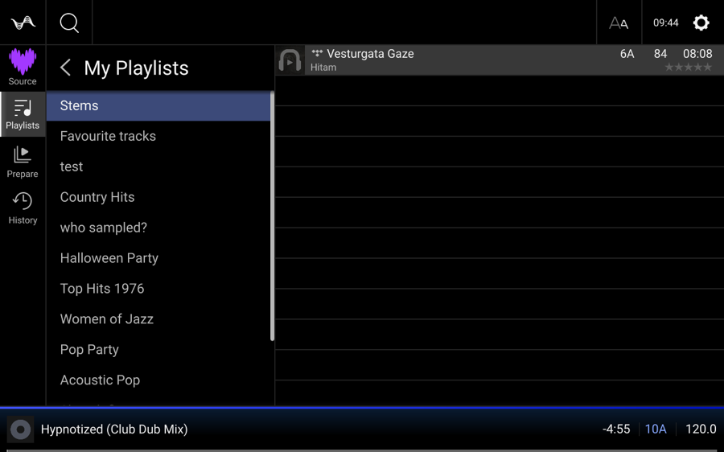
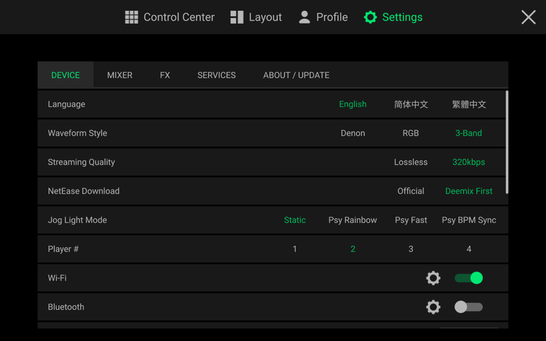
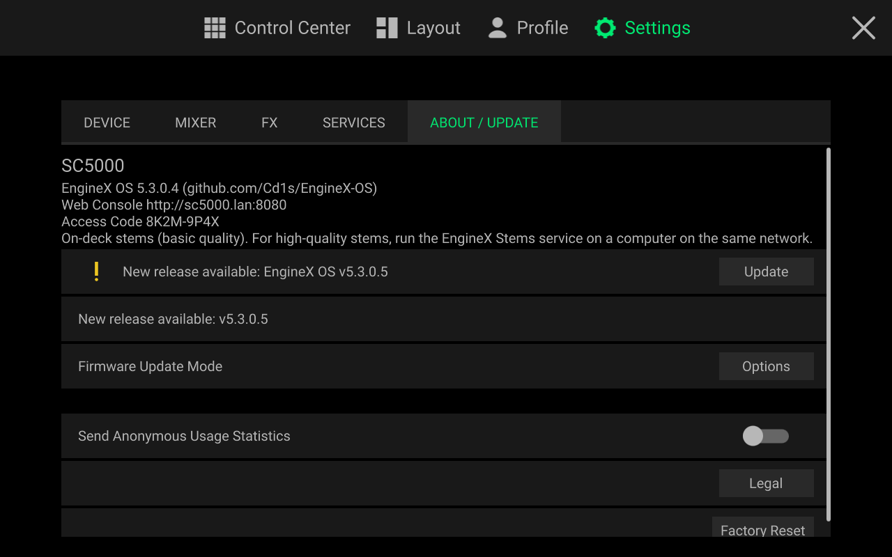

<div align="center">



<br>

<a href="./README.md"></a>
<a href="./README.zh-CN.md"></a>
<a href="./README.zh-TW.md"></a>

<br>

**[Unlocked Features](#features)** · **[Download Firmware](https://github.com/Cd1s/EngineX-OS/releases/latest)** · **[Screenshots](#gallery)** · **[Before vs. After](#benchmarks)** · **[How to Install](#install)** · **[Sponsor](#sponsor)**

</div>

<br>

**EngineX OS 5.0.4.1** is an enhanced firmware upgrade for Denon DJ and Numark standalone players:
`SC5000` · `SC5000M` · `SC6000` · `SC6000M` · `PRIME 4` · `PRIME 2` · `PRIME GO` · `Mixstream Pro`.

Everything works right inside the familiar Denon interface — flash it from a USB stick and unlock the features below.

---

<a id="features"></a>

## 🔓 What Does It Unlock?

### 1. 🎛 4-Part Stems on Every Model (Vocals / Melody / Bass / Drums)
Official firmware locks standalone Stems to select hardware. EngineX OS unlocks the native `Stems` playlist and Performance Pads 4-part mute/unmute across **all SC5000, SC6000, and PRIME models**:
- Swipe left on any USB or streaming track to split **Vocals, Melody, Bass, and Drums** right on the deck;
- Hit the Performance Pads to drop vocals for instant live mashups or isolate drums for transitions;
- Splits tracks directly on the deck with no computer required, or automatically uses your home PC / cloud GPU for high-speed AI separation when on the same Wi-Fi.

### 2. 🎵 5 Streaming Services Built In (Phone QR Login)
No need to copy tracks to a USB drive before every set:
- **NetEase Cloud Music, Spotify, Deezer, SoundCloud, and TIDAL** sit right next to your USB and SD drives in the Source menu;
- Scan the on-screen QR code with your phone to log in and browse your playlists, liked tracks, and search results;
- Switch between **Lossless FLAC and 320 kbps MP3**. Tracks you play are cached locally on the deck so loading them again is instant without re-downloading.

### 3. 📀 Pioneer Rekordbox USB Plug & Play (No Desktop Conversion)
Bring the Rekordbox USB stick you exported for CDJs and plug it straight into your Denon deck:
- Reads all your playlists, Hot Cues, Memory Cues, Loops, and beat grids in **under 2 seconds** — no need to convert your library in Engine DJ Desktop;
- Works with any drive format: Windows `FAT32` / `exFAT` / `NTFS` and Mac `HFS+` / `APFS`;
- Automatically repairs corrupted databases from unmounted drives and removes the annoying "improper eject" warning popup.

### 4. 🌈 Pioneer-Style 3-Band Waveforms, 3 Languages & BPM Jog Lights
- **3 Waveform Styles**: Switch between stock Denon green, high-contrast **RGB**, and Pioneer-style **3-Band (Blue / Orange / White)** waveforms;
- **Jog Wheel Lighting**: Static color, rainbow cycle, fast strobe, or **BPM-synced beat pulse**;
- **3 Languages**: Switch between **English, Simplified Chinese (简体中文), and Traditional Chinese (繁體中文)**.

### 5. 🔇 Click-Free FX Switching & Smoother Long Sets
- Eliminates the audible clicks/pops that happen on stock firmware when toggling or switching DJ effects, even when triggering FX on both decks at once;
- Disables background telemetry disk writes and cache bloat so all memory and CPU power stay focused on audio playback and touchscreen response.

---

<a id="gallery"></a>

## 📸 On-Deck Screenshots

<table>
<tr>
<td width="50%" align="center">
<br>
<b>4-Part Stems & 3-Band Waveforms</b><br>
<sub>Live <code>Vocal · Melody · Bass · Drums</code> pad controls right on the main deck view</sub>
</td>
<td width="50%" align="center">
<br>
<b>Dedicated Stems List in the Library</b><br>
<sub>All split tracks are organized automatically in the sidebar</sub>
</td>
</tr>
<tr>
<td align="center">
<br>
<b>5 Streaming Services in the Source Menu</b><br>
<sub>NetEase · Spotify · Deezer · SoundCloud · TIDAL alongside USB & SD</sub>
</td>
<td align="center">
<br>
<b>Scan QR Code with Your Phone to Log In</b><br>
<sub>Sync your playlists in seconds without typing passwords on the screen</sub>
</td>
</tr>
<tr>
<td align="center">
<br>
<b>BPM & Key Preview + Swipe Left for Stems</b><br>
<sub>See track BPM and key before loading, and swipe left on any song to split Stems</sub>
</td>
<td align="center">
<br>
<b>Waveform, Audio Quality & Jog Light Settings</b><br>
<sub>Built cleanly into the native Settings menu</sub>
</td>
</tr>
</table>

<div align="center">
<br>
<b>Settings → About / Update: One-Click Online Upgrade</b><br>
<sub>Tap "Update" on the screen to download and flash new releases with the native progress screen</sub>
</div>

---

<a id="benchmarks"></a>

## ⚡ How Much Lighter & Faster Is It? (Tested on SC5000)

We refactored and slimmed down the entire system so that all these extra features take almost no space and leave **more free memory than before**:

| What Changed | Stock / Before Refactoring | `EngineX OS 5.0.4.1` (Measured on SC5000) | What It Means for DJs |
| :--- | :--- | :--- | :--- |
| **Firmware Image Size (`*-Update.img`)** | Official stock: `173.88 MB`<br>Earlier custom build: `~210 MB` | **`176.70 MB`** (all custom features combined take only **`4.1 MB`**) | **Only `2.8 MB` larger than stock firmware** |
| **Internal Storage Used After Clean Flash** | `~243 MB` left behind by older builds | **`17.2 MB` for core app + 3-language UI** (`45.6 MB` including extra drive format drivers) | Frees up **nearly `200 MB`** of internal flash space |
| **Free RAM Available (out of `2 GB`)** | `~680 – 780 MB` free | **`1,042 MB` free** (main player uses `~150 MB` less RAM; all background services use just **`29.2 MB`**) | **`~260 MB` more free memory** — zero lag during long sets |
| **Audio Core Interruption by Downloads** | `5% – 25%` spikes when downloading or indexing | **`0.0%`**: all downloads and Stems splitting run on a separate background core | **96 kHz audio playback is never interrupted** |
| **Rekordbox USB Reading Speed** | ~8 min first import, 15–24 s every re-plug | **`< 2 seconds` first plug**, **`0.03 seconds`** after that | Plug in your Rekordbox stick and play right away |
| **4-Minute Track Stems Split Time** | Locked / unavailable on SC5000 | **`~35 seconds`** via PC / cloud; **`1.4×` faster than playback** on the deck alone | Split vocals on the fly even mid-set |

---

<a id="install"></a>

## 🚀 How to Install & Update

### Option 1: USB Stick Install (First-Time Setup)
1. Go to [**Releases**](https://github.com/Cd1s/EngineX-OS/releases/latest) and download the `.img` file for your exact player model:
   - **Denon DJ SC5000 Prime**: `SC5000-5.0.4.1-EngineX-OS-Denon-SC5000-Prime-JP07-Update.img`
   - **Denon DJ SC5000M Prime**: `SC5000M-5.0.4.1-EngineX-OS-Denon-SC5000M-Prime-JP08-Update.img`
   - **Denon DJ SC6000 Prime**: `SC6000-5.0.4.1-EngineX-OS-Denon-SC6000-Prime-JP13-Update.img`
   - **Denon DJ SC6000M Prime**: `SC6000M-5.0.4.1-EngineX-OS-Denon-SC6000M-Prime-JP14-Update.img`
   - **Denon DJ PRIME 4**: `PRIME4-5.0.4.1-EngineX-OS-Denon-PRIME-4-JC11-Update.img`
   - **Denon DJ PRIME 2**: `PRIME2-5.0.4.1-EngineX-OS-Denon-PRIME-2-JC16-Update.img`
   - **Denon DJ PRIME GO**: `PRIMEGO-5.0.4.1-EngineX-OS-Denon-PRIME-GO-JP11-Update.img`
   - **Numark Mixstream Pro**: `MIXSTREAMPRO-5.0.4.1-EngineX-OS-Numark-Mixstream-Pro-NH08-Update.img`
2. Copy the `.img` file to the **root folder of a FAT32 or exFAT USB drive**.
3. Plug the USB drive into your deck, open **Settings → About / Update → Reboot into Firmware Update Mode**, and let the player install and reboot.

### Option 2: One-Click On-Deck Update (When Already Running EngineX OS)
- Connect your deck to Wi-Fi or Ethernet and open **Settings → About / Update**;
- Tap **Update** on the screen and confirm — the deck will automatically launch the full-screen updater, download the new image, and reboot.

### Optional Tip: Use Your Computer to Speed Up Stems
If your Mac or PC is on the same Wi-Fi as your deck, run one command on your computer and the deck will automatically find it and use your computer's GPU/CPU for fast AI Stems separation (no IP address or password setup needed):
```sh
# macOS / Linux
tools/stems/run-home-worker.sh

# Windows (PowerShell)
powershell -ExecutionPolicy Bypass -File tools\stems\run-home-worker.ps1 demucs
```

---

<details>
<summary><b>🔧 Developer & Build Notes (Not needed for DJs)</b></summary>

<br>

- Full 642-issue historical audit manifest: [`docs/OPEN-SOURCE-FULL-MANIFEST.md`](./docs/OPEN-SOURCE-FULL-MANIFEST.md)
- Stress test and fix log: [`docs/ISSUE-FIXES-2026-11-04.md`](./docs/ISSUE-FIXES-2026-11-04.md)

```sh
# Run test suites
go test -race ./...
bash tests/test_rootfs_overlay.sh

# Build the 5-in-1 static ARMv7 suite and C hooks
GOOS=linux GOARCH=arm GOARM=7 CGO_ENABLED=0 go build -trimpath -ldflags="-s -w" -o out/sc5000-suite ./cmd/sc5000-suite
sh tools/ui-mod/build.sh
sh tools/edisksd-hook/build.sh
```

</details>

---

<a id="sponsor"></a>

## ☕ Sponsor & Support

If **EngineX OS** makes your decks more fun to play on or saves you prep time before a gig, consider buying the author a coffee or leaving a **Star ⭐** on the repo!

<table>
<tr>
<td width="33%" align="center" valign="top">
<br>
<b>WeChat Pay</b><br>
<sub>Scan with WeChat (Cheek's 讚賞碼)</sub>
</td>
<td width="33%" align="center" valign="top">
<br>
<b>Binance Pay</b><br>
<sub>Scan with Binance App · <code>User-504fa</code></sub>
</td>
<td width="33%" align="center" valign="top">
<br>
<b>USDT / USDC (BSC / EVM Universal)</b><br>
<sub>Supports <code>BSC (BEP-20)</code> · <code>ERC-20</code> · <code>Arbitrum</code> · <code>Polygon</code></sub>
</td>
</tr>
</table>

> **💳 USDT / USDC Wallet Address (BSC / EVM Universal — click copy on the right):**
> ```text
> 0x35e0c53dd887b37cd5db0064291f7c5a7442bc91
> ```

---

## 📈 Star History

<div align="center">
<a href="https://star-history.com/#Cd1s/EngineX-OS&Date">
  <picture>
    <source media="(prefers-color-scheme: dark)" srcset="https://api.star-history.com/svg?repos=Cd1s/EngineX-OS&type=Date&theme=dark" />
    <source media="(prefers-color-scheme: light)" srcset="https://api.star-history.com/svg?repos=Cd1s/EngineX-OS&type=Date" />
    
  </picture>
</a>
</div>

---

<div align="center">
<sub>MIT License · EngineX OS is an independent community open-source project and is not affiliated with or endorsed by inMusic Brands, Denon DJ, or Numark. No copyrighted stock firmware binaries are distributed in this repository.</sub>
</div>
