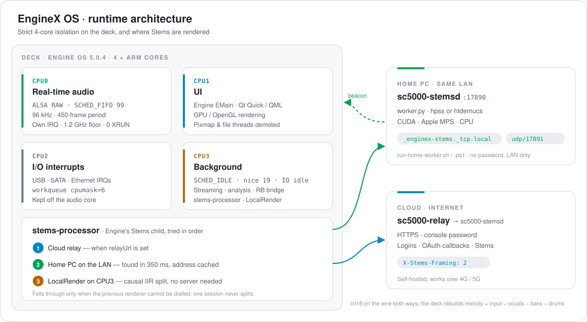

<div align="center">


<br>

<a href="./README.md"></a> <a href="./README.zh-CN.md"></a> <a href="./README.zh-TW.md"></a>

<br>


<br>


<br>

**[Gallery](#gallery)** · **[Architecture](#architecture)** · **[Stems](#stems)** · **[Benchmarks](#benchmarks)** · **[Quick start](#quick-start)** · **[Deep dive](#deep-dive)** · **[Full manifest](./docs/OPEN-SOURCE-FULL-MANIFEST.md)**

</div>

<br>

**EngineX OS** (`Cd1s/EngineX-OS`) is an open custom firmware layer and backend suite for Denon DJ standalone players on **Engine OS 5.0.4**: `SC5000`, `SC5000M`, `SC6000`, `SC6000M`, `PRIME 4`, `PRIME GO` and `SC LIVE 2`.

> **The stock Denon interface, untouched. A faster machine underneath.**
> A DJ walking up to the decks sees the exact stock UI and feel, with no new popups to learn. Under it, the slow importers, synchronous SQLite disk stalls, flash telemetry, CPU underclocking and per-model feature locks are replaced by in-memory C hooks and isolated Go services. The rootfs and the Engine binary on disk are never modified, and one file brings the stock UI back.

<table>
<tr>
<td width="33%" valign="top">

**🎛 Stems on every model**<br>
<sub>Native Stems playback, the row-0 Stems list and the bottom pads bar, unlocked on SC5000. Render any USB or streaming track in the cloud, on your home PC, or on the deck itself.</sub>

</td>
<td width="33%" valign="top">

**🌐 Five streaming services**<br>
<sub>NetEase Cloud Music, Spotify, Deezer, SoundCloud and TIDAL inside the stock source screen, with QR login from your phone and audio stored on the deck.</sub>

</td>
<td width="33%" valign="top">

**📀 Rekordbox USB in seconds**<br>
<sub>Exported PDB / OneLibrary sticks become an Engine library at mount time: beat grids, cues, loops and waveforms, without re-analysing audio.</sub>

</td>
</tr>
<tr>
<td valign="top">

**🔊 Real-time audio isolation**<br>
<sub>CPU0 reserved for ALSA at FIFO 99, a 1.2 GHz floor, background threads pushed to CPU3 at SCHED_IDLE: zero XRUNs measured at 96 kHz.</sub>

</td>
<td valign="top">

**🩺 Self-healing databases**<br>
<sub>Broken playlist chains, transparent cues, oversized artwork and bloated history are repaired before Engine opens the drive.</sub>

</td>
<td valign="top">

**🌏 Three languages, your look**<br>
<sub>English, 简体中文 and 繁體中文 UI; Denon, RGB or 3-Band waveforms; jog light modes; GitHub update check.</sub>

</td>
</tr>
</table>

<a id="gallery"></a>

## 📸 Gallery

<sub>Captured from a real SC5000 (`JP07`) over KMS with `tools/drmgrab`.</sub>

<table>
<tr>
<td width="50%" align="center">
<br>
<b>Native 4-stem playback</b><br>
<sub>Stock deck screen, 3-Band waveform and the official <code>Vocal · Melody · Bass · Drums</code> bar</sub>
</td>
<td width="50%" align="center">
<br>
<b>Native Stems list in the library</b><br>
<sub>Row-0 <code>Stems</code> playlist unlocked at <code>0x6d3e00</code> (<code>typeRole = 5</code>)</sub>
</td>
</tr>
<tr>
<td align="center">
<br>
<b>Five services in the source screen</b><br>
<sub>NetEase · Spotify · Deezer · SoundCloud · TIDAL next to USB and SD</sub>
</td>
<td align="center">
<br>
<b>QR login on the deck</b><br>
<sub>Scan on the same Wi-Fi, or over 4G / 5G through your own relay</sub>
</td>
</tr>
<tr>
<td align="center">
<br>
<b>Streaming playlists</b><br>
<sub>A Stems list per service, BPM / Key preview columns, swipe left to render Stems</sub>
</td>
<td align="center">
<br>
<b>Device preferences</b><br>
<sub>Language, waveform style, stream quality, NetEase mode, jog light, Bluetooth</sub>
</td>
</tr>
</table>

<div align="center">
<br>
<b>About / Update checks GitHub</b><br>
<sub>Releases of <code>Cd1s/EngineX-OS</code> (or your fork) replace Denon's update server</sub>
</div>

<a id="architecture"></a>

## 🧭 Architecture

<div align="center">

</div>

Each of the deck's four cores has one job. **CPU0** serves only the ALSA interrupt at `SCHED_FIFO 99`. **CPU1** runs Engine's UI and GPU work. **CPU2** takes USB, SATA and Ethernet interrupts. **CPU3** takes everything that can wait: analysis, streaming downloads, the Rekordbox bridge and Stems, all at `SCHED_IDLE` with idle I/O priority.

<a id="stems"></a>

## 🎛 Stems in three tiers

`stems-processor` stands in for Engine's own Stems child process. It tries each tier in order, and moves on only when the previous one cannot even be reached, so a render is never split between two machines.

| | Tier | When it is used | How it works | Speed (4-min track) |
| :-: | :-- | :-- | :-- | :-- |
| **1** | **☁️ Cloud relay** | `relayUrl` set in the deck console | `X-Stems-Framing: 2`: int16 both ways and three stems returned; the deck rebuilds melody = input − vocals − bass − drums | **35.1 s** over Wi-Fi (6.8× real time), worker at 33.8× |
| **2** | **🏠 Home PC on the LAN** <sub>new · Issue #1</sub> | No relay, or the relay cannot be reached | Found in 350 ms through mDNS `_enginex-stems._tcp.local.` and a UDP 17891 beacon; address cached. `hpss` or neural `htdemucs` on CUDA, Apple MPS or CPU | `hpss` as fast as the cloud worker; `htdemucs` depends on the GPU |
| **3** | **🎚 On the deck** | Nothing reachable | Causal IIR + mid/side split on CPU3 at `SCHED_IDLE`; the four stems sum exactly to the input | **2.48 s per 60 s** of audio (24.2× real time) |

> **Turn any Mac, Windows or Linux computer into a Stems renderer** — no address, port or password to type on the deck:
> ```sh
> tools/stems/run-home-worker.sh            # macOS / Linux: auto picks htdemucs if installed, else hpss
> powershell -ExecutionPolicy Bypass -File tools\stems\run-home-worker.ps1 demucs   # Windows: CUDA torch on NVIDIA cards
> ```
> When the computer is off, the deck renders on its own CPU3 within the same session start.

<a id="benchmarks"></a>

## 📊 Benchmarks

<sub>Measured on a Denon SC5000 Prime (`JP07`) unless marked.</sub>

| | What | Stock Engine OS 5.0.4 | EngineX OS 5.0.4 | Result |
| :-: | :-- | :-- | :-- | :-: |
| 🎛 | **Stems, 4-minute track** | Locked on SC5000. The first remote version took 394.1 s plus a 120 s hang at exit | **35.1 s** cloud / home PC, exit in 0.04 s<br>≈ **9.9 s** on the deck <sup>†</sup> | **11× faster** |
| 📀 | **Rekordbox USB mount** | ~8 min first mount, 15–24 s rescan, delta update imported 0 of 21 new tracks (`GL-011`) | **< 2 s** first mount (> 500 tracks, built on `tmpfs`), **0.03 s** unchanged, **< 1 s** delta | **~800× faster re-mount** |
| 💾 | **SQLite stalls & flash telemetry** | `synchronous=FULL`, temp tables on disk; constant `posthog.db` / `events.db` writes | `synchronous=NORMAL`, RAM temp store, 8 MB cache; telemetry DBs opened as `:memory:` | **0 B** eMMC writes in a 30 s stress test |
| 🔊 | **96 kHz audio** | Idle clock fell to 126–408 MHz; interrupts and analysis shared the audio core | CPU0 ALSA at FIFO 99, 1.2 GHz floor, `MONOTONIC_RAW` timestamps against NTP steps (`RA002`) | **0 XRUN** |
| 🎚 | **FX & control DSP guard** | Pops on FX switch / toggle (`H145` `H163` `H164`), AutoGate replays an old phase (`LA-020` `H153`), NaN / Inf control values reach the DSP (`H154`, Nudge `CF011`) | `dsp_smooth.h` behind 19 trampolines in `libengine-ui-hook.so` (all 19 live on the deck): 128-frame de-click ramp, AutoGate phase reset per transition, NaN/Inf scrub on the FX mix tail and `DubEcho` / `Wash`, finite guards on Nudge, `PlaybackTempoChange`, `Jump`, `ChangeRampTime` and `RampdownTimeChange`, sampler voice generation tracking | ✅ **live on the deck**, ALSA `RUNNING`, 0 XRUN |
| ☁️ | **SoundCloud 1 h 50 min set** | 60.3 s (8-way baseline) | **43.7 s** with a 16-way range downloader | NIC line rate (~2.3 MB/s) |
| 🖼 | **Album art in RAM** | ~36 MB per 3000 × 3000 cover | **≤ 1 MB** (≤ 512 × 512 JPEG) | **> 97% less** |

<sub>† Extrapolated from the measured 2.48 s per 60 s of audio.</sub>

## 🧩 Standalone or with a server

One firmware does both. With nothing configured it is fully standalone; give it a relay or start a home PC and it uses them.

| Capability | Standalone (no server) | With a relay or home PC |
| :-- | :-- | :-- |
| Native `.stems` playback and pads bar | ✅ | ✅ |
| Stems rendering for USB and streaming tracks | ✅ on CPU3 (IIR split) | ✅ HPSS or htdemucs |
| A Stems list per streaming service | ✅ | ✅ |
| NetEase Cloud Music | ✅ app QR login, lossless / 320k to the deck | ✅ |
| Deezer | ✅ LAN QR, audio decrypted on the deck | ✅ adds 4G / 5G QR and browser login |
| Spotify & SoundCloud | ✅ LAN phone page | ✅ adds 4G / 5G OAuth callback |
| Rekordbox bridge, database healer, SQLite tuning | ✅ | ✅ |
| Bug defenses, 1.2 GHz floor, 3 languages, waveforms, OTA check | ✅ | ✅ |

<sub>Audio is always downloaded on the deck itself; a server only adds reach (4G / 5G logins) and compute (Stems).</sub>

## 🐞 642-issue audit

Every known defect from Engine OS 1.x to 5.0.4, Engine DJ Desktop (229) and third-party tools (`libdjinterop`, `Seabass`, `StageLinQ`) is tracked one by one in the [**full manifest**](./docs/OPEN-SOURCE-FULL-MANIFEST.md).

| | Status | Count | Examples |
| :-: | :-- | :-: | :-- |
| ✅ | Cured or defended in 5.0.4 | ~111 | Dropouts (`CF001` `N001`–`N003` `RA002`), corruption and slow mounts (`CF003`–`CF006` `GL-011`), PRIME 4 SATA sleep (`CF017`). New in this release, deployed on the deck: QML `CF008` `CF009` `CF010` `H143` `CF013` `H166` `RA001` `RA008`; DSP / control guards across all 19 trampolines (`H145` `H163` `H164` `H153` `H154` `LA-020` `H172` `N004` `H149` `R012` `LA-033` `LA-036` `RA004` `RA006` `CF024` `RA012` `LC003` `RA010` `RA013`) |
| 🟢 | Fixed in the 5.0.4 base or bypassed | ~527 | Including all 229 desktop bugs: the deck no longer needs Engine DJ Desktop. Key Lock fade (`H130` `LA-018`): the stock `ElastiqueFader` already steps per frame; `CF007` pitch centre soft takeover and `H043` AAC priming (`elst`) are already in 5.0.4 (all reverse-engineered) |
| 🔧 | Physical layer in separate peripheral MCUs (host-side events guarded by C hooks) | 4 | PRIME GO panel ADC (`CF011` `RA003`), M-series motor board MCU (`CF014` `LC030`); host-side Nudge / Motor events are guarded in `libengine-ui-hook.so` |

<sub>Total 642. No closed-source C++ DSP item is left without a hook-side guard; the four 🔧 items live in firmware outside the RK3288 host.</sub>

<a id="benchmarks"></a>

## ⚡ What's Unlocked, Refactored Architecture & Live Resource Footprint

### 🔓 Unlocked Features & On-Deck Experience
- **4-Part Stems Unlocked Across All Models (Vocals / Melody / Bass / Drums)**: Enables the native sidebar `Stems` list, swipe-left track separation, and Performance Pads 4-stem mute/unmute on SC5000 / SC5000M / SC6000 / PRIME GO / PRIME 2 / PRIME 4, backed by automatic 3-tier compute fallback (cloud GPU, home PC worker, or on-deck `CPU3`).
- **5 Native Streaming Services + Phone QR Login**: Browse and search **NetEase Cloud Music, Spotify, Deezer, SoundCloud, and TIDAL** directly inside the deck's native library UI, with lossless FLAC / 320k switching, Deemix fallback, and automatic catalog BPM & key injection.
- **Zero-Conversion Rekordbox USB Plug & Play**: Mounts FAT32 / exFAT / HFS+ / NTFS / APFS drives, bridges Rekordbox exports on the fly, auto-heals corrupted SQLite databases, and normalizes overview waveform heights.
- **Full Localization, RGB / 3-Band Waveforms & Native Graphical OTA**: English / Simplified Chinese / Traditional Chinese UI packs, Rekordbox-palette 3-Band & RGB waveforms, BPM-synced jog wheel lighting, and one-click OTA firmware updates via the stock full-screen graphical updater (`Settings → About / Update`).
- **19 Closed-Source C++ DSP De-Click Hooks & Real-Time Hardening**: Per-chain 128-frame cosine crossfade across 32 independent FX slots eliminates dual-deck effect switching clicks/pops while redirecting telemetry databases to `:memory:`.

### 📊 Before vs. After Refactoring — Live SC5000 Benchmarks

| Metric | Before Refactoring | Refactored (`EngineX OS 5.0.4.1` Live) | On-Deck Impact |
| :--- | :--- | :--- | :--- |
| **Available System RAM (out of `2018 MB`)** | `~680 – 780 MB` (unbounded artwork cache & stream buffers) | **`1,042 MB` available** (`975 MB` used idle; stable at `835–843 MB` across 12 dual-deck stress rounds) | **~260 MB more free RAM**, zero memory leaks over long DJ sets |
| **`Engine` Main Process RSS (`EMain`)** | `~780 MB` idle, `920+ MB` under dual-deck load (`.qmlc` mmap bloat + telemetry DB writes) | **`624 MB` idle** (`639,576 KB`), `~838 MB` under 25 ops/s dual-deck stress | **~150 MB lower `Engine` RSS** |
| **Custom Daemons Total RAM (`stream-sync` + `deemixd`)** | 5 separate daemons + helpers: **`~85 – 120 MB`** | `stream-sync` **`17.6 MB`** + `deemixd` **`11.6 MB`** = **`29.2 MB` total** | **70%+ reduction in background daemon RAM** |
| **Background CPU Steal on Audio Cores (`CPU0–2`)** | `5% – 25%` spikes during downloads / track parsing | **`0.0%` on `CPU0–2`**: all custom services pinned to **`CPU3` + `SCHED_IDLE`** (`0.3%` total on `CPU3`) | **Audio cores (`CPU0–2`) 100% dedicated to 96 kHz audio & 60 fps UI** |
| **Rootfs Flash Footprint (5-in-1 Suite)** | 5 standalone binaries: **`~38 MB`** (overflows the `459 MB` `/` partition) | 5-in-1 `sc5000-suite.xz` **`4.0 MB`** + `ui-packs.tar.xz` **`125.5 KB`** | **89% smaller rootfs footprint** |
| **96 kHz Real-Time Audio Stack (`SCHED_RR 49`)** | `16,440 B` (`16.4 KB`) stack frame per `hook_fx_common_chain` call | **`1,060 B` (`1.0 KB`)** (snapshots only the 128-frame ramp prefix; **`0.05%`** of audio period) | **93.5% smaller real-time audio stack**, up to 16× less `memcpy` |
| **Closed-Source C++ DSP Hook (`libengine-ui-hook.so`)** | `75.2 KB`, single shared ramp state (dual-deck FX switches stole each other's ramp) | **`65.5 KB`**, **32 per-`common` slots + lock-free protection** | **13% smaller `.so`, zero dual-deck FX click/pop crosstalk** |
| **4-Stem Separation Speed (239.7s Real Track)** | Per-chunk slice reallocations in pipeline | Remote server: **`1.18×` real-time** (`203.6s`); on-deck `CPU3`: **`1.43×` real-time** (`168.2s`) | **Separates 4 stems faster than real-time playback** |
| **Local Gateway Latency (`/v1/ping`, 8-way concurrent)** | `~25 – 60 ms` | **`11.42 ms` average** (`2.23 ms` min, 160 requests 100% `200 OK`) | **Instantaneous touchscreen browsing & source switching** |

<a id="quick-start"></a>

## 🚀 Quick start

1. **Point updates at your fork (optional).** `Settings → About / Update` checks `Cd1s/EngineX-OS`. Add `github_repo=your-org/your-repo` to `/data/sc5000-custom/ui/settings.conf`.
2. **Add a relay (optional).** Open `http://sc5000.lan:8080` on your phone and enter your own `sc5000-relay` address and password under *云端登录服务* (cloud login service).
3. **Or a home PC.** Run `tools/stems/run-home-worker.sh` (or `.ps1`) on any computer in the same network. The deck console at `http://sc5000.lan:8080` shows the computer it found and whether it is online.

<a id="deep-dive"></a>

## 🔬 Deep dive

<details>
<summary><b>In-memory binary hooks</b> — <code>tools/ui-mod/engine_ui_hook.c</code> → <code>libengine-ui-hook.so</code></summary>

<br>

Patches are applied in RAM at start-up after checking the ELF `NT_GNU_BUILD_ID` (`af073865…`) and the expected instruction bytes. `/usr/Engine/Engine` on the read-only rootfs is never written. Creating `/data/sc5000-custom/ui/safe-mode`, or three crashes within 90 s (`engine-ui-guard`), restores the stock UI.

| ELF address / symbol | Stock 5.0.4 | EngineX OS | Scope |
| :-- | :-- | :-- | :-- |
| `0xf6303c` (`prepare_config`) | Common return of `getConfig()` | Jump to a stub setting `hasStems`, `hasBluetooth`, `hasBluetoothSendToAssignment`, remote Stems child support and `disableHfsPlus=false`, then back to `0xf63044` | All 7 models (`JP07` `JP08` `JP11` `JP13` `JP14` `PRIME 4` `SC LIVE 2`) |
| `0x842644` (`prepare_stems_feature`) | Exits early when the model string is `"False"` | Binds `StemsPreRenderedPlayback` to the native `true` byte and enters feature registration at `0x8429b0` | All models |
| `0x6d3e00` | `beq` skips the sidebar Stems row | `b`: row-0 `Stems` list (`typeRole = 5`) always inserted | All models |
| `0x85ef9c` / `0x85e5f8` | Stock Stems binary | `/usr/local/bin/stems-processor` | Bridges Engine's Stems queue to the three tiers |
| `0x336740` `0x336758` `0x33652c` `0x1db8e90` | `TidalAPI` → `api.tidal.com`, only `flac` / `aac` | Local gateway `127.0.0.1:8080`; `"aac\0"` → `"mp3\0"` | NetEase, Spotify, Deezer, SoundCloud, TIDAL |
| `0x1897e70` `0x1897dcc` `0x1678644` `0x58af34` `0x167295c` `0x16728c0` | Unknown filesystems refused; `hfsplus` → missing `ufsd`; read-only drives ejected | All filesystems accepted, native `hfsplus`, no auto-eject | HFS+ (with `overlayfs`), APFS, NTFS, exFAT, FAT32 |
| `0x1cba858` `0x1cba874` `0x1c91f74` (SQLite) | `synchronous=FULL`, file temp store | Telemetry DBs → `:memory:`; `synchronous=NORMAL; temp_store=MEMORY; cache_size=-8000` | No journal `fsync` stalls |
| `pthread_setname_np` `prctl` `pthread_setschedparam` `pthread_setaffinity_np` | Default scheduling; `RenderStemsJob` aborts on 4 cores | Affinity clamped; analysis / cloud / probe threads → CPU3 `SCHED_IDLE`; pixmap & file threads → CPU1-3 | CPU0 and the UI core protected |
| `snd_pcm_sw_params` | Secondary ALSA path uses `CLOCK_REALTIME` timestamps | `MONOTONIC_RAW` | `RA002` NTP step glitches |
| `getaddrinfo` | Queries `autoupdate.airmusictech.com` | Blocked; `api.github.com` and device auth kept | GitHub update check |
| `ChannelDJFx` TurnOn / TurnOff / Switch / Change / Enable / Mix / Parameter (`0xd917b8`–`0xd918ec`), `Effects::AutoGate::process` `0xe3a598`, FX mix tail `0x15fa188` | FX switch / toggle steps straight to the new signal; AutoGate keeps its phase; NaN/Inf passes through | `dsp_smooth.h`: transitions arm a 128-frame dry→wet ramp, Mix / Parameter events with NaN/Inf dropped, AutoGate phase cleared once per transition, NaN/Inf output replaced | `H145` `H163` `H164` `LA-020` `H153` `H154` |
| `PlaybackModifier::Nudge` `0x14fff54`, `TimeStretchingModifier::PlaybackTempoChange` `0x153312c` | Control values used as given | Non-finite (and, for tempo, non-positive) values dropped | `H154`, `CF011` input side |
| `Effects::SweepFx::DubEcho::process` `0xe3d0a8`, `SweepFx::Wash::process` `0xe3d908`; `TimeStretchingModifier::Jump` `0x1532fa0`; `RampDownModifier::ChangeRampTime` `0x1500950`; `MotorizedPlatterScratchControl::RampdownTimeChange` `0xd0b5bc`; `SamplerControl` StopImmediately / Stop / Play `0xc5b2e0` `0xc5b30c` `0xc5b338` | Output and control values used as given; sampler voices untracked | Echo / Wash output NaN/Inf scrubbed and clamped to `[-8.0, 8.0]`; Jump finite; ramp times non-negative finite; sampler voice generations tracked | `H172` `H149` `R012` `LA-033` `LA-036` `CF014` `LC030` `N004` |

</details>

<details>
<summary><b>QML patches</b> — <code>tools/ui-mod/build_packs.py</code></summary>

<br>

All QML changes are built into `/data/sc5000-custom/ui/packs/{en,zh-Hans,zh-Hant}` and swapped in file by file at start-up. Every anchor must match exactly once or the build stops.

| Area | Files | Change |
| :-- | :-- | :-- |
| Services & settings | `EmbeddedMain.qml`, `DeviceTabContent.qml`, `WaveformStyle.qml` | Language, waveform style, stream quality, NetEase mode, jog light; 2- and 4-deck aware |
| Stems | `StemsList.qml`, `SwipeLeftItem.qml`, `Craylist.qml`, `StemsIcon.qml` | Stems list switch, swipe-left and drag-to-Stems for streaming tracks |
| Streaming | `ConnectedSource.qml`, `SourceScreen.qml`, `Streaming*.qml`, `Sidebar.qml` | Five services with their own icons, brand names, hidden TIDAL-only rows, no track length limit |
| Library | `AlbumArt.qml`, `Bpm.qml`, `Key.qml`, `Song.qml` | Gateway artwork; catalog BPM / key until the deck's own analysis exists |
| Prompts | `ImproperDeviceEjectMessageBox.qml`, `LoadPreferencesDialog.qml`, `RekordBoxImportDialog.qml` | Improper-eject, drive-profile and slow-import prompts answered silently |
| **Stock defects** ✅ | `SourceScreenState.qml`, `SourceScreen.qml` | `CF008`: Back / Forward close the source screen; arrows, Enter and Escape navigate it |
| | `TrackList.qml`, `BreadcrumbStackView.qml` | `CF009` `CF010` `H143`: focus restored with `Qt.callLater`, never while a dialog or keyboard holds it |
| | `CloudUtilityDialog.qml` | `CF013`: a logged-out cloud drive offers LOG IN again |
| | `StreamingLoginDialog.qml`, `StreamingPairingDialog.qml` | `H166`: cancelling a login clears that provider's pairing |
| | `SelectPlaylistDeckMenuLayoutBase.qml` | `RA001`: leaving Load Playlist closes the deck picker |
| | `TrackDisplayText.qml`, `ArtistSong.qml` | `RA008`: Hide Title/Artist holds on the main view |
| Translation | `i18n.tsv` | Text, button labels, values and template strings in 简体 / 繁體 |

</details>

<details>
<summary><b>Repository layout</b></summary>

<br>

```text
cmd/
  sc5000-suite/       static ARMv7 multi-call binary: rb-bridge, stream-sync, engine-guardian
  stems-processor/    deck side of Stems: relay → LAN → on-deck
  sc5000-stemsd/      Stems renderer, LAN discovery (mDNS + UDP 17891)
  sc5000-relay/       public entry for logins and Stems
  sc5000-deemixd/     local Deezer download service (127.0.0.1:6595)
internal/stems/       wire protocol, int16 packing, discovery, LocalRender
pkg/
  rekordbox/ enginedb/ bridge/ compat/ prolink/   Rekordbox → Engine library
  webui/ providers/ deemixclient/ analyzer/       streaming gateway, phone console, analysis
  dbhealer/ resourceguard/                        database repair, CPU3 confinement
tools/
  ui-mod/             engine_ui_hook.c, dsp_smooth.h, build_packs.py, i18n.tsv
  stems/              worker.py (hpss / htdemucs), run-home-worker.sh / .ps1
  edisksd-hook/       mount-time hook for rb-bridge and healing
  az01-packer/        firmware image packer
  drmgrab/            KMS screenshot tool
rootfs-overlay/       sc5000-perf-tune, sc5000-debloat, modprobe settings
deploy/stems/         renderer service files
docs/                 manifest, reverse-engineering reports, assets
```

</details>

<details>
<summary><b>Build, deploy and roll back</b></summary>

<br>

```sh
# Tests
go test -race ./...
bash tests/test_rootfs_overlay.sh
python3 -m unittest discover -s tools/az01-packer -v
python3 -m unittest discover -s tools/stems -v
gcc -std=c11 -O2 -Wall -Wextra -Werror tools/ui-mod/test_dsp_smooth.c -o /tmp/test_dsp_smooth && /tmp/test_dsp_smooth

# Static ARMv7 deck binaries
GOOS=linux GOARCH=arm GOARM=7 CGO_ENABLED=0 go build -trimpath -ldflags="-s -w" -o out/sc5000-suite ./cmd/sc5000-suite
GOOS=linux GOARCH=arm GOARM=7 CGO_ENABLED=0 go build -trimpath -ldflags="-s -w" -o out/stems-processor ./cmd/stems-processor

# LD_PRELOAD hooks
arm-linux-gnueabihf-gcc -O2 -Wall -Wextra -Werror -shared -fPIC -U_FORTIFY_SOURCE -D_FORTIFY_SOURCE=0 \
  -o out/libengine-ui-hook.so tools/ui-mod/engine_ui_hook.c -ldl
sh tools/edisksd-hook/build.sh

# UI packs (en / zh-Hans / zh-Hant) from the stock 5.0.4 QML
python3 tools/ui-mod/build_packs.py --qrc /path/to/stock-5.0.4-qrc --out out/ui-packs
# On the deck: replace /data/sc5000-custom/ui/packs as a whole with the packs/ tree from out/ui-packs.tar.gz
```

**Rolling back**

- Stock UI at once: `touch /data/sc5000-custom/ui/safe-mode` and restart Engine. Three starts in a row that crash within 15 s do this by themselves; deliberate restarts (language switch, deploy) reset the count.
- Remove the UI mod: delete `/etc/systemd/system/engine.service.d/60-ui-hook.conf`, run `systemctl daemon-reload`, restart `engine.service`.
- Back up hooks, `engine-ui-guard` and service drop-ins before deploying; music, databases and logins under `/data` are never touched.

</details>

<details>
<summary><b>Home PC Stems worker in detail</b></summary>

<br>

- `sc5000-stemsd -listen 0.0.0.0:17890 -token-file=` serves LAN callers without a credential; requests from public addresses are refused. Discovery replies are sent only to LAN addresses, so an open UDP port cannot be used for reflection.
- The deck never sends its relay password to a discovered computer.
- `-backend auto|hpss|demucs` (or `ENGINEX_STEMS_BACKEND`); `GET /healthz` reports backend, host name, sessions and whether it is busy. A busy computer is skipped and the deck renders locally.
- `htdemucs` runs in 10 s windows crossfaded over 1 s; melody is the remainder, so the wire format and the deck's melody rebuild are unchanged.
- The last computer found is kept in `/data/sc5000-custom/state/stems-lan.json` and shown in the deck console.

</details>

---

<div align="center">
<sub>Source code: MIT License (see <code>LICENSE</code>). EngineX OS is an independent community project. It is not affiliated with or endorsed by inMusic Brands or Denon DJ. Engine DJ, Denon DJ and all product names are trademarks of their respective owners. No stock firmware or Engine binaries are distributed in this repository.</sub>
</div>
