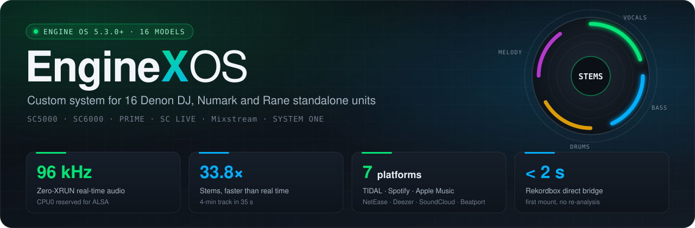
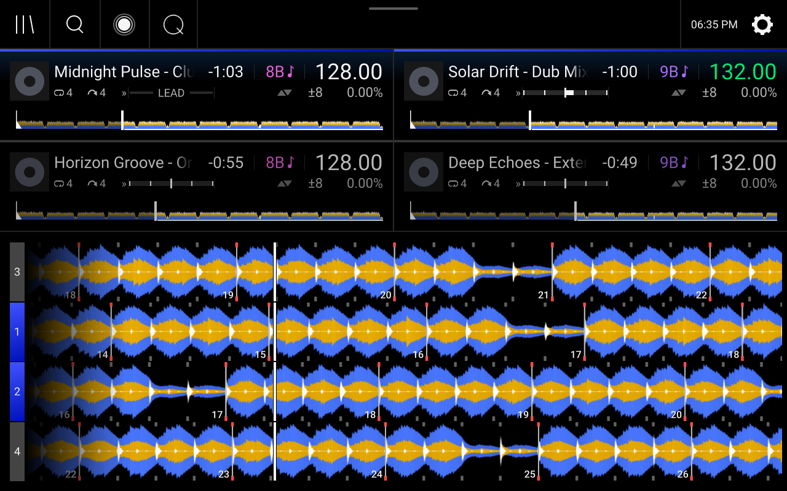
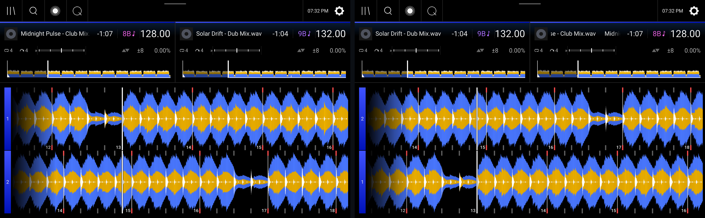
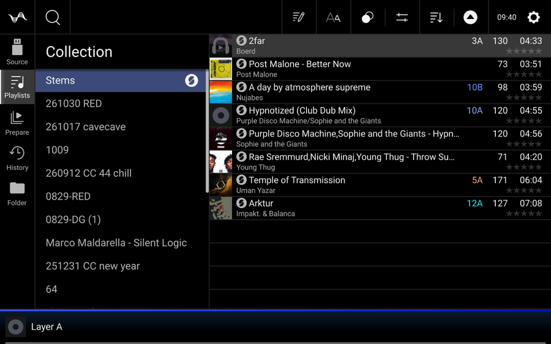
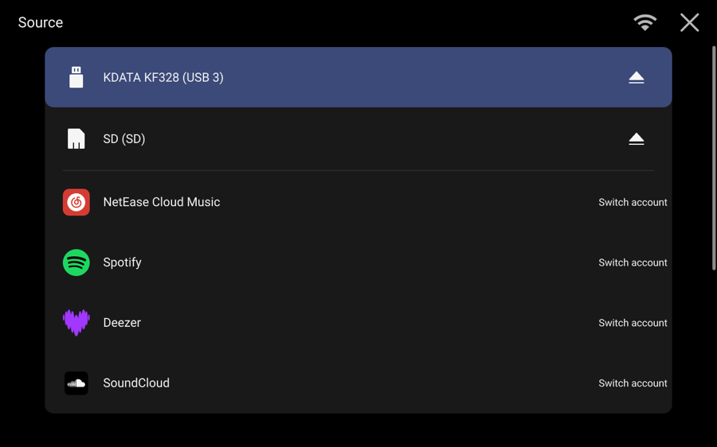
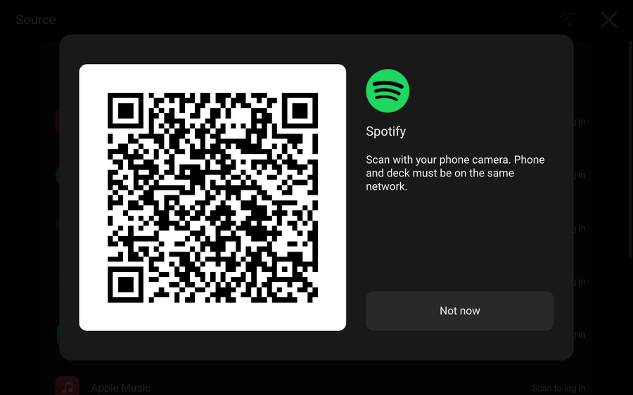
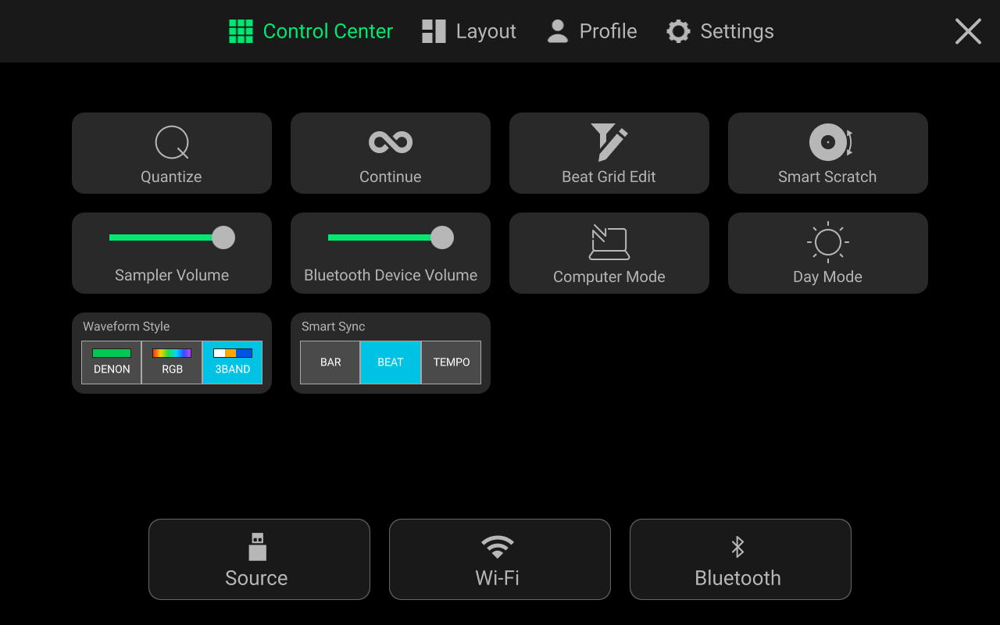
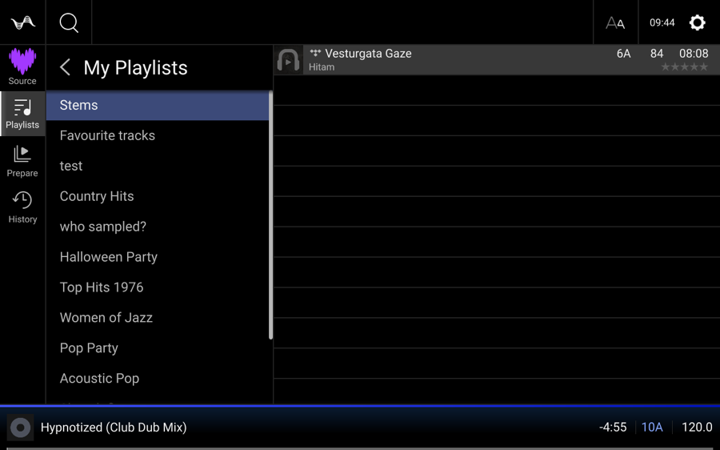
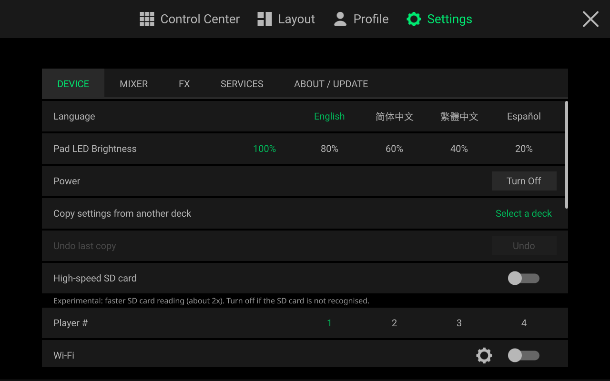
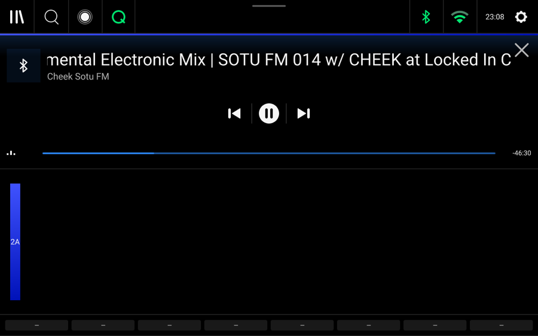

<div align="center">



<br>

<a href="./README.md"></a>
<a href="./README.zh-CN.md"></a>
<a href="./README.zh-TW.md"></a>

<br>

**[Features](#features)** · **[Download & Install](#install)** · **[Screenshots](#gallery)** · **[Benchmarks](#benchmarks)** · **[Sponsor](#sponsor)**

📖 **Online User Guide**: <https://enginexdj.com> · **Roadmap**: <https://enginexdj.com/#roadmap>

</div>

<br>

**EngineX OS 5.3.0.5** is a custom system rebuilt on the official Engine OS 5.3.0+ base for all 16 Denon DJ, Numark, and Rane standalone units:

| Generation | Architecture | Models (board) |
| :--- | :--- | :--- |
| First generation, 8 models | 32-bit (ARM) | `SC5000 Prime` (JP07) · `SC5000M Prime` (JP08) · `PRIME GO` (JP11) · `SC6000 Prime` (JP13) · `SC6000M Prime` (JP14) · `PRIME 4` (JC11) · `PRIME 2` (JC16) · `Mixstream Pro` (NH08) |
| Second generation, 6 models | 32-bit (ARM) | `PRIME 4+` (JC11S) · `PRIME GO+` (JP11S) · `SC LIVE 2` (JP20) · `SC LIVE 4` (JP21) · `Mixstream Pro Go` (NH10) · `Mixstream Pro+` (NH08S) |
| Second generation, 2 models | 64-bit (ARM64) | `PRIME 4 G2` (JP24) · `Rane SYSTEM ONE` (RMZ2) |

All 16 models now use unified `*-Update.img` packages: the 8 first-generation units flash directly from a USB stick, while the 8 second-generation units connect to a computer once with `EngineX-Installer` for a **one-click `.img` update-chain unlock + flash** and update from a USB stick or on-screen OTA just like 1st-gen units from then on (see [How to Install & Update](#install)).

Everything runs right inside the familiar Denon DJ interface — install it and unlock the features below while keeping stock controls and audio reliability.

---

<a id="features"></a>

## Core Features

### 1. 4-Part Stems on Every Model (Vocals / Melody / Bass / Drums)
- Swipe left on any local or streaming track to split **Vocals, Melody, Bass, and Drums**, organized automatically in the sidebar `Stems` list;
- Mute or solo individual stems from the Performance Pads, or press **Shift + Cue (PFL)** on supported mixer consoles (`Profile → Playback → Stems EQ Mode`) to turn channel `HIGH / MID / LOW` EQ knobs into smooth Stems level controls;
- Separates tracks standalone on the deck with no computer required (basic quality), or automatically uses a Mac / PC on the same Wi-Fi / LAN for high-quality `htdemucs` neural separation (`PRIME 4 G2` and `SYSTEM ONE` keep their official Stems behavior).

### 2. 7 Built-In Streaming Services (Phone QR & One-Tap Login)
- **TIDAL, NetEase Cloud Music, Spotify, Deezer, SoundCloud, Beatport, and Apple Music** appear right alongside your USB and SD drives in the Source menu;
- Scan the on-screen QR code with your phone (or pick **`EngineX OS`** in Spotify Connect) to browse playlists, liked songs, and search results, with sorting by BPM, key, rating, title, or artist;
- Switch between **Lossless FLAC and 320 kbps** quality; played tracks are cached on the deck in separate per-service caches so reloading them is instant (when NetEase is set to `Deemix First`, NetEase and Deezer share lossless cached downloads);
- **Native Apple Music & Public/Personal Playlist Import**: Gen-2 and unlocked Engine 5.3.0 hardware play Apple Music natively; scan the on-screen QR code on your phone to paste public playlist/album links or log in to your personal library with auto-rotating developer tokens, intelligent playback matching via ISRC and title for protected streams, and OmniSource isolation keeping Apple Music playlists clean;
- **OmniSource** (`Profile → Library → OmniSource (Drives in Streaming)`, off by default) lets one search span your streaming services, USB/SD drives, djay libraries, and mounted network shares while keeping each service's own playlist page clean.

### 3. Pioneer Rekordbox USB Plug & Play & CDJ Link
- Plug a CDJ-exported Rekordbox USB stick straight into your deck and read playlists, Hot Cues, Memory Cues, Loops, and beat grids in **under 2 seconds** (including legacy rekordbox 5 USB sticks) with no desktop conversion;
- Works with `FAT32` / `exFAT` / `NTFS` and Mac `HFS+` (`Mac OS Extended`; `APFS` is not supported: format the stick as `exFAT` or `Mac OS Extended`), aligns MP3 encoder start offsets so grids and cues sit right on the beat, repairs drive databases after an accidental unplug, and removes the "improper eject" popup;
- **Pro DJ Link (Beta)** under `Settings → Services` browses a CDJ's Rekordbox USB stick over LAN / Wi-Fi, shares your deck's library to CDJs, hands `MASTER` back and forth, and displays CDJ waveforms on shadow decks or all-in-one `Line In` channels.

### 4. Linked 4-Deck & Paired Player Views, Saved Layouts & 4 Languages
- **`Linked View` (`Layout → ENGINEX VIEW PRESET → Linked View`)**: switch standalone players between `Stock`, `Paired Player` (two full-height waveforms showing your active layer on top and the partner player's active layer below), and `4 Decks` (four stacked waveforms with silent shadow decks following another EngineX deck or CDJ); 4-deck all-in-one consoles switch between `Stock` and `4 Decks`;
- **5 Saved Views & UI Scale**: save up to five custom layouts (`View 1`–`View 5`) with per-view `Cue Countdown`, `UI Scale` (`110%`–`75%`), `Dual-Column Browser` with BPM, and `Swap Loop / Beat Jump`;
- **3 Waveform Styles & 4 Languages**: switch live between **English, 简体中文, 繁體中文, and Español**, and toggle between `Denon`, `RGB`, and Pioneer-style `3-Band` waveforms from the Control Center or `Profile → Display → Waveform Style` across all 16 models.

### 5. Studio-Clean Audio, All-in-One FX & Gigabit Networking
- **21 Real-Time Audio Guards**: click-free FX switching, zero-latency `Master Soft Clipper` (-0.1 dBFS ceiling), `Auto-Gain (0 dB Normalize)`, opt-in `Hi-Fi Output` on Gen-1 SC5000 / SC6000 players (`Profile → Playback → Hi-Fi Output`, default `Off`), Flanger volume drop compensation, and smooth `Fader Echo` / `Echo Out` tails on mixer consoles;
- **Pioneer-Style FX on Consoles**: `PRIME 4` adds `Spiral (PX)`, `Pitch Echo (PX)`, `Slip Roll (PX)`, `Dub Echo (PX)`, and `Space (PX)` to its hardware FX selector, with an optional BPM-independent **10–4000 ms** delay mode (`PX Delay Time Mode`), and on the PRIME 4 / PRIME 2 / PRIME GO / Mixstream Pro and the second-generation 32-bit consoles `Profile → Playback → Color FX Style` puts one of them on each channel's `FILTER` knob (stock at the centre, `Off` keeps the stock Sweep FX); standalone players keep a pure player signal path without PX effects;
- **Smart Sync, Gigabit Ethernet & `:8080` Web Console**: one-tap `Bar / Beat / Tempo` sync in the Control Center with automatic Pitch Range widening on wide BPM gaps, unlocked **1 Gbps** wired Ethernet, Wi-Fi drag-and-drop music upload, missing-track relocation, Shoutcast / Icecast `Live Stream`, and optional Mod Hub add-ons (`tailscale-remote`, `dmx-studio`, `midi-controller-mapper`, `jog-logo-studio`, `sampler-pad-studio`, `minimal-club-mode`).

**Gen-1 Player `Hi-Fi Output` — Before vs. After (`5.3.0.5`; dB relative to `1 kHz`):**

| Source & Pitch (`SC5000` / `JP07`) | Mode           |   10k |   14k |   16k |   18k |       20k |
| :--------------------------------- | :------------- | ----: | ----: | ----: | ----: | --------: |
| `48 kHz` @ `0.00 %`                | Stock (`Off`)  | -0.26 | -0.91 | -1.48 | -2.24 |     -3.23 |
| `48 kHz` @ `0.00 %`                | `Hi-Fi Output` |  0.00 |  0.00 |  0.00 |  0.00 | **-0.01** |
| `48 kHz` @ `+1.00 %`               | Stock (`Off`)  | -0.55 | -1.90 | -3.07 | -4.64 |     -6.67 |
| `48 kHz` @ `+1.00 %`               | `Hi-Fi Output` | -0.28 | -0.96 | -1.54 | -2.32 |     -3.35 |
| `44.1 kHz` @ `0.00 %`              | Stock (`Off`)  | -0.64 | -2.21 | -3.54 | -5.34 |     -7.66 |
| `44.1 kHz` @ `0.00 %`              | `Hi-Fi Output` | -0.38 | -1.29 | -2.07 | -3.11 |     -4.44 |

*Method: measured through Engine's real `JP07` (`SC5000`) audio path in the build-host sandbox via `96 kHz` (`S32_LE`) digital capture (Key Lock `Off`; `0.00 %` Key Lock `On` is identical).*
`Hi-Fi Output` restores the fixed `48 → 96 kHz` output-stage roll-off (exact inverse within `±0.011 dB` up to `20 kHz`, rolling back above `~22 kHz`), while it cannot undo the first resampling stage for `44.1 kHz` files and non-zero pitch (for example, `44.1 kHz` @ `0.00 %` still measures `-4.44 dB` at `20 kHz`).

---

## What's New in 5.3.0.5

### New Features
- **Native `EngineX-Installer` & signed updates (#255, #239)**: the installer prepares images and transfers over USB by itself, with no Python, fastboot, e2fsprogs, libusb or WSL to install. Every Release's `SHA256SUMS.txt` is signed (`SHA256SUMS.txt.sig`); the on-screen update and the installer refuse a release that is unsigned, wrongly signed, altered or older than the one on the deck. Decks on 5.3.0.4 or earlier do not check: update them to 5.3.0.5 first.
- **Restore official firmware**: `Restore-Official-Firmware.bat` / `.command` / `.sh` (or `enginex-installer --restore-stock`) returns a deck to stock Engine OS 5.3.0 after clearing the shared QML cache that could leave stock stuck at the logo. EngineX now keeps its own QML cache: **boot a 5.3.0.5 build once before you shut down and return to stock.** See *Restore official firmware* below.
- **Bluetooth speaker output**: pair a speaker in `Settings → Device → Bluetooth` (gear icon) and pick what it plays with the new `Output Source` row under `Assign Input to` (Layer A / B on standalone players; `Main`, `Booth`, `Headphones`, `Zone` on `PRIME 4`; `Main` / `Headphones` on `PRIME 2` and `Mixstream Pro`; `Main` elsewhere). Bluetooth adds about 150–250 ms: use it for monitoring or a second room, not for beatmatching.
- **Copy settings between decks (#205)**: `Settings → Device → Copy settings from another deck` asks the source deck to Allow, then shows a confirmation on the receiving deck. Pause playback first: Link import and Undo restart Engine. Player number, role, colors, identity and accounts stay local. `Profile → Save to my drive` now saves EngineX preferences too, and the stock USB import offers **Include EngineX settings**.
- **USB profile import asks again**: selecting a drive offers the stock Yes / No choice to load its saved profile (r5 answered No automatically). The deck menu's restart-to-apply now saves a changed Player number.
- **rekordbox Link loads its analysis immediately**: grids, hot cues, overview and cover are available when a rekordbox Link track loads, without Engine re-analysis. One start-offset rule now covers Pro DJ Link, USB sticks and the shadow lane for MP3 and AAC/M4A; older converted rows are realigned once while deck edits stay intact.
- **Shadow lane follows the other deck at load**: the other deck's track appears immediately with the same overview colours; the former black or late overview after a previous load is fixed.
- **USB library updates are fail-safe**: an update that cannot read many file names (for example, a wrong character set) leaves the library unchanged and retries at the next mount.
- **Auto-Gain headroom**: quiet tracks rise to about `-4.4 dBFS` with up to `+9 dB` and clip protection, without pumping; timing is the same at 44.1, 48 and 96 kHz.
- **Mixstream Pro / PRIME GO pad pages**: on 4-pad models, Stems remains on pad page 1 and `CUE` returns to the cue page.
- **Windows one-click installer**: PRIME 4 G2 is recognised when it is in Firmware Update Mode.
- **Background rekordbox publish (#301)**: re-plugging a drive or a refused Eject no longer stops automatic publishing; the job waits and resumes when the drive is available.
- **Per-deck `Reverse Jog Wheel` (#213)**: one toggle on 1-jog players, separate left / right toggles on 2-jog consoles, in `Settings → Device` and the `:8080` web console; hidden on motorized-platter models.
- **`Fader Echo` on every console (#258) & motorized platters in 4-deck layouts (#263)**: `Fader Echo` uses the native per-channel Transition FX on all 5.3.0 consoles without stacked echo or stutter; the platter motor and touch nudge now work for the decks a `SC5000M` / `SC6000M` holds in `4 Decks` or `Paired Player`.
- **`Mixstream` Sweep FX and Stems EQ pads (#261)**: `Mixstream Pro`, `Pro+` and `Pro Go` keep Sweep FX, Stems EQ and the Beat Jump bank usable together on the pads bar.
- **On-deck Stems really separate (#238)**: without a computer the deck separates vocals, bass, drums and melody with a spectral method instead of splitting frequency bands. It is not a neural network, so some bleed remains; the computer service stays the cleanest option. Vocals keep their stereo placement. A computer or relay that only offers `hpss` is no longer used: the deck separates the track itself, and the Stems line under `Profile → Library` and `Settings → About / Update` says which source is in use. A Stems upload that stops progressing frees its slot, while a slow renderer keeps its job (#243).
- **Set tracklist export (#268)**: the web console's Set tracklist card downloads a recorded set as text or CSV, keeping play order and repeated tracks.
- **rekordbox colours and sizes**: `3-Band` uses the rekordbox / CDJ-3000 palette, and the deck overview of tracks from a rekordbox USB is as tall as Engine's own, also for tracks played before or whose import was cut short.
- **Live Stream is WAV-only and captures on demand**: the console offers one fixed format (WAV, 16-bit, 48 kHz, stereo) and no Shoutcast target; with nobody listening nothing is captured, which saves about 7% of one CPU core on an idle deck.
- **Cable and Wi-Fi together**: on a deck connected by both in one subnet, Engine Link tracks load over the cable and Wi-Fi stays connected at boot; per-interface ARP settings apply from startup.
- **Remote Library covers (#223)**: Engine DJ Desktop Remote Library tracks show their covers in the list on `SC LIVE 4`.
- **Optional HTTPS console (#242)**: HTTP on `:8080` stays the default. Turn on `HTTPS console (:8443)` in the web console's Deck display & audio card to also serve the console over HTTPS with a self-signed certificate created once on the deck.
- **Remote Load (LAN API, #281)**: `Settings → Services → Remote Load (LAN API)` (off by default, and it can only be switched on at the deck) lets a computer or script on the same LAN load a track from a mounted drive onto an idle deck with the console access code. A deck that is playing, previewing with CUE or scratching is refused.
- **PRIME 4 FX selection (#285, PR #287)**: the effect carousel stays open while you browse, commits after 0.6 s without turning or when you press the knob, and the channel OLED shows all 31 effect names. The FX select knob moves one effect per detent, like stock.
- **Spanish UI (PR #282, thanks to Javier Saenz)**: `Settings → Device → Language` adds `Español` for the deck UI, the web console and the phone login pages.
- **High-speed SD card (experimental)**: `Settings → Device → High-speed SD card` (the same switch is in the web console's Deck display & audio card) is off by default and is offered on the 14 RK3288 units, not on PRIME 4 G2 / SYSTEM ONE. It moves the SD slot from 25 MHz Default Speed (12.5 MB/s at most) to 50 MHz High Speed (25 MB/s at most; 23 MB/s measured on an SC5000). Turn it off if a card is not recognised. While a deck is playing, a change applies at the next start or SD insert.
- **Mac-formatted (HFS+) sticks and cards are writable on all 16 models**: a drive that passes a read-only check is mounted writable, so Engine saves its library, cues and loops on it (first-generation units use a fixed driver module, PRIME 4 G2 / SYSTEM ONE the stock one, and the 32-bit second-generation units a user-space driver). A drive that was not ejected cleanly but checks out fine is marked clean first; anything else stays read-only. A library the deck built while the drive was read-only is copied onto it the first time, in full or not at all. Ejecting waits until everything is flushed.
- **rekordbox on your computer is a source, with one `Pro DJ Link` switch**: `Settings → Services → Pro DJ Link` replaces the two old switches. With it on, each deck shows up in rekordbox as its own player (so `LINK` appears and MASTER can be handed over), and rekordbox 7 in `Export` mode appears in the deck's Source list as `rekordbox (<computer>)` with all tracks and playlists (title, artist, BPM, key). Audio comes from a shared music folder (`Library, network & system → rekordbox music folder` in the web console), a mounted SMB / NAS share, or the computer's own NFS service, read in parallel. The source disappears when LINK goes off. Rekordbox grids, hot cues, overview and cover are available when the track loads; Engine does not re-analyse Link tracks.
- **Big rekordbox sticks open fast (#301)**: the first insert reads the export itself (playlists, tracks, hot cues and memory cues) and is usable within seconds; beat grids and waveforms follow in the background at low priority, with an `Importing rekordbox library…` progress line. An import that does not fit the mount time limit is no longer thrown away. When a big library finishes converting, the deck publishes it by itself once no deck is using the stick and everything has been quiet for 30 seconds: no re-insert needed.
- **Write Cue and Loop edits back to a rekordbox stick (#271)**: web console, `Extras`, `Write cues back to rekordbox USB` writes the deck's Hot Cues, Memory Cues and Loops into the stick's analysis files and `exportLibrary.db` (one-time backup in `/.enginex-backup/`).
- **Color FX on each channel's `FILTER` knob**: `Profile → Playback → Color FX Style` (`Spiral`, `Pitch Echo`, `Slip Roll`, `Dub Echo`, `Space`) now rides the channel's own filter knob like a Pioneer mixer, with the knob's centre exactly stock; `Off` is stock Sweep FX. Available on PRIME 4, PRIME 2, PRIME GO, Mixstream Pro and the second-generation SC LIVE 2 / 4, PRIME 4+, PRIME GO+, Mixstream Pro+ / Pro Go (this also fixes the constant echo some PRIME GO owners heard).
- **Mixstream (#286)**: `Settings → Device` adds `Pitch Bend → Beat Jump` (`-` / `+` jump back / forward, `Shift` keeps Speed Range) and `FX Slot 1–4` (Echo, Flanger, Delay or Phaser on each hardware FX button); the pad bar keeps only the pads and a `△` Sweep FX button, and `Stems EQ` has its own row in `Profile → Playback`.
- **`Jet Flanger (PX)` and a longer `Reverb` tail on PRIME 4 (#195, #207)**, **whole-BPM pitch-fader plateaus** with `Profile → Display → BPM Decimals` set to `2`, and a **hot cue countdown that steps on the beat grid** (#151).
- **Shadow deck**: a jog nudge on the source shows on the other deck's shadow lane within a few frames, the shadow no longer runs slightly ahead, and it follows a loop without overshooting.
- **Streaming Stems**: the imported file is named "Artist - Title" and tagged, the row you tapped shows Engine's own per-track render progress, a song that cannot be downloaded says so, and the "No source drive available" pop-up is gone (the deck keeps a private save drive for it). Stems also work on a computer with an RTX 50-series GPU.
- **Remote access and QR code**: `Settings → Device → Remote access` opens the web console through a Cloudflare Quick Tunnel; About / Update shows a `Scan to open the console` QR code (public address, else tunnel, else LAN; it never contains the access code). The web console has a new design.
- **SMB / NAS without kernel CIFS (#300)**: the web console's network sources use SMB2/3 with a user name and password on every model; **Date Added sorting for Engine Remote Library (#292)**; official Mod **`cpu-ram-monitor` (#296)** shows CPU and RAM next to the status bar clock; **one-click backend** for the relay and Stems service (`deploy/one-click-backend.sh`).
- **Second-generation SSH password (#299)**: the root password set in the web console now works on 2nd-generation decks and survives a reboot.

### Fixes & Improvements
- **Large and slow USB sticks**: Rekordbox imports with thousands of tracks resume cues and artwork within the mount time limit (#264, #272), keep the FAT32 bridge state under 4 GiB, backfill overviews even when a card's export is slow to read, and keep existing track and playlist IDs and deck edits when a legacy import is completed, and an import no longer overwrites library changes Engine makes at the same time. Libraries staged from Pro DJ Link players are bounded per drive, and the other player's drive offers no Stems, as in stock (#252).
- **Eject and update from HFS+ sticks**: ejecting a read-only HFS+ stick works while Engine has its library open and a refused eject says why; a firmware update from an `*-Update.img` on a Mac-formatted stick installs the file that was chosen, in normal and safe mode.
- **Shadow deck scratching**: heavy and very fast scratching moves the shadow deck smoothly along the source's own path.
- **Streaming**: Spotify loads and the TIDAL login carrier no longer interfere (#269), Spotify Collection has no blank rows (#279), Spotify's native Ogg keeps a name Engine recognizes (#277), provider settings are written atomically (#247) and if a later page of a streaming list fails, the rows already loaded stay with one incomplete row and a retry, and an expired login still asks you to log in again (#248).
- **Lighter idle deck**: the boot watch and the 30-second thread sweep do far less work (#236), and the Link / Stems gates follow stock for network drives.
- **Return to stock**: stock no longer reuses EngineX's QML cache, which could crash it before its UI.
- **Mods and metadata**: official Mods run without FFmpeg, MP3 / FLAC / WAV / AIFF metadata is read correctly, and OneLibrary cue positions can no longer overflow.
- **Audio audit (#237, #245)**: the hook's audio-thread functions make no allocating, locking, waiting or I/O call, checked by a test against the block-time budget; saving a `Live Stream` setting no longer disconnects local listeners such as OBS or VLC on `/live.wav`.
- **Settings switches follow the console (#283)**: all 13 EngineX on/off rows use Engine's stock switch row and keep following changes made from the web console after a tap.
- **Large Rekordbox libraries (#272, #253)**: analysis rows are stored compressed, so many more tracks fit under the FAT32 cap, and repeat inserts no longer re-read every saved waveform to recognize your tracks.
- **On-screen update (#215)**: the 5.3.0.5 updater offers only `*-Update.img`; the legacy `*-Data-Bundle.tar.gz` files stay in the Release for decks still on older releases.
- **Internal rename (#234)**: units, binaries, `/etc/enginex` and the `/v1/enginex` API carry the new `enginex` name; the old API alias, data link and downgrade restore are gone. Upgrades from 5.3.0.2 and later migrate your data once.
- **All-in-ones keep their stock views**: `SHIFT + VIEW` cycles the stock view presets again (for example PRIME 4's vertical waveforms with the library), `LOAD` works with the library beside horizontal waveforms, and `Linked View` is only offered on the standalone players (SC5000 / SC5000M / SC6000 / SC6000M).
- **Stutter on the playing deck while another deck loads (#298, PRIME 4)**: the background tuning no longer moves Engine's per-deck decoder and loader threads or its IRQ placement; they stay as stock sets them.
- **HFS+ safety**: 5.3.0.4 could mount a clean, non-journaled HFS+ stick writable on a driver with a kernel bug that can crash the deck and damage the stick; 5.3.0.5 closes this on every model.
- **CDJ-3000 link (#198)**: a CDJ-3000 no longer reports "linked to player with older firmware" and keeps the deck; each deck is its own player, and the CDJ's own numbers are never taken.
- **Other fixes**: `Shift + View` works on the real controller again; the Pro DJ Link export follows a stick that is plugged in or removed; cue write-back sees uncheckpointed edits and falls back to `export.pdb`; the SBC bitpool for Bluetooth speakers is the standard high-quality value; settings requests with trailing data are refused before anything changes; selecting a USB drive never shows a "Settings copy" error; a layer switch on Mixstream is as fast as stock plus a few milliseconds (#222); Apple Music library browsing recovers after a helper sign-in or sign-out; Spanish and other translated labels fit their rows.
- **Wi-Fi power saving is off on every deck (#309)**: decks without the stock `iw` tool, such as the SC LIVE 4, silently kept Wi-Fi power saving on; the deck now switches it off itself at start-up (stock `iw` is still used where it exists).
- **Review fixes for Apple Music, the relay and rekordbox**: signing out of Apple Music on the deck stays signed out while the download helper is still signed in; a relay that points a deck to another helper address no longer hands the old token to the new host; the relay console keeps the auto-detected token when you press Save; holding a phone-login QR can no longer set the helper and push it to the relay; with two computers running rekordbox, one with `LINK` off no longer hides the library of the other; the Mixstream-only `Stems EQ` row is built only on Mixstream units.
- **Engine DJ profile no longer logs streaming out (#304)**: being signed in to your Engine DJ profile no longer ends in "Tidal Disconnected" and a logged-out streaming source when you load a streaming track.
- **The deck header shows the streaming service you chose (#305)**: tracks played from Deezer, Spotify, Apple Music, NetEase, SoundCloud, Beatport or rekordbox show that service's icon, and `Track Info → Source` its name, instead of TIDAL's. It follows the service selected now, not a fact stored per track.

### Known Issue
- Spotify playback fails for many accounts, including older Premium ones, with "audio key refused". Spotify changed its servers so that no librespot-based client can obtain audio keys (librespot-org/librespot#1649, locked 2026-11-07, no known fix). Nothing on the deck can fix this: use TIDAL, Beatport, SoundCloud or Deezer. The Spotify entry stays in the Source menu.
- Second-generation 32-bit units (SC LIVE 4, SC LIVE 2, PRIME 4+, PRIME GO+, Mixstream Pro+, Mixstream Pro Go) write HFS+ through a user-space driver: do not pull the stick while the deck is writing to it.
- The PRIME 4 G2 / SYSTEM ONE data partition size (#244) is not addressed in this release.

---

## What's New in 5.3.0.4

### New Features
- **Unified `*-Update.img` for all 8 second-generation models & one-click unlock**: all 16 models now ship a single `*-Update.img` file per model. On a stock 2nd-gen deck, run `EngineX-Installer` once over USB (`Firmware Update Mode`) to automatically perform **[1/2] One-Click Unlock** of the `.img` update chain and **[2/2] Flash `*-Update.img`**; from then on, 2nd-gen units update from a USB stick or one-tap on-screen OTA just like 1st-gen units, with no computer needed.
- Spotify login, playlists, liked songs and search remain available. Direct audio is temporarily disabled because Spotify blocks audio-key decryption for many accounts. Playback matches tracks on signed-in Deezer, NetEase, Beatport, Apple Music or SoundCloud, in that order. Log in via **`EngineX OS`** in Spotify Connect or the deck QR code; no custom Client ID needed.
- **Unified `Linked View` & `Paired Player` 2-deck view**: `Layout → ENGINEX VIEW PRESET → Linked View` puts `Stock`, `Paired Player`, and `4 Decks` in one row on `SC5000 / SC6000` (`Stock` and `4 Decks` on 4-deck consoles) so returning to `Stock` is always one step away. `Paired Player` gives two linked standalone players two clean full-height waveforms — your active layer on top and the partner player's active layer below — and switches to and from `4 Decks` without restarting Engine.
- **Live `Shadow Deck Mode` (`Auto` / `All Engine Mode` / `All CDJ Mode`)**: `Auto` loads copyable EngineX and CDJ USB/SD tracks locally (muted) so shadow waveforms, beat grids, `Slip` timelines, `Key Offset`, `Auto Loop`, `Stems` icons, `Sync`, and `LEAD` look identical to a local deck (with track info and a progress ring while loading), and falls back automatically to stock-styled CDJ waveforms when a CDJ source cannot be copied. Switching modes takes effect live without restarting Engine.
- **CDJ-3000 waveforms on all-in-one `Line In` channels**: switching a mixer channel to `Line In` on consoles such as `PRIME 4` displays connected Pioneer CDJ-3000 waveforms and playheads right on that channel.
- **`PRIME 4` hardware `(PX)` effects & `10–4000 ms` PX delay mode**: adds `Spiral (PX)`, `Pitch Echo (PX)`, `Slip Roll (PX)`, `Dub Echo (PX)`, and `Space (PX)` to the `PRIME 4` FX selector, plus optional `Profile → Playback → PX Delay Time Mode → Milliseconds (ms)` (`10–4000 ms`) across delay-based PX effects on all-in-one consoles.
- **`SC LIVE 4` AUX channel routing & `Mixstream` Sweep FX / Beat Jump pads**: routes `SC LIVE 4` `AUX` into Channel 3 or 4 via `Mixer Menu → Channels → Input` with full channel EQ, fader, `CUE`, and Sweep FX while keeping `MIC 2` intact; restores physical `FILTER` knob Sweep FX, touch Beat Jump, `Beat Jump Pad Bank`, and `EQ / STEMS` on `Mixstream Pro / Pro+ / Pro Go`.
- **High-quality `htdemucs` computer Stems & bundled scripts**: LAN computer Stems now defaults to the high-quality `htdemucs` neural model, shows live connection status under `Profile → Library` and `Settings → About / Update`, and includes ready-to-run `stems/` scripts inside every `EngineX-Installer` download.
- **USB MIDI controller Mod, verbose log export & Quick Tunnel**: adds the optional `midi-controller-mapper` Mod (with a Pioneer CDJ-400 preset for controlling Deck 3 / 4), one-click redacted log download in the `:8080` web console, a multi-deck status hub in `enginex-relay`, and domain-free Cloudflare Quick Tunnel support for remote mobile QR logins.

### Fixes & Refinements
- **Record with streaming tracks on all-in-ones**: consoles with a built-in recorder can now start recording while a streaming track is loaded and load streaming tracks while recording *(streaming services' terms may not allow keeping recordings of their tracks; keep them for personal use)*.
- **Rekordbox MP3 beat-grid alignment & rekordbox 5 USB sticks**: compensates for MP3 encoder delay (~26–51 ms) so imported Rekordbox beat grids, Hot Cues, Memory Cues, and Loops land right on the beat (updating affected MP3s on already-imported sticks automatically once), and supports legacy rekordbox 5 USB exports.
- **Official Mods `1.1.0` work out of the box on all 16 models**: replaces Python helpers with self-contained native helpers so all official Mods start cleanly on every deck, upgrades `1.0.0` Mods in place from `:8080` while keeping settings, preserves executable permissions on uploaded Mods, and fixes `403` errors when opening Mod Hub over LAN.
- **Boot safety net & power-cut recovery**: if startup ever stalls or crashes repeatedly, the deck falls back safely to stock Engine with Mods paused — never wiping your library or factory-resetting — and saves a redacted report to USB/SD; dirty UI caches after an abrupt power cut are cleaned automatically on next boot.
- **Standalone player `Sampler Output`, 4-deck controls & shadow `Sync`**: `SC5000 / SC6000` keep `Settings → Mixer → Sampler Output` (`Layer A` / `Layer B`), `Player #`, dual-layer `Deck Colors`, `Layer B`, and `Browse` press-to-load in both 2-deck and 4-deck views; shadow decks never steal `MASTER`, lock `Sync` cleanly even past `+100%` pitch, unload cleanly when a partner powers off, and keep compact deck header row 2 numbers steady without jitter.
- **Settings cleanup, full translations & reliable time sync**: unlocks Engine's stock `Profile → Cues/Loops → Link Beat Jump / Loop Size Controls` on all models without overwriting your choice; keeps RGB `Pad LED Brightness` smooth while leaving single-color buttons (`SYNC`, `KEYLOCK`, `SLIP`) at stock brightness; restores stock jog, zoom, and non-master `MASTER` LED behavior; hides Pioneer-style PX effects on standalone players; removes the unused `Auto-Analyze Drives` row; defaults stock `Engine Lighting` to Off and remembers your On or Off choice across restarts and power cuts; completes Simplified and Traditional Chinese settings translations (keeping `Layer A`, `Layer B`, and `3-Band` in English); and retains your `Time Zone` and clock across offline power cuts with global + mainland-China NTP sync.
- **Gen-2 Stems & command-line installer reliability**: fixes **Generate Stems** detection and graphics cache settings on `SC LIVE 4` and other 2nd-gen decks, embeds the EngineX boot splash and removes the first-boot Stems download prompt on 1st-gen `.img` firmware, and improves USB / LAN deck discovery across `SC LIVE 4`, `Mixstream Pro+ / Pro Go`, `PRIME 4+`, and 1st-gen units in `EngineX-Installer`.

> **Pioneer CDJ interop note**: Pro DJ Link features (library browsing, 3-Band waveforms, playhead sync, and Master / Beat Sync handoff) were tested between real Denon SC5000 hardware and [**OpenProLink**](https://github.com/Cd1s/OpenProLink). Reports from physical Pioneer CDJ-3000, CDJ-2000NXS2, XDJ, and DJM setups are very welcome!

---

<a id="gallery"></a>

## On-Deck Screenshots

<table>
<tr>
<td width="50%" align="center" valign="top">
<br>
<b>Linked 4-Deck View & Shadow Waveforms</b><br>
<sub>Local dual-layer decks paired with live silent shadow waveforms from a linked player</sub>
</td>
<td width="50%" align="center" valign="top">
<br>
<b>Paired Player 2-Deck View (SC5000 / SC6000)</b><br>
<sub>Two full-height waveforms: your active layer on top and the partner player's active layer below</sub>
</td>
</tr>
<tr>
<td width="50%" align="center" valign="top">
<br>
<b>4-Part Stems & 3-Band Waveforms</b><br>
<sub>Vocal, Melody, Bass, and Drums pad controls on the main view</sub>
</td>
<td width="50%" align="center" valign="top">
<br>
<b>Dedicated Stems List in the Library</b><br>
<sub>All split tracks are organized automatically in the sidebar</sub>
</td>
</tr>
<tr>
<td width="50%" align="center" valign="top">
<br>
<b>7 Streaming Services in the Source Menu</b><br>
<sub>TIDAL · NetEase · Spotify · Deezer · SoundCloud · Beatport · Apple Music alongside USB & SD</sub>
</td>
<td width="50%" align="center" valign="top">
<br>
<b>Phone QR Code Login</b><br>
<sub>Scan with your phone to sync playlists without typing passwords</sub>
</td>
</tr>
<tr>
<td width="50%" align="center" valign="top">
<br>
<b>Control Center</b><br>
<sub>Quantize, Smart Scratch, Waveform Style, and Smart Sync on one pull-down page</sub>
</td>
<td width="50%" align="center" valign="top">
<br>
<b>Layout Tab (Views 1–5 & EngineX View Preset)</b><br>
<sub>Five saved layout views, Cue Countdown, UI Scale, Linked View, 4-Deck Role, and Shadow Deck Mode</sub>
</td>
</tr>
<tr>
<td width="50%" align="center" valign="top">
<br>
<b>BPM & Key Preview + Swipe Left for Stems</b><br>
<sub>See track BPM and key before loading, and swipe left to split Stems</sub>
</td>
<td width="50%" align="center" valign="top">
<br>
<b>Device Settings Menu</b><br>
<sub>Language, Pad LED Brightness, Player #, Time Sync, and Power</sub>
</td>
</tr>
<tr>
<td width="50%" align="center" valign="top">
<br>
<b>Settings → About / Update: One-Click Online Upgrade</b><br>
<sub>Tap "Update" on screen to download and install new releases</sub>
</td>
<td width="50%" align="center" valign="top">
<br>
<b>Native Bluetooth Audio Input & Playback Controls</b><br>
<sub>Stream from your phone with track info, play/pause, and skip on the deck</sub>
</td>
</tr>
</table>

---

<a id="benchmarks"></a>

## Before vs. After Refactoring (Measured on SC5000)

The system is slimmed down so all extra features use minimal storage and leave more free memory than stock firmware:

| Metric | Stock / Before Refactoring | `EngineX OS 5.3.0.5` (numbers measured on SC5000 with 5.3.0.4) | What It Means for DJs |
| :--- | :--- | :--- | :--- |
| **Firmware Image Size (`*-Update.img`)** | Official stock 5.3.0: `147.79 MB`<br>Earlier custom build: `~210 MB` | **`151.44 MB`** (SC6000 `151.58 MB`, PRIME 4 `151.52 MB`) | **Only `3.64 MB` larger than stock firmware** |
| **Internal Storage Used After Clean Flash** | `~243 MB` left behind by older builds | **`17.2 MB` for core app + 3-language UI** (`45.6 MB` including extra drive format drivers) | Frees up **nearly `200 MB`** of internal flash space |
| **Free RAM Available (out of `2 GB`)** | `~680 – 780 MB` free | **`1,042 MB` free** (main player uses `~150 MB` less RAM; all background services use just **`29.2 MB`**) | **`~260 MB` more free memory** — zero lag during long sets |
| **Audio Core Interruption by Downloads** | `5% – 25%` spikes when downloading or indexing | **`0.0%`**: all downloads and Stems splitting run on a separate background core | **96 kHz audio playback is never interrupted** |
| **Rekordbox USB Reading Speed** | ~8 min first import, 15–24 s every re-plug | **`< 2 seconds` first plug**, **`0.03 seconds`** after that | Plug in your Rekordbox stick and play right away |
| **4-Minute Track Stems Split Time** | Locked / unavailable on SC5000 | **`~35 seconds`** through a relay server running `hpss` (basic quality; `htdemucs` has not been timed); on the deck alone, faster than playback on an idle deck (measured on an SC5000; not measured while it plays) | Split vocals on the fly even mid-set |
| **Sync Across Large BPM Gaps** | Sync cannot reach the other tempo once the gap is wider than the pitch range; widen Pitch Range by hand | **Smart Sync** steps Pitch Range up automatically (up to `±100%`); Bar / Beat / Tempo switch in the Control Center | Sync tracks far apart in tempo without opening settings |
| **Network Speed** | Ethernet limited to `100 Mbps` | Ethernet **`1 Gbps` (1000 Mbps)** full duplex; Wi-Fi about `9–10 MB/s` (hardware bus limit) | Copy large libraries fast over a network cable |

---

<a id="install"></a>

## How to Install & Update

### Option 0: Command-Line `EngineX-Installer` (All 16 Models — Required Once on Stock 2nd-Gen)

`EngineX-Installer` is a **command-line tool** (not a graphical desktop app) for Windows, macOS, and Linux. It automatically discovers supported first- and second-generation decks over LAN/Wi-Fi or USB Firmware Update Mode, downloads the matching `5.3.0.5` `*-Update.img` package, verifies its SHA-256 checksum, and walks you through installation in the terminal (on 2nd-gen decks, automatically running **[1/2] One-Click Unlock** of the `.img` update chain + **[2/2] Flash `*-Update.img`**).

- [Windows 10/11 x64](https://github.com/Cd1s/EngineX-OS/releases/latest/download/EngineX-Installer-5.3.0.5-windows-amd64.zip)
- [macOS Apple Silicon M1–M4](https://github.com/Cd1s/EngineX-OS/releases/latest/download/EngineX-Installer-5.3.0.5-macos-arm64.zip)
- [macOS Intel](https://github.com/Cd1s/EngineX-OS/releases/latest/download/EngineX-Installer-5.3.0.5-macos-amd64.zip)
- [Linux x86_64](https://github.com/Cd1s/EngineX-OS/releases/latest/download/EngineX-Installer-5.3.0.5-linux-amd64.tar.gz)

Extract the archive and run `Install-EngineX.bat` (Windows), `Install-EngineX.command` (macOS), or `./install-enginex.sh` (Linux) in a terminal. LAN installation requires root SSH on the deck and preserves your library and settings. **5.3.0.5:** the executable prepares images and transfers over USB natively, without Python, fastboot, e2fsprogs, libusb or WSL. Windows configures the system WinUSB driver automatically when needed; Linux USB access may require `sudo`. Existing Python/shell helpers remain manual fallbacks for this release; older installers still need their host tools. **Back up your deck first**: writing a fresh second-generation `/data` image over USB erases internal `/data` storage (unplug USB sticks and SD cards beforehand). The bootloader cannot read a backup, so the installer cannot back up first. Back up while the deck is running. After unlocking, use OTA for later updates to preserve data.

**Windows USB setup (5.3.0.5):** if a supported update interface needs setup, approve the administrator prompt. Only that device's binding to Microsoft's existing signed WinUSB driver and its interface registration are changed; no extra driver package, unsigned kernel driver or test-signing mode is installed. A working binding needs no elevation. To undo, uninstall that update device in Device Manager, then disconnect and reconnect USB; leave the Microsoft driver package installed. Rockchip loader writes remain disabled: use Firmware Update Mode.

**5.3.0.5:** the installer prefers a matching model's `*-Update.img` or `*-Data-Bundle.tar.gz` for its own version beside the executable, without checking `releases/latest`. Keep `SHA256SUMS.txt`, `SHA256SUMS.txt.sig` and `RELEASE-TAG.txt` from that same release in the folder too; if they are missing, add them or remove the local image/bundle to check the latest release.

### Option 1: First-Generation Models — Direct USB Stick Install
1. Download the `*-Update.img` file for your exact model (or visit [**Releases**](https://github.com/Cd1s/EngineX-OS/releases/latest)):
   - **Denon DJ SC5000 Prime**: [`SC5000-5.3.0.5-EngineX-OS-Denon-SC5000-Prime-JP07-Update.img`](https://github.com/Cd1s/EngineX-OS/releases/latest/download/SC5000-5.3.0.5-EngineX-OS-Denon-SC5000-Prime-JP07-Update.img)
   - **Denon DJ SC5000M Prime**: [`SC5000M-5.3.0.5-EngineX-OS-Denon-SC5000M-Prime-JP08-Update.img`](https://github.com/Cd1s/EngineX-OS/releases/latest/download/SC5000M-5.3.0.5-EngineX-OS-Denon-SC5000M-Prime-JP08-Update.img)
   - **Denon DJ SC6000 Prime**: [`SC6000-5.3.0.5-EngineX-OS-Denon-SC6000-Prime-JP13-Update.img`](https://github.com/Cd1s/EngineX-OS/releases/latest/download/SC6000-5.3.0.5-EngineX-OS-Denon-SC6000-Prime-JP13-Update.img)
   - **Denon DJ SC6000M Prime**: [`SC6000M-5.3.0.5-EngineX-OS-Denon-SC6000M-Prime-JP14-Update.img`](https://github.com/Cd1s/EngineX-OS/releases/latest/download/SC6000M-5.3.0.5-EngineX-OS-Denon-SC6000M-Prime-JP14-Update.img)
   - **Denon DJ PRIME 4**: [`PRIME4-5.3.0.5-EngineX-OS-Denon-PRIME-4-JC11-Update.img`](https://github.com/Cd1s/EngineX-OS/releases/latest/download/PRIME4-5.3.0.5-EngineX-OS-Denon-PRIME-4-JC11-Update.img)
   - **Denon DJ PRIME 2**: [`PRIME2-5.3.0.5-EngineX-OS-Denon-PRIME-2-JC16-Update.img`](https://github.com/Cd1s/EngineX-OS/releases/latest/download/PRIME2-5.3.0.5-EngineX-OS-Denon-PRIME-2-JC16-Update.img)
   - **Denon DJ PRIME GO**: [`PRIMEGO-5.3.0.5-EngineX-OS-Denon-PRIME-GO-JP11-Update.img`](https://github.com/Cd1s/EngineX-OS/releases/latest/download/PRIMEGO-5.3.0.5-EngineX-OS-Denon-PRIME-GO-JP11-Update.img)
   - **Numark Mixstream Pro**: [`MIXSTREAMPRO-5.3.0.5-EngineX-OS-Numark-Mixstream-Pro-NH08-Update.img`](https://github.com/Cd1s/EngineX-OS/releases/latest/download/MIXSTREAMPRO-5.3.0.5-EngineX-OS-Numark-Mixstream-Pro-NH08-Update.img)
2. Copy the `.img` file unrenamed to the **root folder of a FAT32 or exFAT USB drive**.
3. Plug the USB drive into your deck (stock Engine OS 4.3.x and 5.0.x+ both work), open **Settings → About / Update → Firmware Update Mode → Options**, choose **USB/SD** when `Found 5.3.0.5 on USB/SD` appears, and let the deck update and reboot. If it only asks *Reboot into firmware update mode?*, verify the model matches, keep the original file name in the root folder, and re-insert the USB drive.

### Option 1b: Second-Generation Models — One-Click Unlock + Unified `*-Update.img`

Second-generation units (**SC LIVE 4, SC LIVE 2, PRIME 4+, PRIME GO+, Mixstream Pro+, Mixstream Pro Go, PRIME 4 G2, and Rane SYSTEM ONE**) verify firmware container signatures in software on stock firmware (there is no hardware eFuse lock — an un-unlocked stock deck simply declines a custom `.img` at the `Verifying` step without touching flash). Update the deck to official **Engine OS 5.3.0** first, then follow the two-stage lifecycle below:

1. **First-time install on a stock 2nd-gen unit (`EngineX-Installer` one-click unlock)**:
   - Extract **`EngineX-Installer`** above and run `Install-EngineX.bat` (Windows), `Install-EngineX.command` (macOS), or `./install-enginex.sh` (Linux) in a terminal.
   - On the stock deck, open **Settings → About / Update → Firmware Update Mode → Options** to enter USB update mode and connect a USB cable — `EngineX-Installer` automatically performs **[1/2] One-Click Unlock** of the `.img` update chain and **[2/2] Flashes `*-Update.img`** into `/data/enginex` without modifying the read-only system partition (for the older helper-based Windows installers, forward USB into WSL 2 with `usbipd-win` and run the Linux installer via `wsl -u root`; for `PRIME 4 G2` and `SYSTEM ONE`, press the power button off and back on after USB writing completes; if root SSH is already open on the deck, LAN mode installs directly without erasing `/data`).
2. **Every subsequent update (USB stick or one-tap OTA — no computer needed)**:
   - Once unlocked (existing 2nd-gen EngineX installs also unlock automatically on boot), 2nd-gen units work just like 1st-gen units: copy your model's `*-Update.img` below unrenamed to the **root of a FAT32 or exFAT USB drive** and update on the deck screen (**Settings → About / Update → Firmware Update Mode → Options → USB/SD**), or tap **Settings → About / Update → Update** for one-tap online OTA!
   - **Denon DJ SC LIVE 4**: [`SCLIVE4-5.3.0.5-EngineX-OS-Denon-SC-LIVE-4-JP21-Update.img`](https://github.com/Cd1s/EngineX-OS/releases/latest/download/SCLIVE4-5.3.0.5-EngineX-OS-Denon-SC-LIVE-4-JP21-Update.img)
   - **Denon DJ SC LIVE 2**: [`SCLIVE2-5.3.0.5-EngineX-OS-Denon-SC-LIVE-2-JP20-Update.img`](https://github.com/Cd1s/EngineX-OS/releases/latest/download/SCLIVE2-5.3.0.5-EngineX-OS-Denon-SC-LIVE-2-JP20-Update.img)
   - **Denon DJ PRIME 4+**: [`PRIME4PLUS-5.3.0.5-EngineX-OS-Denon-PRIME-4-Plus-JC11S-Update.img`](https://github.com/Cd1s/EngineX-OS/releases/latest/download/PRIME4PLUS-5.3.0.5-EngineX-OS-Denon-PRIME-4-Plus-JC11S-Update.img)
   - **Denon DJ PRIME GO+**: [`PRIMEGOPLUS-5.3.0.5-EngineX-OS-Denon-PRIME-GO-Plus-JP11S-Update.img`](https://github.com/Cd1s/EngineX-OS/releases/latest/download/PRIMEGOPLUS-5.3.0.5-EngineX-OS-Denon-PRIME-GO-Plus-JP11S-Update.img)
   - **Numark Mixstream Pro+**: [`MIXSTREAMPROPLUS-5.3.0.5-EngineX-OS-Numark-Mixstream-Pro-Plus-NH08S-Update.img`](https://github.com/Cd1s/EngineX-OS/releases/latest/download/MIXSTREAMPROPLUS-5.3.0.5-EngineX-OS-Numark-Mixstream-Pro-Plus-NH08S-Update.img)
   - **Numark Mixstream Pro Go**: [`MIXSTREAMPROGO-5.3.0.5-EngineX-OS-Numark-Mixstream-Pro-Go-NH10-Update.img`](https://github.com/Cd1s/EngineX-OS/releases/latest/download/MIXSTREAMPROGO-5.3.0.5-EngineX-OS-Numark-Mixstream-Pro-Go-NH10-Update.img)
   - **Denon DJ PRIME 4 G2**: [`PRIME4G2-5.3.0.5-EngineX-OS-Denon-PRIME-4-G2-JP24-Update.img`](https://github.com/Cd1s/EngineX-OS/releases/latest/download/PRIME4G2-5.3.0.5-EngineX-OS-Denon-PRIME-4-G2-JP24-Update.img)
   - **Rane SYSTEM ONE**: [`SYSTEMONE-5.3.0.5-EngineX-OS-Rane-SYSTEM-ONE-RMZ2-Update.img`](https://github.com/Cd1s/EngineX-OS/releases/latest/download/SYSTEMONE-5.3.0.5-EngineX-OS-Rane-SYSTEM-ONE-RMZ2-Update.img)

### Restore official firmware (5.3.0.5)

Download the installer for your computer from [Releases](https://github.com/Cd1s/EngineX-OS/releases/latest). The link pattern is `https://github.com/Cd1s/EngineX-OS/releases/latest/download/EngineX-Installer-<VERSION>-<platform>.zip` (`.tar.gz` for `linux-amd64`; the ZIP platforms are `windows-amd64`, `macos-amd64` and `macos-arm64`).

1. Back up your data. Let the deck boot EngineX and connect it to the same LAN as the computer; power off other decks first. Run `Restore-Official-Firmware.bat` on Windows, `.command` on macOS or `.sh` on Linux (USB access on Linux may need `sudo`). The equivalent command is `enginex-installer --restore-stock`.
2. On a first-generation deck, confirm the shared QML cache cleanup. The tool stops Engine, removes only its shared QML cache, syncs and powers the deck off; music and libraries are kept. This prevents the r5 cache from making stock hang at the logo. Second-generation decks use the existing LAN/SSH uninstall instead of firmware flashing.
3. Remove drives containing update files. On SC5000 / SC5000M / SC6000 / SC6000M, hold **MEDIA EJECT + SOURCE + LAYER** while powering on; release at **Computer Update** or the chip icon, then connect USB. Other first-generation models must follow the [official update guide](https://support.enginedj.com/support/solutions/articles/69000797882).
4. Confirm the official 5.3.0 restore and keep power and USB connected until flashing and reboot finish. The first-generation image comes directly from Engine DJ's official download URLs, or pass `--image "path/to/official.img"` to use the matching official 5.3.0 file from [Engine DJ Downloads](https://enginedj.com/downloads). AZ01 compatibility, integrity and the pinned official SHA-256 are checked; renamed EngineX and modified images are refused. No official firmware is included in our packages.

If stock already hangs at the logo and SSH is unavailable, first flash EngineX with the normal installer and let it boot, then run the restore tool again. A stock flash preserves `/data`, so flashing stock again alone does not remove the old QML cache.

<details>
<summary>Manual root-shell install & returning a 2nd-gen unit to stock</summary>

- **Install `*-Update.img` from a root shell on an already-unlocked / SSH-enabled unit (preserves music, library, and settings)**:
  ```sh
  sh /data/enginex/bundle/install.sh "/media/<USB drive>/<MODEL>-5.3.0.5-EngineX-OS-<Model>-Update.img"
  reboot
  ```
- **Uninstall and return to stock**: click **Revert to Stock** in the `:8080` web console, run `EngineX-Installer --uninstall` over LAN, or run `sh /data/enginex/bundle/uninstall.sh && reboot` on the deck (removes only `/data/enginex` and its boot hook while keeping your library and settings).

</details>

> **PRIME 4 G2 / Rane SYSTEM ONE (64-bit models)**: includes the 4-language UI, streaming services (including Apple Music via enginex-amd, Spotify, Deezer, SoundCloud, Beatport, TIDAL, and NetEase), streaming recording, audio guards (`Master Soft Clipper`, `Auto-Gain`, `Echo Out`, `Color FX Style`, `PX Delay Time Mode`), Rekordbox USB direct-read, and `:8080` web console features; Stems remain as provided by official firmware.

### Option 2: One-Click On-Deck Update (Already Running EngineX OS)
- Connect your deck to Wi-Fi or Ethernet and open **Settings → About / Update**;
- Tap **Update** on the touchscreen — all 16 first- and second-generation models download, verify, and install `5.3.0.5` directly while keeping your library, logins, saved views, and Mods (`*-Data-Bundle.tar.gz` is in the 5.3.0.5 Release one last time, alongside `*-Update.img`, so older `5.3.0.2` / `5.3.0.3` 2nd-gen decks can still one-tap OTA upgrade on screen and then unlock `.img` updates on boot; it is retired from `5.3.0.6`, #215).

### Optional: High-Quality Neural Stems on Your Computer
> **5.3.0.5 — on-deck Stems (#238):** without a computer, the deck now separates vocals, bass, drums and melody with a spectral method instead of splitting frequency bands. It is not a neural network, so some bleed between the stems remains. Measured: 60 seconds of music took 16.5–17.0 seconds of work on an idle SC5000 before the vocals became stereo; that change added about 6 % on the build host (2.50 s → 2.65 s for the same audio on its armhf core) and has not been re-measured on a deck. While the deck is playing it only gets idle processor time: that has not been measured, so expect it to take longer. For the cleanest stems, use the computer service below. From 5.3.0.5 a computer or relay that only offers `hpss` is no longer used: the deck's own separator scored higher in our tests, so the deck separates the track itself and that line says so (`On-deck stems (basic quality): <host> only offers hpss, which is not used.`). 5.3.0.4 uses the `hpss` service and shows it as `High-quality stems`.

Stems on first-generation units are made in one of three ways, and the deck names the one in use under **Profile → Library** and **Settings → About / Update** (`PRIME 4 G2` and `SYSTEM ONE` use the stock Stems):

- **On-deck Stems (basic quality)**: no computer needed. Not a neural network, so some bleed between the stems remains.
- **Computer Stems, `hpss` (basic quality)**: the computer service without the neural model (started with `hpss`, or PyTorch / Demucs is not installed). A spectral approximation, not a neural network.
- **Computer Stems, `htdemucs` (high quality, recommended)**: a neural model, the one to use for real separation. A GPU is recommended (NVIDIA CUDA or Apple Silicon); without one it runs on the CPU and takes longer.

For the high-quality mode (`htdemucs` on GPU, Apple Silicon MPS, or CPU), unzip `EngineX-Installer` on a Mac or PC on the same Wi-Fi / LAN and double-click `stems/run-home-worker.command` on macOS, or run one command in a terminal (append `hpss` if you want lightweight mode without PyTorch). Your deck discovers the computer automatically with no IP or password setup and displays `High-quality stems: <host> (htdemucs)` under **Profile → Library** and **Settings → About / Update**:
```sh
# macOS (double-click stems/run-home-worker.command, or run in Terminal) / Linux
./stems/run-home-worker.sh

# Windows PowerShell (inside the unzipped EngineX-Installer folder)
powershell -ExecutionPolicy Bypass -File .\stems\run-home-worker.ps1
```

### Streaming Login Guide
No computer or external server is needed. Connect your deck and phone to the same Wi-Fi, open a service in the **Source** menu, and scan the QR code on screen:

| Service | How to Sign In |
| --- | --- |
| **NetEase Cloud Music** | Scan the QR code with the NetEase Cloud Music app and confirm (tap an expired code to refresh). Offers `Official` and `Deemix First` download modes under `Settings → Services → NetEase Download`. |
| **Spotify** | Spotify login, playlists, liked songs and search remain available. Direct audio is temporarily disabled because Spotify blocks audio-key decryption for many accounts. Playback matches tracks on signed-in Deezer, NetEase, Beatport, Apple Music or SoundCloud, in that order. Log in via **`EngineX OS`** in Spotify Connect or the deck QR code; no custom Client ID needed. |
| **Deezer** | Scan the QR code and paste your **ARL** (step-by-step instructions are on the phone page) to unlock your playlists and lossless FLAC downloads. |
| **SoundCloud** | Enter your username or profile link (no password or API key needed; paste `oauth_token` under *Advanced* for private playlists). Long DJ sets (>10 min) and Go+-linked accounts stream directly from SoundCloud; without Go+, single tracks match lossless / 320k audio across your signed-in Deezer / NetEase / Beatport / Apple Music accounts to avoid 30-second previews. |
| **Apple Music** | Apple Music uses the **`enginex-amd`** download helper to convert lossless ALAC to FLAC and cache it on the deck. The helper runs without Docker on macOS, Windows or Linux, or locally on Gen-2. Set its URL/token in the `:8080` Web Console, then sign in with Apple ID/password and six-digit 2FA on the unified deck LAN phone page `/m/applemusic` or in the console; a helper login link/QR is also available. Playlist/album links, MusicKit JS and `media-user-token` remain available for playlist/library browsing, separately from helper audio login. `Settings → Services → Streaming` controls EngineX Apple Music; the duplicate stock row is hidden. |
| **TIDAL & Beatport** | Scan the QR code on screen to sign in with your account (Beatport keeps only your login token and supports Stems splitting like local tracks). |

> **Spotify audio source (5.3.0.5)**: choose `auto`, Deezer, NetEase, Beatport, Apple Music or SoundCloud in the web console’s Music section. Auto tries those five services in that order; a selected service is used exclusively. Existing cached tracks remain playable.

### Optional: Remote Login Relay & Domain-Free Public Tunnel
To finish streaming QR logins when your phone is on 4G/5G mobile data (or manage multiple players from one dashboard):
1. **Zero-domain Quick Tunnel on the deck**: open `http://<deck-ip>:8080` and click **Enable domain-free public tunnel (Cloudflare Quick Tunnel)** to get an instant `https://*.trycloudflare.com` link for remote console access and QR login callbacks.
2. **One-click `enginex-relay` backend (5.3.0.5)**: from an EngineX source checkout on Debian 12+ / Ubuntu 24.04+ (amd64 or arm64), run `sudo bash deploy/one-click-backend.sh`. It installs and starts `enginex-relay.service` and the HPSS Stems renderer; existing URLs, passwords and renderer tokens survive a rerun. Add `--public https://your-domain.example` to use your reverse proxy; a fresh install without it starts a Quick Tunnel. Open `http://<backend-ip>:6595`; on the first install read `sudo cat /var/lib/enginex-relay/initial-password` locally, sign in and change that password. Upgrades keep your existing password. [Backend details](deploy/relay-host/README.md).
3. **Connect the flashed deck**: boot it on the same LAN, run `enginex-installer --setup-backend` (Windows: `enginex-installer.exe --setup-backend`), then enter the deck address, the Console Access Code shown under **Settings → About / Update**, and the backend URL/password. You can also enter them in `http://<deck-ip>:8080`. Sign in to streaming accounts with the deck screen’s QR codes; local-LAN login needs no relay.
4. **One backend for Stems and Apple Music**: Stems uses the same relay URL/password. If the Apple Music helper files already exist in `/opt/enginex-amd` and `/opt/wrapper-lite`, the script starts them too; the relay detects their LAN address and token automatically and the deck synchronizes them. If the deck cannot reach the detected address, set a reachable HTTPS helper URL in the relay console. On **PRIME 4 G2 / SYSTEM ONE (64-bit Gen-2)**, native Apple Music sign-in needs no external backend. Other models can use the helper; an Apple Music subscription is required.

---

## Security on Club & Public Wi-Fi

- **No default SSH password or bundled SSH keys**: password login is disabled and public releases ship with no SSH keys, so SSH stays closed unless you add your own key.
- **Local-only deck controls**: internal playback, language, waveform, Stems, and update controls only answer the deck itself, so nobody else on the same Wi-Fi can switch tracks, change settings, or reboot your player.
- **Per-deck 8-character console code**: `http://<deck-ip>:8080` requires the random `XXXX-XXXX` code shown on your deck under **Settings → About / Update** (rate-limited after 5 wrong tries). Streaming QR codes only sign into that streaming service and never grant console access.
- **Optional console HTTPS (`:8443`, HTTP stays default)**: turn on **HTTPS console (`:8443`)** in the console settings to also serve the console over HTTPS with a one-time self-signed certificate saved under `/data/enginex/` (mode `0600`, SANs covering the deck's IPs and hostname). HTTP on `:8080` keeps working unchanged, and the console QR code and deck link offer `https://` only while enabled.

For contributors and source builds, see [`CONTRIBUTING.md`](./CONTRIBUTING.md).

---

<a id="sponsor"></a>

## Sponsor & Support

If **EngineX OS** makes your decks more fun to play on or saves you prep time before a gig, consider supporting the project or leaving a **Star** on the repo!

<table>
<tr>
<td width="33%" align="center" valign="top">
<br>
<b>WeChat Pay</b><br>
<sub>Scan with WeChat (Cheek's 讚賞碼)</sub>
</td>
<td width="33%" align="center" valign="top">
<br>
<b>Binance Pay</b><br>
<sub>Scan QR or send to Binance ID: <code>565380652</code> (0 fee)</sub>
</td>
<td width="33%" align="center" valign="top">
<br>
<b>USDT / USDC (All Binance EVM Chains)</b><br>
<sub>BSC · ERC20 · Arbitrum · Optimism · Polygon · Base · opBNB</sub>
</td>
</tr>
</table>

> **Binance ID (UID — 0 fee via Binance Pay, click copy on the right):**
> ```text
> 565380652
> ```
>
> **USDT / USDC Wallet Address (Supports all Binance EVM networks: `BSC (BEP-20)` · `Ethereum (ERC-20)` · `Arbitrum One` · `Optimism` · `Polygon` · `Base` · `opBNB` · `Avalanche C-Chain` · `zkSync Era` · `Scroll` · `Linea`):**
> ```text
> 0x35e0c53dd887b37cd5db0064291f7c5a7442bc91
> ```

---

## Star History

<div align="center">
<a href="https://star-history.com/#Cd1s/EngineX-OS&Date">
  <picture>
    <source media="(prefers-color-scheme: dark)" srcset="https://api.star-history.com/svg?repos=Cd1s/EngineX-OS&type=Date&theme=dark" />
    <source media="(prefers-color-scheme: light)" srcset="https://api.star-history.com/svg?repos=Cd1s/EngineX-OS&type=Date" />
    
  </picture>
</a>
</div>

---

<div align="center">
<sub>MIT License · EngineX OS is an independent community open-source project and is not affiliated with or endorsed by inMusic Brands, Denon DJ, Numark, or Rane. No copyrighted stock firmware binaries are distributed in this repository.</sub>
</div>
