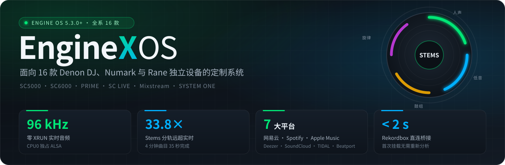
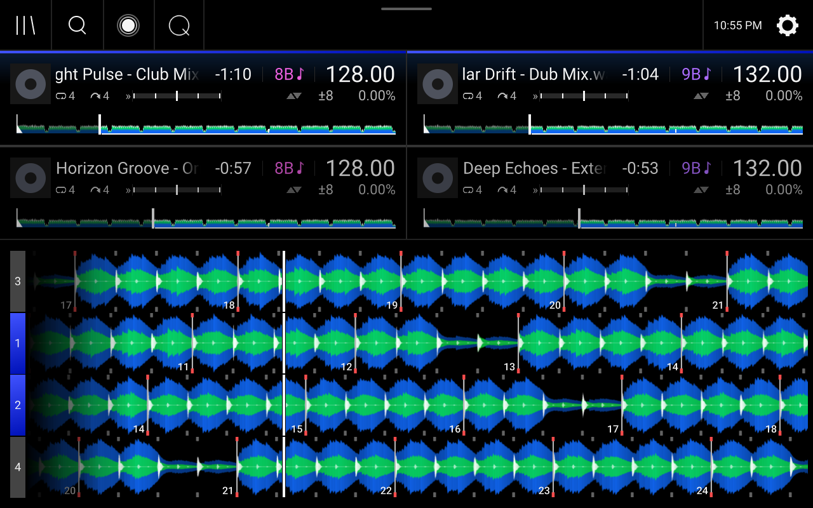
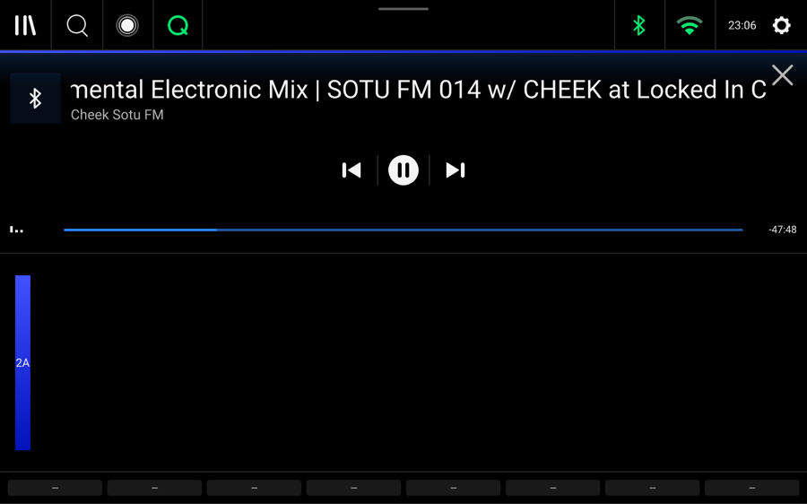

 

 

**[核心功能](#features)** · **[下载与安装](#install)** · **[实机画面](#gallery)** · **[性能对比](#benchmarks)** · **[赞赏支持](#sponsor)**

**在线使用文档**：<https://enginexdj.com> · **路线图**：<https://enginexdj.com/#roadmap>

 

**EngineX OS 5.3.0.5** 是基于官方 Engine OS 5.3.0+ 构建的定制系统，支持天龙 Denon DJ、Numark 与 Rane 共 16 款独立设备：

| 世代 | 架构 | 机型（板号） |
| :--- | :--- | :--- |
| 一代机，8 款 | 32 位（ARM） | `SC5000 Prime`（JP07）· `SC5000M Prime`（JP08）· `PRIME GO`（JP11）· `SC6000 Prime`（JP13）· `SC6000M Prime`（JP14）· `PRIME 4`（JC11）· `PRIME 2`（JC16）· `Mixstream Pro`（NH08） |
| 二代机，6 款 | 32 位（ARM） | `PRIME 4+`（JC11S）· `PRIME GO+`（JP11S）· `SC LIVE 2`（JP20）· `SC LIVE 4`（JP21）· `Mixstream Pro Go`（NH10）· `Mixstream Pro+`（NH08S） |
| 二代机，2 款 | 64 位（ARM64） | `PRIME 4 G2`（JP24）· `Rane SYSTEM ONE`（RMZ2） |

16 款机型统一使用 `*-Update.img` 升级包。一代机直接用 U 盘刷入；二代机首次连接电脑运行一次 `EngineX-Installer` 解锁 `.img` 升级链，之后同样用 U 盘或屏幕在线更新（见[如何安装与升级](#install)）。

---

## 核心功能

- **4 轨 Stems 分轨**：在本地或流媒体曲目上向左滑即可拆出人声、旋律、贝斯、鼓组四轨并归入侧边栏 `Stems` 列表。可通过打击垫或通道 EQ 旋钮（`配置 → 播放 → 分轨 EQ 模式` 或 `Shift + Cue`）控制各轨，支持碟机本机分轨（基础音质）或调用同局域网电脑运行 `htdemucs` 高音质分轨（`PRIME 4 G2` 与 `SYSTEM ONE` 保持官方 Stems）。
- **7 大流媒体音源**：音源菜单内置 TIDAL、网易云音乐、Spotify、Deezer、SoundCloud、Beatport、Apple Music，支持手机扫码登录、FLAC / 320 kbps 音质切换（`设置 → 服务 → 流媒体音质`）、分平台本地缓存，以及跨音源联合搜索 `配置 → 曲库 → OmniSource（在流媒体中显示 U 盘/SD）`。
- **Rekordbox U 盘直读与 Pro DJ Link**：直读 rekordbox 5/6/7 导出的 U 盘（支持 `FAT32`、`exFAT`、`NTFS` 与 Mac `HFS+` 读写；不支持 `APFS`）中的歌单、Hot Cue、Memory Cue、Loop 与拍线。`设置 → 服务 → Pro DJ Link` 支持与 CDJ 及电脑 rekordbox 7（`Export` 模式开启 `LINK`）互联、共享 USB/SD、交接 `MASTER`，并在影子轨或 `线路输入`（`Line In`）通道显示 CDJ 波形。
- **联机视图、波形样式与四语界面**：`布局 → ENGINEX 视图预设 → 联机视图` 让独立播放器在 `原厂`、`双碟机配对` 与 `4 轨` 之间切换（4 轨一体机可在 `原厂` 与 `4 轨` 之间切换），提供 5 组保存视图（`视图 1`–`视图 5`）、`界面缩放`、`热标拍数倒数`、`Denon` / `RGB` / `3-Band` 波形（`配置 → 显示 → 波形样式`），以及简体中文、繁體中文、English、Español 免重启切换（`设置 → 设备 → 语言`）。
- **音频保护、一体机效果与 Web 控制台**：内置 `0dB 防破音软限幅`、`自动增益`、一代独立播放器 `Hi-Fi 高频补偿输出`（`配置 → 播放 → Hi-Fi 高频补偿输出`）、`推子回音`、`PRIME 4` `(PX)` 硬件效果、通道 `FILTER` 旋钮效果 `配置 → 播放 → 先锋风格效果 (Color FX)`、一体机上双击效果的 `Frequency` 条回到 `All Bands`、`先锋效果延时模式 (PX)`、控制中心智能同步、1 Gbps 千兆有线网络，以及 `:8080` 网页控制台（传歌、重定位、WAV `直播推流` 与 Mod 插件中心）。

---

## 5.3.0.5 更新内容

- **原生安装器与签名更新**：`EngineX-Installer` 无需安装 Python、fastboot、libusb 或 WSL 即可通过 USB 刷写，在 Windows 下识别处于固件更新模式的 `PRIME 4 G2`，且安装器与屏幕在线更新均校验 `SHA256SUMS.txt.sig` 签名（#255、#239）。
- **恢复官方固件**：`Restore-Official-Firmware` 可恢复原厂 Engine OS 5.3.0；回退原厂前请先启动一次 5.3.0.5 并正常关机。
- **HFS+ 磁盘读写**：通过只读检查的 Mac `HFS+` U 盘与 SD 卡在全部 16 款机型上以读写方式挂载，Engine 可直接在盘上保存曲库、Cue 与 Loop。
- **电脑 rekordbox Link 与统一 Pro DJ Link**：`设置 → 服务 → Pro DJ Link` 合并原有的两个开关，与 CDJ-3000 联机不再报旧固件提示，并将电脑 rekordbox 7（`Export` 模式）列为碟机音源，加载即带拍线、Cue 与封面（#198、#300）。
- **影子轨显示与跟随**：立即以一致的总览颜色显示对侧碟机曲目，仅跟随源碟机位置而不实际播放以降低 CPU 占用，不支持的机型自动回退原方式。
- **大型 rekordbox U 盘快速导入**：大容量 rekordbox U 盘插入后几秒内即可使用歌单与 Cue，波形在后台转换并在空闲 30 秒后自动发布（#301）。
- **Rekordbox 拍线对齐**：为 Pro DJ Link、U 盘与影子轨的 MP3 和 AAC/M4A 统一拍线起点偏移规则，旧转换曲目自动重新对齐一次并保留碟机上的编辑。
- **rekordbox Cue 写回**：把碟机上修改的 Hot Cue、Memory Cue 与 Loop 写回 rekordbox U 盘，并在 `/.enginex-backup/` 保存备份（`:8080` 网页控制台 `扩展 → 写回 Hot Cue / Loop 到 rekordbox U 盘`，#271）。
- **曲目资料编辑（计划于 5.3.0.6）**：在碟机曲目详情中用原厂键盘编辑 `Genre`、`Label` 与 `Comment`；排队的改动会在存储设备发布更新后写回 Engine 曲库与 rekordbox 6/7 导出。
- **U 盘曲库安全保护**：当字符集不匹配等原因导致大量文件名无法读取时，曲库更新不会改动任何数据，并在下次挂载时重试。
- **通道 FILTER 旋钮 Color FX**：在一体机各通道的 `FILTER` 旋钮上挂载 `Spiral`、`Pitch Echo`、`Slip Roll`、`Dub Echo` 或 `Space`，位于 `配置 → 播放 → 先锋风格效果 (Color FX)`。
- **Hi-Fi 高频补偿输出**：为一代 SC5000 / SC6000 独立播放器新增可选的高频补偿，默认关闭，位于 `配置 → 播放 → Hi-Fi 高频补偿输出`（#172）。
- **自动增益余量与防削波**：将安静曲目提升至约 `-4.4 dBFS` 并提供削波保护以减少泵动，`配置 → 播放` 中的开关名称简化为 `自动增益`。
- **Apple Music 助手与 Spotify 音源选择**：二代机支持通过 `enginex-amd` 缓存 Apple Music 无损音频（`/m/applemusic`），`:8080` 控制台可指定 Spotify 曲目的匹配音源。
- **蓝牙音箱输出来源**：为已配对的蓝牙音箱选择播放的碟位或混音总线（`设置 → 设备 → 蓝牙 → 输出来源`）。
- **碟机间复制设置**：经局域网在两台碟机间确认并复制设置，U 盘保存配置时也包含 EngineX 设置（`设置 → 设备 → 从另一台设备复制设置`，#205）。
- **Mixstream 与 4 垫机型控制**：在 Mixstream Pro / Pro+ / Pro Go 上新增 Pitch Bend 跳拍、4 个可分配 FX 槽位、精简打击垫栏与逐通道分轨 EQ 开关（`设置 → 设备` 与 `配置 → 播放`，#261、#286），并在 Mixstream 系列与 `PRIME GO` 上使 Stems 保持在第 1 页、按 `CUE` 返回热标页。
- **PRIME 4 效果器与一体机控制**：`PRIME 4` 浏览效果时保持弹窗打开并新增 `Jet Flanger (PX)` 与更长的 `Reverb` 尾音，全部一体机支持 `推子回音`，电动转盘支持 4 轨视图（#195、#207、#258、#263、#285）。
- **分侧反转转盘方向**：单转盘机型或双转盘机型左右两侧可独立反转转盘方向（`设置 → 设备 → 反转转盘方向`，#213）。
- **推子整数 BPM 平台与热标倒数**：`配置 → 显示 → BPM 小数位数` 设为 `2` 时在整数 BPM 处提供推子平台，热标拍数倒数按拍线跳变（#151）。
- **本机与流媒体 Stems**：不连电脑时采用保留立体声的频谱分轨，流媒体分轨按“艺人 - 标题”命名并存入私有分区，电脑端支持 RTX 50 系显卡（#238、#243）。
- **Web 控制台、远程访问与局域网工具**：改版 `:8080` 控制台，新增关于页扫码、Cloudflare Quick Tunnel（`设置 → 设备 → 远程访问`）、可选 HTTPS（`:8443`）、演出曲目表 CSV/文本导出、`远程加载（局域网 API）`、`cpu-ram-monitor` Mod 与 `deploy/one-click-backend.sh` 一键后端（#242、#268、#281、#296）。
- **西班牙语界面与高速 SD 卡**：新增 `Español` 西班牙语界面（`设置 → 设备 → 语言`，#282），并在 RK3288 机型上提供实验性 50 MHz 高速 SD 卡开关（`设置 → 设备 → 高速 SD 卡模式`）。
- **播放、流媒体与硬件修复**：修复 `PRIME 4` 装歌卡顿（#298），全机型关闭 Wi-Fi 省电（#309），二代机持久化保存 SSH 密码（#299），登录 Engine DJ 账号不再导致流媒体掉线（#304），顶栏显示当前流媒体图标（#305），恢复一体机 `Shift + View` 切换，并恢复插入 U 盘时的配置导入询问。
- **开机自动浏览唯一本地磁盘**：全部 16 款机型在开机仅接有一个本地磁盘时（含稍晚挂载的盘）自动浏览并加载曲库，不再每次弹出音源列表；感谢 @sklempert（#315）。

---

## 实机画面

<table>
<tr>
<td width="50%" align="center" valign="top">
 
<b>四轨联机视图与影子波形</b> 
本机双层音轨配合另一台播放器的实时影子轨
</td>
<td width="50%" align="center" valign="top">
 
<b>双碟机配对 2 轨视图（SC5000 / SC6000）</b> 
本机当前 Layer 在上，配对碟机当前 Layer 在下
</td>
</tr>
<tr>
<td width="50%" align="center" valign="top">
 
<b>4 轨 Stems 分轨与 3-Band 波形</b> 
主界面显示 Vocal、Melody、Bass、Drums 分轨控制
</td>
<td width="50%" align="center" valign="top">
 
<b>曲库侧边栏 Stems 列表</b> 
已分轨曲目归入侧边栏歌单
</td>
</tr>
<tr>
<td width="50%" align="center" valign="top">
 
<b>音源菜单内置 7 大流媒体</b> 
TIDAL · 网易云 · Spotify · Deezer · SoundCloud · Beatport · Apple Music
</td>
<td width="50%" align="center" valign="top">
 
<b>手机二维码登录</b> 
手机扫码登录账号并同步歌单
</td>
</tr>
<tr>
<td width="50%" align="center" valign="top">
 
<b>下拉控制中心</b> 
量化、智能搓碟、波形样式与智能同步开关
</td>
<td width="50%" align="center" valign="top">
 
<b>布局页（视图 1–5 与 EngineX 视图预设）</b> 
预设视图、热标拍数倒数、界面缩放、联机视图、四轨角色与影子轨模式
</td>
</tr>
<tr>
<td width="50%" align="center" valign="top">
 
<b>BPM 与调性预览 + 左滑拆 Stems</b> 
加载前查看 BPM 与调性，向左滑拆分轨
</td>
<td width="50%" align="center" valign="top">
 
<b>设备设置菜单</b> 
语言、打击垫亮度、播放器编号、时间同步与电源
</td>
</tr>
<tr>
<td width="50%" align="center" valign="top">
 
<b>设置 → 关于 / 更新：屏幕在线升级</b> 
点击屏幕“更新”按钮下载并安装新版本
</td>
<td width="50%" align="center" valign="top">
 
<b>蓝牙音频输入与输出</b> 
连接手机播放或将碟机声音输出到蓝牙音箱
</td>
</tr>
</table>

---

## 性能与占用对比（SC5000 实测）

| 对比项 | 官方原厂 / 旧版 | `EngineX OS 5.3.0.5`（SC5000 实测） | 实际效果 |
| :--- | :--- | :--- | :--- |
| **刷机包体积 (`*-Update.img`)** | 官方 5.3.0：`147.79 MB` | **`151.44 MB`**（SC6000 `151.58 MB`，PRIME 4 `151.52 MB`） | 比官方原厂大 `3.64 MB` |
| **刷机后 `/data` 占用** | 旧版残留约 `243 MB` | **核心与界面 `17.2 MB`**（含文件系统驱动共 `45.6 MB`） | 腾出约 `200 MB` 内置存储 |
| **空闲可用内存（总 `2 GB`）** | `~680 – 780 MB` | **`1,042 MB` 可用**（后台服务合计 `29.2 MB`） | 多留出 `~260 MB` 可用内存 |
| **Rekordbox U 盘读取耗时** | 首次约 `8 分钟`，重插 `15–24 秒` | **首次插盘 `< 2 秒`**，再次插盘 **`0.03 秒`** | 插入 Rekordbox U 盘即可播放 |
| **一代机 `Hi-Fi 高频补偿输出`（`48 kHz` @ `20 kHz`）** | `-3.23 dB` 滚降（原厂关闭） | **`-0.01 dB`**（`配置 → 播放 → Hi-Fi 高频补偿输出`） | 补偿 `48 → 96 kHz` 输出级高频滚降 |
| **有线网口速度** | 限制在 `100 Mbps` | **`1 Gbps`** 全双工（Wi-Fi 约 `9–10 MB/s`） | 有线网络传歌更快 |

---

## 如何安装与升级

### 1. 命令行安装器 `EngineX-Installer`（全系 16 款——原厂二代机首次必用一次）

- [Windows 10/11 x64](https://github.com/Cd1s/EngineX-OS/releases/latest/download/EngineX-Installer-5.3.0.5-windows-amd64.zip)
- [macOS Apple Silicon M1–M4](https://github.com/Cd1s/EngineX-OS/releases/latest/download/EngineX-Installer-5.3.0.5-macos-arm64.zip)
- [macOS Intel](https://github.com/Cd1s/EngineX-OS/releases/latest/download/EngineX-Installer-5.3.0.5-macos-amd64.zip)
- [Linux x86_64](https://github.com/Cd1s/EngineX-OS/releases/latest/download/EngineX-Installer-5.3.0.5-linux-amd64.tar.gz)

解压后在终端运行 `Install-EngineX.bat`（Windows）、`Install-EngineX.command`（macOS）或 `./install-enginex.sh`（Linux）。安装器自动发现局域网内或处于 USB 固件更新模式的碟机，校验 `SHA256SUMS.txt.sig` 签名并原生刷入 `*-Update.img`，无需安装 Python、fastboot、libusb 或 WSL（Windows 按提示自动绑定微软签名 WinUSB 驱动；Linux USB 访问可能需要 `sudo`）。
**注意**：原厂二代机请先用 Engine DJ 官方更新工具升级到官方 Engine OS 5.3.0 或更新版本（在 `设置 → 关于 / 更新` 查看版本号：仍是 5.0.x 等旧原厂系统的碟机装完后无法开机，安装器发现低于 5.3.0 会直接停止，#311），拔下 U 盘与 SD 卡，并在碟机正常运行时备份数据——二代机首次通过 USB 解锁会清空内置 `/data` 分区（若已开启 root SSH，走局域网安装会保留 `/data`）。`PRIME 4 G2` 与 `SYSTEM ONE` 在 USB 写入完成后需按电源键关机再开机。刷写过程中切勿断电或拔线。

### 2. 一代机——U 盘直接刷入（`*-Update.img`）

下载对应机型的 `*-Update.img`，不改名复制到 FAT32 或 exFAT U 盘根目录，插入碟机后打开 **设置 → 关于 / 更新 → 固件更新模式 → 选项 → USB/SD**：

- **Denon DJ SC5000 Prime**：[`SC5000-5.3.0.5-EngineX-OS-Denon-SC5000-Prime-JP07-Update.img`](https://github.com/Cd1s/EngineX-OS/releases/latest/download/SC5000-5.3.0.5-EngineX-OS-Denon-SC5000-Prime-JP07-Update.img)
- **Denon DJ SC5000M Prime**：[`SC5000M-5.3.0.5-EngineX-OS-Denon-SC5000M-Prime-JP08-Update.img`](https://github.com/Cd1s/EngineX-OS/releases/latest/download/SC5000M-5.3.0.5-EngineX-OS-Denon-SC5000M-Prime-JP08-Update.img)
- **Denon DJ SC6000 Prime**：[`SC6000-5.3.0.5-EngineX-OS-Denon-SC6000-Prime-JP13-Update.img`](https://github.com/Cd1s/EngineX-OS/releases/latest/download/SC6000-5.3.0.5-EngineX-OS-Denon-SC6000-Prime-JP13-Update.img)
- **Denon DJ SC6000M Prime**：[`SC6000M-5.3.0.5-EngineX-OS-Denon-SC6000M-Prime-JP14-Update.img`](https://github.com/Cd1s/EngineX-OS/releases/latest/download/SC6000M-5.3.0.5-EngineX-OS-Denon-SC6000M-Prime-JP14-Update.img)
- **Denon DJ PRIME 4**：[`PRIME4-5.3.0.5-EngineX-OS-Denon-PRIME-4-JC11-Update.img`](https://github.com/Cd1s/EngineX-OS/releases/latest/download/PRIME4-5.3.0.5-EngineX-OS-Denon-PRIME-4-JC11-Update.img)
- **Denon DJ PRIME 2**：[`PRIME2-5.3.0.5-EngineX-OS-Denon-PRIME-2-JC16-Update.img`](https://github.com/Cd1s/EngineX-OS/releases/latest/download/PRIME2-5.3.0.5-EngineX-OS-Denon-PRIME-2-JC16-Update.img)
- **Denon DJ PRIME GO**：[`PRIMEGO-5.3.0.5-EngineX-OS-Denon-PRIME-GO-JP11-Update.img`](https://github.com/Cd1s/EngineX-OS/releases/latest/download/PRIMEGO-5.3.0.5-EngineX-OS-Denon-PRIME-GO-JP11-Update.img)
- **Numark Mixstream Pro**：[`MIXSTREAMPRO-5.3.0.5-EngineX-OS-Numark-Mixstream-Pro-NH08-Update.img`](https://github.com/Cd1s/EngineX-OS/releases/latest/download/MIXSTREAMPRO-5.3.0.5-EngineX-OS-Numark-Mixstream-Pro-NH08-Update.img)

### 3. 二代机——统一 `*-Update.img` 与屏幕在线升级（OTA）

二代机用 `EngineX-Installer` 解锁一次后（或已安装旧版 EngineX 开机自动解锁后），即可将下方 `*-Update.img` 放入 FAT32/exFAT U 盘升级，或在联网后点 **设置 → 关于 / 更新 → 更新** 在线升级（本版本 Release 最后一次同时提供 `*-Data-Bundle.tar.gz`，供 `5.3.0.2` / `5.3.0.3` 二代机在线升级并自动解锁 `.img`；5.3.0.4 及更早版本请先升至 5.3.0.5 以启用签名校验）：

- **Denon DJ SC LIVE 4**：[`SCLIVE4-5.3.0.5-EngineX-OS-Denon-SC-LIVE-4-JP21-Update.img`](https://github.com/Cd1s/EngineX-OS/releases/latest/download/SCLIVE4-5.3.0.5-EngineX-OS-Denon-SC-LIVE-4-JP21-Update.img)
- **Denon DJ SC LIVE 2**：[`SCLIVE2-5.3.0.5-EngineX-OS-Denon-SC-LIVE-2-JP20-Update.img`](https://github.com/Cd1s/EngineX-OS/releases/latest/download/SCLIVE2-5.3.0.5-EngineX-OS-Denon-SC-LIVE-2-JP20-Update.img)
- **Denon DJ PRIME 4+**：[`PRIME4PLUS-5.3.0.5-EngineX-OS-Denon-PRIME-4-Plus-JC11S-Update.img`](https://github.com/Cd1s/EngineX-OS/releases/latest/download/PRIME4PLUS-5.3.0.5-EngineX-OS-Denon-PRIME-4-Plus-JC11S-Update.img)
- **Denon DJ PRIME GO+**：[`PRIMEGOPLUS-5.3.0.5-EngineX-OS-Denon-PRIME-GO-Plus-JP11S-Update.img`](https://github.com/Cd1s/EngineX-OS/releases/latest/download/PRIMEGOPLUS-5.3.0.5-EngineX-OS-Denon-PRIME-GO-Plus-JP11S-Update.img)
- **Numark Mixstream Pro+**：[`MIXSTREAMPROPLUS-5.3.0.5-EngineX-OS-Numark-Mixstream-Pro-Plus-NH08S-Update.img`](https://github.com/Cd1s/EngineX-OS/releases/latest/download/MIXSTREAMPROPLUS-5.3.0.5-EngineX-OS-Numark-Mixstream-Pro-Plus-NH08S-Update.img)
- **Numark Mixstream Pro Go**：[`MIXSTREAMPROGO-5.3.0.5-EngineX-OS-Numark-Mixstream-Pro-Go-NH10-Update.img`](https://github.com/Cd1s/EngineX-OS/releases/latest/download/MIXSTREAMPROGO-5.3.0.5-EngineX-OS-Numark-Mixstream-Pro-Go-NH10-Update.img)
- **Denon DJ PRIME 4 G2**：[`PRIME4G2-5.3.0.5-EngineX-OS-Denon-PRIME-4-G2-JP24-Update.img`](https://github.com/Cd1s/EngineX-OS/releases/latest/download/PRIME4G2-5.3.0.5-EngineX-OS-Denon-PRIME-4-G2-JP24-Update.img)
- **Rane SYSTEM ONE**：[`SYSTEMONE-5.3.0.5-EngineX-OS-Rane-SYSTEM-ONE-RMZ2-Update.img`](https://github.com/Cd1s/EngineX-OS/releases/latest/download/SYSTEMONE-5.3.0.5-EngineX-OS-Rane-SYSTEM-ONE-RMZ2-Update.img)

### 4. 恢复官方固件与可选电脑端服务

- **恢复官方 Engine OS 5.3.0**：先让碟机启动一次 5.3.0.5 并连入与电脑相同的局域网，运行 `Restore-Official-Firmware.bat` / `.command` / `.sh`（`enginex-installer --restore-stock`）。一代机先确认清理缓存，拔下含更新文件的存储设备，进入电脑更新模式（SC5000/SC6000 按住 `MEDIA EJECT + SOURCE + LAYER` 开机；其他一代机按[官方更新说明](https://support.enginedj.com/support/solutions/articles/69000797882)操作），保持供电与 USB 连接直至官方 5.3.0 刷入完成；若一代机已卡在原厂 Logo，请先刷入 EngineX 启动一次再恢复。二代机可在 `:8080` 控制台点 `卸载恢复原厂` 或局域网运行 `enginex-installer --uninstall`（保留曲库与设置）。
- **电脑端 Stems、流媒体与中继**：在同局域网电脑解压安装器后运行 `./stems/run-home-worker.sh`（macOS/Linux）或 `powershell -ExecutionPolicy Bypass -File .\stems\run-home-worker.ps1`（Windows）即可启用 `htdemucs` 高音质分轨。手机用 4G/5G 扫码登录时，可在 `http://<deck-ip>:8080` 开启 `Cloudflare Quick Tunnel`（`设置 → 设备 → 远程访问`），或在 Debian 12+ / Ubuntu 24.04+ 主机运行 `sudo bash deploy/one-click-backend.sh` 部署自建中继、Stems 与 `enginex-amd` Apple Music 后端并用 `enginex-installer --setup-backend` 绑定碟机。详见 [`deploy/relay-host/README.md`](./deploy/relay-host/README.md)、[在线使用文档](https://enginexdj.com)与 [`CONTRIBUTING.md`](./CONTRIBUTING.md)。

---

## 赞赏与支持

<table>
<tr>
<td width="33%" align="center" valign="top">
 
<b>微信赞赏码</b> 
微信扫码赞赏
</td>
<td width="33%" align="center" valign="top">
 
<b>币安支付 (Binance Pay)</b> 
币安 ID：<code>565380652</code>（0 手续费）
</td>
<td width="33%" align="center" valign="top">
 
<b>USDT / USDC（EVM 链）</b> 
<code>0x35e0c53dd887b37cd5db0064291f7c5a7442bc91</code>
</td>
</tr>
</table>

MIT License · EngineX OS 是独立的开源项目，与 inMusic Brands、Denon DJ、Numark 或 Rane 无关。本仓库不分发任何受版权保护的原厂固件二进制文件。

