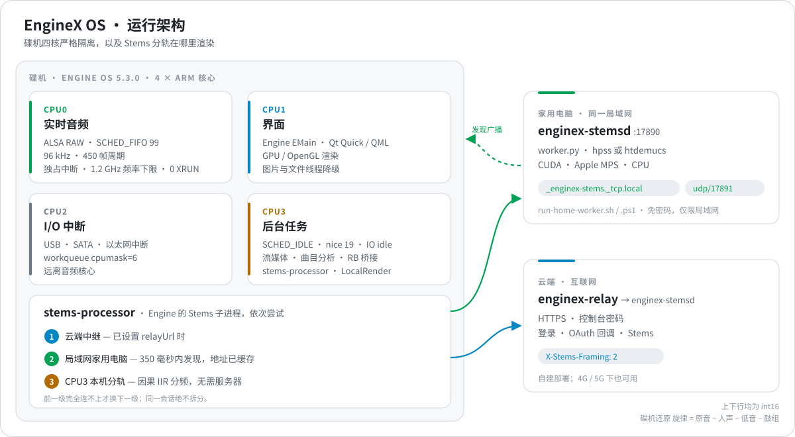

<div align="center">


<br>

<a href="./README.md"></a> <a href="./README.zh-CN.md"></a> <a href="./README.zh-TW.md"></a>

<br>


<br>


<br>

**[实机截图](#gallery)** · **[系统架构](#architecture)** · **[Stems 分轨](#stems)** · **[性能对比](#benchmarks)** · **[快速上手](#quick-start)** · **[技术深潜](#deep-dive)** · **[完整技术清单](./docs/OPEN-SOURCE-FULL-MANIFEST.md)**

</div>

<br>

**EngineX OS**（`sc5000-custom-os`）是面向天龙 Denon DJ **Engine OS 5.0.4** 独立播放器的开源定制固件层与后端套件，支持 `SC5000`、`SC5000M`、`SC6000`、`SC6000M`、`PRIME 4`、`PRIME GO` 与 `SC LIVE 2`。

> **界面原汁原味，底层脱胎换骨。**
> DJ 走上台看到的就是原厂界面和原厂手感，没有新弹窗要学。底层那些拖慢机器的慢速导库、SQLite 同步写盘卡顿、闪存遥测、CPU 降频和机型功能锁，已被内存中的 C 钩子和相互隔离的 Go 服务替换。rootfs 与磁盘上的 Engine 二进制从不改动，一个文件就能回到原厂界面。

<table>
<tr>
<td width="33%" valign="top">

**🎛 全机型 Stems 分轨**<br>
<sub>在 SC5000 上解锁原生 Stems 播放、第 0 行 Stems 歌单与底部分轨栏。U 盘和流媒体曲目都能分轨：云端、家里电脑或碟机本机任选。</sub>

</td>
<td width="33%" valign="top">

**🌐 五大流媒体平台**<br>
<sub>网易云音乐、Spotify、Deezer、SoundCloud 与 TIDAL 进入原厂音源页，手机扫码登录，音频直接存进碟机。</sub>

</td>
<td width="33%" valign="top">

**📀 Rekordbox U 盘秒读**<br>
<sub>插入导出好的 PDB / OneLibrary U 盘，挂载时即转换为 Engine 曲库：拍线、Cue、Loop、波形全部保留，无需重新分析音频。</sub>

</td>
</tr>
<tr>
<td valign="top">

**🔊 实时音频隔离**<br>
<sub>CPU0 独占 ALSA 中断（FIFO 99），频率下限 1.2 GHz，后台线程全部压到 CPU3（SCHED_IDLE）：96 kHz 下实测零 XRUN。</sub>

</td>
<td valign="top">

**🩺 数据库自愈**<br>
<sub>Engine 打开 U 盘之前，先修好断裂的歌单链表、透明 Cue、超大封面和膨胀的历史库。</sub>

</td>
<td valign="top">

**🌏 三语界面，随心配色**<br>
<sub>English、简体中文、繁體中文界面；Denon、RGB、3-Band 波形；转盘灯效；GitHub 更新检查。</sub>

</td>
</tr>
</table>

<a id="gallery"></a>

## 📸 实机截图

<sub>在 SC5000（`JP07`）实机上通过 KMS 用 `tools/drmgrab` 截取。</sub>

<table>
<tr>
<td width="50%" align="center">
<br>
<b>原生 4 轨 Stems 播放</b><br>
<sub>原厂碟机界面、3-Band 波形与官方 <code>Vocal · Melody · Bass · Drums</code> 分轨栏</sub>
</td>
<td width="50%" align="center">
<br>
<b>曲库里的原生 Stems 歌单</b><br>
<sub>在 <code>0x6d3e00</code> 解锁的第 0 行 <code>Stems</code> 歌单（<code>typeRole = 5</code>）</sub>
</td>
</tr>
<tr>
<td align="center">
<br>
<b>音源页集成五大平台</b><br>
<sub>网易云 · Spotify · Deezer · SoundCloud · TIDAL 与 U 盘、SD 卡并列</sub>
</td>
<td align="center">
<br>
<b>碟机屏幕扫码登录</b><br>
<sub>同一 Wi-Fi 下直接扫码，或通过自建中继在 4G / 5G 下扫码</sub>
</td>
</tr>
<tr>
<td align="center">
<br>
<b>流媒体歌单</b><br>
<sub>每个平台独立的 Stems 歌单、BPM / 调性预览列、左滑一键分轨</sub>
</td>
<td align="center">
<br>
<b>设备设置</b><br>
<sub>语言、波形样式、串流音质、网易云下载方式、转盘灯效、蓝牙</sub>
</td>
</tr>
</table>

<div align="center">
<br>
<b>关于 / 更新：检查 GitHub 发布</b><br>
<sub>用 <code>Cd1s/sc5000-custom-os</code>（或你的 fork）的 Releases 取代天龙官方更新服务器</sub>
</div>

<a id="architecture"></a>

## 🧭 系统架构

<div align="center">

</div>

碟机的四个核心各司其职。**CPU0** 只服务 ALSA 音频中断（`SCHED_FIFO 99`）。**CPU1** 运行 Engine 界面与 GPU 渲染。**CPU2** 承接 USB、SATA 与以太网中断。**CPU3** 负责一切可以等待的工作：曲目分析、流媒体下载、Rekordbox 桥接与 Stems 分轨，全部以 `SCHED_IDLE` 和空闲 I/O 优先级运行。

<a id="stems"></a>

## 🎛 三级 Stems 算力

`stems-processor` 替代 Engine 原厂的 Stems 子进程，按顺序尝试三级算力。只有前一级完全连不上时才换下一级，所以同一次分轨绝不会被拆到两台机器上。

| | 级别 | 何时使用 | 工作方式 | 速度（4 分钟曲目） |
| :-: | :-- | :-- | :-- | :-- |
| **1** | **☁️ 云端中继** | 在碟机控制台设置了 `relayUrl` | `X-Stems-Framing: 2`：上下行均为 int16，只回传三轨；碟机用 原音 − 人声 − 低音 − 鼓组 还原旋律 | Wi-Fi 下 **35.1 秒**（6.8 倍实时），分轨核心 33.8 倍 |
| **2** | **🏠 局域网家用电脑** <sub>新功能 · Issue #1</sub> | 没有中继，或中继连不上 | 通过 mDNS `_enginex-stems._tcp.local.` 与 UDP 17891 广播在 350 毫秒内发现并缓存地址；`hpss` 或神经网络 `htdemucs`（CUDA、Apple MPS 或 CPU） | `hpss` 与云端一样快；`htdemucs` 取决于显卡 |
| **3** | **🎚 碟机本机** | 什么都连不上 | 在 CPU3（`SCHED_IDLE`）上做因果 IIR + 中/侧声道分离；四轨相加严格等于原音 | **每 60 秒音频 2.48 秒**（24.2 倍实时） |

> **把任意一台 Mac、Windows 或 Linux 电脑变成 Stems 算力机**，碟机上不用填地址、端口或密码：
> ```sh
> tools/stems/run-home-worker.sh            # macOS / Linux：装了 demucs 就用 htdemucs，否则用 hpss
> powershell -ExecutionPolicy Bypass -File tools\stems\run-home-worker.ps1 demucs   # Windows：N 卡自动装 CUDA 版 torch
> ```
> 电脑关机时，碟机在下一次分轨开始时自动改用自己的 CPU3。

<a id="benchmarks"></a>

## 📊 性能对比

<sub>除特别标注外，均在天龙 SC5000 Prime（`JP07`）实机上测得。</sub>

| | 项目 | 原厂 Engine OS 5.0.4 | EngineX OS 5.0.4 | 结果 |
| :-: | :-- | :-- | :-- | :-: |
| 🎛 | **Stems，4 分钟曲目** | SC5000 上被锁死。初版远程方案耗时 394.1 秒，结束时还卡 120 秒 | 云端 / 家用电脑 **35.1 秒**，0.04 秒退出<br>碟机本机约 **9.9 秒** <sup>†</sup> | **快 11 倍** |
| 📀 | **Rekordbox U 盘挂载** | 首次挂载约 8 分钟，重扫 15–24 秒，增量更新 21 首新歌导入 0 首（`GL-011`） | 首次挂载 **< 2 秒**（> 500 首，在 `tmpfs` 上生成），未变化 **0.03 秒**，增量 **< 1 秒** | **重新挂载快约 800 倍** |
| 💾 | **SQLite 卡顿与闪存遥测** | `synchronous=FULL`，临时表落盘；`posthog.db` / `events.db` 持续写入 | `synchronous=NORMAL`、内存临时表、8 MB 缓存；遥测库以 `:memory:` 打开 | 30 秒压力测试 eMMC 写入 **0 B** |
| 🔊 | **96 kHz 音频** | 空闲时降到 126–408 MHz；中断与分析线程挤占音频核心 | CPU0 独占 ALSA（FIFO 99）、1.2 GHz 下限、`MONOTONIC_RAW` 时间戳防 NTP 跳变（`RA002`） | **0 XRUN** |
| 🎚 | **FX 与控制 DSP 守护** | 切换 / 开关 FX 爆音（`H145` `H163` `H164`），AutoGate 混入旧相位（`LA-020` `H153`），NaN / Inf 控制值进入 DSP（`H154`、Nudge `CF011`） | `dsp_smooth.h` 经 `libengine-ui-hook.so` 的 11 个跳板接入：128 帧防爆音斜坡、每次切换复位 AutoGate 相位、清除 FX 混合尾链中的 NaN/Inf、Nudge 与 `PlaybackTempoChange` 有限值守卫 | ✅ **已实机部署**，ALSA `RUNNING`、0 XRUN |
| ☁️ | **SoundCloud 1 小时 50 分 DJ Set** | 60.3 秒（8 路基线） | 16 路分段下载 **43.7 秒** | 跑满网卡（约 2.3 MB/s） |
| 🖼 | **封面占用内存** | 每张 3000 × 3000 封面约 36 MB | **≤ 1 MB**（≤ 512 × 512 JPEG） | **减少 97% 以上** |

<sub>† 由实测的每 60 秒音频 2.48 秒推算。</sub>

## 🧩 单机版还是加服务器

同一套固件两种用法。什么都不配置就是完整的单机版；配上中继或打开家里电脑就自动用上。

| 能力 | 单机版（无服务器） | 加中继或家用电脑 |
| :-- | :-- | :-- |
| 原生 `.stems` 播放与分轨栏 | ✅ | ✅ |
| U 盘与流媒体曲目分轨 | ✅ CPU3 本机（IIR 分频） | ✅ HPSS 或 htdemucs |
| 每个流媒体平台独立的 Stems 歌单 | ✅ | ✅ |
| 网易云音乐 | ✅ App 扫码，无损 / 320k 直接下载到碟机 | ✅ |
| Deezer | ✅ 局域网扫码，音频在碟机本机解密 | ✅ 增加 4G / 5G 扫码与浏览器登录 |
| Spotify 与 SoundCloud | ✅ 局域网手机页面 | ✅ 增加 4G / 5G OAuth 回调 |
| Rekordbox 桥接、数据库自愈、SQLite 调优 | ✅ | ✅ |
| Bug 防御、1.2 GHz 下限、三语界面、波形、OTA 检查 | ✅ | ✅ |

<sub>音频始终下载在碟机本机；服务器只是增加可达性（4G / 5G 登录）和算力（Stems）。</sub>

## 🐞 642 条问题核查

Engine OS 1.x 到 5.0.4、Engine DJ 电脑版（229 条）以及第三方工具（`libdjinterop`、`Seabass`、`StageLinQ`）的全部已知缺陷，都在 [**完整技术清单**](./docs/OPEN-SOURCE-FULL-MANIFEST.md) 里逐条记录。

| | 状态 | 数量 | 例子 |
| :-: | :-- | :-: | :-- |
| ✅ | 在 5.0.4 上已根治或已防御 | ~102 | 断音（`CF001` `N001`–`N003` `RA002`）、损坏与慢挂载（`CF003`–`CF006` `GL-011`）、PRIME 4 SATA 休眠（`CF017`）。本版新增并已实机部署：QML `CF008` `CF009` `CF010` `H143` `CF013` `H166` `RA001` `RA008`；DSP 守护 `H145` `H163` `H164` `H153` `H154` `LA-020` |
| 🟢 | 5.0.4 底包已修复或已被架构绕开 | ~527 | 包括全部 229 条电脑版缺陷：碟机不再需要 Engine DJ 电脑版。Key Lock 淡化（`H130` `LA-018`）：逆向确认原厂 `ElastiqueFader` 已逐帧步进，保持原样 |
| ❌ | 位于闭源 DSP 或电机 MCU 固件内 | ~16 | Sync 状态机（`RA004` `LA-033`）、M 系列转盘 MCU（`CF014` `LC030`） |

<a id="quick-start"></a>

## 🚀 快速上手

1. **把更新检查指向你的 fork（可选）。** `设置 → 关于 / 更新` 默认检查 `Cd1s/sc5000-custom-os`。在 `/data/sc5000-custom/ui/settings.conf` 中加入 `github_repo=your-org/your-repo`，或设置 `SC5000_GITHUB_REPO`。
2. **配置中继（可选）。** 手机打开 `http://sc5000.lan:8080`，在「云端登录服务」里填入你自建的 `sc5000-relay` 地址和密码。
3. **或者用家里电脑。** 在同一网络的任意电脑上运行 `tools/stems/run-home-worker.sh`（或 `.ps1`）。碟机控制台 `http://sc5000.lan:8080` 会显示找到的电脑以及是否在线。

<a id="deep-dive"></a>

## 🔬 技术深潜

<details>
<summary><b>内存二进制钩子</b> — <code>tools/ui-mod/engine_ui_hook.c</code> → <code>libengine-ui-hook.so</code></summary>

<br>

所有补丁在启动时先校验 ELF `NT_GNU_BUILD_ID`（`af073865…`）与预期指令字节，再在内存中应用。只读 rootfs 上的 `/usr/Engine/Engine` 从不写入。创建 `/data/sc5000-custom/ui/safe-mode`，或 90 秒内连续崩溃三次（`engine-ui-guard`），即恢复原厂界面。

| ELF 地址 / 符号 | 原厂 5.0.4 | EngineX OS | 范围 |
| :-- | :-- | :-- | :-- |
| `0xf6303c`（`prepare_config`） | `getConfig()` 公共返回路径 | 跳到桩代码，置 `hasStems`、`hasBluetooth`、`hasBluetoothSendToAssignment`、远程 Stems 子进程支持与 `disableHfsPlus=false`，再跳回 `0xf63044` | 全部 7 个机型（`JP07` `JP08` `JP11` `JP13` `JP14` `PRIME 4` `SC LIVE 2`） |
| `0x842644`（`prepare_stems_feature`） | 机型字符串为 `"False"` 时提前退出 | 把 `StemsPreRenderedPlayback` 绑到原厂 `true` 字节，进入 `0x8429b0` 的特性登记 | 全机型 |
| `0x6d3e00` | `beq` 跳过侧栏 Stems 行 | 改为 `b`：始终插入第 0 行 `Stems` 歌单（`typeRole = 5`） | 全机型 |
| `0x85ef9c` / `0x85e5f8` | 原厂分轨二进制 | `/usr/local/bin/stems-processor` | 把 Engine 的分轨队列接到三级算力 |
| `0x336740` `0x336758` `0x33652c` `0x1db8e90` | `TidalAPI` → `api.tidal.com`，只认 `flac` / `aac` | 本地网关 `127.0.0.1:8080`；`"aac\0"` → `"mp3\0"` | 网易云、Spotify、Deezer、SoundCloud、TIDAL |
| `0x1897e70` `0x1897dcc` `0x1678644` `0x58af34` `0x167295c` `0x16728c0` | 拒绝未知文件系统；`hfsplus` 被改写为不存在的 `ufsd`；只读盘被弹出 | 接受所有文件系统、保留原生 `hfsplus`、不自动弹出 | HFS+（配合 `overlayfs`）、APFS、NTFS、exFAT、FAT32 |
| `0x1cba858` `0x1cba874` `0x1c91f74`（SQLite） | `synchronous=FULL`，临时表落盘 | 遥测库 → `:memory:`；`synchronous=NORMAL; temp_store=MEMORY; cache_size=-8000` | 消除日志 `fsync` 卡顿 |
| `pthread_setname_np` `prctl` `pthread_setschedparam` `pthread_setaffinity_np` | 默认调度；`RenderStemsJob` 在 4 核上绑核失败崩溃 | 修正亲和性掩码；分析 / 云服务 / 探针线程 → CPU3 `SCHED_IDLE`；图片与文件线程 → CPU1-3 | 保护 CPU0 与界面核心 |
| `snd_pcm_sw_params` | 次级 ALSA 路径用 `CLOCK_REALTIME` 时间戳 | 改为 `MONOTONIC_RAW` | `RA002` NTP 跳变杂音 |
| `getaddrinfo` | 访问 `autoupdate.airmusictech.com` | 屏蔽；保留 `api.github.com` 与设备认证 | GitHub 更新检查 |
| `ChannelDJFx` TurnOn / TurnOff / Switch / Change / Enable / Mix / Parameter（`0xd917b8`–`0xd918ec`）、`Effects::AutoGate::process` `0xe3a598`、FX 混合尾链 `0x15fa188` | FX 切换 / 开关时直接跳到新信号；AutoGate 保留旧相位；NaN/Inf 原样输出 | `dsp_smooth.h`：切换时武装 128 帧干→湿斜坡、丢弃含 NaN/Inf 的 Mix / Parameter 事件、每次切换清零一次 AutoGate 相位、替换 NaN/Inf 输出 | `H145` `H163` `H164` `LA-020` `H153` `H154` |
| `PlaybackModifier::Nudge` `0x14fff54`、`TimeStretchingModifier::PlaybackTempoChange` `0x153312c` | 控制值原样使用 | 丢弃非有限值（速度还要求为正） | `H154`、`CF011` 输入侧 |

</details>

<details>
<summary><b>QML 补丁</b> — <code>tools/ui-mod/build_packs.py</code></summary>

<br>

所有 QML 改动编译进 `/data/sc5000-custom/ui/packs/{en,zh-Hans,zh-Hant}`，启动时按文件替换。每个锚点必须恰好匹配一次，否则构建中止。

| 范围 | 文件 | 改动 |
| :-- | :-- | :-- |
| 服务与设置 | `EmbeddedMain.qml`、`DeviceTabContent.qml`、`WaveformStyle.qml` | 语言、波形样式、串流音质、网易云下载方式、转盘灯效；兼容 2 通道与 4 通道 |
| Stems | `StemsList.qml`、`SwipeLeftItem.qml`、`Craylist.qml`、`StemsIcon.qml` | Stems 歌单开关、流媒体曲目左滑分轨与拖入 Stems 歌单 |
| 流媒体 | `ConnectedSource.qml`、`SourceScreen.qml`、`Streaming*.qml`、`Sidebar.qml` | 五个平台各自的入口与图标、品牌名、隐藏 TIDAL 专属分类、取消曲目时长限制 |
| 曲库 | `AlbumArt.qml`、`Bpm.qml`、`Key.qml`、`Song.qml` | 网关封面；本机分析完成前显示曲库 BPM / 调性 |
| 弹窗 | `ImproperDeviceEjectMessageBox.qml`、`LoadPreferencesDialog.qml`、`RekordBoxImportDialog.qml` | 未安全弹出、U 盘配置文件、慢速导库三个弹窗自动应答 |
| **原厂缺陷** ✅ | `SourceScreenState.qml`、`SourceScreen.qml` | `CF008`：Back / Forward 关闭来源窗口；方向键、Enter、Escape 可操作 |
| | `TrackList.qml`、`BreadcrumbStackView.qml` | `CF009` `CF010` `H143`：用 `Qt.callLater` 恢复焦点，有弹窗或键盘时不抢焦点 |
| | `CloudUtilityDialog.qml` | `CF013`：云盘退出登录后可重新登录 |
| | `StreamingLoginDialog.qml`、`StreamingPairingDialog.qml` | `H166`：取消登录时清理该平台的配对状态 |
| | `SelectPlaylistDeckMenuLayoutBase.qml` | `RA001`：退出 Load Playlist 时同步关闭选碟机菜单 |
| | `TrackDisplayText.qml`、`ArtistSong.qml` | `RA008`：隐藏曲名 / 艺人在主界面同样生效 |
| 翻译 | `i18n.tsv` | 文字、按钮、数值与模板字符串的简体 / 繁体翻译 |

</details>

<details>
<summary><b>仓库结构</b></summary>

<br>

```text
cmd/
  sc5000-suite/       静态 ARMv7 多合一程序：rb-bridge、stream-sync、engine-guardian
  stems-processor/    碟机端 Stems：中继 → 局域网 → 本机
  sc5000-stemsd/      Stems 渲染服务，局域网发现（mDNS + UDP 17891）
  sc5000-relay/       登录与 Stems 的公网入口
  sc5000-deemixd/     本地 Deezer 下载服务（127.0.0.1:6595）
internal/stems/       传输协议、int16 打包、局域网发现、LocalRender
pkg/
  rekordbox/ enginedb/ bridge/ compat/ prolink/   Rekordbox → Engine 曲库
  webui/ providers/ deemixclient/ analyzer/       流媒体网关、手机控制台、音频分析
  dbhealer/ resourceguard/                        数据库修复、CPU3 资源隔离
tools/
  ui-mod/             engine_ui_hook.c、dsp_smooth.h、build_packs.py、i18n.tsv
  stems/              worker.py（hpss / htdemucs）、run-home-worker.sh / .ps1
  edisksd-hook/       挂载时调用 rb-bridge 与自愈的钩子
  az01-packer/        固件镜像打包工具
  drmgrab/            KMS 截图工具
rootfs-overlay/       sc5000-perf-tune、sc5000-debloat、内核模块参数
deploy/stems/         渲染服务部署文件
docs/                 技术清单、逆向报告、图片资源
```

</details>

<details>
<summary><b>构建、部署与回退</b></summary>

<br>

```sh
# 测试
go test -race ./...
bash tests/test_rootfs_overlay.sh
python3 -m unittest discover -s tools/az01-packer -v
python3 -m unittest discover -s tools/stems -v
gcc -std=c11 -O2 -Wall -Wextra -Werror tools/ui-mod/test_dsp_smooth.c -o /tmp/test_dsp_smooth && /tmp/test_dsp_smooth

# 碟机用静态 ARMv7 程序
GOOS=linux GOARCH=arm GOARM=7 CGO_ENABLED=0 go build -trimpath -ldflags="-s -w" -o out/sc5000-suite ./cmd/sc5000-suite
GOOS=linux GOARCH=arm GOARM=7 CGO_ENABLED=0 go build -trimpath -ldflags="-s -w" -o out/stems-processor ./cmd/stems-processor

# LD_PRELOAD 钩子
arm-linux-gnueabihf-gcc -O2 -Wall -Wextra -Werror -shared -fPIC -U_FORTIFY_SOURCE -D_FORTIFY_SOURCE=0 \
  -o out/libengine-ui-hook.so tools/ui-mod/engine_ui_hook.c -ldl
sh tools/edisksd-hook/build.sh

# 由原厂 5.0.4 QML 生成三语界面包（en / zh-Hans / zh-Hant）
python3 tools/ui-mod/build_packs.py --qrc /path/to/stock-5.0.4-qrc --out out/ui-packs
# 在碟机上：用 out/ui-packs.tar.gz 里的 packs/ 整体替换 /data/sc5000-custom/ui/packs
```

**回退**

- 立即回到原厂界面：`touch /data/sc5000-custom/ui/safe-mode` 后重启 Engine。90 秒内连续三次启动失败也会自动这样做。
- 卸载界面改动：删除 `/etc/systemd/system/engine.service.d/60-ui-hook.conf`，执行 `systemctl daemon-reload`，重启 `engine.service`。
- 部署前先备份钩子、`engine-ui-guard` 与服务 drop-in；`/data` 下的音乐、数据库和登录信息不会被改动。

</details>

<details>
<summary><b>家用电脑 Stems 算力机详解</b></summary>

<br>

- `sc5000-stemsd -listen 0.0.0.0:17890 -token-file=` 只为局域网内的调用者免密服务，来自公网地址的请求一律拒绝。发现应答只发往局域网地址，开放的 UDP 端口无法被用来做反射放大。
- 碟机绝不会把中继密码发给自动发现的电脑。
- `-backend auto|hpss|demucs`（或 `ENGINEX_STEMS_BACKEND`）；`GET /healthz` 返回后端、主机名、并发数与是否繁忙。电脑繁忙时碟机跳过它，改为本机分轨。
- `htdemucs` 以 10 秒为一段、相邻段交叉淡化 1 秒；旋律仍是余量，所以传输格式与碟机的旋律还原都不变。
- 最近一次找到的电脑记录在 `/data/sc5000-custom/state/stems-lan.json`，并显示在碟机控制台中。

</details>

---

<div align="center">
<sub>EngineX OS 是独立的社区项目，与 inMusic Brands 或 Denon DJ 无任何关联，也未获其认可。Engine DJ、Denon DJ 及所有产品名称均为其各自所有者的商标。本仓库不分发任何原厂固件或 Engine 二进制文件。</sub>
</div>
