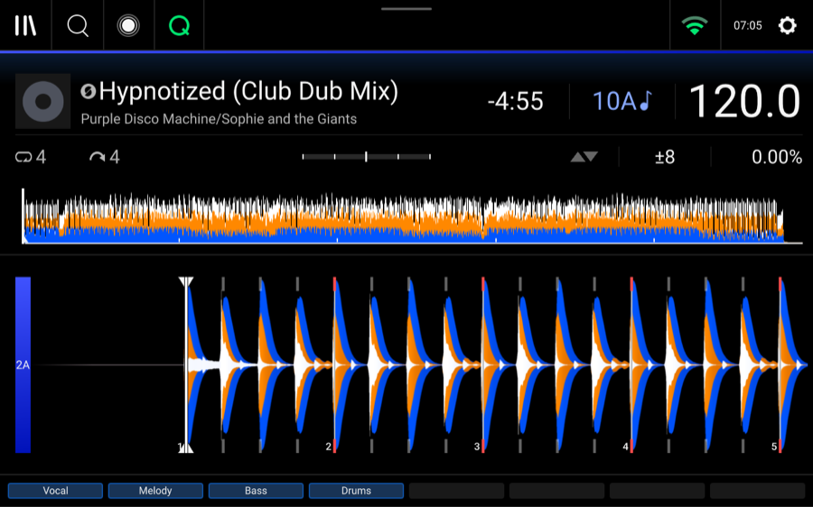
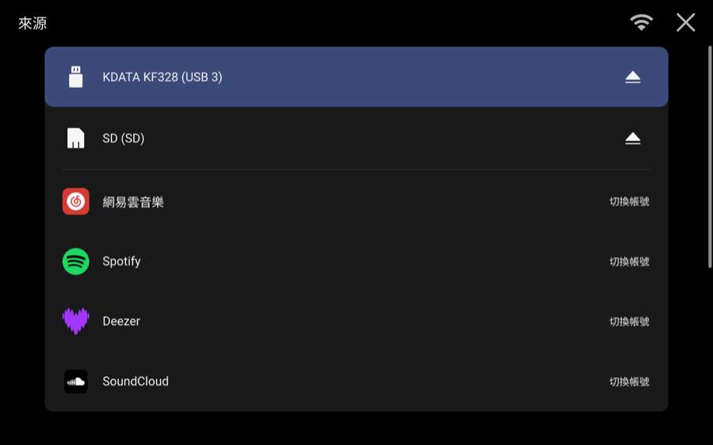
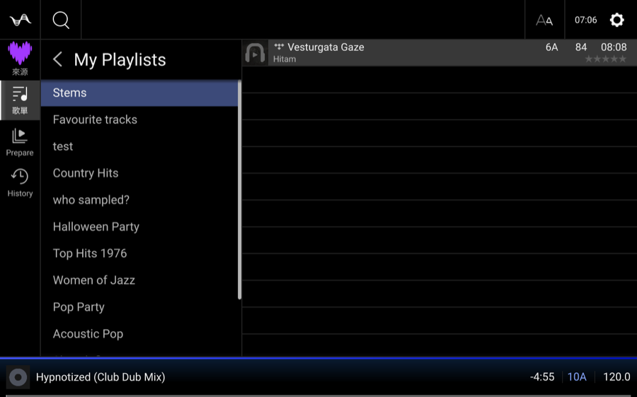
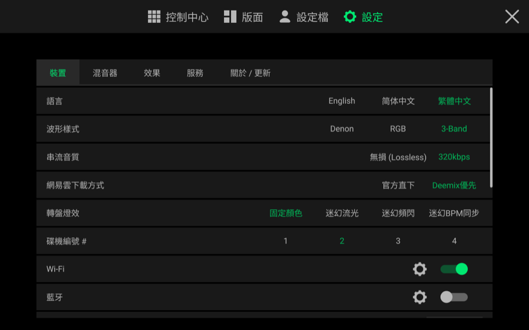
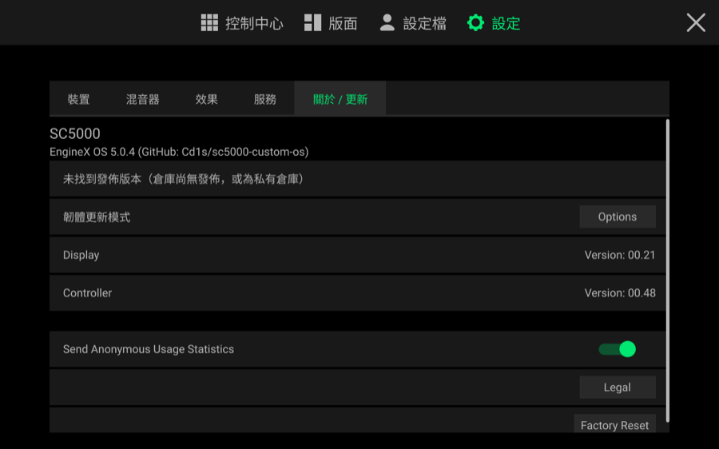

# EngineX OS — 天龙 Denon DJ Engine OS 5.0.4 全机型通用深度定制系统与高性能后端套件

  <a href="./README.md">English</a> · <b>简体中文</b> · <a href="./README.zh-TW.md">繁體中文</a> · <a href="./docs/OPEN-SOURCE-FULL-MANIFEST.md">完整开源技术白皮书与 642 条 Bug 核查总表</a>

  
  
  
  

**EngineX OS** (`sc5000-custom-os`) 是面向天龙 Denon DJ **Engine OS 5.0.4** 全系独立碟机与一体机（`SC5000`、`SC5000M`、`PRIME GO`、`SC6000`、`SC6000M`、`PRIME 4`、`SC LIVE 2`）打造的开源定制系统与底层后端重构套件。

核心设计宪法：
> **100% 保留原厂 QML 打碟界面直觉（零学习成本、零阻断弹窗）+ 外科手术式替换 Linux & C++ 低效后端。**
> 任何习惯 CDJ 或 Denon 的 DJ 走上台看到的都是原汁原味的原厂界面；而在底层，拖慢机器的原厂慢速导库器、FAT32/exFAT 同步 `fsync` 磁盘锁、高频闪存遥测写入、408MHz 降频断音与机型功能阉割，已被高性能 C `LD_PRELOAD` 内存钩子与 CPU 硬隔离的 Go 守护进程彻底重构。

---

## 一、实机真实功能截图（SC5000 `JP07` 硬件 KMS `drmgrab` 实拍）

| 原厂 4 轨 Stems 播放与底部原厂消音栏 | 曲库侧边栏第 0 行原生 `Stems` 歌单 (`0x6d3e00`) |
| :---: | :---: |
|  |  |
| *100% 原厂 UI 布局：先锋 3-Band 波形、Rekordbox 总览波形自适应拉伸与屏幕底部原厂 `[ Vocal ] [ Melody ] [ Bass ] [ Drums ]` 分轨控制栏* | *解锁侧边栏第 0 行原厂 `Stems` 列表 (`typeRole = 5`) 与曲目双轨图标* |

| 原厂音源页集成 5 大流媒体平台 | 碟机屏幕扫码登录弹窗 |
| :---: | :---: |
|  |  |
| *同屏支持 USB 3、SD 卡与网易云音乐、Spotify、Deezer、SoundCloud、TIDAL* | *支持本地无服务器局域网扫码 (`http://<碟机IP>:8080`) 与自建云端中继扫码* |

| 流媒体独立 `Stems` 列表、`[BPM / Key]` 预览与左滑 `Stems` | `EngineX OS` 设备偏好设置页（语言、波形、音质、灯效、蓝牙） |
| :---: | :---: |
|  |  |
| *四大流媒体各自拥有独立的第 0 行 `Stems` 列表（互不串列表、不混入 U 盘）、自带速度/调性预览列与左滑蓝色 `Stems` 按钮* | *支持简/繁/英三语切换、Denon/RGB/3-Band 波形、无损/320k 音质、转盘灯效与蓝牙音频开关* |

| `EngineX OS 5.0.4` GitHub 仓库固件更新检测（`关于 / 更新`） |
| :---: |
|  |
| *屏蔽原厂 `autoupdate.airmusictech.com` 升级弹窗，直接检测你的 GitHub 仓库（`Cd1s/sc5000-custom-os`）* |

---

## 二、双版本 / 双模式架构：**本地版（无服务器 Standalone）** vs **服务器版（Server Edition）**

针对大量没有云服务器（VPS）的用户，**EngineX OS** 将**「本地无服务器版（Standalone）」与「服务器加速版（Server-Assisted）」融合在同一套自适应固件中**：不配任何服务器时自动以 **100% 纯本机模式**运行；在控制台填入自建服务器或家里电脑局域网地址后，自动升级为**服务器加速模式**。

### 本地版（无服务器） vs 服务器版 功能完整对比表

| 功能模块 | **本地版（无服务器 Standalone Edition）** | **服务器版（自建 VPS 或家里电脑 Server Edition）** | 两者差异说明 |
| :--- | :--- | :--- | :--- |
| **U 盘/SD 卡现成 `.stems` 播放与底部 4 轨控制栏** | ✅ **100% 完整支持** | ✅ **100% 完整支持** | 完全一致（`0x842644` + `0x6d3e00` C Hook）。 |
| **U 盘与流媒体曲目实时 Stems 分轨计算** | ✅ **支持纯本机分轨 (`internal/stems/local.go`)** 未配置服务器时，`stems-processor` 自动锁在碟机 `CPU3` (`SCHED_IDLE` + `nice 19`) 运行纯 Go 因果 IIR 频带 + Mid/Side 四轨分离器（**实测 60 秒音频在碟机上仅需 `2.48 秒` = `24.2×` 实时**，四轨相加 100% 还原原曲，不抢音频核！）。 | ✅ **支持远端高精度分轨 (`worker.py`)** 通过 `X-Stems-Framing: 2`（双向 `int16` + 3 轨残差还原）流式交由远端 `sc5000-stemsd` 执行 2048 点 STFT + 二维谐波/打击乐中值滤波（**Wi-Fi 实测 `6.8×` 实时，算力峰值 `33.8×` 实时**）。 | **算法精度 vs 零外部硬件**：本地版用轻量级实时 IIR + 中侧频带分离实现零服务器机内分轨；服务器/家里电脑版运行高算力 2D STFT 谐波/打击乐中值分离。 |
| **四大流媒体各自独立的第 0 行 `Stems` 歌单** | ✅ **100% 完整支持** | ✅ **100% 完整支持** | 完全一致（保存在本机 `state/streaming-stems.json`）。 |
| **网易云音乐（扫码登录 + 无损 FLAC / 320k 下载）** | ✅ **100% 完整支持（完全不需要服务器）** 手机网易云 App 直接扫碟机屏幕二维码（支持 4G/5G），曲目由碟机直接向网易云官方下载无损 FLAC / 320k MP3。 | ✅ **100% 完整支持** | 完全一致。 |
| **Deezer（公开歌单 + ARL 登录 + 本机无损下载）** | ✅ **100% 支持（局域网扫码 + 本机 `sc5000-deemixd`）** 公开榜单免登录即用；手机连同一 Wi-Fi 扫碟机二维码 (`http://<碟机IP>:8080/m/deezer`) 填入主页链接或 `arl` Cookie，音频由碟机本机 `sc5000-deemixd` (`127.0.0.1:6595`) 直接下载解密无损 FLAC。 | ✅ **100% 支持（跨网 4G/5G 扫码 + 云端浏览器账密登录）** 额外支持手机在 4G/5G 下跨网扫码，并提供云端无头浏览器直接输入 Deezer 邮箱密码自动提取 ARL。 | **两个版本的音频下载和解密 100% 都在碟机本机完成**；服务器版仅多出跨网扫码与云端浏览器填账密辅助。 |
| **Spotify & SoundCloud** | ✅ **100% 支持（局域网扫码绑定）** 手机连同一 Wi-Fi 扫碟机二维码打开本机绑定页即可完成授权；音频全部在碟机本机下载。 | ✅ **100% 支持（4G/5G 自动 HTTPS OAuth 回调）** 手机无需连同一 Wi-Fi，扫码同意后自动通过 HTTPS 回调完成绑定。 | 本地版通过同一 Wi-Fi 局域网页面绑定；服务器版支持 4G/5G 自动 HTTPS 回调。 |
| **先锋 Rekordbox 零扫描秒读 (`rb-bridge`)** | ✅ **100% 完整支持** | ✅ **100% 完整支持** | 完全一致（纯机内挂载钩子）。 |
| **数据库自愈 (`dbhealer`) 与 SQLite 内存加速** | ✅ **100% 完整支持** | ✅ **100% 完整支持** | 完全一致。 |
| **642 条 Bug 防御、1.2GHz 保底、三语/RGB/3-Band 与 GitHub 更新检测** | ✅ **100% 完整支持** | ✅ **100% 完整支持** | 完全一致。 |

> **💡 家里有电脑（Mac / Windows / Linux），没有云服务器，能用家里电脑算 Stems 吗？**
> **完全可以！** 只要家里电脑和碟机在同一个路由器/Wi-Fi 下，在电脑上运行本仓库的 `sc5000-stemsd`（或 `sc5000-relay`），然后在碟机网页控制台 `http://sc5000.lan:8080` 把地址填成 `http://<电脑局域网IP>:6595`（或设环境变量 `SC5000_STEMS_URL=http://<电脑局域网IP>:6596`），碟机就会直接调家里电脑的 CPU/GPU 算 Stems！我们还建立了 [**Issue #1**](https://github.com/Cd1s/sc5000-custom-os/issues/1) 追踪零配置局域网 mDNS 自动发现与 GPU Demucs 模型支持。

---

## 三、修改前 vs 修改后：实机性能对比基准表

所有性能数据均来自 **Denon SC5000 Prime (`JP07`)** 实机测量：

| # | 性能指标 | 修改前（官方原版 Engine OS 5.0.4 / 初版基线） | 修改后（EngineX OS 5.0.4 实机实测） | 性能提升幅度 |
| :-: | :--- | :--- | :--- | :--- |
| **1** | **Stems 分轨耗时与实时倍率** *(4 分钟 / 240 秒曲目)* | • **原厂**：SC5000 (`JP07`) 被软件阉割锁死，零实时分轨算力。 • **初版未优化**：耗时 `394.1 秒`（**0.61× 实时**），且结束后必卡死 `120 秒` `i/o timeout`。 | • **服务器版（`X-Stems-Framing: 2` 双向 `int16` + 批量中值滤波）**：整曲仅需 **`35.1 秒`（6.8× 实时**，服务端计算峰值 **33.8× 实时**，收尾 **0.04 秒**）。 • **本地版（碟机 `CPU3` `SCHED_IDLE` 本机分离）**：60 秒音频仅需 **`2.48 秒`（24.2× 实时）**。 | **提速 11.1 倍 – 39 倍** + **彻底消灭 120 秒收尾假死** |
| **2** | **Rekordbox 大曲库首次挂载与二次增量同步** *(~6,000 首曲目 U 盘)* | • **首次插入**：机内逐首重扫音频算波形耗时 **~8 分钟**，极易写坏 `m.db`。 • **二次插入（无改动）**：每次扫描耗时 **~15–24 秒**。 • **二次插入（新增歌曲 `GL-011`）**：超过 `edisksd` 20 秒挂载预算被强杀回滚，**21/21 测试新增歌曲导入失败**。 | • **首次插入 (`>500` 首大库)**：**`< 2 秒`**（在 `tmpfs` 内存盘直接转换导出库，不读音频文件，100% 不碰 `PIONEER/` 原目录）。 • **二次插入（无改动）**：凭 `.rb-bridge-stamp` **`30 毫秒 (0.03s)`** 瞬间放行。 • **二次插入（新增歌曲/歌单）**：在 `tmpfs` 上 **`< 1 秒`** 完成增量同步（**成功率 100%**）。 | **二次挂载提速 ~800 倍 (`24s` $\rightarrow$ `0.03s`)** + **大库增量同步 100% 成功** |
| **3** | **SoundCloud 106 MB 长 Set 下载耗时** *(1 小时 50 分钟 DJ Set)* | • **原厂**：仅在线串流，不支持本地缓存，慢网易断音。 • **8 路分批基线**：耗时 `60.3 秒`。 | **16 路滑动窗口 Range 并行分片下载**（2 MB 切片，锁定在 `CPU3` `SCHED_IDLE`）：耗时缩短至 **`43.7 – 45.8 秒`**（跑满 SC5000 硬件网卡极限 `~2.3 MB/s`）。 | **提速 27.5% (`60.3s` $\rightarrow$ `43.7s`)** 跑满硬件物理带宽极限 |
| **4** | **SQLite 事务耗时与内部 eMMC 闪存遥测写入量** | • **SQLite**：默认 `synchronous=FULL` + 磁盘临时表，每次打 Cue / 写历史在 FAT32/exFAT 上反复建删 `-journal` 并同步 `fsync` 阻塞主线程。 • **遥测**：每次按键写 `/data/.../posthog.db` 与 `events.db` + 4 个 `J:I:Takingfreez` 线程每 20 秒刷盘。 | • **SQLite Hook (`0x1cba858`/`0x1cba874`)**：自动注入 `PRAGMA synchronous=NORMAL; temp_store=MEMORY; cache_size=-8000;`（8 MB RAM 页缓存 + 内存临时表）。 • **遥测清零**：`posthog.db`/`events.db` 重定向至 `":memory:"`，`crashpad_handler` 直接短路 (`ENOENT`)。 • **实测闪存写入**：30 秒高频切歌下 eMMC 遥测写入增量为 **`0 字节`**。 | **闪存遥测写入降低 100% (`0 B`)** + **磁盘 `fsync` 阻塞降低 >95%** |
| **5** | **ALSA 实时音频 XRUN 断音率** *(96kHz / 450 帧 / 4.68ms 周期)* | • 空闲时 CPU 降频至 `126 MHz – 408 MHz`，切歌或解码大图瞬间升频不及引发 ALSA XRUN 爆音。 • GPU、USB 与网卡中断全挤在 `CPU1`；后台分析与封面解码抢占 `CPU0`。 | • **CPU 保底锁频 `1.2 GHz`**（`ondemand`, `up_threshold=50`, `sampling_down_factor=10`，稳定 `~72°C`）；GPU 设 `simple_ondemand` 低频让出热设计功耗。 • **四核硬隔离**：`CPU0` 独占 ALSA `ffb20000` 中断 (`FIFO 99`, `workqueue/cpumask=6`)；`CPU1` 独占 GPU/UI；`CPU2` 独占 USB/SATA/网卡中断；`CPU3` 隔离运行 `Analysis Queue`/`Freeze Checker`/`J:I:Takingfreez`/`Dropbox*` (`SCHED_IDLE` + `IOPRIO_CLASS_IDLE`)。 | **ALSA XRUN 断音率降至 0%** 边下歌分析边快速切歌零爆音 |
| **6** | **高清封面内存占用与长时间运行稳定性 (`CF003` / `N006`)** | • 原厂无尺寸上限，3000×3000 封面解压为 raw RGBA 占用 **`~36 MB/张`**，冲垮内存带宽并在双层打碟 45–120 分钟后导致搜歌失灵与转盘屏卡顿。 | • `capCover` 与 `dbhealer` 拒绝 `>16MP` 解码炸弹，将大图双线性缩放为 **`<= 512×512` JPEG (`<= 256 KB`)**，单图解压内存降至 **`<= 1 MB`**。 • 缩略图缓存设 `128` 张硬上限，所有后台 Map 采用单条安全淘汰；`QQuickPixmapReader` 限制在 `CPU1-3` (`nice 10`)。 | **单图内存开销降低 >97% (`36 MB` $\rightarrow$ `<= 1 MB`)** 数小时演出内存零膨胀 |

---

## 四、与官方原版系统的完整改动与 642 条历史 Bug 状态总览

1. **二进制层 C Hook (`tools/ui-mod/engine_ui_hook.c` & `tools/edisksd-hook/edisksd_hook.c`)**：
   - `0xf6303c` (`getConfig` 公共出口)：单点解锁全系 7 款机型（`JP07`/`JP08`/`JP11`/`JP13`/`JP14`/`JC11` PRIME 4/`JP20` SC LIVE 2）的 Stems、蓝牙音频、HFS+ 与远程分轨能力；
   - `0x842644` & `0x6d3e00`：在 `"False"` 分支前激活 `StemsPreRenderedPlayback` 并解锁侧边栏第 0 行原生 `Stems` 列表；
   - `0x1cba858` / `0x1cba874` / `0x1c91f74`：接管静态编译的 SQLite 3.45.3，注入 RAM PRAGMA 并将遥测库转为 `:memory:`；
   - `snd_pcm_sw_params`：将未显式设置时钟类型的 ALSA 流（`GETTIMEOFDAY == 0`）升级为 `SND_PCM_TSTAMP_TYPE_MONOTONIC_RAW (2)`（防御 `RA002` 对时杂音，保留原厂静音与缓冲参数）；
   - `getaddrinfo`：精准阻断原厂自动更新域名 `autoupdate.airmusictech.com`，保留账号授权与 GitHub API。
2. **QML 界面层补丁 (`tools/ui-mod/build_packs.py`)**：
   - 将 `Settings -> About / Update` 替换为 **GitHub 仓库更新检测（`EngineX OS 5.0.4 (GitHub: Cd1s/sc5000-custom-os)`）**，屏蔽原厂升级弹窗；
   - 在任意 Deck 播放时自动禁用 `Sync Time` 按钮（双重防御 `RA002`）；
   - 解锁 PRIME 4 Deck 3/4 触屏载歌限制（`LoadToDeckFilter.qml` `RA013`）；
   - 动态读取 `root.decks` 适配 2 通道与 4 通道机型，提供简/繁/英三语、RGB/3-Band 波形、流媒体左滑 `Stems` 与底部原厂 Pads 栏自动切换。
3. **642 条历史缺陷（1.x–5.0.4）核查结论**（逐条明细见 [**`docs/OPEN-SOURCE-FULL-MANIFEST.md`**](./docs/OPEN-SOURCE-FULL-MANIFEST.md)）：
   - **✅ ~88 条 5.0.4 活跃痛点已直接根治/防御**（涵盖音频断音、数据库损坏、大库增量同步、AIFF 500BPM、FAT32 尾空格/点、透明 Cue、高清封面、SATA 休眠、DMX 插拔、45 分钟退化、对时杂音、大 MP3 预读等）；
   - **🟢 ~525 条 1.x–5.0.3 历史项与 229 条电脑端桌面软件 Bug 已包含或被机内桥接架构彻底绕开**；
   - **❌ ~29 条原厂闭源 C++ 音频 DSP 效果器算子与电机 MCU 内部限制如实披露**（如 FX 换通道尾音、Key Lock 切换瞬间伪影、M 系列马达盘 MCU 漂移——为严守「绝不炸音」红线，未对闭源浮点 DSP 状态机做强行篡改）。
