<div align="center">

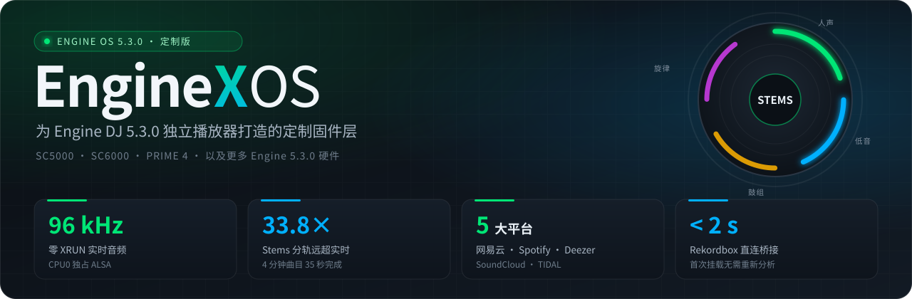

<br>

<a href="./README.md"></a>
<a href="./README.zh-CN.md"></a>
<a href="./README.zh-TW.md"></a>

<br>

**[核心功能](#features)** · **[下载与安装](#install)** · **[实机画面](#gallery)** · **[性能对比](#benchmarks)** · **[赞赏支持](#sponsor)**

📖 **在线使用文档**：<https://enginexdj.com> · **路线图**：<https://enginexdj.com/#roadmap>

</div>

<br>

**EngineX OS 5.3.0.4** 是基于官方 Engine OS 5.3.0+ 底层重构的定制系统，支持天龙 Denon DJ、Numark 与 Rane 全系 16 款独立设备：
`SC5000` · `SC5000M` · `SC6000` · `SC6000M` · `PRIME 4` · `PRIME 2` · `PRIME GO` · `Mixstream Pro` · `SC LIVE 4` · `SC LIVE 2` · `PRIME 4+` · `PRIME GO+` · `Mixstream Pro+` · `Mixstream Pro Go` · `PRIME 4 G2` · `Rane SYSTEM ONE`。

全系 16 款机型现统一使用 `*-Update.img` 升级包：前八款一代机直接用 U 盘免电脑刷入；后八款二代机首次连接电脑运行一次 `EngineX-Installer` 自动完成**一键解锁 `.img` 升级链并刷入**，之后即可像一代机一样直接用 U 盘或屏幕一键在线升级（见[如何安装与升级](#install)）。

操作界面与原厂完全一致，安装后即可在熟悉的原厂界面里直接使用以下全部功能。

---

<a id="features"></a>

## 核心功能

### 1. 全机型 4 轨 Stems 实时分轨（人声 / 旋律 / 贝斯 / 鼓组）
- 在本地或流媒体曲目上向左滑即可拆出 **Vocal（人声）、Melody（旋律）、Bass（贝斯）、Drums（鼓组）** 四轨，并自动归入曲库侧边栏 `Stems` 歌单；
- 打碟时直接按打击垫一键静音人声做 Acapella 或单留鼓点过渡；在支持分轨 EQ 的一体机上按各通道 **Shift + Cue (PFL)**（或开启 `配置 → 播放 → 分轨 EQ 模式`），即可用实体 `HIGH / MID / LOW` 旋钮丝滑控制分轨音量；
- 不连电脑即可在碟机本机完成分轨；同一局域网下运行电脑端服务时，自动调用显卡与 `htdemucs` 神经网络模型完成高音质分轨（`PRIME 4 G2` 与 `SYSTEM ONE` 保持官方 Stems 行为）。

### 2. 内置 7 大流媒体音源（手机扫码与一键配对登录）
- 音源菜单直接内置 **TIDAL、网易云音乐、Spotify、Deezer、SoundCloud、Beatport、Apple Music**，与 U 盘、SD 卡并列显示；
- 手机扫描碟机屏幕二维码（或在 Spotify Connect 里点选 **`EngineX OS`**）即可登录账号，直接浏览红心歌单、收藏夹并按 BPM、调性、星级、歌名或歌手排序；
- 支持 **无损 FLAC 与 320 kbps** 音质切换；播放过的曲目按平台各自独立缓存在碟机内部存储，再次加载直接秒开（网易云开启 `Deemix 优先` 时与 Deezer 共享无损缓存）；
- **OmniSource**（`配置 → 曲库 → OmniSource（在流媒体中显示 U 盘/SD）`，默认关闭）支持一次搜索同时查找各流媒体、U 盘 / SD 卡、djay 曲库与网络共享，同时保持各平台自己的歌单页干净不串歌单。

### 3. 先锋 Rekordbox U 盘即插即用与 CDJ 互联
- 给先锋 CDJ 导出的 Rekordbox U 盘直接插上碟机，**2 秒内**读取全部歌单、Hot Cue、Memory Cue、Loop 与拍线（含旧版 rekordbox 5 导出的 U 盘），无需再用电脑端 Engine DJ 重新转换；
- 兼容 `FAT32` / `exFAT` / `NTFS` 与 Mac `HFS+`（`Mac OS 扩展`；不支持 `APFS`，请将 U 盘格式化为 `exFAT` 或 `Mac OS 扩展`），自动补偿 MP3 编码起始延迟让拍线与 Cue 精准落在鼓点上，自动修复异常拔盘造成的数据库损坏并去掉“未安全弹出”弹窗；
- **Pro DJ Link（测试版，位于 `设置 → 服务`）** 支持跨网线 / Wi-Fi 浏览 CDJ 上的 Rekordbox U 盘、向 CDJ 共享本机曲库、双向交接 `MASTER`，并在影子轨或一体机 `线路输入`（`Line In`）通道实时显示 CDJ 波形。

### 4. 四轨联机与双碟机配对视图、5 组保存布局与三语界面
- **`联机视图`（`布局 → ENGINEX 视图预设 → 联机视图`）**：独立播放器可在 `原厂`、`双碟机配对`（同屏显示两条全高波形：本机当前 Layer 在上，另一台碟机当前 Layer 在下）与 `4 轨`（四轨波形同屏，对端轨道作为静音影子轨实时跟随）之间切换，4 轨一体机可在 `原厂` 与 `4 轨` 之间切换；
- **5 组预设布局与界面缩放**：支持保存 `视图 1`–`视图 5` 共五组独立布局，分别记住 `热标拍数倒数`、`界面缩放`（`110%`–`75%`）、带 BPM 显示的 `双栏浏览` 与 `互换循环 / 节拍跳跃`；
- **3 种波形配色与 3 种语言**：全系 16 款支持 **简体中文 / 繁體中文 / English** 免重启切换，并在控制中心或 `配置 → 显示 → 波形样式` 一键切换 `Denon`、`RGB` 与先锋风格 `3-Band` 波形。

### 5. 演出现场音质保护、一体机先锋风格效果与千兆网络
- **21 项实时音频保护**：消除切效果器爆音，内置零延迟 `0dB 防破音软限幅`（峰值压在 -0.1 dBFS 以下）、`自动增益（0 dB 归一化）`、Flanger 音量下沉补偿，以及带混音台一体机上的 `推子回音` / `回声淡出`；
- **一体机先锋风格效果**：`PRIME 4` 硬件效果选择器内置 `Spiral (PX)`、`Pitch Echo (PX)`、`Slip Roll (PX)`、`Dub Echo (PX)`、`Space (PX)`，其余一体机提供 `配置 → 播放 → 先锋风格效果 (Color FX)` 以及可选的 **10–4000 ms** 独立毫秒延时模式（`先锋效果延时模式 (PX)`；独立播放器不提供 PX 效果，保持纯净播放器链路）；
- **智能同步、千兆网口与 `:8080` Web 控制台**：控制中心一键切换 `Bar / Beat / Tempo` 同步并在大 BPM 跨度下自动扩大变速范围，有线网口解锁 **1 Gbps** 满速，`:8080` 网页控制台支持 Wi-Fi 拖拽传歌、丢失曲目一键重定位、Shoutcast / Icecast `直播推流`，以及按需安装的 Mod 插件中心（`tailscale-remote`、`dmx-studio`、`midi-controller-mapper`、`jog-logo-studio`、`sampler-pad-studio`、`minimal-club-mode`）。

---

## 5.3.0.4 更新内容

### 新功能
- **二代机全系 8 款统一 `*-Update.img` 与一键解锁刷机**：全系 16 款机型现统一发布单文件 `*-Update.img` 升级包。原厂二代机首次只需进入 `固件更新模式` 连 USB 运行一次 `EngineX-Installer`，自动完成 **[1/2] 一键解锁 `.img` 升级链** 与 **[2/2] 刷入 `*-Update.img`**；解锁后后续升级与一代机完全一致——既可把 `*-Update.img` 放进 U 盘插机升级，也可在屏幕 `设置 → 关于 / 更新` 一键在线 OTA，全程免电脑。
- **Spotify 原生音频与免配置登录**：Spotify Premium 直接拉取原生 320 kbps Ogg Vorbis 音频并自动生成 BPM、调性与波形入库，绝不跨平台找替身；同一网络下在 Spotify Connect 选择 **`EngineX OS`** 或扫描屏幕二维码即可登录，无需自建开发者应用。
- **`联机视图` 三合一选择器与 `双碟机配对` 2 轨视图**：`布局 → ENGINEX 视图预设 → 联机视图` 在 `SC5000 / SC6000` 上整合 `原厂` / `双碟机配对` / `4 轨`（4 轨一体机为 `原厂` / `4 轨`），一步即可切回 `原厂` 单/双层视图。`双碟机配对` 为两台联机独立碟机展示上下两条全高波形（上方为本机当前 Layer，下方实时跟随对端碟机当前 Layer），与 `4 轨` 互切无需重启 Engine。
- **`影子轨模式`（`自动` / `全部 Engine 模式` / `全部 CDJ 模式`）免重启实时切换**：默认 `自动` 下，对端 EngineX 碟机或 CDJ U 盘中可拷贝的曲目由本机静音加载，用原厂界面完整绘制波形、拍线、滑行线、移调、循环、`Stems` 图标、绿色 `Sync` BPM 与 `主控 (LEAD)`（加载期间显示曲目信息与进度环）；无法拷贝的 CDJ 音源自动回退显示原厂样式的 CDJ 波形并注明原因。切换模式即时生效，不中断本机播放。
- **一体机 `线路输入`（`Line In`）显示 CDJ-3000 波形**：在 `PRIME 4` 等一体机上把通道输入切到 `Line In`，联机的先锋 CDJ-3000 波形与播放进度会直接显示在该通道上。
- **`PRIME 4` 硬件 `(PX)` 效果器与 `10–4000 ms` 毫秒延时模式**：`PRIME 4` 硬件效果选择器新增 5 款 `(PX)` 效果与独立时间档位控制；一体机 `配置 → 播放 → 先锋效果延时模式 (PX)`（及 `:8080` 控制台）支持为延时类 PX 效果开启独立于 BPM 的 `10–4000 ms` 毫秒延时。
- **`SC LIVE 4` AUX 通道混音与 `Mixstream` 实体滤波 / 跳拍打击垫**：`SC LIVE 4` 可在 `混音台菜单 → 通道 → 输入` 将 `AUX` 送入通道 3 或 4 使用通道推子、EQ、监听与滤波效果并保留 `MIC 2`；`Mixstream Pro / Pro+ / Pro Go` 恢复实体 `FILTER` 旋钮原厂滤波效果、触屏跳拍、`节拍跳跃打击垫` 与 `EQ / 分轨` 切换。
- **电脑端高音质 `htdemucs` Stems 默认开启与内置脚本**：电脑端局域网分轨默认采用高音质 `htdemucs` 模型，碟机 `配置 → 曲库` 与 `设置 → 关于 / 更新` 实时提示连接状态，四个平台的 `EngineX-Installer` 压缩包均内置一键启动脚本。
- **USB MIDI 控制器映射 Mod、脱敏日志下载与免域名公网隧道**：Mod 社区新增 `midi-controller-mapper`（内置 Pioneer CDJ-400 预设直控内部第 3 / 4 轨），`:8080` 控制台新增 `详细日志` 开关与一键脱敏日志下载，`enginex-relay` 新增多碟机在线总览，并支持一键开启 Cloudflare Quick Tunnel 免域名远程扫码登录。

### 修复与调整
- **一体机流媒体曲目双向录音**：带录音功能的一体机现可在加载流媒体曲目时开始录音，录音过程中也能继续加载流媒体曲目 *（流媒体服务条款可能不允许保留其曲目的录音，请仅供个人使用）*。
- **Rekordbox MP3 拍线精准对齐与 rekordbox 5 U 盘兼容**：自动修正 MP3 编码延迟导致的约 26–51 ms 拍线、Hot Cue、Memory Cue 与 Loop 偏移（已导入过的 U 盘再次插入时自动重转受影响的 MP3 一次），并支持旧版 rekordbox 5 导出的 U 盘。
- **官方 Mod `1.1.0` 全机型免 Python 即装即用**：全部 5 款官方 Mod 改用自带的原生辅助程序，彻底解决碟机无 Python 无法启动的问题；支持在 `:8080` 直接上传 `1.1.0` 就地覆盖升级并保留原有设置，修复局域网访问 Mod 中心报错及安装包可执行权限丢失。
- **启动恢复安全网与断电保护**：若开机意外卡住或连续异常退出，碟机会自动回退到原厂 Engine 并隔离外置 Mod（绝不触发恢复出厂设置、绝不清空曲库），插入 U 盘或 SD 卡即可自动导出脱敏诊断报告；异常断电重启后自动清理残留界面缓存。
- **独立碟机 `采样器输出`、四轨操控与影子轨 `Sync` 稳定性**：`SC5000 / SC6000` 在二轨与四轨下均保留 `设置 → 混音台 → 采样器输出`（`Layer A` / `Layer B`）、`碟机编号 #`、`碟机颜色` 双层选色盘、`Layer B` 开关与 `Browse` 按压直载当前层；静音影子轨绝不抢 `MASTER`，支持超过 `+100%` 变速的跨倍速 `Sync` 紧锁，对端关机干净退歌不卡切源，紧凑轨道顶栏数字定宽不晃动。
- **设置项精简、全界面简繁翻译补齐与断电时区记忆**：全机型解锁原厂 `配置 → Cue / Loop → 联动节拍跳跃与 Loop 长度` 且绝不篡改用户开关；`打击垫亮度` 平滑调节彩灯并保持 `SYNC`、`KEYLOCK`、`SLIP` 等单色键原厂亮度；转盘、波形缩放与非主控 `MASTER` 灯恢复原厂手感与暗亮值；独立碟机隐藏先锋风格 PX 效果；移除无效的自动分析盘开关；原厂 `Engine 灯光` 默认关闭，开启或关闭后的选择在重启、断电后保留；补齐设置页全部简繁中文翻译（`Layer A`、`Layer B` 与 `3-Band` 保持英文）；内置中国大陆与全球 NTP 时间池，断电离线开机仍保留已选时区与时钟进度。
- **二代机 Stems 识别与命令行安装器增强**：修复 `SC LIVE 4` 等二代机点 **Generate Stems** 跳回设置页的问题并对齐图形缓存上限；一代机 `.img` 内置定制开机画面并消除首次开机无效 Stems 下载提示；提升命令行 `EngineX-Installer` 对 `SC LIVE 4`、`Mixstream Pro+ / Pro Go`、`PRIME 4+` 及一代机 USB / 局域网的识别率。

> **5.3.0.5 开发中 — 复制设置（#205）：** `设置 → 设备 → 从另一台设备复制设置` 先由来源设备允许，再由接收设备确认。请先暂停播放：Link 导入和撤销会正常重启 Engine。本机碟机编号、角色、颜色、身份及账号均保留。`Profile → Save to my drive` 同时保存 EngineX 偏好；原厂 USB 导入增加 **包含 EngineX 设置** 开关，不强制重启。不支持的机型设置会列出并跳过，USB 撤销会在重启前逐字节恢复 EngineX 文件和私有原厂 profile，再由原厂 loader 恢复白名单偏好；保留正常退出写下的原生身份与状态文件，避免回退 Player 编号。复制后若本机角色、身份或账号设置已变，撤销会拒绝执行。不复制 MIDI 映射或视图文件。

> **先锋 CDJ 联机说明**：与先锋 CDJ-3000 的局域网互通（曲库共享、3-Band 波形、播放头跟随与 Master / Beat Sync 双向交接）基于真机 Denon SC5000 与 [**OpenProLink**](https://github.com/Cd1s/OpenProLink) 联调验证，欢迎拥有先锋 CDJ / XDJ / DJM 真机的玩家反馈实测体验！

---

<a id="gallery"></a>

## 实机画面

<table>
<tr>
<td width="50%" align="center" valign="top">
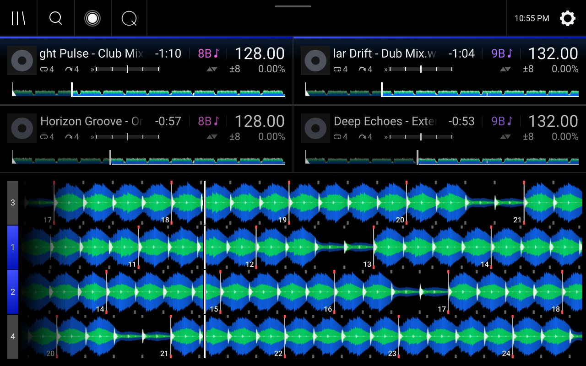<br>
<b>双机互联四轨同屏与影子波形</b><br>
<sub>本机双层轨道与对端碟机实时同步的静音影子轨四轨波形同屏滚动</sub>
</td>
<td width="50%" align="center" valign="top">
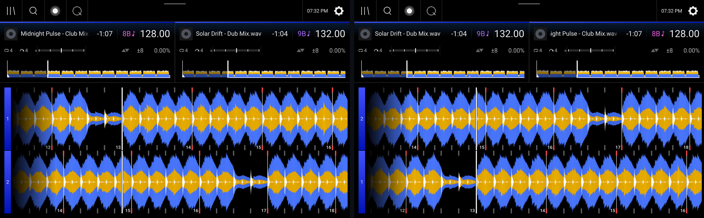<br>
<b>双碟机配对 2 轨视图（SC5000 / SC6000）</b><br>
<sub>同屏两条全高波形：上方为本机当前 Layer，下方实时跟随对端碟机当前 Layer</sub>
</td>
</tr>
<tr>
<td width="50%" align="center" valign="top">
<br>
<b>原生 4 轨 Stems 分轨与 3-Band 波形</b><br>
<sub>底部显示人声、旋律、贝斯、鼓组四轨状态，打击垫一键静音</sub>
</td>
<td width="50%" align="center" valign="top">
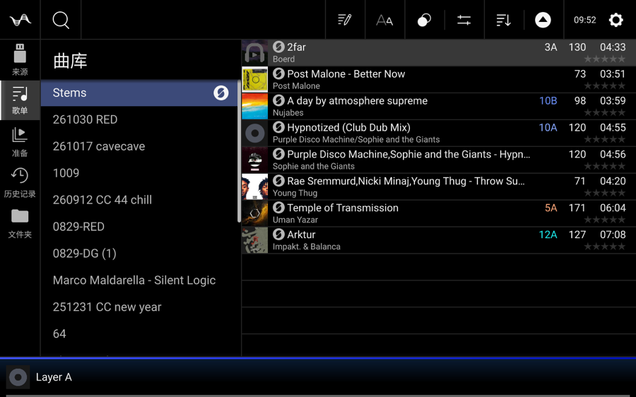<br>
<b>曲库侧边栏 Stems 专属歌单</b><br>
<sub>所有已分轨曲目自动归类，随时筛选调用</sub>
</td>
</tr>
<tr>
<td width="50%" align="center" valign="top">
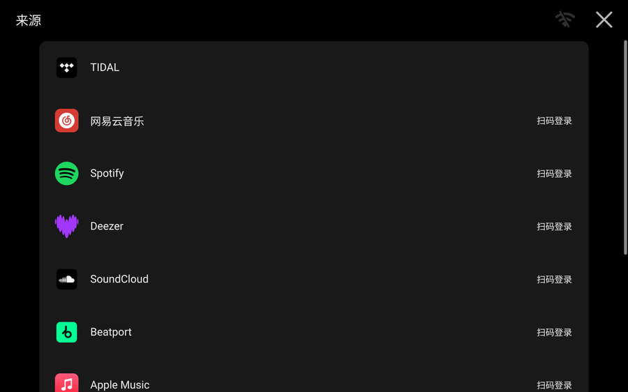<br>
<b>来源页内置 7 大音乐平台</b><br>
<sub>TIDAL · 网易云 · Spotify · Deezer · SoundCloud · Beatport · Apple Music 与 U 盘并列</sub>
</td>
<td width="50%" align="center" valign="top">
<br>
<b>屏幕二维码扫码登录</b><br>
<sub>手机扫一扫直接同步个人歌单，免输密码</sub>
</td>
</tr>
<tr>
<td width="50%" align="center" valign="top">
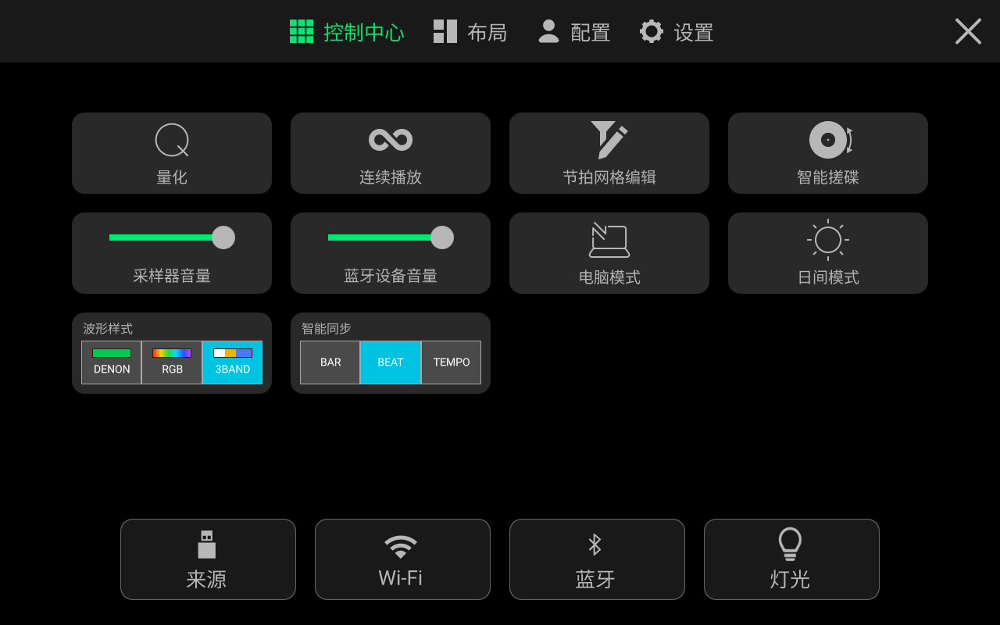<br>
<b>下拉控制中心</b><br>
<sub>量化、智能搓碟、波形样式与智能同步一屏直达</sub>
</td>
<td width="50%" align="center" valign="top">
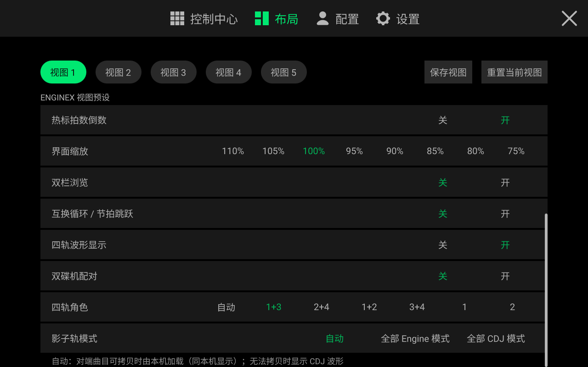<br>
<b>布局页（视图 1–5 与 EngineX 视图预设）</b><br>
<sub>5 组预设视图、热标拍数倒数、界面缩放、联机视图、四轨角色与影子轨模式</sub>
</td>
</tr>
<tr>
<td width="50%" align="center" valign="top">
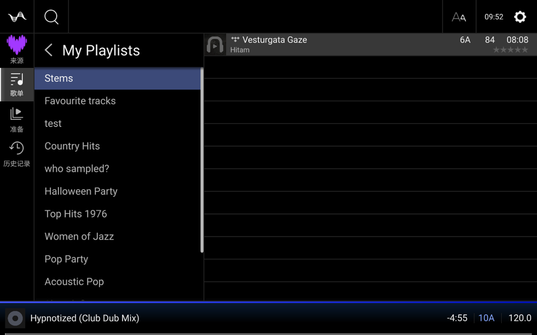<br>
<b>在线歌单 BPM / 调性预览与左滑分轨</b><br>
<sub>加载前即可查看曲目 BPM 与调性，左滑一键拆分 Stems</sub>
</td>
<td width="50%" align="center" valign="top">
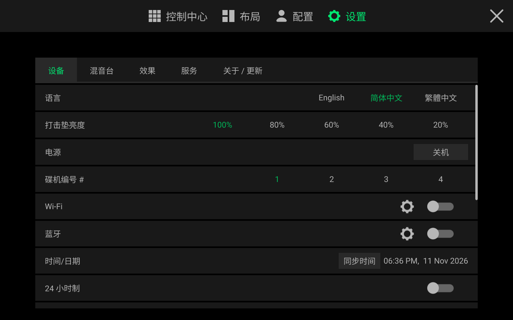<br>
<b>设备设置菜单</b><br>
<sub>切换语言、打击垫亮度、碟机编号 #、时间同步与电源关机</sub>
</td>
</tr>
<tr>
<td width="50%" align="center" valign="top">
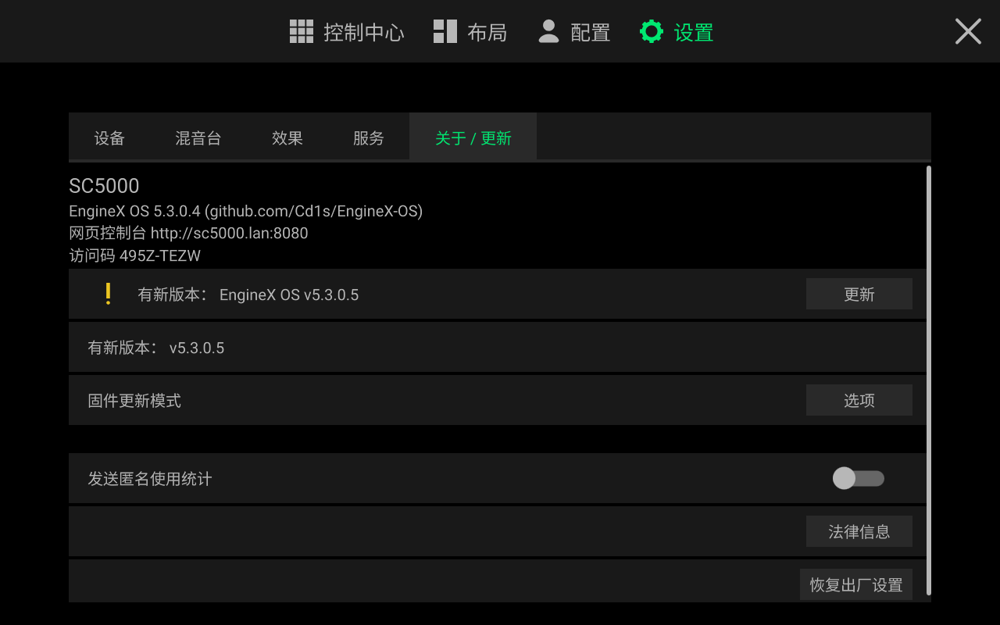<br>
<b>设置 → 关于 / 更新：屏幕一键在线升级</b><br>
<sub>检测到新版本时直接点「更新」即可在线下载升级</sub>
</td>
<td width="50%" align="center" valign="top">
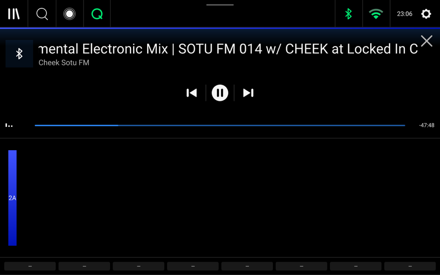<br>
<b>原生蓝牙音频输入与播放控制</b><br>
<sub>手机蓝牙推流到碟机，屏幕显示曲目信息，可直接播放/暂停与切歌</sub>
</td>
</tr>
</table>

---

<a id="benchmarks"></a>

## 重构前后性能与占用对比（SC5000 实机实测）

系统经过全面精简，所有增强功能仅占极小空间，比原厂固件留出更多可用内存：

| 对比项 | 官方原厂 / 重构前 | 重构后（`EngineX OS 5.3.0.4` 实测） | 实际打碟提升 |
| :--- | :--- | :--- | :--- |
| **刷机包体积 (`*-Update.img`)** | 官方原厂 5.3.0 `147.79 MB`<br>早期改版 `~210 MB` | **`151.44 MB`**（SC6000 `151.58 MB`，PRIME 4 `151.52 MB`） | **仅比官方原厂大 `3.64 MB`** |
| **纯刷机开机硬盘占用 (`/data`)** | 旧版残留约 `243 MB` | **核心程序 + 三语界面仅占 `17.2 MB`**（含扩展磁盘格式驱动共 `45.6 MB`） | 内置闪存多腾出 **近 `200 MB`** 空间 |
| **整机空闲可用内存（总 `2 GB`）** | `~680 – 780 MB` | **`1,042 MB` 空闲可用**（主程序省出 `~150 MB`，后台服务合计仅占 **`29.2 MB`**） | **多释放 `~260 MB` 内存**，长时间演出不卡顿 |
| **音频核心被后台抢占率** | 下载或导库时偶发占用 `5% – 25%` | **`0.0%`**：所有下载与分轨任务隔离在独立副核，不碰音频核心 | **96 kHz 声音播放全程零断音** |
| **先锋 Rekordbox U 盘读取速度** | 首次转换约 `8 分钟`，重扫 `15–24 秒` | **首次插盘 `< 2 秒`**，再次插盘 **`0.03 秒`** | 插上 U 盘即插即打，无需等待 |
| **4 分钟歌曲 Stems 分轨耗时** | SC5000 原厂锁死不可用 | 连电脑 / 云端约 **`35 秒`**；碟机本机分轨比播放速度快 **`1.4 倍`** | 演出中途临时拆人声也能快速完成 |
| **大 BPM 跨度同步** | BPM 跨度超出变速范围时 Sync 对不上，需手动调大变速范围 | **智能同步**自动升档变速范围（最高 `±100%`），控制中心一键切 Bar / Beat / Tempo | 速度相差很大的两首歌也能直接同步 |
| **网络传输速度** | 有线网口限制在 `100 Mbps` | 有线网口 **`1 Gbps`（1000 Mbps）全双工**；Wi-Fi 实测约 `9～10 MB/s`（受主板总线带宽限制） | 大曲库走千兆有线网口高速传输 |

---

<a id="install"></a>

## 如何安装与升级

### 方式零：全系 16 款命令行安装工具 `EngineX-Installer`（原厂二代机首次必用一次）

`EngineX-Installer` 是跨平台 **命令行工具**（终端程序，非图形窗口软件），支持 Windows、macOS 与 Linux。它无需输入 IP 或手动选择机型，可自动发现同一局域网 / Wi-Fi 或处于 USB 固件更新模式的碟机，下载对应的 `5.3.0.4` `*-Update.img` 升级包、校验 SHA-256 并引导完成安装（二代机自动执行 **[1/2] 一键解锁 `.img` 升级链** + **[2/2] 刷入 `*-Update.img`**）。

- [Windows 10/11 x64](https://github.com/Cd1s/EngineX-OS/releases/latest/download/EngineX-Installer-5.3.0.4-windows-amd64.zip)
- [macOS Apple Silicon M1–M4](https://github.com/Cd1s/EngineX-OS/releases/latest/download/EngineX-Installer-5.3.0.4-macos-arm64.zip)
- [macOS Intel](https://github.com/Cd1s/EngineX-OS/releases/latest/download/EngineX-Installer-5.3.0.4-macos-amd64.zip)
- [Linux x86_64](https://github.com/Cd1s/EngineX-OS/releases/latest/download/EngineX-Installer-5.3.0.4-linux-amd64.tar.gz)

解压后在终端运行 `Install-EngineX.bat`（Windows）、`Install-EngineX.command`（macOS）或 `./install-enginex.sh`（Linux）。局域网安装需碟机已开启 root SSH，可完整保留音乐与设置；USB 线刷需安装 `fastboot` 与 Python 3（新建二代机 `/data` 镜像另需 `e2fsprogs`；Windows 线刷二代机请通过 `usbipd-win` 将 USB 直通给 WSL 2，并以 `wsl -u root` 运行 Linux 版安装器）。**请先备份碟机数据**：通过 USB 刷入全新二代机 `/data` 镜像会清空内置 `/data` 分区上的音乐、曲库与设置（刷机前请拔下 U 盘与 SD 卡）。

### 方式一：一代机型 —— U 盘免电脑直接刷机
1. 点击下方对应你机器型号的直链下载 `*-Update.img` 固件（或访问 [**Releases 页面**](https://github.com/Cd1s/EngineX-OS/releases/latest)）：
   - **Denon DJ SC5000 Prime**：[`SC5000-5.3.0.4-EngineX-OS-Denon-SC5000-Prime-JP07-Update.img`](https://github.com/Cd1s/EngineX-OS/releases/latest/download/SC5000-5.3.0.4-EngineX-OS-Denon-SC5000-Prime-JP07-Update.img)
   - **Denon DJ SC5000M Prime**：[`SC5000M-5.3.0.4-EngineX-OS-Denon-SC5000M-Prime-JP08-Update.img`](https://github.com/Cd1s/EngineX-OS/releases/latest/download/SC5000M-5.3.0.4-EngineX-OS-Denon-SC5000M-Prime-JP08-Update.img)
   - **Denon DJ SC6000 Prime**：[`SC6000-5.3.0.4-EngineX-OS-Denon-SC6000-Prime-JP13-Update.img`](https://github.com/Cd1s/EngineX-OS/releases/latest/download/SC6000-5.3.0.4-EngineX-OS-Denon-SC6000-Prime-JP13-Update.img)
   - **Denon DJ SC6000M Prime**：[`SC6000M-5.3.0.4-EngineX-OS-Denon-SC6000M-Prime-JP14-Update.img`](https://github.com/Cd1s/EngineX-OS/releases/latest/download/SC6000M-5.3.0.4-EngineX-OS-Denon-SC6000M-Prime-JP14-Update.img)
   - **Denon DJ PRIME 4**：[`PRIME4-5.3.0.4-EngineX-OS-Denon-PRIME-4-JC11-Update.img`](https://github.com/Cd1s/EngineX-OS/releases/latest/download/PRIME4-5.3.0.4-EngineX-OS-Denon-PRIME-4-JC11-Update.img)
   - **Denon DJ PRIME 2**：[`PRIME2-5.3.0.4-EngineX-OS-Denon-PRIME-2-JC16-Update.img`](https://github.com/Cd1s/EngineX-OS/releases/latest/download/PRIME2-5.3.0.4-EngineX-OS-Denon-PRIME-2-JC16-Update.img)
   - **Denon DJ PRIME GO**：[`PRIMEGO-5.3.0.4-EngineX-OS-Denon-PRIME-GO-JP11-Update.img`](https://github.com/Cd1s/EngineX-OS/releases/latest/download/PRIMEGO-5.3.0.4-EngineX-OS-Denon-PRIME-GO-JP11-Update.img)
   - **Numark Mixstream Pro**：[`MIXSTREAMPRO-5.3.0.4-EngineX-OS-Numark-Mixstream-Pro-NH08-Update.img`](https://github.com/Cd1s/EngineX-OS/releases/latest/download/MIXSTREAMPRO-5.3.0.4-EngineX-OS-Numark-Mixstream-Pro-NH08-Update.img)
2. 将 `.img` 文件保持原名放入 **FAT32 或 exFAT 格式 U 盘的根目录**。
3. 将 U 盘插入碟机（原厂 Engine OS 4.3.x 与 5.0.x+ 均可直接刷入），打开 **设置 → 关于 / 更新 → 固件更新模式 → 选项**，看到 `Found 5.3.0.4 on USB/SD` 时选择 **USB/SD**，机器会自动刷入并重启。若只弹出 *Reboot into firmware update mode?*，请核对型号、确认文件未改名且位于根目录后重新插拔 U 盘。

### 方式一 b：二代机型 —— 首次一键解锁 + 统一 `*-Update.img` 升级

二代机（**SC LIVE 4、SC LIVE 2、PRIME 4+、PRIME GO+、Mixstream Pro+、Mixstream Pro Go、PRIME 4 G2、Rane SYSTEM ONE**）没有硬件熔断锁，原厂状态下由软件层校验固件签名（未解锁的原厂机直接刷改版 `.img` 只会在校验阶段退回，不会写入闪存或变砖）。请先将碟机升至官方 **Engine OS 5.3.0**，再按以下两阶段安装与升级：

1. **原厂二代机首次安装（运行一次 `EngineX-Installer` 一键解锁）**：
   - 解压上方 **`EngineX-Installer`**，在终端运行 `Install-EngineX.bat`（Windows）、`Install-EngineX.command`（macOS）或 `./install-enginex.sh`（Linux）。
   - 在原厂碟机屏幕打开 **设置 → 关于 / 更新 → 固件更新模式 → 选项** 进入 USB 更新模式并连上 USB 线——安装器会自动执行 **[1/2] 一键解锁 `.img` 升级链** 与 **[2/2] 刷入 `*-Update.img`**（仅写入 `/data/enginex`，不改只读系统分区；Windows 请用 `usbipd-win` 将 USB 直通给 WSL 2 并以 `wsl -u root` 运行 Linux 版安装器；`PRIME 4 G2` 与 `SYSTEM ONE` 写入完成后按电源键关机再开机即可激活；若碟机已开 root SSH，同局域网即可无损安装且不清空 `/data`）。
2. **此后每次更新（U 盘直刷或屏幕一键 OTA，无需电脑）**：
   - 完成首次解锁后（此前已安装过 EngineX 的二代机开机时也会自动解锁），二代机的升级方式与一代机完全一样：将下方对应机型的 `*-Update.img` 保持原名放入 **FAT32 或 exFAT U 盘根目录** 在碟机屏幕升级（**设置 → 关于 / 更新 → 固件更新模式 → 选项 → USB/SD**），或直接点 **设置 → 关于 / 更新 → 更新** 一键在线 OTA！
   - **Denon DJ SC LIVE 4**：[`SCLIVE4-5.3.0.4-EngineX-OS-Denon-SC-LIVE-4-JP21-Update.img`](https://github.com/Cd1s/EngineX-OS/releases/latest/download/SCLIVE4-5.3.0.4-EngineX-OS-Denon-SC-LIVE-4-JP21-Update.img)
   - **Denon DJ SC LIVE 2**：[`SCLIVE2-5.3.0.4-EngineX-OS-Denon-SC-LIVE-2-JP20-Update.img`](https://github.com/Cd1s/EngineX-OS/releases/latest/download/SCLIVE2-5.3.0.4-EngineX-OS-Denon-SC-LIVE-2-JP20-Update.img)
   - **Denon DJ PRIME 4+**：[`PRIME4PLUS-5.3.0.4-EngineX-OS-Denon-PRIME-4-Plus-JC11S-Update.img`](https://github.com/Cd1s/EngineX-OS/releases/latest/download/PRIME4PLUS-5.3.0.4-EngineX-OS-Denon-PRIME-4-Plus-JC11S-Update.img)
   - **Denon DJ PRIME GO+**：[`PRIMEGOPLUS-5.3.0.4-EngineX-OS-Denon-PRIME-GO-Plus-JP11S-Update.img`](https://github.com/Cd1s/EngineX-OS/releases/latest/download/PRIMEGOPLUS-5.3.0.4-EngineX-OS-Denon-PRIME-GO-Plus-JP11S-Update.img)
   - **Numark Mixstream Pro+**：[`MIXSTREAMPROPLUS-5.3.0.4-EngineX-OS-Numark-Mixstream-Pro-Plus-NH08S-Update.img`](https://github.com/Cd1s/EngineX-OS/releases/latest/download/MIXSTREAMPROPLUS-5.3.0.4-EngineX-OS-Numark-Mixstream-Pro-Plus-NH08S-Update.img)
   - **Numark Mixstream Pro Go**：[`MIXSTREAMPROGO-5.3.0.4-EngineX-OS-Numark-Mixstream-Pro-Go-NH10-Update.img`](https://github.com/Cd1s/EngineX-OS/releases/latest/download/MIXSTREAMPROGO-5.3.0.4-EngineX-OS-Numark-Mixstream-Pro-Go-NH10-Update.img)
   - **Denon DJ PRIME 4 G2**：[`PRIME4G2-5.3.0.4-EngineX-OS-Denon-PRIME-4-G2-JP24-Update.img`](https://github.com/Cd1s/EngineX-OS/releases/latest/download/PRIME4G2-5.3.0.4-EngineX-OS-Denon-PRIME-4-G2-JP24-Update.img)
   - **Rane SYSTEM ONE**：[`SYSTEMONE-5.3.0.4-EngineX-OS-Rane-SYSTEM-ONE-RMZ2-Update.img`](https://github.com/Cd1s/EngineX-OS/releases/latest/download/SYSTEMONE-5.3.0.4-EngineX-OS-Rane-SYSTEM-ONE-RMZ2-Update.img)

<details>
<summary>二代机终端手动安装与卸载恢复原厂</summary>

- **在已解锁 / 已开启 root SSH 的碟机终端内手动安装 `*-Update.img`（完整保留音乐、曲库与设置）**：
  ```sh
  sh /data/enginex/bundle/install.sh "/media/<U 盘名>/<MODEL>-5.3.0.4-EngineX-OS-<Model>-Update.img"
  reboot
  ```
- **卸载恢复原厂**：在 `:8080` Web 控制台点击 **「卸载恢复原厂」**，或同局域网运行 `EngineX-Installer --uninstall`，或在碟机终端执行 `sh /data/enginex/bundle/uninstall.sh && reboot`（仅移除 `/data/enginex` 与启动钩子，保留曲库与设置）。

</details>

> **PRIME 4 G2 / Rane SYSTEM ONE（64 位机型）**：已包含三语界面、7 大流媒体服务（含原厂 Apple Music 解锁、Spotify、Deezer、SoundCloud、Beatport、TIDAL、网易云）、流媒体录音、实时音质保护（`0dB 防破音软限幅`、`自动增益`、`回声淡出`、`先锋风格效果 (Color FX)`、`先锋效果延时模式 (PX)`）、Rekordbox U 盘直读与 `:8080` Web 控制台全部能力；Stems 保持官方固件行为。

### 方式二：碟机屏幕一键在线升级（已安装 EngineX OS 后）
- 连接 Wi-Fi 或网线后打开 **设置 → 关于 / 更新**；
- 点击屏幕上的 **「更新」** 按钮——全系 16 款一代与二代机型均会自动下载、校验并安装 `5.3.0.4`，完整保留曲库、流媒体账号、预设视图与已装 Mod（GitHub Release 中同时保留 `*-Data-Bundle.tar.gz` 兼容包，使旧版 `5.3.0.2` / `5.3.0.3` 二代机也能直接在屏幕上一键 OTA 升级并在开机后自动解锁 `.img` 直刷）。

### 选配：用电脑开启高音质 `htdemucs` AI 分轨
碟机本机分轨为轻量快速模式。如需高音质神经网络分轨（默认自动启用 `htdemucs`，支持显卡 / Apple Silicon MPS / CPU），在与碟机同一 Wi-Fi / 局域网的电脑上解压 `EngineX-Installer` 后，macOS 可直接双击 `stems/run-home-worker.command`，或在终端运行一条命令（末尾加 `hpss` 可切换免 PyTorch 轻量模式）。碟机会自动发现电脑（无需输入 IP 或密码），并在 **配置 → 曲库** 与 **设置 → 关于 / 更新** 显示 `高音质分轨：<主机名> (htdemucs)`：
```sh
# macOS（双击 stems/run-home-worker.command，或在终端运行）/ Linux
./stems/run-home-worker.sh

# Windows PowerShell（在解压后的 EngineX-Installer 目录内）
powershell -ExecutionPolicy Bypass -File .\stems\run-home-worker.ps1
```

### 流媒体扫码登录指南
无需电脑或服务器，手机与碟机连同一 Wi-Fi，在碟机 **来源** 菜单点开平台扫码即可：

| 平台 | 登录方式 |
| --- | --- |
| **网易云音乐** | 用网易云音乐 App 扫屏幕二维码并确认（过期点一下刷新）；在 `设置 → 服务 → 网易云下载方式` 提供 `官方直下` 与 `Deemix 优先` 切换。 |
| **Spotify** | **音频播放需 Spotify Premium。** 同一网络下在手机/电脑 Spotify Connect 点选 **`EngineX OS`**，或扫碟机二维码在 Spotify 官方授权页确认，无需自建 Client ID。直接拉取 320 kbps Ogg Vorbis（或 160 / 96 kbps）并自动分析 BPM、调性与波形，绝不跨平台兜底。 |
| **Deezer** | 扫码后在手机页粘贴你自己的 **ARL**（页面附分步教程），同步歌单并解锁无损 FLAC 下载。 |
| **SoundCloud** | 输入用户名或主页链接即可（私密歌单在「高级」填入 `oauth_token`）。超过 10 分钟的 DJ Set 与已绑 Go+ 账号直连官方高音质流；未绑 Go+ 时普通单曲自动在已登录的 Deezer / 网易云 / Beatport 匹配无损 / 320k 音频，避开 30 秒试听限制。 |
| **Apple Music** | 直接使用已解锁的 Engine 5.3.0 原生 Apple Music 音源播放；手机页可粘贴公开歌单/专辑链接或登录个人资料库。 |
| **TIDAL 与 Beatport** | 扫屏幕二维码登录个人账号即可（Beatport 仅保存登录令牌，曲目同样支持一键拆 Stems）。 |

### 选配：远程登录中继与免域名公网隧道
当手机使用 4G/5G 流量扫码登录，或需要集中查看多台碟机状态时：
1. **碟机端免域名一键穿透**：打开 `http://<碟机 IP>:8080` 点击 **「开启免域名公网隧道 (Cloudflare Quick Tunnel)」**，数秒内生成 `https://*.trycloudflare.com` 公网地址供手机远程访问与流媒体扫码回调。
2. **自建 `enginex-relay` 中继**：在服务器运行 `enginex-relay -public https://你的域名`（或 `enginex-relay -public auto` 免域名穿透），再把地址与密码填入碟机 `:8080` 控制台。

---

## 演出现场公共网络安全防护

- **无默认 SSH 密码、公开固件零内置密钥**：密码登录彻底关闭，公开包不内置任何人的 SSH 公钥，未手动添加公钥前 SSH 完全关闭。
- **内部控制接口仅限本机调用**：切歌、切波形、切语言、在线升级与分轨接口仅响应碟机本机请求，同 Wi-Fi 的其他人无法远程操控你的碟机。
- **每台机器独有的 8 位访问码**：打开 `http://<碟机 IP>:8080` 必须输入碟机 `设置 → 关于 / 更新` 显示的随机访问码 `XXXX-XXXX`（连续输错 5 次自动临时锁定）；流媒体二维码仅用于对应平台登录，绝不开放控制台权限。
- **可选控制台 HTTPS（`:8443`，默认保持 HTTP）**：在控制台设置中开启 **启用控制台 HTTPS (`:8443`)** 后，碟机将首次生成自签名证书并保存于 `/data/enginex/`（权限 `0600`，SAN 覆盖碟机 IP 与主机名，重启复用），并在 `:8443` 同步提供 HTTPS 控制台。原有 `:8080` HTTP 保持不变，控制台二维码与屏幕链接仅在开启时提供 `https://`。

参与开发与源码构建说明见 [`CONTRIBUTING.md`](./CONTRIBUTING.md)。

---

<a id="sponsor"></a>

## 赞赏与支持

如果 **EngineX OS** 让你的碟机更好用、在演出或练歌时帮到了你，欢迎赞赏支持或给项目点个 **Star**！

<table>
<tr>
<td width="33%" align="center" valign="top">
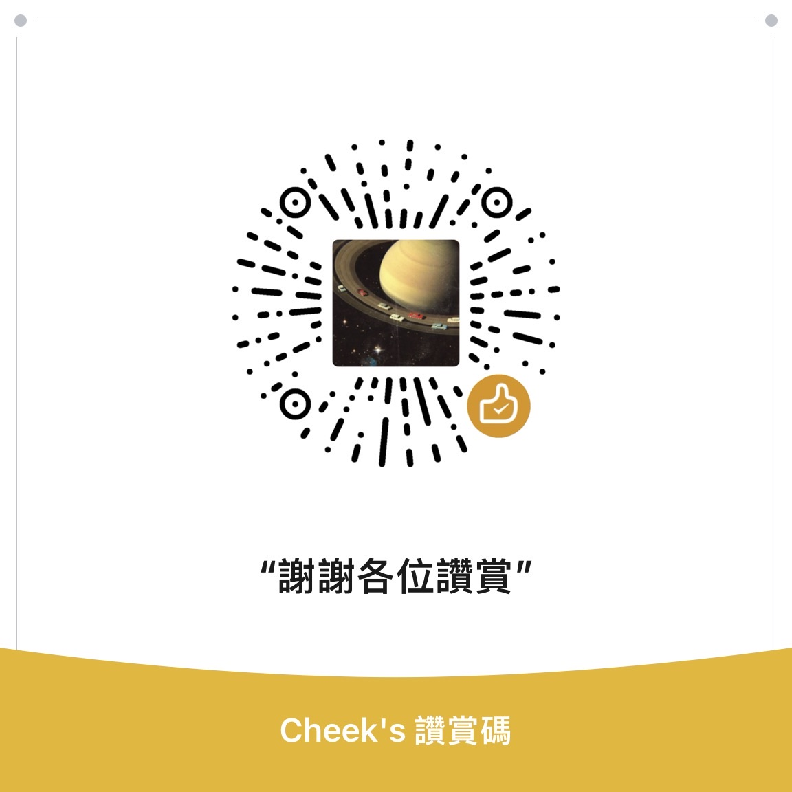<br>
<b>微信赞赏码</b><br>
<sub>微信扫一扫直接赞赏</sub>
</td>
<td width="33%" align="center" valign="top">
<br>
<b>币安支付 (Binance Pay)</b><br>
<sub>币安扫码或转币安 ID：<code>565380652</code>（0 手续费）</sub>
</td>
<td width="33%" align="center" valign="top">
<br>
<b>USDT / USDC（币安 EVM 全链通用）</b><br>
<sub>支持 BSC · ERC20 · Arbitrum · Optimism · Polygon · Base · opBNB</sub>
</td>
</tr>
</table>

> **币安 ID (Binance UID，币安内转账 0 手续费，点击右侧一键复制)：**
> ```text
> 565380652
> ```
>
> **USDT / USDC 链上收款地址（支持币安所有 EVM 网络：`BSC (BEP-20)` · `Ethereum (ERC-20)` · `Arbitrum One` · `Optimism` · `Polygon` · `Base` · `opBNB` · `Avalanche C-Chain` · `zkSync Era` · `Scroll` · `Linea`）：**
> ```text
> 0x35e0c53dd887b37cd5db0064291f7c5a7442bc91
> ```

---

## Star 增长趋势

<div align="center">
<a href="https://star-history.com/#Cd1s/EngineX-OS&Date">
  <picture>
    <source media="(prefers-color-scheme: dark)" srcset="https://api.star-history.com/svg?repos=Cd1s/EngineX-OS&type=Date&theme=dark" />
    <source media="(prefers-color-scheme: light)" srcset="https://api.star-history.com/svg?repos=Cd1s/EngineX-OS&type=Date" />
    
  </picture>
</a>
</div>

---

<div align="center">
<sub>MIT License · EngineX OS 是独立的开源社区项目，与 inMusic Brands / Denon DJ / Numark / Rane 无关。本仓库仅提供开源补丁与工具源码，不分发任何受版权保护的原厂固件文件。</sub>
</div>
