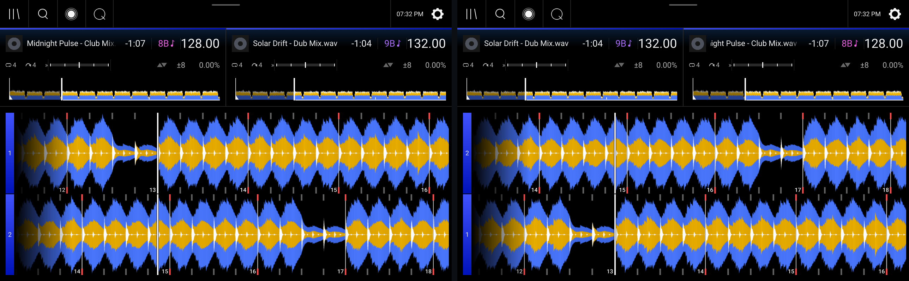
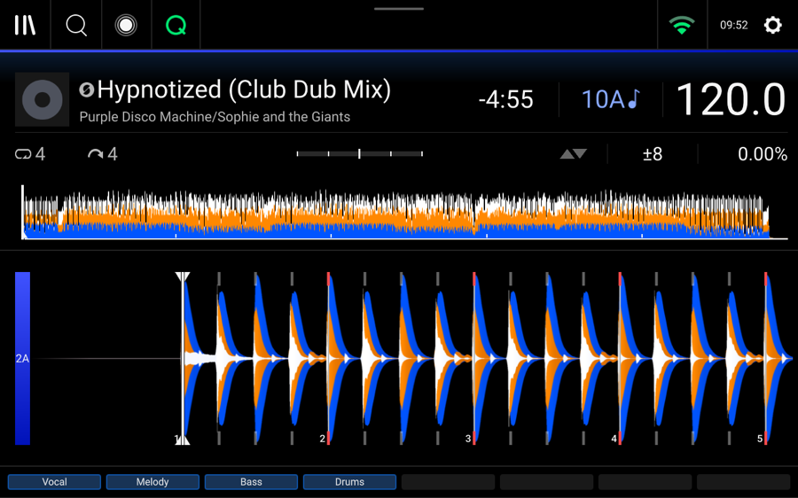
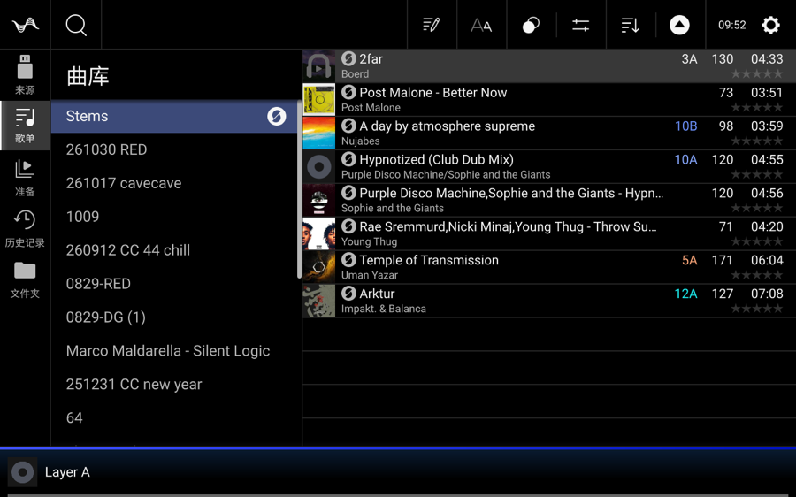
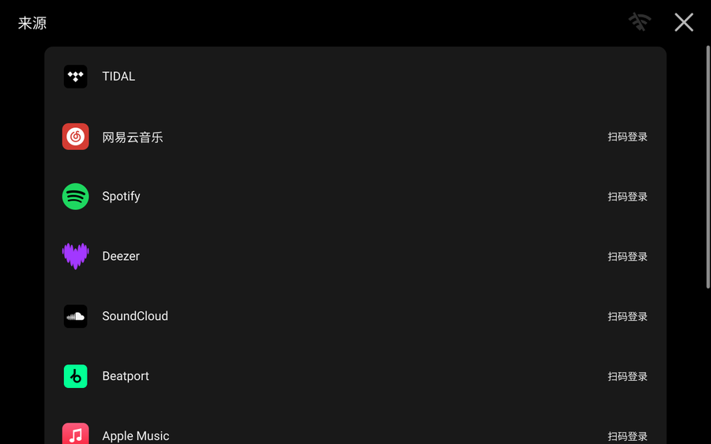
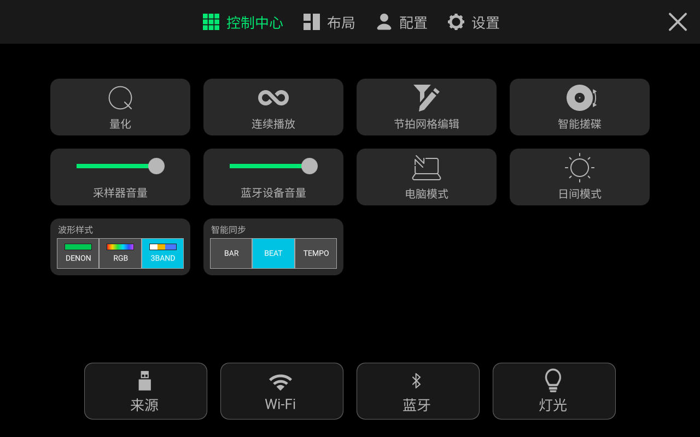
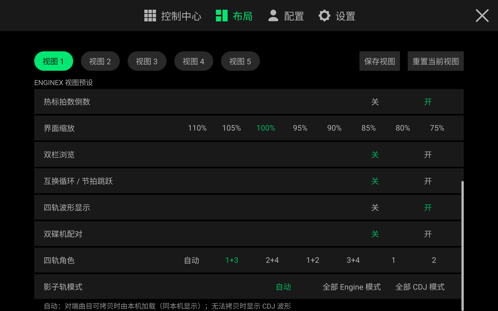
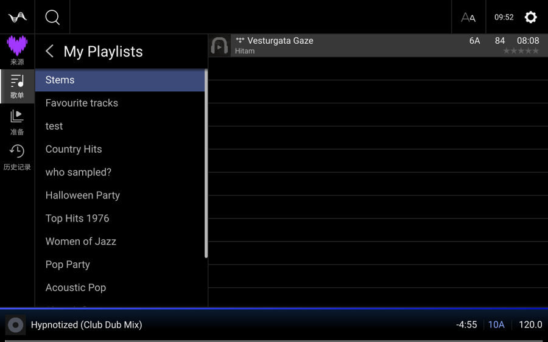
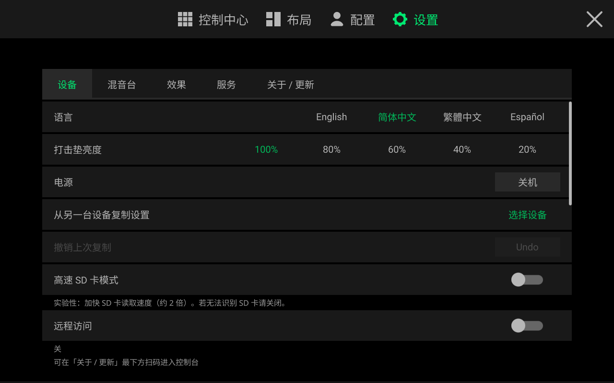
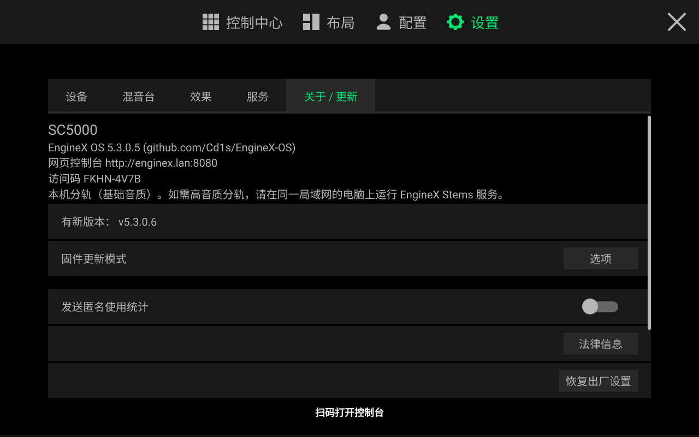
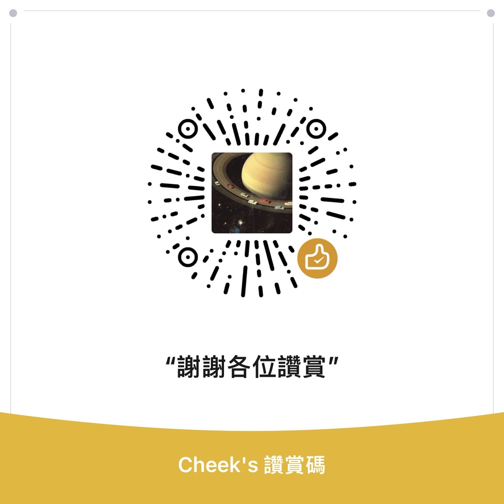

<div align="center">


<br>

<a href="./README.md"></a>
<a href="./README.zh-CN.md"></a>
<a href="./README.zh-TW.md"></a>

<br>

**[核心功能](#features)** · **[下载与安装](#install)** · **[实机画面](#gallery)** · **[性能对比](#benchmarks)** · **[赞赏支持](#sponsor)**

📖 **在线使用文档**：<https://enginexdj.com> · **路线图**：<https://enginexdj.com/#roadmap>

</div>

<br>

**EngineX OS 5.3.0.5** 是基于官方 Engine OS 5.3.0+ 底层重构的定制系统，支持天龙 Denon DJ、Numark 与 Rane 全系 16 款独立设备：

| 世代 | 架构 | 机型（板号） |
| :--- | :--- | :--- |
| 一代机，8 款 | 32 位（ARM） | `SC5000 Prime`（JP07）· `SC5000M Prime`（JP08）· `PRIME GO`（JP11）· `SC6000 Prime`（JP13）· `SC6000M Prime`（JP14）· `PRIME 4`（JC11）· `PRIME 2`（JC16）· `Mixstream Pro`（NH08） |
| 二代机，6 款 | 32 位（ARM） | `PRIME 4+`（JC11S）· `PRIME GO+`（JP11S）· `SC LIVE 2`（JP20）· `SC LIVE 4`（JP21）· `Mixstream Pro Go`（NH10）· `Mixstream Pro+`（NH08S） |
| 二代机，2 款 | 64 位（ARM64） | `PRIME 4 G2`（JP24）· `Rane SYSTEM ONE`（RMZ2） |

全系 16 款机型现统一使用 `*-Update.img` 升级包：前八款一代机直接用 U 盘免电脑刷入；后八款二代机首次连接电脑运行一次 `EngineX-Installer` 自动完成**一键解锁 `.img` 升级链并刷入**，之后即可像一代机一样直接用 U 盘或屏幕一键在线升级（见[如何安装与升级](#install)）。

操作界面与原厂完全一致，安装后即可在熟悉的原厂界面里直接使用以下全部功能。

---

<a id="features"></a>

## 核心功能

### 1. 全机型 4 轨 Stems 实时分轨（人声 / 旋律 / 贝斯 / 鼓组）
- 在本地或流媒体曲目上向左滑即可拆出 **Vocal（人声）、Melody（旋律）、Bass（贝斯）、Drums（鼓组）** 四轨，并自动归入曲库侧边栏 `Stems` 歌单；
- 打碟时直接按打击垫一键静音人声做 Acapella 或单留鼓点过渡；在支持分轨 EQ 的一体机上按各通道 **Shift + Cue (PFL)**（或开启 `配置 → 播放 → 分轨 EQ 模式`），即可用实体 `HIGH / MID / LOW` 旋钮丝滑控制分轨音量；
- 不连电脑即可在碟机本机完成分轨（基础音质）；同一局域网下运行电脑端服务时，自动调用显卡与 `htdemucs` 神经网络模型完成高音质分轨（`PRIME 4 G2` 与 `SYSTEM ONE` 保持官方 Stems 行为）。

### 2. 内置 7 大流媒体音源（手机扫码与一键配对登录）
- 音源菜单直接内置 **TIDAL、网易云音乐、Spotify、Deezer、SoundCloud、Beatport、Apple Music**，与 U 盘、SD 卡并列显示；
- 手机扫描碟机屏幕二维码（或在 Spotify Connect 里点选 **`EngineX OS`**）即可登录账号，直接浏览红心歌单、收藏夹并按 BPM、调性、星级、歌名或歌手排序；
- **支持无损 FLAC 与 320 kbps** 音质切换；播放过的曲目按平台各自独立缓存在碟机内部存储，再次加载直接秒开（网易云开启 `Deemix 优先` 时与 Deezer 共享无损缓存）；
- **Apple Music 原厂解锁与公开/个人歌单导入**：二代机与已解锁 Engine 5.3.0 原生播放 Apple Music；手机扫码即可直接粘贴 Apple Music 公开歌单/专辑链接或登录个人资料库，自动轮转提取 Web 开发者令牌，针对受保护音频通过 ISRC 与歌名精准智能回放，OmniSource 隔离保持 Apple Music 歌单纯净；
- **OmniSource**（`配置 → 曲库 → OmniSource（在流媒体中显示 U 盘/SD）`，默认关闭）支持一次搜索同时查找各流媒体、U 盘 / SD 卡、djay 曲库与网络共享，同时保持各平台自己的歌单页干净不串歌单。

### 3. 先锋 Rekordbox U 盘即插即用与 CDJ 互联
- 给先锋 CDJ 导出的 Rekordbox U 盘直接插上碟机，**2 秒内**读取全部歌单、Hot Cue、Memory Cue、Loop 与拍线（含旧版 rekordbox 5 导出的 U 盘），无需再用电脑端 Engine DJ 重新转换；
- 兼容 `FAT32` / `exFAT` / `NTFS` 与 Mac `HFS+`（`Mac OS 扩展`；不支持 `APFS`，请将 U 盘格式化为 `exFAT` 或 `Mac OS 扩展`），自动补偿 MP3 编码起始延迟让拍线与 Cue 精准落在鼓点上，自动修复异常拔盘造成的数据库损坏并去掉“未安全弹出”弹窗；
- **Pro DJ Link（测试版，位于 `设置 → 服务`）** 支持跨网线 / Wi-Fi 浏览 CDJ 上的 Rekordbox U 盘、向 CDJ 共享本机曲库、双向交接 `MASTER`，并在影子轨或一体机 `线路输入`（`Line In`）通道实时显示 CDJ 波形。

### 4. 四轨联机与双碟机配对视图、5 组保存布局与四语界面
- **`联机视图`（`布局 → ENGINEX 视图预设 → 联机视图`）**：独立播放器可在 `原厂`、`双碟机配对`（同屏显示两条全高波形：本机当前 Layer 在上，另一台碟机当前 Layer 在下）与 `4 轨`（四轨波形同屏，对端轨道作为静音影子轨实时跟随）之间切换，4 轨一体机可在 `原厂` 与 `4 轨` 之间切换；
- **5 组预设布局与界面缩放**：支持保存 `视图 1`–`视图 5` 共五组独立布局，分别记住 `热标拍数倒数`、`界面缩放`（`110%`–`75%`）、带 BPM 显示的 `双栏浏览` 与 `互换循环 / 节拍跳跃`；
- **3 种波形配色与 4 种语言**：全系 16 款支持 **简体中文 / 繁體中文 / English / Español** 免重启切换，并在控制中心或 `配置 → 显示 → 波形样式` 一键切换 `Denon`、`RGB` 与先锋风格 `3-Band` 波形。

### 5. 演出现场音质保护、一体机先锋风格效果与千兆网络
- **21 项实时音频保护**：消除切效果器爆音，内置零延迟 `0dB 防破音软限幅`（峰值压在 -0.1 dBFS 以下）、`自动增益（0 dB 归一化）`、Flanger 音量下沉补偿，以及带混音台一体机上的 `推子回音` / `回声淡出`；
- **一体机先锋风格效果**：`PRIME 4` 硬件效果选择器内置 `Spiral (PX)`、`Pitch Echo (PX)`、`Slip Roll (PX)`、`Dub Echo (PX)`、`Space (PX)`，并有可选的 **10–4000 ms** 独立毫秒延时模式（`先锋效果延时模式 (PX)`）；PRIME 4 / PRIME 2 / PRIME GO / Mixstream Pro 及二代 32 位一体机可在 `配置 → 播放 → 先锋风格效果 (Color FX)` 把其中一种效果放到每个通道的 `FILTER` 旋钮上（旋钮居中时与原厂相同，选 `关` 保持原厂 Sweep FX）；独立播放器不提供 PX 效果，保持纯净播放器链路；
- **智能同步、千兆网口与 `:8080` Web 控制台**：控制中心一键切换 `Bar / Beat / Tempo` 同步并在大 BPM 跨度下自动扩大变速范围，有线网口解锁 **1 Gbps** 满速，`:8080` 网页控制台支持 Wi-Fi 拖拽传歌、丢失曲目一键重定位、Shoutcast / Icecast `直播推流`，以及按需安装的 Mod 插件中心（`tailscale-remote`、`dmx-studio`、`midi-controller-mapper`、`jog-logo-studio`、`sampler-pad-studio`、`minimal-club-mode`）。

---

## 5.3.0.5 更新内容

### 新功能
- **原生 `EngineX-Installer` 与签名更新（#255、#239）**：安装器自己完成镜像准备和 USB 传输，不再需要安装 Python、fastboot、e2fsprogs、libusb 或 WSL。每个 Release 的 `SHA256SUMS.txt` 都有签名（`SHA256SUMS.txt.sig`）；屏幕在线更新和安装器会拒绝无签名、签名错误、被改动或比碟机当前版本旧的发布。5.3.0.4 及更早版本的碟机不做这项检查：请先更新到 5.3.0.5。
- **恢复官方固件**：`Restore-Official-Firmware.bat` / `.command` / `.sh`（或 `enginex-installer --restore-stock`）先清理可能让原厂卡在 Logo 的共享 QML 缓存，再把碟机恢复到原厂 Engine OS 5.3.0。EngineX 现在使用独立的 QML 缓存：**回到原厂前请先启动一次 5.3.0.5，再正常关机。**步骤见下文「恢复官方固件」。
- **蓝牙音箱输出**：在 `设置 → 设备 → 蓝牙`（右侧齿轮）配对音箱，用 `输入分配到` 下新增的 `输出来源` 选择播放内容（独立播放器选 Layer A / B；`PRIME 4` 可选 `主输出`、`监听音箱`、`耳机`、`副区`；`PRIME 2` 与 `Mixstream Pro` 可选 `主输出` / `耳机`；其他机型为 `主输出`）。蓝牙约增加 150–250 ms 延迟：适合监听或第二个房间，不适合打拍对齐。
- **碟机之间复制设置（#205）**：`设置 → 设备 → 从另一台设备复制设置`，来源碟机必须允许，接收碟机确认后才复制。请先暂停播放：Link 导入和撤销会重启 Engine。Player 编号、角色、颜色、身份与账号保留在本机。`Profile → Save to my drive` 现在也保存 EngineX 偏好，原厂 USB 导入提示新增 **包含 EngineX 设置**。
- **USB 配置导入恢复提问**：选择 U 盘时再次出现原厂「是 / 否」选项来决定是否加载其中保存的配置（r5 会自动选 No）。机身菜单的「重启以应用」现在会保存修改后的 Player 编号。
- **分侧 `反转转盘方向`（#213）**：单转盘播放器一个开关，双转盘机型左右各一个，位于 `设置 → 设备` 与 `:8080` 网页控制台；电动转盘机型不显示。
- **所有一体机支持 `推子回音`（#258），电动转盘支持 4 轨布局（#263）**：`推子回音` 在全部 5.3.0 一体机上使用原生逐通道 Transition FX，不再叠加回音或卡顿；`SC5000M` / `SC6000M` 在 `4 Decks` 或 `Paired Player` 下，转盘马达与触摸微调对本机持有的碟位生效。
- **`Mixstream` Sweep FX 与 Stems EQ 打击垫（#261）**：`Mixstream Pro`、`Pro+`、`Pro Go` 的打击垫栏可同时使用 Sweep FX、Stems EQ 与跳拍组。
- **碟机本机 Stems 改为真正的分离（#238）**：不连电脑时，用频谱分离方法拆出人声、贝斯、鼓和旋律，不再只是按频段切分；人声保持原有的立体声位置，只提供 `hpss` 的电脑或中继不再被使用，改由碟机自己分离，`配置 → 曲库` 与 `设置 → 关于 / 更新` 里的 Stems 状态行会写明当前来源；停止进展的 Stems 上传会释放名额，而慢但仍在工作的渲染端保留它的任务（#243）。它不是神经网络，音轨之间仍有串音；想要最干净的分轨请用电脑服务。
- **演出曲目表导出（#268）**：网页控制台的「演出曲目表」卡片可把已记录的演出下载为文本或 CSV，保留播放顺序和重复曲目。
- **rekordbox 配色与尺寸**：`3-Band` 使用 rekordbox / CDJ-3000 配色；rekordbox U 盘曲目的碟机概览与 Engine 自己分析的一样高，之前播放过或导入中断的曲目也一样。
- **`直播推流` 只输出 WAV，按需采集**：控制台只提供固定格式（WAV、16 位、48 kHz、立体声），不再提供 Shoutcast 目标；没人收听时不采集，空闲碟机约省 7% 的单核 CPU。
- **网线与 Wi-Fi 同时连接**：同一网段内同时接网线和 Wi-Fi 时，Engine Link 曲目走网线加载，开机后 Wi-Fi 不再被断开；各网卡的 ARP 设置从开机起生效。
- **Remote Library 封面（#223）**：`SC LIVE 4` 的曲目列表显示 Engine DJ Desktop Remote Library 的封面。
- **可选的 HTTPS 控制台（#242）**：默认仍是 `:8080` 的 HTTP。在网页控制台「碟机显示与音频」卡片打开 `启用控制台 HTTPS (:8443)`，碟机会用首次生成的自签名证书同时提供 HTTPS 控制台。
- **远程加载（局域网 API，#281）**：`设置 → 服务 → 远程加载（局域网 API）`（默认关，只能在碟机上打开）让同一局域网内的电脑或脚本用控制台访问码，把已挂载硬盘上的歌加载到空闲的碟位。正在播放、按住 CUE 预听或搓碟的碟位会被拒绝。
- **PRIME 4 效果选择（#285，PR #287）**：浏览效果时选择窗口保持打开，停止转动 0.6 秒后自动确认，或按下旋钮确认；通道 OLED 显示全部 31 个效果名称。效果选择旋钮与原厂一样，每一格移动一个效果。
- **西班牙语界面（PR #282，感谢 Javier Saenz）**：`设置 → 设备 → 语言` 新增 `Español`，覆盖碟机界面、网页控制台和手机登录页。
- **高速 SD 卡（实验性）**：`设置 → 设备 → 高速 SD 卡模式`（网页控制台「碟机显示与音频」卡片里有同一个开关）默认关闭，在 14 款 RK3288 机型上提供，PRIME 4 G2 / SYSTEM ONE 没有。它把 SD 卡槽从 25 MHz 默认速度（最高 12.5 MB/s）提到 50 MHz 高速（最高 25 MB/s，SC5000 上实测 23 MB/s）。若某张卡无法识别请关闭它。碟机正在播放时改动，会在下次启动或重新插入 SD 卡时生效。
- **全部 16 款机型都能读写 Mac 格式（HFS+）的 U 盘和存储卡**：通过只读检查的盘会以读写方式挂载，Engine 把曲库、Cue 和 Loop 直接存到盘上（一代机用固定的驱动模块，PRIME 4 G2 / SYSTEM ONE 用原厂驱动，二代 32 位机用用户态驱动）。上次没有正常弹出、但检查正常的盘会先标记为干净再读写，其余情况仍是只读。碟机在盘只读时为它建的库，第一次读写挂载时整体复制到盘上，要么全部成功要么不复制。弹出时会等数据全部写完。
- **电脑上的 rekordbox 作为来源，只有一个 `Pro DJ Link` 开关**：`设置 → 服务 → Pro DJ Link` 取代原来的两个开关。开启后每台碟机在 rekordbox 里都是独立的播放器（所以会出现 `LINK`，MASTER 也能交接），在 `Export` 模式运行的 rekordbox 7 会出现在碟机来源列表里，名为 `rekordbox（<电脑名>）`，可浏览全部曲目和歌单（曲名、艺人、BPM、调性）。音频来自共享的音乐文件夹（网页控制台 `曲库、网络与系统 → rekordbox 音乐文件夹`）、已挂载的 SMB / NAS 共享，或电脑自己的 NFS 服务（并行读取）。关掉 LINK 后来源会消失。波形、拍线和 Cue 由 Engine 在加载后自己分析。
- **大型 rekordbox U 盘首次插入很快（#301）**：第一次插入时碟机直接读出导出里的歌单、曲目、热 Cue 和 Memory Cue，几秒内即可使用，拍线和波形随后在后台低优先级补齐，并显示 `正在导入 rekordbox 曲库…` 进度。超出挂载时限的导入不会再被丢弃。大库转换完成后，碟机会在没有碟机再用这个 U 盘、并安静 30 秒后自动发布，不需要重新插入。
- **把 Cue 和 Loop 的修改写回 rekordbox U 盘（#271）**：网页控制台 `扩展` 页的 `写回 Hot Cue / Loop 到 rekordbox U 盘` 会把碟机上的 Hot Cue、Memory Cue 和 Loop 写进盘上的分析文件和 `exportLibrary.db`（先在 `/.enginex-backup/` 备份一次）。
- **每个通道的 `FILTER` 旋钮带 Color FX**：`配置 → 播放 → 先锋风格效果 (Color FX)`（`Spiral`、`Pitch Echo`、`Slip Roll`、`Dub Echo`、`Space`）现在像先锋混音台一样挂在通道自己的滤波旋钮上，旋钮中位与原厂完全一致；`Off` 是原厂 Sweep FX。适用于 PRIME 4、PRIME 2、PRIME GO、Mixstream Pro 以及二代的 SC LIVE 2 / 4、PRIME 4+、PRIME GO+、Mixstream Pro+ / Pro Go（同时修复了部分 PRIME GO 用户听到的持续回声）。
- **Mixstream（#286）**：`设置 → 设备` 新增 `Pitch Bend 按键改为 Beat Jump`（`-` / `+` 前后跳，`Shift` 仍调速度范围）和 `FX 槽位 1–4`（四个实体 FX 键各自选 Echo、Flanger、Delay 或 Phaser）；打击垫栏只保留打击垫和一个 `△` Sweep FX 按钮，`Stems EQ` 在 `配置 → 播放` 里有独立一行。
- **PRIME 4 的 `Jet Flanger (PX)` 与更长的 `Reverb` 尾音（#195、#207）**、`配置 → 显示 → BPM 小数位数` 设为 `2` 时的**整数 BPM 推子平台**，以及**按拍线跳变的热点倒数**（#151）。
- **影子轨**：源碟微调时，另一台碟机的影子轨几帧内就跟上，不再略微超前，循环里也不会冲过。
- **流媒体 Stems**：导入的文件按“艺人 - 标题”命名并写入标签，点的那一行显示原厂的逐首分轨进度，下载不下来的歌会说明，“没有可用的来源磁盘”弹窗不再出现（碟机为此保留自己的私有保存盘）；带 RTX 50 系显卡的电脑上 Stems 也能用。
- **远程访问与二维码**：`设置 → 设备 → 远程访问` 通过 Cloudflare Quick Tunnel 打开网页控制台；“关于 / 更新”里有 `扫码打开控制台` 二维码（优先公开地址，其次隧道，再次局域网；二维码里不含访问码）。网页控制台换了新设计。
- **不依赖内核 CIFS 的 SMB / NAS（#300）**：网页控制台的网络来源在所有机型上用 SMB2/3 和用户名密码登录；**Engine 远程曲库支持按 Date Added 排序（#292）**；官方 Mod **`cpu-ram-monitor`（#296）**在状态栏时钟旁显示 CPU 和内存占用；**一键后端**（`deploy/one-click-backend.sh`）部署中继和 Stems 服务。
- **二代机 SSH 密码（#299）**：在网页控制台设置的 root 密码现在在二代机上有效，重启后仍然有效。

### 修复与改进
- **大容量与慢速 U 盘**：数千首曲目的 Rekordbox 导入在挂载时限内续做 Cue 和封面（#264、#272），FAT32 上的桥接状态保持在 4 GiB 以下，读取很慢的存储卡也会补全概览，旧版导入补全时保留已有曲目与歌单 ID 和碟机上的编辑，导入也不再覆盖 Engine 同时对曲库做的改动。从 Pro DJ Link 播放器暂存的曲库按每个盘限量，对方播放器的盘与原厂一致不提供 Stems（#252）。
- **HFS+ U 盘弹出与更新**：Engine 打开曲库时也能弹出只读 HFS+ U 盘，弹出被拒时会说明原因；Mac 格式 U 盘上的 `*-Update.img` 固件更新会安装所选文件，正常模式与安全模式都一样。
- **影子轨搓碟**：用力搓碟和极快搓碟时，影子轨沿源碟的轨迹平滑跟随。
- **流媒体**：Spotify 载入与 TIDAL 登录载体不再互相干扰（#269），Spotify 收藏夹不再有空白行（#279），Spotify 原生 Ogg 保持 Engine 可识别的文件名（#277），音源设置原子写入（#247），流媒体列表的后续页面加载失败时，已加载的行会保留，并显示一条未完成提示和重试；登录过期仍会提示重新登录（#248）。
- **空闲碟机更省**：开机监视和 30 秒线程巡检大幅减少工作量（#236），网络盘上的 Link / Stems 条件与原厂一致。
- **回到原厂**：原厂不再复用 EngineX 的 QML 缓存，避免它在界面出现前崩溃。
- **Mod 与元数据**：官方 Mod 无需 FFmpeg 即可运行，MP3 / FLAC / WAV / AIFF 元数据读取更准确，OneLibrary 的 Cue 位置不再溢出。
- **音频审计（#237、#245）**：钩子的音频线程函数不做分配内存、加锁、等待或 I/O 调用，由对照块时间预算的测试检查；保存 `直播推流` 设置不再让 `/live.wav` 上的本地听众（如 OBS、VLC）断线。
- **设置开关跟随控制台（#283）**：EngineX 的 13 个开关行全部改用 Engine 原厂的开关行，点按之后仍会跟随网页控制台所做的改动。
- **大型 Rekordbox 曲库（#272、#253）**：分析数据压缩存储，FAT32 上能容纳的曲目多得多；重复插盘时不再为识别你的曲目而重读每个已保存的波形。
- **屏幕在线更新（#215）**：5.3.0.5 的更新器只提供 `*-Update.img`；旧版 `*-Data-Bundle.tar.gz` 仍留在 Release 里，供还在旧版本的碟机使用。
- **内部更名（#234）**：服务单元、程序、`/etc/enginex` 和 `/v1/enginex` 接口统一使用新的 `enginex` 名称；旧的接口别名、数据链接和降级还原已移除。从 5.3.0.2 及更高版本升级时会一次性迁移你的数据。
- **一体机保持原厂视图**：`SHIFT + VIEW` 重新循环切换原厂视图预设（例如 PRIME 4 的竖向波形加曲库），横向波形旁边显示曲库时 `LOAD` 仍可用，`联机视图`只在独立播放器（SC5000 / SC5000M / SC6000 / SC6000M）上提供。
- **另一台碟机加载时正在播放的碟机卡顿（#298，PRIME 4）**：后台调优不再移动 Engine 每路解码、加载线程和中断的位置，保持原厂的安排。
- **HFS+ 安全**：5.3.0.4 会把干净、未启用日志的 HFS+ U 盘以读写方式挂在有内核 bug 的驱动上，可能让碟机崩溃并损坏盘；5.3.0.5 在所有机型上堵上了这个问题。
- **CDJ-3000 联机（#198）**：CDJ-3000 不再提示“已与固件较旧的播放机联机”并会保持联机；每台碟机都是独立的播放器，也不会占用 CDJ 自己的编号。
- **其他修复**：真机控制器上 `Shift + View` 重新可用；Pro DJ Link 导出会跟随插入或拔出的 U 盘；写回 Cue 能看到尚未检查点的修改并回退到 `export.pdb`；蓝牙音箱的 SBC 码率池使用标准高音质值；带多余内容的设置请求会在改动任何东西之前被拒绝；选择 U 盘不会再弹出“复制设置”错误；Mixstream 的层切换与原厂只差几毫秒（#222）；Apple Music 曲库浏览在助手登录或退出后恢复；西班牙语等翻译标签不再溢出。
- **所有碟机都会关闭 Wi-Fi 省电（#309）**：没有原厂 `iw` 工具的碟机（例如 SC LIVE 4）以前会悄悄保持 Wi-Fi 省电；现在碟机开机时自己关掉它（有原厂 `iw` 的机型仍优先用原厂工具）。
- **Apple Music、中继和 rekordbox 的复核修复**：在碟机上退出 Apple Music 后，下载助手仍在登录时也不会自动重新登录；中继把碟机指向另一个助手地址时，不再把旧令牌交给新主机；中继控制台点保存不再丢掉自动探测到的令牌；持有手机登录二维码的人不能再设置助手并推送到中继；两台电脑运行 rekordbox 时，关了 `LINK` 的那台不再遮住另一台的曲库；只属于 Mixstream 的 `Stems EQ` 行只在 Mixstream 机型上创建。
- **登录 Engine DJ 账号不再让流媒体掉线（#304）**：已登录 Engine DJ 账号时，载入流媒体曲目不再弹出“Tidal Disconnected”并让流媒体来源退出登录。
- **碟机顶栏显示你选的流媒体服务（#305）**：从 Deezer、Spotify、Apple Music、网易云、SoundCloud、Beatport 或 rekordbox 播放的曲目，顶栏显示该服务的图标，`Track Info → Source` 显示它的名字，不再是 TIDAL。它跟随当前选中的服务，不是每首曲目各自记录的事实。

### 已知问题
- 许多账号（包括较早的 Premium 账号）播放 Spotify 会失败，提示 “audio key refused”。Spotify 更改了服务器，所有基于 librespot 的客户端都无法获得音频密钥（librespot-org/librespot#1649，2026-11-07 已锁定，目前没有已知的修复）。碟机上没有任何办法能修复它：请改用 TIDAL、Beatport、SoundCloud 或 Deezer。来源菜单里仍保留 Spotify 入口。
- 二代 32 位机（SC LIVE 4、SC LIVE 2、PRIME 4+、PRIME GO+、Mixstream Pro+、Mixstream Pro Go）通过用户态驱动写 HFS+：碟机正在写入时请不要直接拔出 U 盘。
- PRIME 4 G2 / SYSTEM ONE 的数据分区大小（#244）不在本版本。

---

## 5.3.0.4 更新内容

### 新功能
- **二代机全系 8 款统一 `*-Update.img` 与一键解锁刷机**：全系 16 款机型现统一发布单文件 `*-Update.img` 升级包。原厂二代机首次只需进入 `固件更新模式` 连 USB 运行一次 `EngineX-Installer`，自动完成 **[1/2] 一键解锁 `.img` 升级链** 与 **[2/2] 刷入 `*-Update.img`**；解锁后后续升级与一代机完全一致——既可把 `*-Update.img` 放进 U 盘插机升级，也可在屏幕 `设置 → 关于 / 更新` 一键在线 OTA，全程免电脑。
- Spotify 登录、歌单、红心与搜索保留；原生音频暂时停用（Spotify 阻止部分账号的音频密钥解密）。播放依次匹配碟机已登录的 Deezer、网易云、Beatport、Apple Music 或 SoundCloud。用 Spotify Connect 的 **`EngineX OS`** 或碟机二维码登录，无需自建 Client ID。
- **`联机视图` 三合一选择器与 `双碟机配对` 2 轨视图**：`布局 → ENGINEX 视图预设 → 联机视图` 在 `SC5000 / SC6000` 上整合 `原厂` / `双碟机配对` / `4 轨`（4 轨一体机为 `原厂` / `4 轨`），一步即可切回 `原厂` 单/双层视图。`双碟机配对` 为两台联机独立碟机展示上下两条全高波形（上方为本机当前 Layer，下方实时跟随对端碟机当前 Layer），与 `4 轨` 互切无需重启 Engine。
- **`影子轨模式`（`自动` / `全部 Engine 模式` / `全部 CDJ 模式`）免重启实时切换**：默认 `自动` 下，对端 EngineX 碟机或 CDJ U 盘中可拷贝的曲目由本机静音加载，用原厂界面完整绘制波形、拍线、滑行线、移调、循环、`Stems` 图标、绿色 `Sync` BPM 与 `主控 (LEAD)`（加载期间显示曲目信息与进度环）；无法拷贝的 CDJ 音源自动回退显示原厂样式的 CDJ 波形并注明原因。切换模式即时生效，不中断本机播放。
- **一体机 `线路输入`（`Line In`）显示 CDJ-3000 波形**：在 `PRIME 4` 等一体机上把通道输入切到 `Line In`，联机的先锋 CDJ-3000 波形与播放进度会直接显示在该通道上。
- **`PRIME 4` 硬件 `(PX)` 效果器与 `10–4000 ms` 毫秒延时模式**：`PRIME 4` 硬件效果选择器新增 5 款 `(PX)` 效果与独立时间档位控制；一体机 `配置 → 播放 → 先锋效果延时模式 (PX)`（及 `:8080` 控制台）支持为延时类 PX 效果开启独立于 BPM 的 `10–4000 ms` 毫秒延时。
- **`SC LIVE 4` AUX 通道混音与 `Mixstream` 实体滤波 / 跳拍打击垫**：`SC LIVE 4` 可在 `混音台菜单 → 通道 → 输入` 将 `AUX` 送入通道 3 或 4 使用通道推子、EQ、监听与滤波效果并保留 `MIC 2`；`Mixstream Pro / Pro+ / Pro Go` 恢复实体 `FILTER` 旋钮原厂滤波效果、触屏跳拍、`节拍跳跃打击垫` 与 `EQ / 分轨` 切换。
- **电脑端高音质 `htdemucs` Stems 默认开启与内置脚本**：电脑端局域网分轨默认采用高音质 `htdemucs` 模型，碟机 `配置 → 曲库` 与 `设置 → 关于 / 更新` 实时提示连接状态，四个平台的 `EngineX-Installer` 压缩包均内置一键启动脚本。
- **USB MIDI 控制器映射 Mod、脱敏日志下载与免域名公网隧道**：Mod 社区新增 `midi-controller-mapper`（内置 Pioneer CDJ-400 预设直控内部第 3 / 4 轨），`:8080` 控制台新增 `详细日志` 开关与一键脱敏日志下载，`enginex-relay` 新增多碟机在线总览，并支持一键开启 Cloudflare Quick Tunnel 免域名远程扫码登录。

### 修复与调整
- **一体机流媒体曲目双向录音**：带录音功能的一体机现可在加载流媒体曲目时开始录音，录音过程中也能继续加载流媒体曲目 *（流媒体服务条款可能不允许保留其曲目的录音，请仅供个人使用）*。
- **Rekordbox MP3 拍线精准对齐与 rekordbox 5 U 盘兼容**：自动修正 MP3 编码延迟导致的约 26–51 ms 拍线、Hot Cue、Memory Cue 与 Loop 偏移（已导入过的 U 盘再次插入时自动重转受影响的 MP3 一次），并支持旧版 rekordbox 5 导出的 U 盘。
- **官方 Mod `1.1.0` 全机型免 Python 即装即用**：全部 5 款官方 Mod 改用自带的原生辅助程序，彻底解决碟机无 Python 无法启动的问题；支持在 `:8080` 直接上传 `1.1.0` 就地覆盖升级并保留原有设置，修复局域网访问 Mod 中心报错及安装包可执行权限丢失。
- **启动恢复安全网与断电保护**：若开机意外卡住或连续异常退出，碟机会自动回退到原厂 Engine 并隔离外置 Mod（绝不触发恢复出厂设置、绝不清空曲库），插入 U 盘或 SD 卡即可自动导出脱敏诊断报告；异常断电重启后自动清理残留界面缓存。
- **独立碟机 `采样器输出`、四轨操控与影子轨 `Sync` 稳定性**：`SC5000 / SC6000` 在二轨与四轨下均保留 `设置 → 混音台 → 采样器输出`（`Layer A` / `Layer B`）、`碟机编号 #`、`碟机颜色` 双层选色盘、`Layer B` 开关与 `Browse` 按压直载当前层；静音影子轨绝不抢 `MASTER`，支持超过 `+100%` 变速的跨倍速 `Sync` 紧锁，对端关机干净退歌不卡切源，紧凑轨道顶栏数字定宽不晃动。
- **设置项精简、全界面简繁翻译补齐与断电时区记忆**：全机型解锁原厂 `配置 → Cue / Loop → 联动节拍跳跃与 Loop 长度` 且绝不篡改用户开关；`打击垫亮度` 平滑调节彩灯并保持 `SYNC`、`KEYLOCK`、`SLIP` 等单色键原厂亮度；转盘、波形缩放与非主控 `MASTER` 灯恢复原厂手感与暗亮值；独立碟机隐藏先锋风格 PX 效果；移除无效的自动分析盘开关；原厂 `Engine 灯光` 默认关闭，开启或关闭后的选择在重启、断电后保留；补齐设置页全部简繁中文翻译（`Layer A`、`Layer B` 与 `3-Band` 保持英文）；内置中国大陆与全球 NTP 时间池，断电离线开机仍保留已选时区与时钟进度。
- **二代机 Stems 识别与命令行安装器增强**：修复 `SC LIVE 4` 等二代机点 **Generate Stems** 跳回设置页的问题并对齐图形缓存上限；一代机 `.img` 内置定制开机画面并消除首次开机无效 Stems 下载提示；提升命令行 `EngineX-Installer` 对 `SC LIVE 4`、`Mixstream Pro+ / Pro Go`、`PRIME 4+` 及一代机 USB / 局域网的识别率。

> **先锋 CDJ 联机说明**：与先锋 CDJ-3000 的局域网互通（曲库共享、3-Band 波形、播放头跟随与 Master / Beat Sync 双向交接）基于真机 Denon SC5000 与 [**OpenProLink**](https://github.com/Cd1s/OpenProLink) 联调验证，欢迎拥有先锋 CDJ / XDJ / DJM 真机的玩家反馈实测体验！

---

<a id="gallery"></a>

## 实机画面

<table>
<tr>
<td width="50%" align="center" valign="top">
<br>
<b>双机互联四轨同屏与影子波形</b><br>
<sub>本机双层轨道与对端碟机实时同步的静音影子轨四轨波形同屏滚动</sub>
</td>
<td width="50%" align="center" valign="top">
<br>
<b>双碟机配对 2 轨视图（SC5000 / SC6000）</b><br>
<sub>同屏两条全高波形：上方为本机当前 Layer，下方实时跟随对端碟机当前 Layer</sub>
</td>
</tr>
<tr>
<td width="50%" align="center" valign="top">
<br>
<b>原生 4 轨 Stems 分轨与 3-Band 波形</b><br>
<sub>底部显示人声、旋律、贝斯、鼓组四轨状态，打击垫一键静音</sub>
</td>
<td width="50%" align="center" valign="top">
<br>
<b>曲库侧边栏 Stems 专属歌单</b><br>
<sub>所有已分轨曲目自动归类，随时筛选调用</sub>
</td>
</tr>
<tr>
<td width="50%" align="center" valign="top">
<br>
<b>来源页内置 7 大音乐平台</b><br>
<sub>TIDAL · 网易云 · Spotify · Deezer · SoundCloud · Beatport · Apple Music 与 U 盘并列</sub>
</td>
<td width="50%" align="center" valign="top">
<br>
<b>屏幕二维码扫码登录</b><br>
<sub>手机扫一扫直接同步个人歌单，免输密码</sub>
</td>
</tr>
<tr>
<td width="50%" align="center" valign="top">
<br>
<b>下拉控制中心</b><br>
<sub>量化、智能搓碟、波形样式与智能同步一屏直达</sub>
</td>
<td width="50%" align="center" valign="top">
<br>
<b>布局页（视图 1–5 与 EngineX 视图预设）</b><br>
<sub>5 组预设视图、热标拍数倒数、界面缩放、联机视图、四轨角色与影子轨模式</sub>
</td>
</tr>
<tr>
<td width="50%" align="center" valign="top">
<br>
<b>在线歌单 BPM / 调性预览与左滑分轨</b><br>
<sub>加载前即可查看曲目 BPM 与调性，左滑一键拆分 Stems</sub>
</td>
<td width="50%" align="center" valign="top">
<br>
<b>设备设置菜单</b><br>
<sub>切换语言、打击垫亮度、碟机编号 #、时间同步与电源关机</sub>
</td>
</tr>
<tr>
<td width="50%" align="center" valign="top">
<br>
<b>设置 → 关于 / 更新：屏幕一键在线升级</b><br>
<sub>检测到新版本时直接点「更新」即可在线下载升级</sub>
</td>
<td width="50%" align="center" valign="top">
<br>
<b>原生蓝牙音频输入与播放控制</b><br>
<sub>手机蓝牙推流到碟机，屏幕显示曲目信息，可直接播放/暂停与切歌</sub>
</td>
</tr>
</table>

---

<a id="benchmarks"></a>

## 重构前后性能与占用对比（SC5000 实机实测）

系统经过全面精简，所有增强功能仅占极小空间，比原厂固件留出更多可用内存：

| 对比项 | 官方原厂 / 重构前 | 重构后（`EngineX OS 5.3.0.5`，数据为 5.3.0.4 在 SC5000 实测） | 实际打碟提升 |
| :--- | :--- | :--- | :--- |
| **刷机包体积 (`*-Update.img`)** | 官方原厂 5.3.0 `147.79 MB`<br>早期改版 `~210 MB` | **`151.44 MB`**（SC6000 `151.58 MB`，PRIME 4 `151.52 MB`） | **仅比官方原厂大 `3.64 MB`** |
| **纯刷机开机硬盘占用 (`/data`)** | 旧版残留约 `243 MB` | **核心程序 + 三语界面仅占 `17.2 MB`**（含扩展磁盘格式驱动共 `45.6 MB`） | 内置闪存多腾出 **近 `200 MB`** 空间 |
| **整机空闲可用内存（总 `2 GB`）** | `~680 – 780 MB` | **`1,042 MB` 空闲可用**（主程序省出 `~150 MB`，后台服务合计仅占 **`29.2 MB`**） | **多释放 `~260 MB` 内存**，长时间演出不卡顿 |
| **音频核心被后台抢占率** | 下载或导库时偶发占用 `5% – 25%` | **`0.0%`**：所有下载与分轨任务隔离在独立副核，不碰音频核心 | **96 kHz 声音播放全程零断音** |
| **先锋 Rekordbox U 盘读取速度** | 首次转换约 `8 分钟`，重扫 `15–24 秒` | **首次插盘 `< 2 秒`**，再次插盘 **`0.03 秒`** | 插上 U 盘即插即打，无需等待 |
| **4 分钟歌曲 Stems 分轨耗时** | SC5000 原厂锁死不可用 | 经中继服务器（运行 `hpss`，基础音质）约 **`35 秒`**，`htdemucs` 尚未计时；碟机本机分轨在空闲碟机上比播放速度快（SC5000 实测；播放中未实测） | 演出中途临时拆人声也能快速完成 |
| **大 BPM 跨度同步** | BPM 跨度超出变速范围时 Sync 对不上，需手动调大变速范围 | **智能同步**自动升档变速范围（最高 `±100%`），控制中心一键切 Bar / Beat / Tempo | 速度相差很大的两首歌也能直接同步 |
| **网络传输速度** | 有线网口限制在 `100 Mbps` | 有线网口 **`1 Gbps`（1000 Mbps）全双工**；Wi-Fi 实测约 `9～10 MB/s`（受主板总线带宽限制） | 大曲库走千兆有线网口高速传输 |

---

<a id="install"></a>

## 如何安装与升级

### 方式零：全系 16 款命令行安装工具 `EngineX-Installer`（原厂二代机首次必用一次）

`EngineX-Installer` 是跨平台 **命令行工具**（终端程序，非图形窗口软件），支持 Windows、macOS 与 Linux。它无需输入 IP 或手动选择机型，可自动发现同一局域网 / Wi-Fi 或处于 USB 固件更新模式的碟机，下载对应的 `5.3.0.5` `*-Update.img` 升级包、校验 SHA-256 并引导完成安装（二代机自动执行 **[1/2] 一键解锁 `.img` 升级链** + **[2/2] 刷入 `*-Update.img`**）。

- [Windows 10/11 x64](https://github.com/Cd1s/EngineX-OS/releases/latest/download/EngineX-Installer-5.3.0.5-windows-amd64.zip)
- [macOS Apple Silicon M1–M4](https://github.com/Cd1s/EngineX-OS/releases/latest/download/EngineX-Installer-5.3.0.5-macos-arm64.zip)
- [macOS Intel](https://github.com/Cd1s/EngineX-OS/releases/latest/download/EngineX-Installer-5.3.0.5-macos-amd64.zip)
- [Linux x86_64](https://github.com/Cd1s/EngineX-OS/releases/latest/download/EngineX-Installer-5.3.0.5-linux-amd64.tar.gz)

解压后在终端运行 `Install-EngineX.bat`（Windows）、`Install-EngineX.command`（macOS）或 `./install-enginex.sh`（Linux）。局域网安装需碟机已开启 root SSH，可完整保留音乐与设置；**5.3.0.5**：安装器原生构建镜像并通过 USB 传输，无需 Python、fastboot、e2fsprogs、libusb 或 WSL。Windows 在需要时自动配置系统 WinUSB 驱动，Linux 的 USB 访问可能需要 `sudo`。现有 Python／Shell 辅助脚本在本版本保留为手动备用方式，旧版安装器仍需其宿主工具。**请先备份碟机数据**：通过 USB 刷入全新二代机 `/data` 镜像会清空内置 `/data` 分区上的音乐、曲库与设置（刷机前请拔下 U 盘与 SD 卡）。 引导程序无法读取备份，安装器不能先备份；请在碟机正常运行时备份。解锁后请通过 OTA 升级以保留数据。

**Windows USB 驱动配置（5.3.0.5）**：受支持的更新接口需要配置时，请批准管理员授权。只更改该设备与微软现有签名 WinUSB 驱动的绑定及接口注册，不安装额外驱动包、未签名内核驱动，也不开启测试签名模式；驱动已正常工作时无需提权。撤销方法：在设备管理器卸载这个更新设备，再拔插 USB；保留微软驱动包。Rockchip loader 写入仍禁用，请使用 Firmware Update Mode。

**5.3.0.5**：若安装器旁有机型与安装器版本均匹配的 `*-Update.img` 或 `*-Data-Bundle.tar.gz`，会优先使用，不查询 `releases/latest`。同一目录还需放入同一发布版本的 `SHA256SUMS.txt`、`SHA256SUMS.txt.sig` 和 `RELEASE-TAG.txt`；缺少时请补齐这些文件，或移除本地镜像／数据包后查询最新版。

### 方式一：一代机型 —— U 盘免电脑直接刷机
1. 点击下方对应你机器型号的直链下载 `*-Update.img` 固件（或访问 [**Releases 页面**](https://github.com/Cd1s/EngineX-OS/releases/latest)）：
   - **Denon DJ SC5000 Prime**：[`SC5000-5.3.0.5-EngineX-OS-Denon-SC5000-Prime-JP07-Update.img`](https://github.com/Cd1s/EngineX-OS/releases/latest/download/SC5000-5.3.0.5-EngineX-OS-Denon-SC5000-Prime-JP07-Update.img)
   - **Denon DJ SC5000M Prime**：[`SC5000M-5.3.0.5-EngineX-OS-Denon-SC5000M-Prime-JP08-Update.img`](https://github.com/Cd1s/EngineX-OS/releases/latest/download/SC5000M-5.3.0.5-EngineX-OS-Denon-SC5000M-Prime-JP08-Update.img)
   - **Denon DJ SC6000 Prime**：[`SC6000-5.3.0.5-EngineX-OS-Denon-SC6000-Prime-JP13-Update.img`](https://github.com/Cd1s/EngineX-OS/releases/latest/download/SC6000-5.3.0.5-EngineX-OS-Denon-SC6000-Prime-JP13-Update.img)
   - **Denon DJ SC6000M Prime**：[`SC6000M-5.3.0.5-EngineX-OS-Denon-SC6000M-Prime-JP14-Update.img`](https://github.com/Cd1s/EngineX-OS/releases/latest/download/SC6000M-5.3.0.5-EngineX-OS-Denon-SC6000M-Prime-JP14-Update.img)
   - **Denon DJ PRIME 4**：[`PRIME4-5.3.0.5-EngineX-OS-Denon-PRIME-4-JC11-Update.img`](https://github.com/Cd1s/EngineX-OS/releases/latest/download/PRIME4-5.3.0.5-EngineX-OS-Denon-PRIME-4-JC11-Update.img)
   - **Denon DJ PRIME 2**：[`PRIME2-5.3.0.5-EngineX-OS-Denon-PRIME-2-JC16-Update.img`](https://github.com/Cd1s/EngineX-OS/releases/latest/download/PRIME2-5.3.0.5-EngineX-OS-Denon-PRIME-2-JC16-Update.img)
   - **Denon DJ PRIME GO**：[`PRIMEGO-5.3.0.5-EngineX-OS-Denon-PRIME-GO-JP11-Update.img`](https://github.com/Cd1s/EngineX-OS/releases/latest/download/PRIMEGO-5.3.0.5-EngineX-OS-Denon-PRIME-GO-JP11-Update.img)
   - **Numark Mixstream Pro**：[`MIXSTREAMPRO-5.3.0.5-EngineX-OS-Numark-Mixstream-Pro-NH08-Update.img`](https://github.com/Cd1s/EngineX-OS/releases/latest/download/MIXSTREAMPRO-5.3.0.5-EngineX-OS-Numark-Mixstream-Pro-NH08-Update.img)
2. 将 `.img` 文件保持原名放入 **FAT32 或 exFAT 格式 U 盘的根目录**。
3. 将 U 盘插入碟机（原厂 Engine OS 4.3.x 与 5.0.x+ 均可直接刷入），打开 **设置 → 关于 / 更新 → 固件更新模式 → 选项**，看到 `Found 5.3.0.5 on USB/SD` 时选择 **USB/SD**，机器会自动刷入并重启。若只弹出 *Reboot into firmware update mode?*，请核对型号、确认文件未改名且位于根目录后重新插拔 U 盘。

### 方式一 b：二代机型 —— 首次一键解锁 + 统一 `*-Update.img` 升级

二代机（**SC LIVE 4、SC LIVE 2、PRIME 4+、PRIME GO+、Mixstream Pro+、Mixstream Pro Go、PRIME 4 G2、Rane SYSTEM ONE**）没有硬件熔断锁，原厂状态下由软件层校验固件签名（未解锁的原厂机直接刷改版 `.img` 只会在校验阶段退回，不会写入闪存或变砖）。请先将碟机升至官方 **Engine OS 5.3.0**，再按以下两阶段安装与升级：

1. **原厂二代机首次安装（运行一次 `EngineX-Installer` 一键解锁）**：
   - 解压上方 **`EngineX-Installer`**，在终端运行 `Install-EngineX.bat`（Windows）、`Install-EngineX.command`（macOS）或 `./install-enginex.sh`（Linux）。
   - 在原厂碟机屏幕打开 **设置 → 关于 / 更新 → 固件更新模式 → 选项** 进入 USB 更新模式并连上 USB 线——安装器会自动执行 **[1/2] 一键解锁 `.img` 升级链** 与 **[2/2] 刷入 `*-Update.img`**（仅写入 `/data/enginex`，不改只读系统分区；旧版脚本式 Windows 安装器请用 `usbipd-win` 将 USB 直通给 WSL 2 并以 `wsl -u root` 运行 Linux 版安装器；`PRIME 4 G2` 与 `SYSTEM ONE` 写入完成后按电源键关机再开机即可激活；若碟机已开 root SSH，同局域网即可无损安装且不清空 `/data`）。
2. **此后每次更新（U 盘直刷或屏幕一键 OTA，无需电脑）**：
   - 完成首次解锁后（此前已安装过 EngineX 的二代机开机时也会自动解锁），二代机的升级方式与一代机完全一样：将下方对应机型的 `*-Update.img` 保持原名放入 **FAT32 或 exFAT U 盘根目录** 在碟机屏幕升级（**设置 → 关于 / 更新 → 固件更新模式 → 选项 → USB/SD**），或直接点 **设置 → 关于 / 更新 → 更新** 一键在线 OTA！
   - **Denon DJ SC LIVE 4**：[`SCLIVE4-5.3.0.5-EngineX-OS-Denon-SC-LIVE-4-JP21-Update.img`](https://github.com/Cd1s/EngineX-OS/releases/latest/download/SCLIVE4-5.3.0.5-EngineX-OS-Denon-SC-LIVE-4-JP21-Update.img)
   - **Denon DJ SC LIVE 2**：[`SCLIVE2-5.3.0.5-EngineX-OS-Denon-SC-LIVE-2-JP20-Update.img`](https://github.com/Cd1s/EngineX-OS/releases/latest/download/SCLIVE2-5.3.0.5-EngineX-OS-Denon-SC-LIVE-2-JP20-Update.img)
   - **Denon DJ PRIME 4+**：[`PRIME4PLUS-5.3.0.5-EngineX-OS-Denon-PRIME-4-Plus-JC11S-Update.img`](https://github.com/Cd1s/EngineX-OS/releases/latest/download/PRIME4PLUS-5.3.0.5-EngineX-OS-Denon-PRIME-4-Plus-JC11S-Update.img)
   - **Denon DJ PRIME GO+**：[`PRIMEGOPLUS-5.3.0.5-EngineX-OS-Denon-PRIME-GO-Plus-JP11S-Update.img`](https://github.com/Cd1s/EngineX-OS/releases/latest/download/PRIMEGOPLUS-5.3.0.5-EngineX-OS-Denon-PRIME-GO-Plus-JP11S-Update.img)
   - **Numark Mixstream Pro+**：[`MIXSTREAMPROPLUS-5.3.0.5-EngineX-OS-Numark-Mixstream-Pro-Plus-NH08S-Update.img`](https://github.com/Cd1s/EngineX-OS/releases/latest/download/MIXSTREAMPROPLUS-5.3.0.5-EngineX-OS-Numark-Mixstream-Pro-Plus-NH08S-Update.img)
   - **Numark Mixstream Pro Go**：[`MIXSTREAMPROGO-5.3.0.5-EngineX-OS-Numark-Mixstream-Pro-Go-NH10-Update.img`](https://github.com/Cd1s/EngineX-OS/releases/latest/download/MIXSTREAMPROGO-5.3.0.5-EngineX-OS-Numark-Mixstream-Pro-Go-NH10-Update.img)
   - **Denon DJ PRIME 4 G2**：[`PRIME4G2-5.3.0.5-EngineX-OS-Denon-PRIME-4-G2-JP24-Update.img`](https://github.com/Cd1s/EngineX-OS/releases/latest/download/PRIME4G2-5.3.0.5-EngineX-OS-Denon-PRIME-4-G2-JP24-Update.img)
   - **Rane SYSTEM ONE**：[`SYSTEMONE-5.3.0.5-EngineX-OS-Rane-SYSTEM-ONE-RMZ2-Update.img`](https://github.com/Cd1s/EngineX-OS/releases/latest/download/SYSTEMONE-5.3.0.5-EngineX-OS-Rane-SYSTEM-ONE-RMZ2-Update.img)

### 恢复官方固件（5.3.0.5）

从 [Releases](https://github.com/Cd1s/EngineX-OS/releases/latest) 下载电脑对应的安装器。链接格式为 `https://github.com/Cd1s/EngineX-OS/releases/latest/download/EngineX-Installer-<VERSION>-<platform>.zip`（`linux-amd64` 使用 `.tar.gz`；ZIP 平台为 `windows-amd64`、`macos-amd64`、`macos-arm64`）。

1. 先备份数据，让碟机正常启动 EngineX 并连接电脑所在的局域网，先关闭其他碟机。Windows 运行 `Restore-Official-Firmware.bat`，macOS 运行 `.command`，Linux 运行 `.sh`（USB 权限不足时用 `sudo`）。等效命令是 `enginex-installer --restore-stock`。
2. 一代机先确认清理共享 QML 缓存。工具停止 Engine，只删除它的共享 QML 缓存，执行同步并正常关机，保留音乐与曲库，避免 r5 旧缓存导致官方固件卡在 Logo。二代机则使用现有的局域网 SSH 卸载流程，不刷写固件。
3. 拔下含更新文件的存储设备。SC5000／SC5000M／SC6000／SC6000M 按住 **MEDIA EJECT + SOURCE + LAYER** 再开机，看到 **Computer Update** 或芯片图标后松开，连接 USB 线。其他一代机请按[官方更新说明](https://support.enginedj.com/support/solutions/articles/69000797882)操作。
4. 确认恢复官方 5.3.0 后保持供电与 USB 连接，直至刷写及重启完成。一代机镜像直接从 Engine DJ 官方地址下载，也可从 [Engine DJ Downloads](https://enginedj.com/downloads) 下载对应机型的官方 5.3.0 文件，以 `--image "官方镜像路径.img"` 指定。工具检查 AZ01 机型、完整性及固定的官方 SHA-256，拒绝改名的 EngineX 或修改过的镜像；安装包不包含官方固件。

如果已经刷回官方固件且卡在 Logo、无法连接 SSH，请先用普通安装器刷入 EngineX 并让它正常启动，再运行恢复工具。刷官方固件会保留 `/data`，重复刷写本身不会清除旧 QML 缓存。

<details>
<summary>二代机终端手动安装与卸载恢复原厂</summary>

- **在已解锁 / 已开启 root SSH 的碟机终端内手动安装 `*-Update.img`（完整保留音乐、曲库与设置）**：
  ```sh
  sh /data/enginex/bundle/install.sh "/media/<U 盘名>/<MODEL>-5.3.0.5-EngineX-OS-<Model>-Update.img"
  reboot
  ```
- **卸载恢复原厂**：在 `:8080` Web 控制台点击 **「卸载恢复原厂」**，或同局域网运行 `EngineX-Installer --uninstall`，或在碟机终端执行 `sh /data/enginex/bundle/uninstall.sh && reboot`（仅移除 `/data/enginex` 与启动钩子，保留曲库与设置）。

</details>

> **PRIME 4 G2 / Rane SYSTEM ONE（64 位机型）**：已包含四语界面、7 大流媒体服务（含通过 enginex-amd 下载 Apple Music、Spotify、Deezer、SoundCloud、Beatport、TIDAL、网易云）、流媒体录音、实时音质保护（`0dB 防破音软限幅`、`自动增益`、`回声淡出`、`先锋风格效果 (Color FX)`、`先锋效果延时模式 (PX)`）、Rekordbox U 盘直读与 `:8080` Web 控制台全部能力；Stems 保持官方固件行为。

### 方式二：碟机屏幕一键在线升级（已安装 EngineX OS 后）
- 连接 Wi-Fi 或网线后打开 **设置 → 关于 / 更新**；
- 点击屏幕上的 **「更新」** 按钮——全系 16 款一代与二代机型均会自动下载、校验并安装 `5.3.0.5`，完整保留曲库、流媒体账号、预设视图与已装 Mod（GitHub Release 中最后一次附带 `*-Data-Bundle.tar.gz` 兼容包，使旧版 `5.3.0.2` / `5.3.0.3` 二代机仍能直接在屏幕上一键 OTA 升级并在开机后自动解锁 `.img` 直刷；`5.3.0.6` 起退役，#215）。

### 选配：用电脑开启高音质 `htdemucs` AI 分轨
> **5.3.0.5 — 碟机本机 Stems（#238）：** 不连电脑时，碟机改用频谱分离方法拆出人声、贝斯、鼓和旋律，不再按频段切分。它不是神经网络，各轨之间仍会有串音。实测：空闲的 SC5000 上 60 秒音乐需 16.5–17.0 秒运算（人声改为立体声之前）；这项改动在编译机的 armhf 核上多用约 6%（同一段音频 2.50 秒 → 2.65 秒），尚未在碟机上重测。碟机播放时只能用空闲的处理器时间，这种情况没有实测，耗时会更长。想要最干净的分轨，请使用下面的电脑端服务。5.3.0.5 起，电脑或中继只提供 `hpss` 时不再使用它：碟机自己的分离在我们的测试里得分更高，所以改由碟机本机分轨，状态行会写明（`本机分轨（基础音质）：<主机名> 只提供 hpss，不会使用。`）。5.3.0.4 会使用 `hpss` 服务并把它显示成 `高音质分轨`。

一代机型的 Stems 有三种来源，碟机会在 **配置 → 曲库** 与 **设置 → 关于 / 更新** 写明当前用的是哪一种（`PRIME 4 G2` 与 `SYSTEM ONE` 使用官方 Stems）：

- **碟机本机分轨（基础音质）**：不需要电脑。不是神经网络，各轨之间会有串音。
- **电脑分轨 `hpss`（基础音质）**：电脑端服务没有神经网络模型时的模式（启动时加了 `hpss`，或没有装上 PyTorch / Demucs）。它是频谱近似算法，不是神经网络。
- **电脑分轨 `htdemucs`（高音质，推荐）**：神经网络模型，想要真正的分离请用它。建议使用显卡（NVIDIA CUDA 或 Apple Silicon）；没有显卡时用 CPU 运行，耗时更长。

如需高音质模式（默认自动启用 `htdemucs`，支持显卡 / Apple Silicon MPS / CPU），在与碟机同一 Wi-Fi / 局域网的电脑上解压 `EngineX-Installer` 后，macOS 可直接双击 `stems/run-home-worker.command`，或在终端运行一条命令（末尾加 `hpss` 可切换免 PyTorch 轻量模式）。碟机会自动发现电脑（无需输入 IP 或密码），并在 **配置 → 曲库** 与 **设置 → 关于 / 更新** 显示 `高音质分轨：<主机名> (htdemucs)`：
```sh
# macOS（双击 stems/run-home-worker.command，或在终端运行）/ Linux
./stems/run-home-worker.sh

# Windows PowerShell（在解压后的 EngineX-Installer 目录内）
powershell -ExecutionPolicy Bypass -File .\stems\run-home-worker.ps1
```

### 流媒体扫码登录指南
无需电脑或服务器，手机与碟机连同一 Wi-Fi，在碟机 **来源** 菜单点开平台扫码即可：

| 平台 | 登录方式 |
| --- | --- |
| **网易云音乐** | 用网易云音乐 App 扫屏幕二维码并确认（过期点一下刷新）；在 `设置 → 服务 → 网易云下载方式` 提供 `官方直下` 与 `Deemix 优先` 切换。 |
| **Spotify** | Spotify 登录、歌单、红心与搜索保留；原生音频暂时停用（Spotify 阻止部分账号的音频密钥解密）。播放依次匹配碟机已登录的 Deezer、网易云、Beatport、Apple Music 或 SoundCloud。用 Spotify Connect 的 **`EngineX OS`** 或碟机二维码登录，无需自建 Client ID。 |
| **Deezer** | 扫码后在手机页粘贴你自己的 **ARL**（页面附分步教程），同步歌单并解锁无损 FLAC 下载。 |
| **SoundCloud** | 输入用户名或主页链接即可（私密歌单在「高级」填入 `oauth_token`）。超过 10 分钟的 DJ Set 与已绑 Go+ 账号直连官方高音质流；未绑 Go+ 时普通单曲自动在已登录的 Deezer / 网易云 / Beatport / Apple Music 匹配无损 / 320k 音频，避开 30 秒试听限制。 |
| **Apple Music** | Apple Music 使用 **`enginex-amd`** 下载助手，将无损 ALAC 转为 FLAC 并缓存在碟机。助手无需 Docker，可在 macOS、Windows、Linux 运行，Gen-2 也可在本机运行。先在 `:8080` Web 控制台设置助手 URL／令牌，再通过碟机统一局域网手机页 `/m/applemusic` 或控制台完成 Apple ID／密码和六位 2FA 登录；也可打开助手登录页／二维码。歌单／专辑链接、MusicKit JS 与 `media-user-token` 表单用于浏览歌单和资料库，助手登录用于音频下载。`设置 → 服务 → 流媒体` 开关控制 EngineX Apple Music；原厂同名行隐藏，避免重复入口。 |
| **TIDAL 与 Beatport** | 扫屏幕二维码登录个人账号即可（Beatport 仅保存登录令牌，曲目同样支持一键拆 Stems）。 |

> **Spotify 音源（5.3.0.5）**：在 Web 控制台的「音乐」分区选择 `auto`、Deezer、网易云、Beatport、Apple Music 或 SoundCloud。自动模式按此顺序尝试；指定音源时只使用所选服务。已有缓存可继续播放。

### 选配：远程登录中继与免域名公网隧道
当手机使用 4G/5G 流量扫码登录，或需要集中查看多台碟机状态时：
1. **碟机端免域名一键穿透**：打开 `http://<碟机 IP>:8080` 点击 **「开启免域名公网隧道 (Cloudflare Quick Tunnel)」**，数秒内生成 `https://*.trycloudflare.com` 公网地址供手机远程访问与流媒体扫码回调。
2. **一键部署 `enginex-relay` 后端（5.3.0.5）**：在 Debian 12+ / Ubuntu 24.04+（amd64 或 arm64）的 EngineX 源码目录执行 `sudo bash deploy/one-click-backend.sh`，自动安装并启动 `enginex-relay.service` 和 HPSS Stems 服务；重复执行会保留现有地址、密码及分轨令牌。已有反向代理时加 `--public https://你的域名`；全新安装未指定时自动开启 Quick Tunnel。打开 `http://<后端 IP>:6595`，首次安装在本机执行 `sudo cat /var/lib/enginex-relay/initial-password` 查看初始密码，登录并修改；升级保留原密码。[后端说明](deploy/relay-host/README.md)。
3. **连接刷好的碟机**：正常启动并接入同一局域网，运行 `enginex-installer --setup-backend`（Windows：`enginex-installer.exe --setup-backend`），依次输入碟机地址、屏幕 **设置 → 关于 / 更新** 显示的控制台访问码，以及后端地址和密码；也可直接在 `http://<碟机 IP>:8080` 填写。流媒体账号通过碟机屏幕上的二维码登录；局域网手机登录无需中继。
4. **同一后端提供 Stems 与 Apple Music**：Stems 使用相同的中继地址和密码。如果 `/opt/enginex-amd` 与 `/opt/wrapper-lite` 已有 Apple Music 助手文件，脚本也会启动它们；中继会自动检测其局域网地址和令牌并同步到碟机；若碟机无法访问检测到的地址，请在中继控制台填写可达的 HTTPS 助手地址。**PRIME 4 G2 / SYSTEM ONE（64 位二代机）**可原生登录 Apple Music，无需外部后端；其他机型可使用助手，需有效 Apple Music 订阅。

---

## 演出现场公共网络安全防护

- **无默认 SSH 密码、公开固件零内置密钥**：密码登录彻底关闭，公开包不内置任何人的 SSH 公钥，未手动添加公钥前 SSH 完全关闭。
- **内部控制接口仅限本机调用**：切歌、切波形、切语言、在线升级与分轨接口仅响应碟机本机请求，同 Wi-Fi 的其他人无法远程操控你的碟机。
- **每台机器独有的 8 位访问码**：打开 `http://<碟机 IP>:8080` 必须输入碟机 `设置 → 关于 / 更新` 显示的随机访问码 `XXXX-XXXX`（连续输错 5 次自动临时锁定）；流媒体二维码仅用于对应平台登录，绝不开放控制台权限。
- **可选控制台 HTTPS（`:8443`，默认保持 HTTP）**：在控制台设置中开启 **启用控制台 HTTPS (`:8443`)** 后，碟机将首次生成自签名证书并保存于 `/data/enginex/`（权限 `0600`，SAN 覆盖碟机 IP 与主机名，重启复用），并在 `:8443` 同步提供 HTTPS 控制台。原有 `:8080` HTTP 保持不变，控制台二维码与屏幕链接仅在开启时提供 `https://`。

参与开发与源码构建说明见 [`CONTRIBUTING.md`](./CONTRIBUTING.md)。

---

<a id="sponsor"></a>

## 赞赏与支持

如果 **EngineX OS** 让你的碟机更好用、在演出或练歌时帮到了你，欢迎赞赏支持或给项目点个 **Star**！

<table>
<tr>
<td width="33%" align="center" valign="top">
<br>
<b>微信赞赏码</b><br>
<sub>微信扫一扫直接赞赏</sub>
</td>
<td width="33%" align="center" valign="top">
<br>
<b>币安支付 (Binance Pay)</b><br>
<sub>币安扫码或转币安 ID：<code>565380652</code>（0 手续费）</sub>
</td>
<td width="33%" align="center" valign="top">
<br>
<b>USDT / USDC（币安 EVM 全链通用）</b><br>
<sub>支持 BSC · ERC20 · Arbitrum · Optimism · Polygon · Base · opBNB</sub>
</td>
</tr>
</table>

> **币安 ID (Binance UID，币安内转账 0 手续费，点击右侧一键复制)：**
> ```text
> 565380652
> ```
>
> **USDT / USDC 链上收款地址（支持币安所有 EVM 网络：`BSC (BEP-20)` · `Ethereum (ERC-20)` · `Arbitrum One` · `Optimism` · `Polygon` · `Base` · `opBNB` · `Avalanche C-Chain` · `zkSync Era` · `Scroll` · `Linea`）：**
> ```text
> 0x35e0c53dd887b37cd5db0064291f7c5a7442bc91
> ```

---

## Star 增长趋势

<div align="center">
<a href="https://star-history.com/#Cd1s/EngineX-OS&Date">
  <picture>
    <source media="(prefers-color-scheme: dark)" srcset="https://api.star-history.com/svg?repos=Cd1s/EngineX-OS&type=Date&theme=dark" />
    <source media="(prefers-color-scheme: light)" srcset="https://api.star-history.com/svg?repos=Cd1s/EngineX-OS&type=Date" />
    
  </picture>
</a>
</div>

---

<div align="center">
<sub>MIT License · EngineX OS 是独立的开源社区项目，与 inMusic Brands / Denon DJ / Numark / Rane 无关。本仓库仅提供开源补丁与工具源码，不分发任何受版权保护的原厂固件文件。</sub>
</div>
