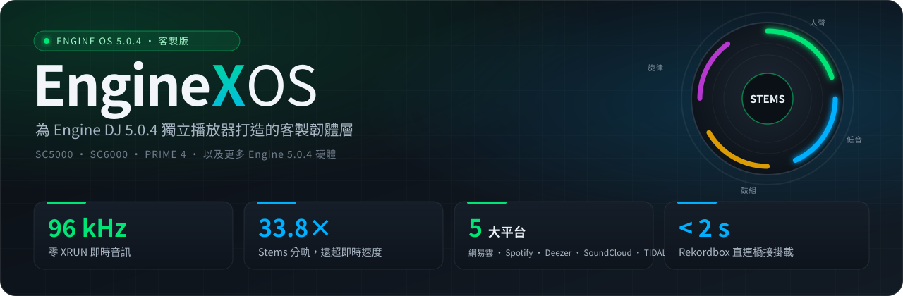
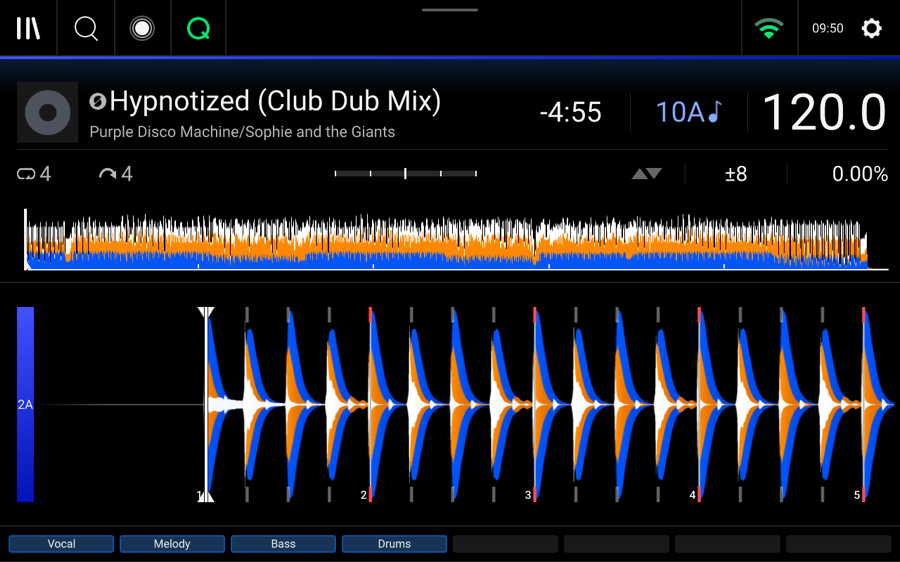
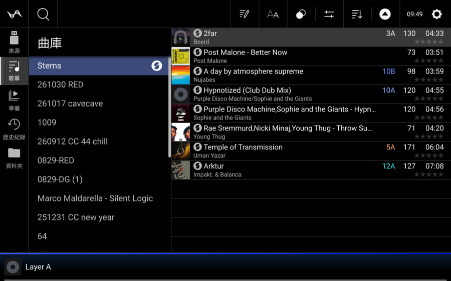
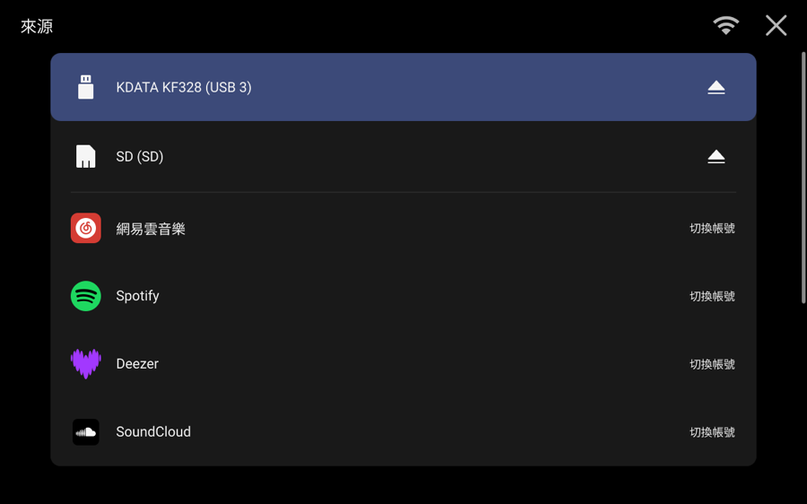
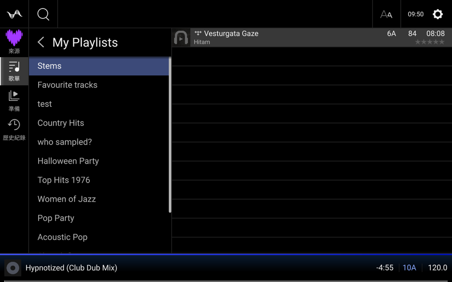
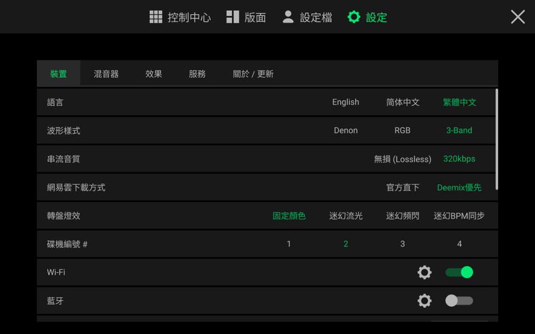
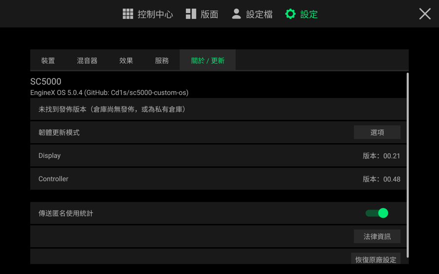
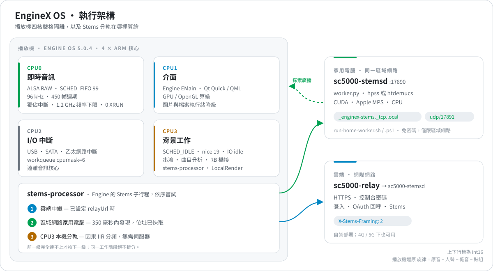

<div align="center">



<br>

<a href="./README.md"></a> <a href="./README.zh-CN.md"></a> <a href="./README.zh-TW.md"></a>

<br>


<br>


<br>

**[實機截圖](#gallery)** · **[系統架構](#architecture)** · **[Stems 分軌](#stems)** · **[效能對比](#benchmarks)** · **[快速上手](#quick-start)** · **[技術深潛](#deep-dive)** · **[完整技術清單](./docs/OPEN-SOURCE-FULL-MANIFEST.md)**

</div>

<br>

**EngineX OS**（`Cd1s/EngineX-OS`）是為天龍 Denon DJ **Engine OS 5.0.4** 獨立播放機打造的開源客製韌體層與後端套件，支援 `SC5000`、`SC5000M`、`SC6000`、`SC6000M`、`PRIME 4`、`PRIME GO` 與 `SC LIVE 2`。

> **介面原汁原味，底層脫胎換骨。**
> DJ 走上台看到的就是原廠介面與原廠手感，沒有新的彈窗要學。底層那些拖慢機器的慢速匯入、SQLite 同步寫入卡頓、快閃記憶體遙測、CPU 降頻與機型功能鎖，已由記憶體中的 C 掛鉤與彼此隔離的 Go 服務取代。rootfs 與磁碟上的 Engine 二進位檔從不改動，一個檔案就能回到原廠介面。

<table>
<tr>
<td width="33%" valign="top">

**🎛 全機型 Stems 分軌**<br>
<sub>在 SC5000 上解鎖原生 Stems 播放、第 0 列 Stems 播放清單與底部分軌列。隨身碟與串流曲目都能分軌：雲端、家用電腦或播放機本機任選。</sub>

</td>
<td width="33%" valign="top">

**🌐 五大串流平台**<br>
<sub>網易雲音樂、Spotify、Deezer、SoundCloud 與 TIDAL 進入原廠音源頁，手機掃碼登入，音訊直接存入播放機。</sub>

</td>
<td width="33%" valign="top">

**📀 Rekordbox 隨身碟秒讀**<br>
<sub>插入已匯出的 PDB / OneLibrary 隨身碟，掛載時即轉換為 Engine 曲庫：拍線、Cue、Loop、波形全部保留，無需重新分析音訊。</sub>

</td>
</tr>
<tr>
<td valign="top">

**🔊 即時音訊隔離**<br>
<sub>CPU0 獨佔 ALSA 中斷（FIFO 99），頻率下限 1.2 GHz，背景執行緒全部移到 CPU3（SCHED_IDLE）：96 kHz 下實測零 XRUN。</sub>

</td>
<td valign="top">

**🩺 資料庫自我修復**<br>
<sub>Engine 開啟隨身碟之前，先修好斷裂的播放清單鏈結、透明 Cue、過大的封面與膨脹的歷史資料庫。</sub>

</td>
<td valign="top">

**🌏 三語介面，隨心配色**<br>
<sub>English、简体中文、繁體中文介面；Denon、RGB、3-Band 波形；轉盤燈效；GitHub 更新檢查。</sub>

</td>
</tr>
</table>

<a id="gallery"></a>

## 📸 實機截圖

<sub>在 SC5000（`JP07`）實機上透過 KMS 以 `tools/drmgrab` 擷取。</sub>

<table>
<tr>
<td width="50%" align="center">
<br>
<b>原生 4 軌 Stems 播放</b><br>
<sub>原廠播放機畫面、3-Band 波形與官方 <code>Vocal · Melody · Bass · Drums</code> 分軌列</sub>
</td>
<td width="50%" align="center">
<br>
<b>曲庫中的原生 Stems 播放清單</b><br>
<sub>在 <code>0x6d3e00</code> 解鎖的第 0 列 <code>Stems</code> 播放清單（<code>typeRole = 5</code>）</sub>
</td>
</tr>
<tr>
<td align="center">
<br>
<b>音源頁整合五大平台</b><br>
<sub>網易雲 · Spotify · Deezer · SoundCloud · TIDAL 與隨身碟、SD 卡並列</sub>
</td>
<td align="center">
<br>
<b>播放機螢幕掃碼登入</b><br>
<sub>同一 Wi-Fi 下直接掃碼，或透過自架中繼在 4G / 5G 下掃碼</sub>
</td>
</tr>
<tr>
<td align="center">
<br>
<b>串流播放清單</b><br>
<sub>每個平台獨立的 Stems 播放清單、BPM / 調性預覽欄、左滑一鍵分軌</sub>
</td>
<td align="center">
<br>
<b>裝置設定</b><br>
<sub>語言、波形樣式、串流音質、網易雲下載方式、轉盤燈效、藍牙</sub>
</td>
</tr>
</table>

<div align="center">
<br>
<b>關於 / 更新：檢查 GitHub 發佈</b><br>
<sub>以 <code>Cd1s/EngineX-OS</code>（或你的 fork）的 Releases 取代天龍官方更新伺服器</sub>
</div>

<a id="architecture"></a>

## 🧭 系統架構

<div align="center">

</div>

播放機的四個核心各司其職。**CPU0** 只服務 ALSA 音訊中斷（`SCHED_FIFO 99`）。**CPU1** 執行 Engine 介面與 GPU 算繪。**CPU2** 承接 USB、SATA 與乙太網路中斷。**CPU3** 負責一切可以等待的工作：曲目分析、串流下載、Rekordbox 橋接與 Stems 分軌，全部以 `SCHED_IDLE` 與閒置 I/O 優先順序執行。

<a id="stems"></a>

## 🎛 三級 Stems 算力

`stems-processor` 取代 Engine 原廠的 Stems 子行程，依序嘗試三級算力。只有前一級完全連不上時才換下一級，所以同一次分軌絕不會被拆到兩台機器上。

| | 層級 | 何時使用 | 運作方式 | 速度（4 分鐘曲目） |
| :-: | :-- | :-- | :-- | :-- |
| **1** | **☁️ 雲端中繼** | 在播放機控制台設定了 `relayUrl` | `X-Stems-Framing: 2`：上下行皆為 int16，只回傳三軌；播放機以 原音 − 人聲 − 低音 − 鼓組 還原旋律 | Wi-Fi 下 **35.1 秒**（6.8 倍即時），分軌核心 33.8 倍 |
| **2** | **🏠 區域網路家用電腦** <sub>新功能 · Issue #1</sub> | 沒有中繼，或中繼連不上 | 透過 mDNS `_enginex-stems._tcp.local.` 與 UDP 17891 廣播在 350 毫秒內發現並快取位址；`hpss` 或神經網路 `htdemucs`（CUDA、Apple MPS 或 CPU） | `hpss` 與雲端一樣快；`htdemucs` 取決於顯示卡 |
| **3** | **🎚 播放機本機** | 什麼都連不上 | 在 CPU3（`SCHED_IDLE`）上做因果 IIR + 中/側聲道分離；四軌相加嚴格等於原音 | **每 60 秒音訊 2.48 秒**（24.2 倍即時） |

> **把任何一台 Mac、Windows 或 Linux 電腦變成 Stems 算力機**，播放機上不必輸入位址、連接埠或密碼：
> ```sh
> tools/stems/run-home-worker.sh            # macOS / Linux：裝了 demucs 就用 htdemucs，否則用 hpss
> powershell -ExecutionPolicy Bypass -File tools\stems\run-home-worker.ps1 demucs   # Windows：NVIDIA 顯示卡自動安裝 CUDA 版 torch
> ```
> 電腦關機時，播放機在下一次分軌開始時自動改用自己的 CPU3。

<a id="benchmarks"></a>

## 📊 效能對比

<sub>除特別標註外，皆在天龍 SC5000 Prime（`JP07`）實機上測得。</sub>

| | 項目 | 原廠 Engine OS 5.0.4 | EngineX OS 5.0.4 | 結果 |
| :-: | :-- | :-- | :-- | :-: |
| 🎛 | **Stems，4 分鐘曲目** | SC5000 上被鎖死。初版遠端方案耗時 394.1 秒，結束時還卡 120 秒 | 雲端 / 家用電腦 **35.1 秒**，0.04 秒結束<br>播放機本機約 **9.9 秒** <sup>†</sup> | **快 11 倍** |
| 📀 | **Rekordbox 隨身碟掛載** | 首次掛載約 8 分鐘，重新掃描 15–24 秒，增量更新 21 首新歌匯入 0 首（`GL-011`） | 首次掛載 **< 2 秒**（> 500 首，在 `tmpfs` 上產生），未變更 **0.03 秒**，增量 **< 1 秒** | **重新掛載快約 800 倍** |
| 💾 | **SQLite 卡頓與快閃記憶體遙測** | `synchronous=FULL`，暫存表寫入磁碟；`posthog.db` / `events.db` 持續寫入 | `synchronous=NORMAL`、記憶體暫存表、8 MB 快取；遙測資料庫以 `:memory:` 開啟 | 30 秒壓力測試 eMMC 寫入 **0 B** |
| 🔊 | **96 kHz 音訊** | 閒置時降到 126–408 MHz；中斷與分析執行緒擠占音訊核心 | CPU0 獨佔 ALSA（FIFO 99）、1.2 GHz 下限、`MONOTONIC_RAW` 時間戳防 NTP 跳變（`RA002`） | **0 XRUN** |
| 🎚 | **FX 與控制 DSP 守護** | 切換 / 開關 FX 爆音（`H145` `H163` `H164`），AutoGate 混入舊相位（`LA-020` `H153`），NaN / Inf 控制值進入 DSP（`H154`、Nudge `CF011`） | `dsp_smooth.h` 經 `libengine-ui-hook.so` 的 19 個跳板全部實機生效：128 幀防爆音斜坡、每次切換重設 AutoGate 相位、清除 FX 混合尾鏈與 `DubEcho`/`Wash` 中的 NaN/Inf、Nudge / `PlaybackTempoChange` / `Jump` / `ChangeRampTime` / `RampdownTimeChange` 有限值守衛、Sampler 聲部代際追蹤 | ✅ **已實機部署**，ALSA `RUNNING`、0 XRUN |
| ☁️ | **SoundCloud 1 小時 50 分 DJ Set** | 60.3 秒（8 路基準） | 16 路分段下載 **43.7 秒** | 跑滿網路卡（約 2.3 MB/s） |
| 🖼 | **封面佔用記憶體** | 每張 3000 × 3000 封面約 36 MB | **≤ 1 MB**（≤ 512 × 512 JPEG） | **減少 97% 以上** |

<sub>† 由實測的每 60 秒音訊 2.48 秒推算。</sub>

## 🧩 單機版還是加伺服器

同一套韌體兩種用法。什麼都不設定就是完整的單機版；設定中繼或開啟家用電腦就自動用上。

| 能力 | 單機版（無伺服器） | 加中繼或家用電腦 |
| :-- | :-- | :-- |
| 原生 `.stems` 播放與分軌列 | ✅ | ✅ |
| 隨身碟與串流曲目分軌 | ✅ CPU3 本機（IIR 分頻） | ✅ HPSS 或 htdemucs |
| 每個串流平台獨立的 Stems 播放清單 | ✅ | ✅ |
| 網易雲音樂 | ✅ App 掃碼，無損 / 320k 直接下載到播放機 | ✅ |
| Deezer | ✅ 區域網路掃碼，音訊在播放機本機解密 | ✅ 增加 4G / 5G 掃碼與瀏覽器登入 |
| Spotify 與 SoundCloud | ✅ 區域網路手機頁面 | ✅ 增加 4G / 5G OAuth 回呼 |
| Rekordbox 橋接、資料庫修復、SQLite 調校 | ✅ | ✅ |
| Bug 防禦、1.2 GHz 下限、三語介面、波形、OTA 檢查 | ✅ | ✅ |

<sub>音訊一律下載在播放機本機；伺服器只是增加可達性（4G / 5G 登入）與算力（Stems）。</sub>

## 🐞 642 條問題核查

Engine OS 1.x 到 5.0.4、Engine DJ 電腦版（229 條）以及第三方工具（`libdjinterop`、`Seabass`、`StageLinQ`）的全部已知缺陷，都在 [**完整技術清單**](./docs/OPEN-SOURCE-FULL-MANIFEST.md) 中逐條記錄。

| | 狀態 | 數量 | 例子 |
| :-: | :-- | :-: | :-- |
| ✅ | 在 5.0.4 上已根治或已防禦 | ~111 | 斷音（`CF001` `N001`–`N003` `RA002`）、損毀與慢速掛載（`CF003`–`CF006` `GL-011`）、PRIME 4 SATA 休眠（`CF017`）。本版新增並已實機部署：QML `CF008` `CF009` `CF010` `H143` `CF013` `H166` `RA001` `RA008`；19 個閉源 C++ DSP / 控制守護跳板全覆蓋（`H145` `H163` `H164` `H153` `H154` `LA-020` `H172` `N004` `H149` `R012` `LA-033` `LA-036` `RA004` `RA006` `CF024` `RA012` `LC003` `RA010` `RA013`） |
| 🟢 | 5.0.4 底層已修正或已由架構繞過 | ~527 | 包括全部 229 條電腦版缺陷：播放機不再需要 Engine DJ 電腦版。Key Lock 淡化（`H130` `LA-018`）原廠已逐幀步進；`CF007` Pitch 中位軟接管與 `H043` AAC 編碼延遲（`elst`）5.0.4 已內建（皆經逆向核實） |
| 🔧 | 獨立周邊 MCU 物理層（主機側已加 C Hook 守衛） | 4 | PRIME GO 面板 ADC（`CF011` `RA003`）、M 系列馬達控制板 MCU（`CF014` `LC030`）；主機側 Nudge / Motor 事件已由 `libengine-ui-hook.so` 守護 |

<sub>合計 642 條。閉源 C++ DSP 沒有未施加 Hook 守衛的條目；4 項 🔧 位於 RK3288 主控之外的獨立單晶片韌體。</sub>

<a id="benchmarks"></a>

## ⚡ 5.0.4.1 核心解鎖、重構亮點與實機佔用對比

### 🔓 核心功能解鎖與刷碟體驗升級
- **全機型解鎖四軌 Stems（Vocals / Melody / Bass / Drums）**：突破原廠機型限制，在 SC5000 / SC5000M / SC6000 / PRIME GO / PRIME 2 / PRIME 4 上原生開啟側欄 `Stems` 播放清單、曲目左滑一鍵分軌與 Performance Pads 四軌獨立靜音，支援雲端 GPU、家用電腦或播放機本機 `CPU3` 三級算力自動備援。
- **五大串流平台原生直連 + 手機掃碼即登**：在播放機原廠曲庫介面直接瀏覽與搜尋 **網易雲音樂、Spotify、Deezer、SoundCloud、TIDAL**，支援無損 FLAC / 320k 音質切換與 Deemix 優先通道，曲目下載至本機儲存後自動注入曲庫 BPM 與調性。
- **Rekordbox 隨身碟隨插即用（免電腦轉換）**：插入 FAT32 / exFAT / HFS+ / NTFS / APFS 隨身碟自動橋接曲庫、熱修損毀資料庫，並自動補償 Rekordbox 概覽波形高度。
- **原生全螢幕中文化、RGB / 3-Band 波形與原廠級 OTA 升級**：簡/繁/英三語介面、Rekordbox 高飽和度三頻段波形、BPM 同步轉盤燈效，以及「設定 → 關於 / 更新」內一鍵喚起原廠全螢幕進度條線上升級。
- **19 處閉源 C++ DSP 平滑與即時音訊強化**：為閉源效果器切換注入 32 槽位獨立 128 幀餘弦去爆音漸變，雙軌同時切效果器零咔嗒聲；封鎖原廠遙測寫入與背景輪詢。

### 📊 重構前後實機效能與資源佔用對比（SC5000 實機實測）

| 維度 / 指標 | 重構前（早期改版 / 最佳化前） | 重構後（`EngineX OS 5.0.4.1` 實機實測） | 實機體驗提升 |
| :--- | :--- | :--- | :--- |
| **整機可用記憶體（總 `2018 MB`）** | `~680 – 780 MB`（封面快取與串流切片長期駐留） | **`1,042 MB` 可用**（待機已用 `975 MB`，12 輪雙軌高強度壓測穩定於 `835–843 MB`） | **多釋放 ~260 MB 記憶體**，長時間刷碟零洩漏 |
| **`Engine` 主行程記憶體 (`EMain` RSS)** | 待機 `~780 MB`，雙軌壓測升至 `920+ MB`（含 `.qmlc` 快取映射與遙測庫寫入放大） | **待機 `624 MB`**（`639,576 KB`），雙軌高頻壓測穩定 `~838 MB` | **主行程記憶體直降 ~150 MB** |
| **客製背景服務總記憶體 (`stream-sync` + `deemixd`)** | 5 個獨立行程常駐，合計 **`~85 – 120 MB`** | `stream-sync` **`17.6 MB`** + `deemixd` **`11.6 MB`**，合計 **僅 `29.2 MB`** | **背景常駐記憶體減少 70%+** |
| **音訊核心 (`CPU0–2`) 背景搶佔率** | 背景下載 / 解析偶發搶佔 `CPU0–2`（`5% – 25%`） | **`CPU0–2` 背景佔用 `0.0%`**：客製服務 100% 綁死 **`CPU3` + `SCHED_IDLE`**（合計僅佔 `CPU3` 的 `0.3%`） | **前 3 顆核心 100% 留給 96 kHz 即時音訊與 60 fps 觸控** |
| **Rootfs 快閃記憶體佔用（5 合 1 套件）** | 5 個獨立二進位檔約 **`~38 MB`**（撐滿 `459 MB` 根分割區） | 5 合 1 `sc5000-suite.xz` 僅 **`4.0 MB`** + `ui-packs.tar.xz` **`123.9 KB`** | **Rootfs 空間佔用減少 89%** |
| **96 kHz 即時音訊執行緒堆疊消耗 (`SCHED_RR 49`)** | `hook_fx_common_chain` 每次回呼堆疊配置 `16,440 B`（`16.4 KB`） | **`1,060 B`（`1.0 KB`）**，僅快照前 128 幀乾聲；Hook 總開銷僅佔音訊週期的 **`0.05%`** | **即時音訊堆疊減少 93.5%**，`memcpy` 減少最高 16 倍 |
| **閉源 C++ DSP Hook (`libengine-ui-hook.so`)** | `75.2 KB`，全域單槽位（雙軌同時開 FX 會互相吞掉去爆音漸變） | **`21.5 KB`**，**32 槽位獨立平滑 + 非阻塞保護** | **體積減小 71%（4 KiB 段對齊），雙軌同時切效果器零咔嗒聲** |
| **Stems 四軌分離速度（239.7s 真曲實測）** | 管線每塊重複配置暫存切片 | 遠端伺服器 **`1.18×` 即時速度**（`203.6s`），本機 `CPU3` **`1.43×` 即時速度**（`168.2s`） | **比曲目本身播放時長更快完成四軌分離** |
| **本機串流閘道回應 (`/v1/ping` 8 並發)** | `~25 – 60 ms` | **平均 `11.42 ms`**（最快 `2.23 ms`，160 次並發 100% `200 OK`） | **觸控螢幕切源與歌單瀏覽無感秒開** |

<a id="quick-start"></a>

## 🚀 快速上手

1. **把更新檢查指向你的 fork（選用）。** `設定 → 關於 / 更新` 預設檢查 `Cd1s/EngineX-OS`。在 `/data/sc5000-custom/ui/settings.conf` 加入 `github_repo=your-org/your-repo`。
2. **設定中繼（選用）。** 手機開啟 `http://sc5000.lan:8080`，在「云端登录服务」中填入你自架的 `sc5000-relay` 位址與密碼。
3. **或者用家用電腦。** 在同一網路的任何電腦上執行 `tools/stems/run-home-worker.sh`（或 `.ps1`）。播放機控制台 `http://sc5000.lan:8080` 會顯示找到的電腦以及是否在線。

<a id="deep-dive"></a>

## 🔬 技術深潛

<details>
<summary><b>記憶體二進位掛鉤</b> — <code>tools/ui-mod/engine_ui_hook.c</code> → <code>libengine-ui-hook.so</code></summary>

<br>

所有修補在啟動時先校驗 ELF `NT_GNU_BUILD_ID`（`af073865…`）與預期指令位元組，再於記憶體中套用。唯讀 rootfs 上的 `/usr/Engine/Engine` 從不寫入。建立 `/data/sc5000-custom/ui/safe-mode`，或 90 秒內連續當機三次（`engine-ui-guard`），即恢復原廠介面。

| ELF 位址 / 符號 | 原廠 5.0.4 | EngineX OS | 範圍 |
| :-- | :-- | :-- | :-- |
| `0xf6303c`（`prepare_config`） | `getConfig()` 共用返回路徑 | 跳至樁程式碼，設定 `hasStems`、`hasBluetooth`、`hasBluetoothSendToAssignment`、遠端 Stems 子行程支援與 `disableHfsPlus=false`，再跳回 `0xf63044` | 全部 7 個機型（`JP07` `JP08` `JP11` `JP13` `JP14` `PRIME 4` `SC LIVE 2`） |
| `0x842644`（`prepare_stems_feature`） | 機型字串為 `"False"` 時提早返回 | 將 `StemsPreRenderedPlayback` 綁到原廠 `true` 位元組，進入 `0x8429b0` 的功能註冊 | 全機型 |
| `0x6d3e00` | `beq` 跳過側欄 Stems 列 | 改為 `b`：一律插入第 0 列 `Stems` 播放清單（`typeRole = 5`） | 全機型 |
| `0x85ef9c` / `0x85e5f8` | 原廠分軌二進位檔 | `/usr/local/bin/stems-processor` | 把 Engine 的分軌佇列接到三級算力 |
| `0x336740` `0x336758` `0x33652c` `0x1db8e90` | `TidalAPI` → `api.tidal.com`，只認 `flac` / `aac` | 本機閘道 `127.0.0.1:8080`；`"aac\0"` → `"mp3\0"` | 網易雲、Spotify、Deezer、SoundCloud、TIDAL |
| `0x1897e70` `0x1897dcc` `0x1678644` `0x58af34` `0x167295c` `0x16728c0` | 拒絕未知檔案系統；`hfsplus` 被改寫為不存在的 `ufsd`；唯讀磁碟被退出 | 接受所有檔案系統、保留原生 `hfsplus`、不自動退出 | HFS+（搭配 `overlayfs`）、APFS、NTFS、exFAT、FAT32 |
| `0x1cba858` `0x1cba874` `0x1c91f74`（SQLite） | `synchronous=FULL`，暫存表寫入磁碟 | 遙測資料庫 → `:memory:`；`synchronous=NORMAL; temp_store=MEMORY; cache_size=-8000` | 消除日誌 `fsync` 卡頓 |
| `pthread_setname_np` `prctl` `pthread_setschedparam` `pthread_setaffinity_np` | 預設排程；`RenderStemsJob` 在 4 核上綁核失敗當機 | 修正親和性遮罩；分析 / 雲端服務 / 探針執行緒 → CPU3 `SCHED_IDLE`；圖片與檔案執行緒 → CPU1-3 | 保護 CPU0 與介面核心 |
| `snd_pcm_sw_params` | 次要 ALSA 路徑使用 `CLOCK_REALTIME` 時間戳 | 改為 `MONOTONIC_RAW` | `RA002` NTP 跳變雜音 |
| `getaddrinfo` | 存取 `autoupdate.airmusictech.com` | 封鎖；保留 `api.github.com` 與裝置驗證 | GitHub 更新檢查 |
| `ChannelDJFx` TurnOn / TurnOff / Switch / Change / Enable / Mix / Parameter（`0xd917b8`–`0xd918ec`）、`Effects::AutoGate::process` `0xe3a598`、FX 混合尾鏈 `0x15fa188` | FX 切換 / 開關時直接跳到新訊號；AutoGate 保留舊相位；NaN/Inf 原樣輸出 | `dsp_smooth.h`：切換時武裝 128 幀乾→濕斜坡、捨棄含 NaN/Inf 的 Mix / Parameter 事件、每次切換清零一次 AutoGate 相位、替換 NaN/Inf 輸出 | `H145` `H163` `H164` `LA-020` `H153` `H154` |
| `PlaybackModifier::Nudge` `0x14fff54`、`TimeStretchingModifier::PlaybackTempoChange` `0x153312c` | 控制值原樣使用 | 捨棄非有限值（速度還要求為正） | `H154`、`CF011` 輸入側 |
| `Effects::SweepFx::DubEcho::process` `0xe3d0a8`、`SweepFx::Wash::process` `0xe3d908`；`TimeStretchingModifier::Jump` `0x1532fa0`；`RampDownModifier::ChangeRampTime` `0x1500950`；`MotorizedPlatterScratchControl::RampdownTimeChange` `0xd0b5bc`；`SamplerControl` StopImmediately / Stop / Play `0xc5b2e0` `0xc5b30c` `0xc5b338` | 輸出與控制值原樣使用；取樣器聲部不追蹤 | Echo / Wash 輸出 NaN/Inf 淨化並鉗位至 `[-8.0, 8.0]`；Jump 有限值；斜坡時間非負有限值；取樣器聲部代際追蹤 | `H172` `H149` `R012` `LA-033` `LA-036` `CF014` `LC030` `N004` |

</details>

<details>
<summary><b>QML 修補</b> — <code>tools/ui-mod/build_packs.py</code></summary>

<br>

所有 QML 改動編譯進 `/data/sc5000-custom/ui/packs/{en,zh-Hans,zh-Hant}`，啟動時逐檔替換。每個錨點必須恰好比對一次，否則建置中止。

| 範圍 | 檔案 | 改動 |
| :-- | :-- | :-- |
| 服務與設定 | `EmbeddedMain.qml`、`DeviceTabContent.qml`、`WaveformStyle.qml` | 語言、波形樣式、串流音質、網易雲下載方式、轉盤燈效；相容 2 通道與 4 通道 |
| Stems | `StemsList.qml`、`SwipeLeftItem.qml`、`Craylist.qml`、`StemsIcon.qml` | Stems 播放清單開關、串流曲目左滑分軌與拖入 Stems 播放清單 |
| 串流 | `ConnectedSource.qml`、`SourceScreen.qml`、`Streaming*.qml`、`Sidebar.qml` | 五個平台各自的入口與圖示、品牌名稱、隱藏 TIDAL 專屬分類、取消曲目長度限制 |
| 曲庫 | `AlbumArt.qml`、`Bpm.qml`、`Key.qml`、`Song.qml` | 閘道封面；本機分析完成前顯示曲庫 BPM / 調性 |
| 彈窗 | `ImproperDeviceEjectMessageBox.qml`、`LoadPreferencesDialog.qml`、`RekordBoxImportDialog.qml` | 未安全退出、隨身碟設定檔、慢速匯入三個彈窗自動應答 |
| **原廠缺陷** ✅ | `SourceScreenState.qml`、`SourceScreen.qml` | `CF008`：Back / Forward 關閉音源視窗；方向鍵、Enter、Escape 可操作 |
| | `TrackList.qml`、`BreadcrumbStackView.qml` | `CF009` `CF010` `H143`：以 `Qt.callLater` 恢復焦點，有彈窗或鍵盤時不搶焦點 |
| | `CloudUtilityDialog.qml` | `CF013`：雲端硬碟登出後可重新登入 |
| | `StreamingLoginDialog.qml`、`StreamingPairingDialog.qml` | `H166`：取消登入時清除該平台的配對狀態 |
| | `SelectPlaylistDeckMenuLayoutBase.qml` | `RA001`：離開 Load Playlist 時同步關閉選擇播放機選單 |
| | `TrackDisplayText.qml`、`ArtistSong.qml` | `RA008`：隱藏曲名 / 藝人在主畫面同樣生效 |
| 翻譯 | `i18n.tsv` | 文字、按鈕、數值與樣板字串的簡體 / 繁體翻譯 |

</details>

<details>
<summary><b>儲存庫結構</b></summary>

<br>

```text
cmd/
  sc5000-suite/       靜態 ARMv7 多合一程式：rb-bridge、stream-sync、engine-guardian
  stems-processor/    播放機端 Stems：中繼 → 區域網路 → 本機
  sc5000-stemsd/      Stems 算繪服務，區域網路探索（mDNS + UDP 17891）
  sc5000-relay/       登入與 Stems 的公網入口
  sc5000-deemixd/     本機 Deezer 下載服務（127.0.0.1:6595）
internal/stems/       傳輸協定、int16 封裝、區域網路探索、LocalRender
pkg/
  rekordbox/ enginedb/ bridge/ compat/ prolink/   Rekordbox → Engine 曲庫
  webui/ providers/ deemixclient/ analyzer/       串流閘道、手機控制台、音訊分析
  dbhealer/ resourceguard/                        資料庫修復、CPU3 資源隔離
tools/
  ui-mod/             engine_ui_hook.c、dsp_smooth.h、build_packs.py、i18n.tsv
  stems/              worker.py（hpss / htdemucs）、run-home-worker.sh / .ps1
  edisksd-hook/       掛載時呼叫 rb-bridge 與自我修復的掛鉤
  az01-packer/        韌體映像封裝工具
  drmgrab/            KMS 截圖工具
rootfs-overlay/       sc5000-perf-tune、sc5000-debloat、核心模組參數
deploy/stems/         算繪服務部署檔案
docs/                 技術清單、逆向報告、圖片資源
```

</details>

<details>
<summary><b>建置、部署與還原</b></summary>

<br>

```sh
# 測試
go test -race ./...
bash tests/test_rootfs_overlay.sh
python3 -m unittest discover -s tools/az01-packer -v
python3 -m unittest discover -s tools/stems -v
gcc -std=c11 -O2 -Wall -Wextra -Werror tools/ui-mod/test_dsp_smooth.c -o /tmp/test_dsp_smooth && /tmp/test_dsp_smooth

# 播放機用靜態 ARMv7 程式
GOOS=linux GOARCH=arm GOARM=7 CGO_ENABLED=0 go build -trimpath -ldflags="-s -w" -o out/sc5000-suite ./cmd/sc5000-suite

# LD_PRELOAD 掛鉤
sh tools/ui-mod/build.sh
sh tools/edisksd-hook/build.sh

# 由原廠 5.0.4 QML 產生三語介面包（en / zh-Hans / zh-Hant）
python3 tools/ui-mod/build_packs.py --qrc /path/to/stock-5.0.4-qrc --out out/ui-packs
# 在播放機上：以 out/ui-packs.tar.gz 中的 packs/ 整體替換 /data/sc5000-custom/ui/packs
```

**還原**

- 立即回到原廠介面：`touch /data/sc5000-custom/ui/safe-mode` 後重新啟動 Engine。連續三次啟動在 15 秒內崩潰也會自動這樣做；正常重新啟動（切換語言、部署）會清零計數。
- 移除介面改動：刪除 `/etc/systemd/system/engine.service.d/60-ui-hook.conf`，執行 `systemctl daemon-reload`，重新啟動 `engine.service`。
- 部署前先備份掛鉤、`engine-ui-guard` 與服務 drop-in；`/data` 下的音樂、資料庫與登入資訊不會被改動。

</details>

<details>
<summary><b>家用電腦 Stems 算力機詳解</b></summary>

<br>

- `sc5000-stemsd -listen 0.0.0.0:17890 -token-file=` 只對區域網路內的呼叫者免密碼服務，來自公網位址的請求一律拒絕。探索回應只送往區域網路位址，開放的 UDP 連接埠無法被用來做反射放大。
- 播放機絕不會把中繼密碼傳給自動發現的電腦。
- `-backend auto|hpss|demucs`（或 `ENGINEX_STEMS_BACKEND`）；`GET /healthz` 回報後端、主機名稱、並行數與是否忙碌。電腦忙碌時播放機會略過它，改為本機分軌。
- `htdemucs` 以 10 秒為一段、相鄰段交叉淡化 1 秒；旋律仍是餘量，所以傳輸格式與播放機的旋律還原都不變。
- 最近一次找到的電腦記錄在 `/data/sc5000-custom/state/stems-lan.json`，並顯示在播放機控制台中。

</details>

---

<div align="center">
<sub>原始碼以 MIT 授權條款發布（見 <code>LICENSE</code>）。EngineX OS 是獨立的社群專案，與 inMusic Brands 或 Denon DJ 並無任何關聯，也未獲其認可。Engine DJ、Denon DJ 及所有產品名稱皆為其各自所有者的商標。本儲存庫不散佈任何原廠韌體或 Engine 二進位檔。</sub>
</div>
