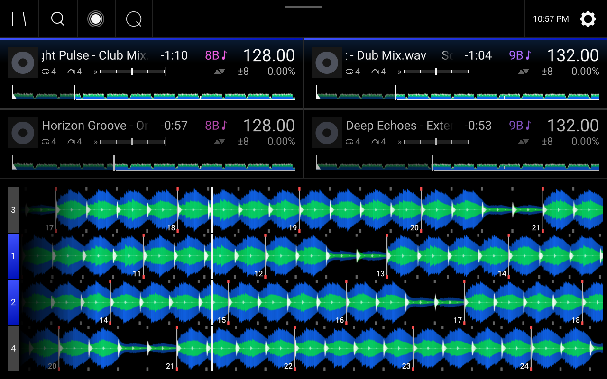
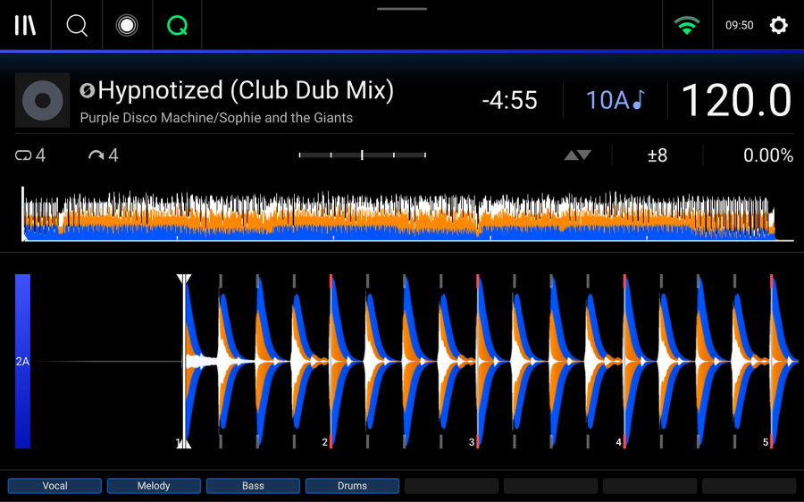
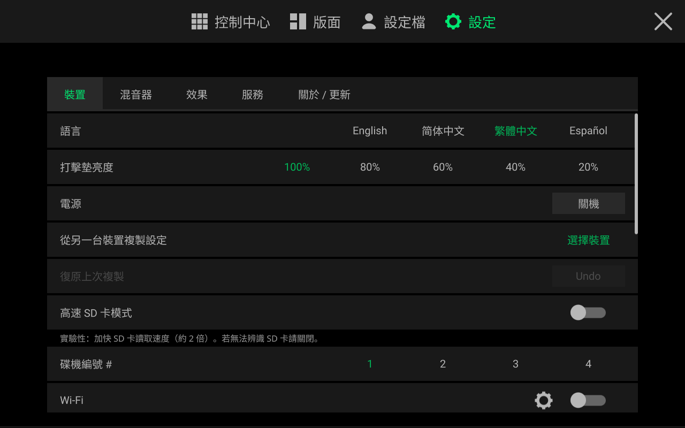
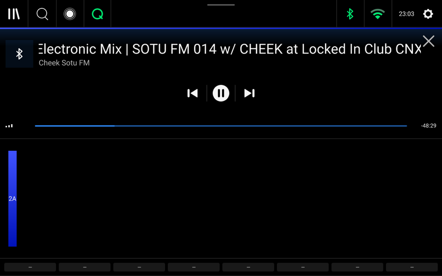

 

 

**[核心功能](#features)** · **[下載與安裝](#install)** · **[實機畫面](#gallery)** · **[效能對比](#benchmarks)** · **[讚賞支持](#sponsor)**

**線上使用文件**：<https://enginexdj.com> · **路線圖**：<https://enginexdj.com/#roadmap>

 

**EngineX OS 5.3.0.5** 是基於官方 Engine OS 5.3.0+ 建置的客製系統，支援天龍 Denon DJ、Numark 與 Rane 共 16 款獨立設備：

| 世代 | 架構 | 機型（板號） |
| :--- | :--- | :--- |
| 一代機，8 款 | 32 位元（ARM） | `SC5000 Prime`（JP07）· `SC5000M Prime`（JP08）· `PRIME GO`（JP11）· `SC6000 Prime`（JP13）· `SC6000M Prime`（JP14）· `PRIME 4`（JC11）· `PRIME 2`（JC16）· `Mixstream Pro`（NH08） |
| 二代機，6 款 | 32 位元（ARM） | `PRIME 4+`（JC11S）· `PRIME GO+`（JP11S）· `SC LIVE 2`（JP20）· `SC LIVE 4`（JP21）· `Mixstream Pro Go`（NH10）· `Mixstream Pro+`（NH08S） |
| 二代機，2 款 | 64 位元（ARM64） | `PRIME 4 G2`（JP24）· `Rane SYSTEM ONE`（RMZ2） |

16 款機型統一使用 `*-Update.img` 升級包。一代機直接用隨身碟刷入；二代機首次連接電腦執行一次 `EngineX-Installer` 解鎖 `.img` 升級鏈，之後同樣用隨身碟或螢幕線上更新（見[如何安裝與升級](#install)）。

---

## 核心功能

- **4 軌 Stems 分軌**：在本機或串流曲目上向左滑即可拆出人聲、旋律、貝斯、鼓組四軌並歸入側邊欄 `Stems` 清單。可透過打擊墊或通道 EQ 旋鈕（`設定檔 → 播放 → 分軌 EQ 模式` 或 `Shift + Cue`）控制各軌，支援播放機本機分軌（基礎音質）或呼叫同區域網路電腦執行 `htdemucs` 高音質分軌（`PRIME 4 G2` 與 `SYSTEM ONE` 維持官方 Stems）。
- **7 大串流音源**：來源選單內建 TIDAL、網易雲音樂、Spotify、Deezer、SoundCloud、Beatport、Apple Music，支援手機掃碼登入、FLAC / 320 kbps 音質切換（`設定 → 服務 → 串流音質`）、分平台本機快取，以及跨音源聯合搜尋 `設定檔 → 曲庫 → OmniSource（在串流中顯示 USB/SD）`。
- **Rekordbox 隨身碟直讀與 Pro DJ Link**：直讀 rekordbox 5/6/7 匯出的隨身碟（支援 `FAT32`、`exFAT`、`NTFS` 與 Mac `HFS+` 讀寫；不支援 `APFS`）中的歌單、Hot Cue、Memory Cue、Loop 與拍線。`設定 → 服務 → Pro DJ Link` 支援與 CDJ 及電腦 rekordbox 7（`Export` 模式開啟 `LINK`）互聯、分享 USB/SD、交接 `MASTER`，並在影子軌或 `線路輸入`（`Line In`）通道顯示 CDJ 波形。
- **聯機視圖、波形樣式與四語介面**：`版面 → ENGINEX 視圖預設 → 聯機視圖` 讓獨立播放機在 `原廠`、`雙碟機配對` 與 `4 軌` 之間切換（4 軌一體機可在 `原廠` 與 `4 軌` 之間切換），提供 5 組儲存視圖（`視圖 1`–`視圖 5`）、`介面縮放`、`熱標拍數倒數`、`Denon` / `RGB` / `3-Band` 波形（`設定檔 → 顯示 → 波形樣式`），以及繁體中文、简体中文、English、Español 免重啟切換（`設定 → 裝置 → 語言`）。
- **音訊保護、一體機效果與 Web 主控台**：內建 `0dB 防破音軟限幅`、`自動增益（0 dB 正規化）`、一代獨立播放機 `Hi-Fi 高頻補償輸出`（`設定檔 → 播放 → Hi-Fi 高頻補償輸出`）、`推桿回音`、`PRIME 4` `(PX)` 硬體效果、通道 `FILTER` 旋鈕效果 `設定檔 → 播放 → 先鋒風格效果 (Color FX)`、`先鋒效果延遲模式 (PX)`、控制中心智慧同步、1 Gbps Gigabit 有線網路，以及 `:8080` 網頁主控台（傳歌、重新定位、WAV `直播推流` 與 Mod 外掛中心）。

---

## 5.3.0.5 更新內容

- **原生安裝器與簽章更新**：`EngineX-Installer` 無需安裝 Python、fastboot、libusb 或 WSL 即可透過 USB 刷寫，安裝器與螢幕線上更新皆校驗 `SHA256SUMS.txt.sig` 簽章（#255、#239）。
- **恢復官方韌體**：`Restore-Official-Firmware` 可恢復原廠 Engine OS 5.3.0；回退原廠前請先啟動一次 5.3.0.5 並正常關機。
- **HFS+ 磁碟讀寫**：通過唯讀檢查的 Mac `HFS+` 隨身碟與 SD 卡在全部 16 款機型上以讀寫方式掛載，Engine 可直接在磁碟上儲存曲庫、Cue 與 Loop。
- **電腦 rekordbox Link 與統一 Pro DJ Link**：`設定 → 服務 → Pro DJ Link` 合併原有的兩個開關，與 CDJ-3000 聯機不再提示舊版韌體，並將電腦 rekordbox 7（`Export` 模式）列為播放機音源，載入即帶拍線、Cue 與封面（#198、#300）。
- **大型 rekordbox 隨身碟快速匯入**：大容量 rekordbox 隨身碟插入後幾秒內即可使用歌單與 Cue，波形於背景轉換並在閒置 30 秒後自動發佈（#301）。
- **rekordbox Cue 寫回**：把播放機上修改的 Hot Cue、Memory Cue 與 Loop 寫回 rekordbox 隨身碟，並在 `/.enginex-backup/` 儲存備份（`:8080` 網頁主控台 `擴充 → 寫回 Hot Cue / Loop 到 rekordbox 隨身碟`，#271）。
- **通道 FILTER 旋鈕 Color FX**：在一體機各通道的 `FILTER` 旋鈕上掛載 `Spiral`、`Pitch Echo`、`Slip Roll`、`Dub Echo` 或 `Space`，位於 `設定檔 → 播放 → 先鋒風格效果 (Color FX)`。
- **Apple Music 助手與 Spotify 音源選擇**：二代機支援透過 `enginex-amd` 快取 Apple Music 無損音訊（`/m/applemusic`），`:8080` 主控台可指定 Spotify 曲目的比對音源。
- **藍牙喇叭輸出來源**：為已配對的藍牙喇叭選擇播放的碟位或混音匯流排（`設定 → 裝置 → 藍牙 → 輸出來源`）。
- **碟機間複製設定**：經區域網路在兩台播放機間確認並複製設定，隨身碟儲存設定檔時也包含 EngineX 設定（`設定 → 裝置 → 從另一台裝置複製設定`，#205）。
- **Mixstream 硬體控制**：在 Mixstream Pro / Pro+ / Pro Go 上新增 Pitch Bend 跳拍、4 個可指派 FX 槽位、精簡打擊墊列與逐通道分軌 EQ 開關（`設定 → 裝置` 與 `設定檔 → 播放`，#261、#286）。
- **PRIME 4 效果器與一體機控制**：`PRIME 4` 瀏覽效果時保持彈窗開啟並新增 `Jet Flanger (PX)` 與更長的 `Reverb` 尾音，全部一體機支援 `推桿回音`，電動轉盤支援 4 軌視圖（#195、#207、#258、#263、#285）。
- **分側反轉轉盤方向**：單轉盤機型或雙轉盤機型左右兩側可獨立反轉轉盤方向（`設定 → 裝置 → 反轉轉盤方向`，#213）。
- **推桿整數 BPM 平台與熱標倒數**：`設定檔 → 顯示 → BPM 小數位數` 設為 `2` 時在整數 BPM 處提供推桿平台，熱標拍數倒數按拍線跳變（#151）。
- **本機與串流 Stems**：不連電腦時採用保留立體聲的頻譜分軌，串流分軌按「藝人 - 標題」命名並存入私有分區，電腦端支援 RTX 50 系顯示卡（#238、#243）。
- **Web 主控台、遠端存取與區域網路工具**：改版 `:8080` 主控台，新增關於頁掃碼、Cloudflare Quick Tunnel（`設定 → 裝置 → 遠端存取`）、可選 HTTPS（`:8443`）、演出曲目表 CSV/文字匯出、`遠端載入（區域網路 API）`、`cpu-ram-monitor` Mod 與 `deploy/one-click-backend.sh` 一鍵後端（#242、#268、#281、#296）。
- **西班牙語介面與高速 SD 卡**：新增 `Español` 西班牙語介面（`設定 → 裝置 → 語言`，#282），並在 RK3288 機型上提供實驗性 50 MHz 高速 SD 卡開關（`設定 → 裝置 → 高速 SD 卡模式`）。
- **播放、串流與硬體修復**：修復 `PRIME 4` 載入曲目卡頓（#298），全機型關閉 Wi-Fi 省電（#309），二代機持久化儲存 SSH 密碼（#299），登入 Engine DJ 帳號不再導致串流斷線（#304），頂欄顯示目前串流圖示（#305），恢復一體機 `Shift + View` 切換，並恢復插入隨身碟時的設定檔匯入詢問。

---

## 實機畫面

<table>
<tr>
<td width="50%" align="center" valign="top">
 
<b>四軌聯機視圖與影子波形</b> 
本機雙層音軌配合另一台播放機的即時影子軌
</td>
<td width="50%" align="center" valign="top">
 
<b>雙碟機配對 2 軌視圖（SC5000 / SC6000）</b> 
本機目前 Layer 在上，配對碟機目前 Layer 在下
</td>
</tr>
<tr>
<td width="50%" align="center" valign="top">
 
<b>4 軌 Stems 分軌與 3-Band 波形</b> 
主畫面顯示 Vocal、Melody、Bass、Drums 分軌控制
</td>
<td width="50%" align="center" valign="top">
 
<b>曲庫側邊欄 Stems 清單</b> 
已分軌曲目歸入側邊欄歌單
</td>
</tr>
<tr>
<td width="50%" align="center" valign="top">
 
<b>來源選單內建 7 大串流</b> 
TIDAL · 網易雲 · Spotify · Deezer · SoundCloud · Beatport · Apple Music
</td>
<td width="50%" align="center" valign="top">
 
<b>手機 QR Code 登入</b> 
手機掃碼登入帳號並同步歌單
</td>
</tr>
<tr>
<td width="50%" align="center" valign="top">
 
<b>下拉控制中心</b> 
量化、智慧刷碟、波形樣式與智慧同步開關
</td>
<td width="50%" align="center" valign="top">
 
<b>版面頁（視圖 1–5 與 EngineX 視圖預設）</b> 
預設視圖、熱標拍數倒數、介面縮放、聯機視圖、四軌角色與影子軌模式
</td>
</tr>
<tr>
<td width="50%" align="center" valign="top">
 
<b>BPM 與調性預覽 + 左滑拆 Stems</b> 
載入前查看 BPM 與調性，向左滑拆分軌
</td>
<td width="50%" align="center" valign="top">
 
<b>裝置設定選單</b> 
語言、打擊墊亮度、播放機編號、時間同步與電源
</td>
</tr>
<tr>
<td width="50%" align="center" valign="top">
 
<b>設定 → 關於 / 更新：螢幕線上升級</b> 
點擊螢幕「更新」按鈕下載並安裝新版本
</td>
<td width="50%" align="center" valign="top">
 
<b>藍牙音訊輸入與輸出</b> 
連接手機播放或將播放機聲音輸出至藍牙喇叭
</td>
</tr>
</table>

---

## 效能與佔用對比（SC5000 實測）

| 對比項 | 官方原廠 / 舊版 | `EngineX OS 5.3.0.5`（SC5000 實測） | 實際效果 |
| :--- | :--- | :--- | :--- |
| **刷機包大小 (`*-Update.img`)** | 官方 5.3.0：`147.79 MB` | **`151.44 MB`**（SC6000 `151.58 MB`，PRIME 4 `151.52 MB`） | 比官方原廠大 `3.64 MB` |
| **刷機後 `/data` 佔用** | 舊版殘留約 `243 MB` | **核心與介面 `17.2 MB`**（含檔案系統驅動共 `45.6 MB`） | 騰出約 `200 MB` 內建儲存 |
| **閒置可用記憶體（總 `2 GB`）** | `~680 – 780 MB` | **`1,042 MB` 可用**（背景服務合計 `29.2 MB`） | 多留出 `~260 MB` 可用記憶體 |
| **Rekordbox 隨身碟讀取耗時** | 首次約 `8 分鐘`，重插 `15–24 秒` | **首次插碟 `< 2 秒`**，再次插碟 **`0.03 秒`** | 插入 Rekordbox 隨身碟即可播放 |
| **一代機 `Hi-Fi 高頻補償輸出`（`48 kHz` @ `20 kHz`）** | `-3.23 dB` 滾降（原廠關閉） | **`-0.01 dB`**（`設定檔 → 播放 → Hi-Fi 高頻補償輸出`） | 補償 `48 → 96 kHz` 輸出級高頻滾降 |
| **有線網路孔速度** | 限制在 `100 Mbps` | **`1 Gbps`** 全雙工（Wi-Fi 約 `9–10 MB/s`） | 有線網路傳歌更快 |

---

## 如何安裝與升級

### 1. 命令列安裝器 `EngineX-Installer`（全系 16 款——原廠二代機首次必用一次）

- [Windows 10/11 x64](https://github.com/Cd1s/EngineX-OS/releases/latest/download/EngineX-Installer-5.3.0.5-windows-amd64.zip)
- [macOS Apple Silicon M1–M4](https://github.com/Cd1s/EngineX-OS/releases/latest/download/EngineX-Installer-5.3.0.5-macos-arm64.zip)
- [macOS Intel](https://github.com/Cd1s/EngineX-OS/releases/latest/download/EngineX-Installer-5.3.0.5-macos-amd64.zip)
- [Linux x86_64](https://github.com/Cd1s/EngineX-OS/releases/latest/download/EngineX-Installer-5.3.0.5-linux-amd64.tar.gz)

解壓後於終端機執行 `Install-EngineX.bat`（Windows）、`Install-EngineX.command`（macOS）或 `./install-enginex.sh`（Linux）。安裝器自動探索區域網路內或處於 USB 韌體更新模式的播放機，校驗 `SHA256SUMS.txt.sig` 簽章並原生刷入 `*-Update.img`，無需安裝 Python、fastboot、libusb 或 WSL（Windows 按提示自動綁定微軟簽章 WinUSB 驅動；Linux USB 存取可能需要 `sudo`）。
**注意**：原廠二代機請先升級至官方 Engine OS 5.3.0，拔下隨身碟與 SD 卡，並在播放機正常執行時備份資料——二代機首次透過 USB 解鎖會清空內建 `/data` 分區（若已開啟 root SSH，走區域網路安裝會保留 `/data`）。`PRIME 4 G2` 與 `SYSTEM ONE` 在 USB 寫入完成後需按電源鍵關機再開機。刷寫過程中切勿斷電或拔線。

### 2. 一代機——隨身碟直接刷入（`*-Update.img`）

下載對應機型的 `*-Update.img`，不改名複製到 FAT32 或 exFAT 隨身碟根目錄，插入播放機後開啟 **設定 → 關於 / 更新 → 韌體更新模式 → 選項 → USB/SD**：

- **Denon DJ SC5000 Prime**：[`SC5000-5.3.0.5-EngineX-OS-Denon-SC5000-Prime-JP07-Update.img`](https://github.com/Cd1s/EngineX-OS/releases/latest/download/SC5000-5.3.0.5-EngineX-OS-Denon-SC5000-Prime-JP07-Update.img)
- **Denon DJ SC5000M Prime**：[`SC5000M-5.3.0.5-EngineX-OS-Denon-SC5000M-Prime-JP08-Update.img`](https://github.com/Cd1s/EngineX-OS/releases/latest/download/SC5000M-5.3.0.5-EngineX-OS-Denon-SC5000M-Prime-JP08-Update.img)
- **Denon DJ SC6000 Prime**：[`SC6000-5.3.0.5-EngineX-OS-Denon-SC6000-Prime-JP13-Update.img`](https://github.com/Cd1s/EngineX-OS/releases/latest/download/SC6000-5.3.0.5-EngineX-OS-Denon-SC6000-Prime-JP13-Update.img)
- **Denon DJ SC6000M Prime**：[`SC6000M-5.3.0.5-EngineX-OS-Denon-SC6000M-Prime-JP14-Update.img`](https://github.com/Cd1s/EngineX-OS/releases/latest/download/SC6000M-5.3.0.5-EngineX-OS-Denon-SC6000M-Prime-JP14-Update.img)
- **Denon DJ PRIME 4**：[`PRIME4-5.3.0.5-EngineX-OS-Denon-PRIME-4-JC11-Update.img`](https://github.com/Cd1s/EngineX-OS/releases/latest/download/PRIME4-5.3.0.5-EngineX-OS-Denon-PRIME-4-JC11-Update.img)
- **Denon DJ PRIME 2**：[`PRIME2-5.3.0.5-EngineX-OS-Denon-PRIME-2-JC16-Update.img`](https://github.com/Cd1s/EngineX-OS/releases/latest/download/PRIME2-5.3.0.5-EngineX-OS-Denon-PRIME-2-JC16-Update.img)
- **Denon DJ PRIME GO**：[`PRIMEGO-5.3.0.5-EngineX-OS-Denon-PRIME-GO-JP11-Update.img`](https://github.com/Cd1s/EngineX-OS/releases/latest/download/PRIMEGO-5.3.0.5-EngineX-OS-Denon-PRIME-GO-JP11-Update.img)
- **Numark Mixstream Pro**：[`MIXSTREAMPRO-5.3.0.5-EngineX-OS-Numark-Mixstream-Pro-NH08-Update.img`](https://github.com/Cd1s/EngineX-OS/releases/latest/download/MIXSTREAMPRO-5.3.0.5-EngineX-OS-Numark-Mixstream-Pro-NH08-Update.img)

### 3. 二代機——統一 `*-Update.img` 與螢幕線上升級（OTA）

二代機用 `EngineX-Installer` 解鎖一次後（或已安裝舊版 EngineX 開機自動解鎖後），即可將下方 `*-Update.img` 放入 FAT32/exFAT 隨身碟升級，或在連網後點 **設定 → 關於 / 更新 → 更新** 線上升級（本版本 Release 最後一次同時提供 `*-Data-Bundle.tar.gz`，供 `5.3.0.2` / `5.3.0.3` 二代機線上升級並自動解鎖 `.img`；5.3.0.4 及更早版本請先升至 5.3.0.5 以啟用簽章校驗）：

- **Denon DJ SC LIVE 4**：[`SCLIVE4-5.3.0.5-EngineX-OS-Denon-SC-LIVE-4-JP21-Update.img`](https://github.com/Cd1s/EngineX-OS/releases/latest/download/SCLIVE4-5.3.0.5-EngineX-OS-Denon-SC-LIVE-4-JP21-Update.img)
- **Denon DJ SC LIVE 2**：[`SCLIVE2-5.3.0.5-EngineX-OS-Denon-SC-LIVE-2-JP20-Update.img`](https://github.com/Cd1s/EngineX-OS/releases/latest/download/SCLIVE2-5.3.0.5-EngineX-OS-Denon-SC-LIVE-2-JP20-Update.img)
- **Denon DJ PRIME 4+**：[`PRIME4PLUS-5.3.0.5-EngineX-OS-Denon-PRIME-4-Plus-JC11S-Update.img`](https://github.com/Cd1s/EngineX-OS/releases/latest/download/PRIME4PLUS-5.3.0.5-EngineX-OS-Denon-PRIME-4-Plus-JC11S-Update.img)
- **Denon DJ PRIME GO+**：[`PRIMEGOPLUS-5.3.0.5-EngineX-OS-Denon-PRIME-GO-Plus-JP11S-Update.img`](https://github.com/Cd1s/EngineX-OS/releases/latest/download/PRIMEGOPLUS-5.3.0.5-EngineX-OS-Denon-PRIME-GO-Plus-JP11S-Update.img)
- **Numark Mixstream Pro+**：[`MIXSTREAMPROPLUS-5.3.0.5-EngineX-OS-Numark-Mixstream-Pro-Plus-NH08S-Update.img`](https://github.com/Cd1s/EngineX-OS/releases/latest/download/MIXSTREAMPROPLUS-5.3.0.5-EngineX-OS-Numark-Mixstream-Pro-Plus-NH08S-Update.img)
- **Numark Mixstream Pro Go**：[`MIXSTREAMPROGO-5.3.0.5-EngineX-OS-Numark-Mixstream-Pro-Go-NH10-Update.img`](https://github.com/Cd1s/EngineX-OS/releases/latest/download/MIXSTREAMPROGO-5.3.0.5-EngineX-OS-Numark-Mixstream-Pro-Go-NH10-Update.img)
- **Denon DJ PRIME 4 G2**：[`PRIME4G2-5.3.0.5-EngineX-OS-Denon-PRIME-4-G2-JP24-Update.img`](https://github.com/Cd1s/EngineX-OS/releases/latest/download/PRIME4G2-5.3.0.5-EngineX-OS-Denon-PRIME-4-G2-JP24-Update.img)
- **Rane SYSTEM ONE**：[`SYSTEMONE-5.3.0.5-EngineX-OS-Rane-SYSTEM-ONE-RMZ2-Update.img`](https://github.com/Cd1s/EngineX-OS/releases/latest/download/SYSTEMONE-5.3.0.5-EngineX-OS-Rane-SYSTEM-ONE-RMZ2-Update.img)

### 4. 恢復官方韌體與選配電腦端服務

- **恢復官方 Engine OS 5.3.0**：先讓播放機啟動一次 5.3.0.5 並連入與電腦相同的區域網路，執行 `Restore-Official-Firmware.bat` / `.command` / `.sh`（`enginex-installer --restore-stock`）。第一代機型先確認清理快取，拔除含更新檔案的儲存裝置，進入電腦更新模式（SC5000/SC6000 按住 `MEDIA EJECT + SOURCE + LAYER` 開機；其他第一代機型依[官方更新說明](https://support.enginedj.com/support/solutions/articles/69000797882)操作），保持供電與 USB 連線直到官方 5.3.0 刷入完成；若第一代機型已停在原廠 Logo，請先刷入 EngineX 啟動一次再恢復。第二代機型可在 `:8080` 主控台點 `解除安裝恢復原廠` 或區域網路執行 `enginex-installer --uninstall`（保留曲庫與設定）。
- **電腦端 Stems、串流與中繼**：於同區域網路電腦解壓安裝器後執行 `./stems/run-home-worker.sh`（macOS/Linux）或 `.\stems\run-home-worker.ps1`（Windows）即可啟用 `htdemucs` 高音質分軌。串流掃碼登入、Apple Music 下載助手（`enginex-amd`）與一鍵中繼後端（`sudo bash deploy/one-click-backend.sh`）說明見[線上使用文件](https://enginexdj.com)與 [`CONTRIBUTING.md`](./CONTRIBUTING.md)。

---

## 讚賞與支持

<table>
<tr>
<td width="33%" align="center" valign="top">
 
<b>微信讚賞碼</b> 
微信掃碼讚賞
</td>
<td width="33%" align="center" valign="top">
 
<b>幣安支付 (Binance Pay)</b> 
幣安 ID：<code>565380652</code>（0 手續費）
</td>
<td width="33%" align="center" valign="top">
 
<b>USDT / USDC（EVM 鏈）</b> 
<code>0x35e0c53dd887b37cd5db0064291f7c5a7442bc91</code>
</td>
</tr>
</table>

MIT License · EngineX OS 是獨立的開源專案，與 inMusic Brands、Denon DJ、Numark 或 Rane 無關。本儲存庫不散佈任何受版權保護的原廠韌體二進位檔案。

