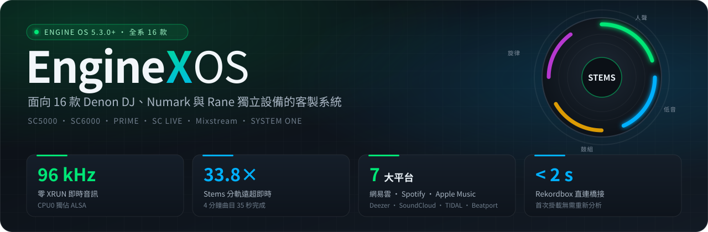
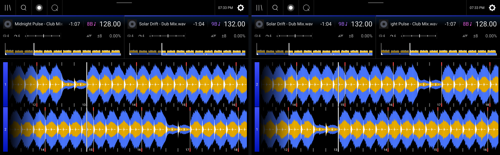
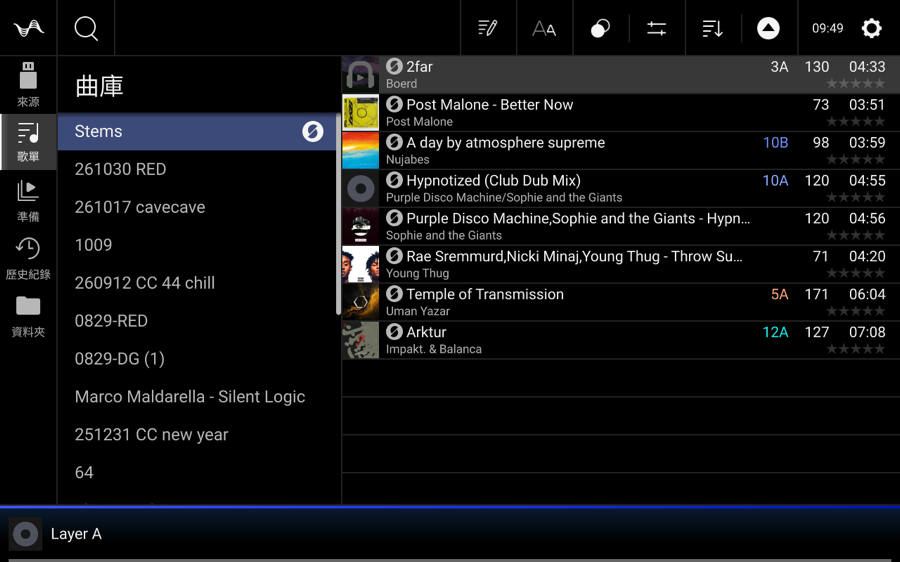
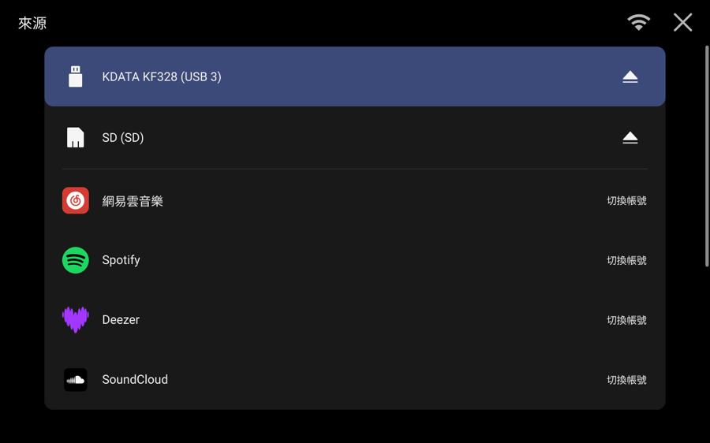
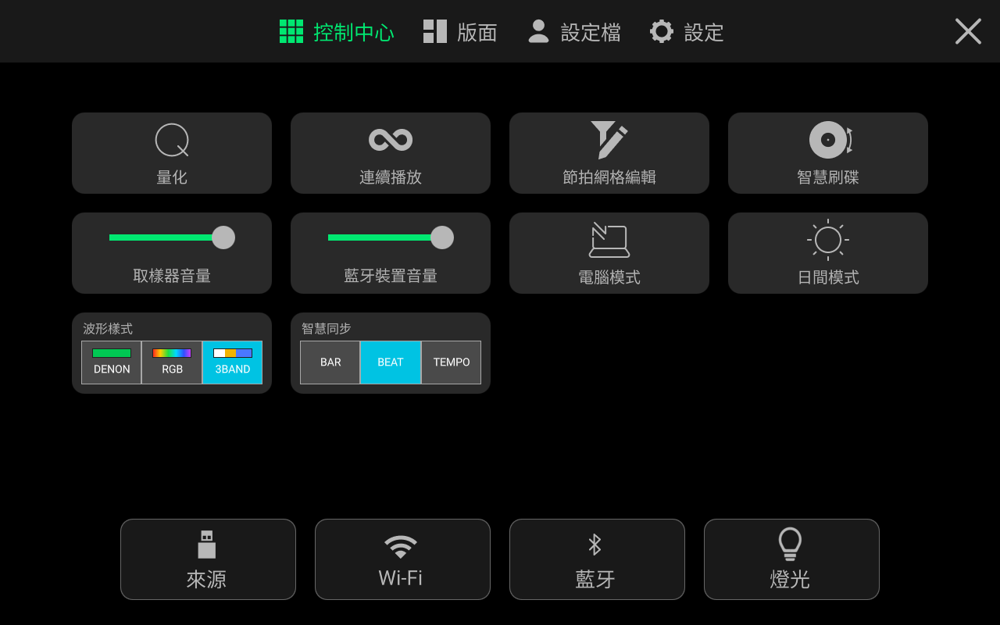
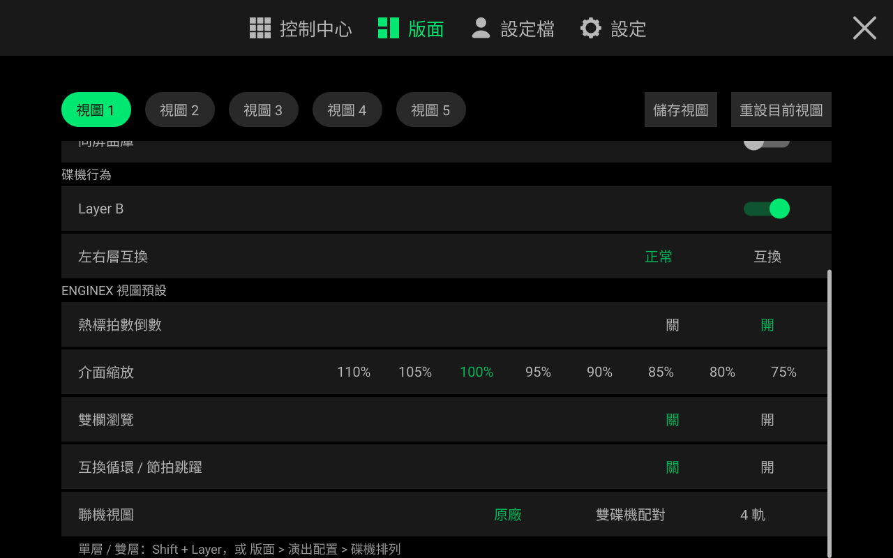
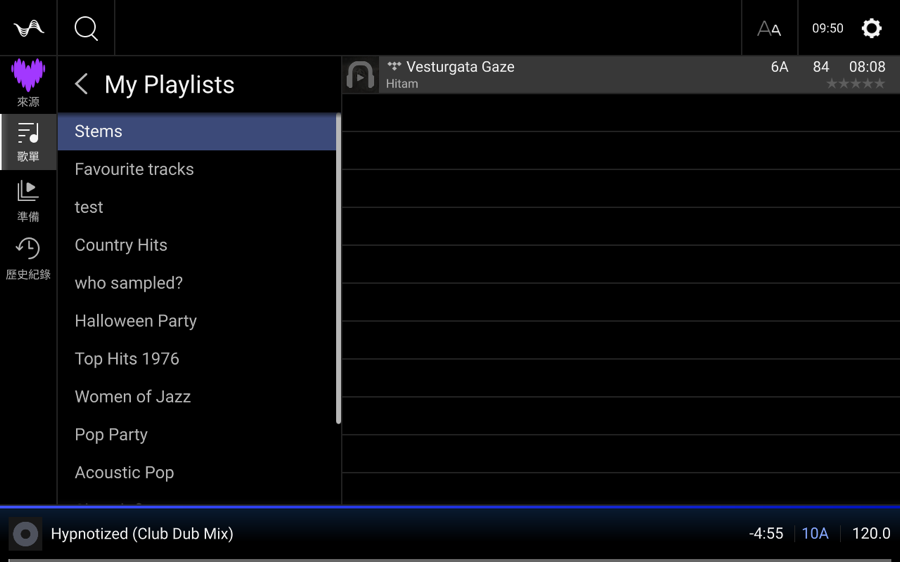
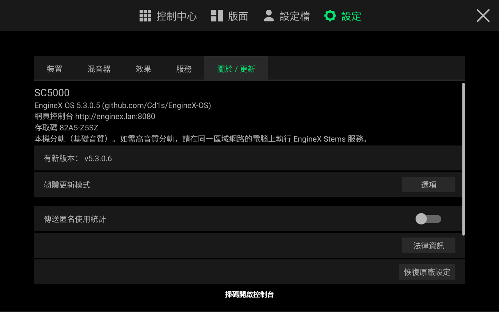
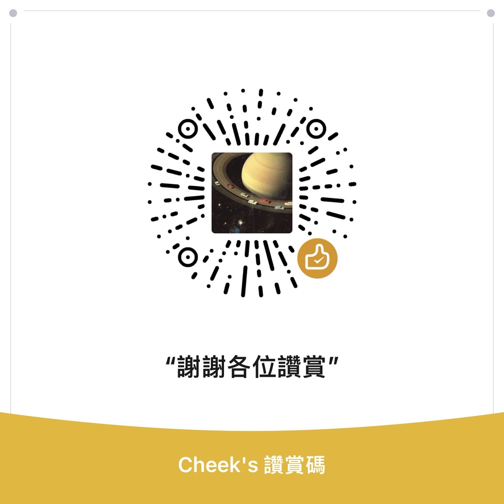

<div align="center">



<br>

<a href="./README.md"></a>
<a href="./README.zh-CN.md"></a>
<a href="./README.zh-TW.md"></a>

<br>

**[核心功能](#features)** · **[下載與安裝](#install)** · **[實機畫面](#gallery)** · **[效能對比](#benchmarks)** · **[讚賞支持](#sponsor)**

📖 **線上使用文件**：<https://enginexdj.com> · **路線圖**：<https://enginexdj.com/#roadmap>

</div>

<br>

**EngineX OS 5.3.0.5** 是基於官方 Engine OS 5.3.0+ 底層重構的客製系統，支援天龍 Denon DJ、Numark 與 Rane 全系 16 款獨立設備：

| 世代 | 架構 | 機型（板號） |
| :--- | :--- | :--- |
| 一代機，8 款 | 32 位元（ARM） | `SC5000 Prime`（JP07）· `SC5000M Prime`（JP08）· `PRIME GO`（JP11）· `SC6000 Prime`（JP13）· `SC6000M Prime`（JP14）· `PRIME 4`（JC11）· `PRIME 2`（JC16）· `Mixstream Pro`（NH08） |
| 二代機，6 款 | 32 位元（ARM） | `PRIME 4+`（JC11S）· `PRIME GO+`（JP11S）· `SC LIVE 2`（JP20）· `SC LIVE 4`（JP21）· `Mixstream Pro Go`（NH10）· `Mixstream Pro+`（NH08S） |
| 二代機，2 款 | 64 位元（ARM64） | `PRIME 4 G2`（JP24）· `Rane SYSTEM ONE`（RMZ2） |

全系 16 款機型現統一使用 `*-Update.img` 升級包：前八款一代機直接用隨身碟免電腦刷入；後八款二代機首次連接電腦執行一次 `EngineX-Installer` 自動完成**一鍵解鎖 `.img` 升級鏈並刷入**，之後即可像一代機一樣直接用隨身碟或螢幕一鍵線上升級（見[如何安裝與升級](#install)）。

操作介面與原廠完全一致，安裝後即可在熟悉的原廠介面裡直接使用以下全部功能。

---

<a id="features"></a>

## 核心功能

### 1. 全機型 4 軌 Stems 即時分軌（人聲 / 旋律 / 貝斯 / 鼓組）
- 在本機或串流曲目上向左滑即可拆出 **Vocal（人聲）、Melody（旋律）、Bass（貝斯）、Drums（鼓組）** 四軌，並自動歸入曲庫側邊欄 `Stems` 歌單；
- 演出時直接按打擊墊一鍵靜音人聲做 Acapella 或單留鼓點過渡；在支援分軌 EQ 的一體機上按各通道 **Shift + Cue (PFL)**（或開啟 `設定檔 → 播放 → 分軌 EQ 模式`），即可用實體 `HIGH / MID / LOW` 旋鈕流暢控制分軌音量；
- 不連電腦即可在播放機本機完成分軌（基礎音質）；同一區域網路下執行電腦端服務時，自動呼叫顯示卡與 `htdemucs` 神經網路模型完成高音質分軌（`PRIME 4 G2` 與 `SYSTEM ONE` 維持官方 Stems 行為）。

### 2. 內建 7 大串流音源（手機掃碼與一鍵配對登入）
- 來源選單直接內建 **TIDAL、網易雲音樂、Spotify、Deezer、SoundCloud、Beatport、Apple Music**，與隨身碟、SD 卡並列顯示；
- 手機掃描播放機螢幕 QR Code（或在 Spotify Connect 裡點選 **`EngineX OS`**）即可登入帳號，直接瀏覽個人歌單、收藏夾並依 BPM、調性、評等、歌名或歌手排序；
- **支援無損 FLAC 與 320 kbps** 音質切換；播放過的曲目依平台各自獨立快取在播放機內部儲存，再次載入直接秒開（網易雲開啟 `Deemix 優先` 時與 Deezer 共享無損快取）；
- **Apple Music 原廠解鎖與公開/個人歌單匯入**：二代機與已解鎖 Engine 5.3.0 原生播放 Apple Music；手機掃碼即可直接貼上 Apple Music 公開歌單/專輯連結或登入個人資料庫，自動輪轉擷取 Web 開發者權杖，針對受保護音訊透過 ISRC 與歌名精準智慧回放，OmniSource 隔離保持 Apple Music 歌單純淨；
- **OmniSource**（`設定檔 → 曲庫 → OmniSource（在串流中顯示 USB/SD）`，預設關閉）支援一次搜尋同時查找各串流平台、隨身碟 / SD 卡、djay 曲庫與網路共用，同時保持各平台自己的歌單頁乾淨不混單。

### 3. 先鋒 Rekordbox 隨身碟隨插即用與 CDJ 互聯
- 給先鋒 CDJ 匯出的 Rekordbox 隨身碟直接插上播放機，**2 秒內**讀取全部歌單、Hot Cue、Memory Cue、Loop 與拍線（含舊版 rekordbox 5 匯出的隨身碟），不必再用電腦版 Engine DJ 重新轉庫；
- 相容 `FAT32` / `exFAT` / `NTFS` 與 Mac `HFS+`（`Mac OS 擴充格式`；不支援 `APFS`，請將隨身碟格式化為 `exFAT` 或 `Mac OS 擴充格式`），自動補償 MP3 編碼起始延遲讓拍線與 Cue 精準落在鼓點上，自動修復異常拔碟造成的資料庫損毀並移除「未安全退出」彈窗；
- **Pro DJ Link（測試版，位於 `設定 → 服務`）** 支援跨網路線 / Wi-Fi 瀏覽 CDJ 上的 Rekordbox 隨身碟、向 CDJ 分享本機曲庫、雙向交接 `MASTER`，並在影子軌或一體機 `線路輸入`（`Line In`）通道即時顯示 CDJ 波形。

### 4. 四軌聯機與雙碟機配對視圖、5 組儲存版面與四語介面
- **`聯機視圖`（`版面 → ENGINEX 視圖預設 → 聯機視圖`）**：獨立播放機可在 `原廠`、`雙碟機配對`（同屏顯示兩條全高波形：本機目前 Layer 在上，另一台碟機目前 Layer 在下）與 `4 軌`（四軌波形同屏，對端軌道作為靜音影子軌即時跟隨）之間切換，4 軌一體機可在 `原廠` 與 `4 軌` 之間切換；
- **5 組預設版面與介面縮放**：支援儲存 `視圖 1`–`視圖 5` 共五組獨立版面，分別記住 `熱標拍數倒數`、`介面縮放`（`110%`–`75%`）、帶 BPM 顯示的 `雙欄瀏覽` 與 `互換循環 / 節拍跳躍`；
- **3 種波形配色與 4 種語言**：全系 16 款支援 **繁體中文 / 简体中文 / English / Español** 免重啟切換，並於控制中心或 `設定檔 → 顯示 → 波形樣式` 一鍵切換 `Denon`、`RGB` 與先鋒風格 `3-Band` 波形。

### 5. 演出現場音質保護、一體機先鋒風格效果與 Gigabit 網路
- **21 項即時音訊保護**：消除切效果器爆音，內建零延遲 `0dB 防破音軟限幅`（峰值壓在 -0.1 dBFS 以下）、`自動增益（0 dB 正規化）`、Flanger 音量下沉補償，以及帶混音台一體機上的 `推桿回音` / `回聲淡出`；
- **一體機先鋒風格效果**：`PRIME 4` 硬體效果選擇器內建 `Spiral (PX)`、`Pitch Echo (PX)`、`Slip Roll (PX)`、`Dub Echo (PX)`、`Space (PX)`，並有選配的 **10–4000 ms** 獨立毫秒延遲模式（`先鋒效果延遲模式 (PX)`）；PRIME 4 / PRIME 2 / PRIME GO / Mixstream Pro 及二代 32 位元一體機可在 `設定檔 → 播放 → 先鋒風格效果 (Color FX)` 把其中一種效果放到每個通道的 `FILTER` 旋鈕上（旋鈕置中時與原廠相同，選 `關` 維持原廠 Sweep FX）；獨立播放機不提供 PX 效果，維持純淨播放機音訊路徑；
- **智慧同步、Gigabit 網路孔與 `:8080` Web 主控台**：控制中心一鍵切換 `Bar / Beat / Tempo` 同步並在大 BPM 差距下自動擴大變速範圍，有線網路孔解鎖 **1 Gbps** 滿速，`:8080` 網頁主控台支援 Wi-Fi 拖曳傳歌、遺失曲目一鍵重新定位、Shoutcast / Icecast `直播推流`，以及按需安裝的 Mod 外掛中心（`tailscale-remote`、`dmx-studio`、`midi-controller-mapper`、`jog-logo-studio`、`sampler-pad-studio`、`minimal-club-mode`）。

---

## 5.3.0.5 更新內容

### 新功能
- **原生 `EngineX-Installer` 與簽章更新（#255、#239）**：安裝器自行完成映像準備與 USB 傳輸，不再需要安裝 Python、fastboot、e2fsprogs、libusb 或 WSL。每個 Release 的 `SHA256SUMS.txt` 都有簽章（`SHA256SUMS.txt.sig`）；螢幕線上更新與安裝器會拒絕無簽章、簽章錯誤、被改動或比碟機目前版本舊的發佈。5.3.0.4 及更早版本的碟機不做這項檢查：請先更新到 5.3.0.5。
- **恢復官方韌體**：`Restore-Official-Firmware.bat` / `.command` / `.sh`（或 `enginex-installer --restore-stock`）先清理可能讓原廠卡在 Logo 的共用 QML 快取，再把碟機恢復到原廠 Engine OS 5.3.0。EngineX 現在使用獨立的 QML 快取：**回到原廠前請先啟動一次 5.3.0.5，再正常關機。**步驟見下文「恢復官方韌體」。
- **藍牙喇叭輸出**：在 `設定 → 裝置 → 藍牙`（右側齒輪）配對喇叭，用 `輸入分配到` 下新增的 `輸出來源` 選擇播放內容（獨立播放機選 Layer A / B；`PRIME 4` 可選 `主輸出`、`監聽喇叭`、`耳機`、`副區`；`PRIME 2` 與 `Mixstream Pro` 可選 `主輸出` / `耳機`；其他機型為 `主輸出`）。藍牙約增加 150–250 ms 延遲：適合監聽或第二個房間，不適合打拍對齊。
- **碟機之間複製設定（#205）**：`設定 → 裝置 → 從另一台裝置複製設定`，來源碟機必須允許，接收碟機確認後才複製。請先暫停播放：Link 匯入與復原會重新啟動 Engine。Player 編號、角色、顏色、身分與帳號保留在本機。`Profile → Save to my drive` 現在也儲存 EngineX 偏好，原廠 USB 匯入提示新增 **包含 EngineX 設定**。
- **USB 設定檔匯入恢復詢問**：選擇隨身碟時再次出現原廠「是 / 否」選項來決定是否載入其中儲存的設定檔（r5 會自動選 No）。機身選單的「重新啟動以套用」現在會儲存修改後的 Player 編號。
- **分側 `反轉轉盤方向`（#213）**：單轉盤播放機一個開關，雙轉盤機型左右各一個，位於 `設定 → 裝置` 與 `:8080` 網頁主控台；電動轉盤機型不顯示。
- **所有一體機支援 `推桿回音`（#258），電動轉盤支援 4 軌版面（#263）**：`推桿回音` 在全部 5.3.0 一體機上使用原生逐通道 Transition FX，不再疊加回音或卡頓；`SC5000M` / `SC6000M` 在 `4 Decks` 或 `Paired Player` 下，轉盤馬達與觸控微調對本機持有的碟位生效。
- **`Mixstream` Sweep FX 與 Stems EQ 打擊墊（#261）**：`Mixstream Pro`、`Pro+`、`Pro Go` 的打擊墊列可同時使用 Sweep FX、Stems EQ 與跳拍組。
- **碟機本機 Stems 改為真正的分離（#238）**：不連電腦時，用頻譜分離方法拆出人聲、貝斯、鼓與旋律，不再只是按頻段切分；人聲保持原有的立體聲位置，只提供 `hpss` 的電腦或中繼不再被使用，改由播放機自己分離，`設定檔 → 曲庫` 與 `設定 → 關於 / 更新` 裡的 Stems 狀態列會寫明目前來源；停止進展的 Stems 上傳會釋放名額，而慢但仍在工作的渲染端保留它的任務（#243）。它不是神經網路，音軌之間仍有串音；想要最乾淨的分軌請用電腦服務。
- **演出曲目表匯出（#268）**：網頁主控台的「演出曲目表」卡片可把已記錄的演出下載為文字或 CSV，保留播放順序與重複曲目。
- **rekordbox 配色與尺寸**：`3-Band` 使用 rekordbox / CDJ-3000 配色；rekordbox 隨身碟曲目的碟機概覽與 Engine 自己分析的一樣高，先前播放過或匯入中斷的曲目也一樣。
- **`直播推流` 只輸出 WAV，按需擷取**：主控台只提供固定格式（WAV、16 位元、48 kHz、立體聲），不再提供 Shoutcast 目標；沒人收聽時不擷取，閒置碟機約省 7% 的單核 CPU。
- **網路線與 Wi-Fi 同時連線**：同一網段內同時接網路線與 Wi-Fi 時，Engine Link 曲目走網路線載入，開機後 Wi-Fi 不再被斷開；各網卡的 ARP 設定從開機起生效。
- **Remote Library 封面（#223）**：`SC LIVE 4` 的曲目清單顯示 Engine DJ Desktop Remote Library 的封面。
- **可選的 HTTPS 主控台（#242）**：預設仍是 `:8080` 的 HTTP。在網頁主控台「碟機顯示與音訊」卡片開啟 `啟用主控台 HTTPS (:8443)`，播放機會用首次產生的自簽名憑證同時提供 HTTPS 主控台。
- **遠端載入（區域網路 API，#281）**：`設定 → 服務 → 遠端載入（區域網路 API）`（預設關，只能在播放機上開啟）讓同一區域網路內的電腦或腳本用主控台存取碼，把已掛載磁碟上的歌載入到閒置的碟位。正在播放、按住 CUE 預聽或刷碟的碟位會被拒絕。
- **PRIME 4 效果選擇（#285，PR #287）**：瀏覽效果時選擇視窗保持開啟，停止轉動 0.6 秒後自動確認，或按下旋鈕確認；通道 OLED 顯示全部 31 個效果名稱。效果選擇旋鈕與原廠一樣，每一格移動一個效果。
- **西班牙語介面（PR #282，感謝 Javier Saenz）**：`設定 → 裝置 → 語言` 新增 `Español`，涵蓋播放機介面、網頁主控台與手機登入頁。
- **高速 SD 卡（實驗性）**：`設定 → 裝置 → 高速 SD 卡模式`（網頁主控台「碟機顯示與音訊」卡片裡有同一個開關）預設關閉，在 14 款 RK3288 機型上提供，PRIME 4 G2 / SYSTEM ONE 沒有。它把 SD 卡槽從 25 MHz 預設速度（最高 12.5 MB/s）提到 50 MHz 高速（最高 25 MB/s，SC5000 上實測 23 MB/s）。若某張卡無法辨識請關閉它。播放機正在播放時變更，會在下次啟動或重新插入 SD 卡時生效。
- **全部 16 款機型都能讀寫 Mac 格式（HFS+）的隨身碟和記憶卡**：通過唯讀檢查的碟會以讀寫方式掛載，Engine 把曲庫、Cue 和 Loop 直接存到碟上（一代機用固定的驅動模組，PRIME 4 G2 / SYSTEM ONE 用原廠驅動，二代 32 位元機用使用者空間驅動）。上次沒有正常彈出、但檢查正常的碟會先標記為乾淨再讀寫，其餘情況仍是唯讀。播放機在碟唯讀時為它建的曲庫，第一次讀寫掛載時整體複製到碟上，要麼全部成功要麼不複製。彈出時會等資料全部寫完。
- **電腦上的 rekordbox 作為來源，只有一個 `Pro DJ Link` 開關**：`設定 → 服務 → Pro DJ Link` 取代原來的兩個開關。開啟後每台播放機在 rekordbox 裡都是獨立的播放器（所以會出現 `LINK`，MASTER 也能交接），在 `Export` 模式執行的 rekordbox 7 會出現在播放機來源清單裡，名為 `rekordbox（<電腦名稱>）`，可瀏覽全部曲目和歌單（曲名、藝人、BPM、調性）。音訊來自分享的音樂資料夾（網頁主控台 `曲庫、網路與系統 → rekordbox 音樂資料夾`）、已掛載的 SMB / NAS 分享，或電腦自己的 NFS 服務（並行讀取）。關掉 LINK 後來源會消失。波形、拍線和 Cue 由 Engine 在載入後自己分析。
- **大型 rekordbox 隨身碟首次插入很快（#301）**：第一次插入時播放機直接讀出匯出裡的歌單、曲目、熱 Cue 和 Memory Cue，幾秒內即可使用，拍線和波形隨後在背景低優先順序補齊，並顯示 `正在匯入 rekordbox 曲庫…` 進度。超出掛載時限的匯入不會再被丟棄。大型曲庫轉換完成後，播放機會在沒有播放機再使用這個隨身碟、並安靜 30 秒後自動發佈，不需要重新插入。
- **把 Cue 和 Loop 的修改寫回 rekordbox 隨身碟（#271）**：網頁主控台 `擴充` 頁的 `寫回 Hot Cue / Loop 到 rekordbox 隨身碟` 會把播放機上的 Hot Cue、Memory Cue 和 Loop 寫進碟上的分析檔案和 `exportLibrary.db`（先在 `/.enginex-backup/` 備份一次）。
- **每個通道的 `FILTER` 旋鈕帶 Color FX**：`設定檔 → 播放 → 先鋒風格效果 (Color FX)`（`Spiral`、`Pitch Echo`、`Slip Roll`、`Dub Echo`、`Space`）現在像先鋒混音台一樣掛在通道自己的濾波旋鈕上，旋鈕中位與原廠完全一致；`Off` 是原廠 Sweep FX。適用於 PRIME 4、PRIME 2、PRIME GO、Mixstream Pro 以及二代的 SC LIVE 2 / 4、PRIME 4+、PRIME GO+、Mixstream Pro+ / Pro Go（同時修復了部分 PRIME GO 使用者聽到的持續迴音）。
- **Mixstream（#286）**：`設定 → 裝置` 新增 `Pitch Bend 按鍵改為 Beat Jump`（`-` / `+` 前後跳，`Shift` 仍調速度範圍）和 `FX 槽位 1–4`（四個實體 FX 鍵各自選 Echo、Flanger、Delay 或 Phaser）；打擊墊列只保留打擊墊和一個 `△` Sweep FX 按鈕，`Stems EQ` 在 `設定檔 → 播放` 裡有獨立一列。
- **PRIME 4 的 `Jet Flanger (PX)` 與更長的 `Reverb` 尾音（#195、#207）**、`設定檔 → 顯示 → BPM 小數位數` 設為 `2` 時的**整數 BPM 推桿平台**，以及**依拍線跳變的熱點倒數**（#151）。
- **影子軌**：來源碟微調時，另一台播放機的影子軌幾幀內就跟上，不再略微超前，循環裡也不會衝過。
- **串流 Stems**：匯入的檔案依「藝人 - 標題」命名並寫入標籤，點的那一列顯示原廠的逐首分軌進度，下載不下來的歌會說明，「沒有可用的來源磁碟」彈窗不再出現（播放機為此保留自己的私有儲存碟）；帶 RTX 50 系顯示卡的電腦上 Stems 也能用。
- **遠端存取與 QR Code**：`設定 → 裝置 → 遠端存取` 透過 Cloudflare Quick Tunnel 開啟網頁主控台；「關於 / 更新」裡有 `掃碼開啟主控台` QR Code（優先公開位址，其次通道，再次區域網路；QR Code 裡不含存取碼）。網頁主控台換了新設計。
- **不依賴核心 CIFS 的 SMB / NAS（#300）**：網頁主控台的網路來源在所有機型上用 SMB2/3 和使用者名稱密碼登入；**Engine 遠端曲庫支援依 Date Added 排序（#292）**；官方 Mod **`cpu-ram-monitor`（#296）**在狀態列時鐘旁顯示 CPU 和記憶體使用率；**一鍵後端**（`deploy/one-click-backend.sh`）部署中繼和 Stems 服務。
- **二代機 SSH 密碼（#299）**：在網頁主控台設定的 root 密碼現在在二代機上有效，重啟後仍然有效。

### 修復與改進
- **大容量與慢速隨身碟**：數千首曲目的 Rekordbox 匯入在掛載時限內續做 Cue 與封面（#264、#272），FAT32 上的橋接狀態保持在 4 GiB 以下，讀取很慢的記憶卡也會補全概覽，舊版匯入補全時保留既有曲目與播放清單 ID 和碟機上的編輯，匯入也不再覆蓋 Engine 同時對曲庫做的變更。從 Pro DJ Link 播放機暫存的曲庫依每個碟限量，對方播放機的碟與原廠一致不提供 Stems（#252）。
- **HFS+ 隨身碟彈出與更新**：Engine 開啟曲庫時也能彈出唯讀 HFS+ 隨身碟，彈出被拒時會說明原因；Mac 格式隨身碟上的 `*-Update.img` 韌體更新會安裝所選檔案，正常模式與安全模式都一樣。
- **影子軌搓碟**：用力搓碟與極快搓碟時，影子軌沿來源碟的軌跡平滑跟隨。
- **串流**：Spotify 載入與 TIDAL 登入載體不再互相干擾（#269），Spotify 收藏不再有空白列（#279），Spotify 原生 Ogg 保持 Engine 可辨識的檔名（#277），音源設定原子寫入（#247），串流清單的後續頁面載入失敗時，已載入的列會保留，並顯示一則未完成提示與重試；登入過期仍會提示重新登入（#248）。
- **閒置碟機更省**：開機監看與 30 秒執行緒巡檢大幅減少工作量（#236），網路碟上的 Link / Stems 條件與原廠一致。
- **回到原廠**：原廠不再重用 EngineX 的 QML 快取，避免它在介面出現前當機。
- **Mod 與中繼資料**：官方 Mod 無需 FFmpeg 即可執行，MP3 / FLAC / WAV / AIFF 中繼資料讀取更準確，OneLibrary 的 Cue 位置不再溢位。
- **音訊稽核（#237、#245）**：掛鉤的音訊執行緒函式不做配置記憶體、加鎖、等待或 I/O 呼叫，由對照區塊時間預算的測試檢查；儲存 `直播推流` 設定不再讓 `/live.wav` 上的本機聽眾（如 OBS、VLC）斷線。
- **設定開關跟隨主控台（#283）**：EngineX 的 13 個開關列全部改用 Engine 原廠的開關列，點按之後仍會跟隨網頁主控台所做的變更。
- **大型 Rekordbox 曲庫（#272、#253）**：分析資料壓縮儲存，FAT32 上能容納的曲目多得多；重複插碟時不再為辨識你的曲目而重讀每個已儲存的波形。
- **螢幕線上更新（#215）**：5.3.0.5 的更新器只提供 `*-Update.img`；舊版 `*-Data-Bundle.tar.gz` 仍留在 Release 裡，供還在舊版本的播放機使用。
- **內部更名（#234）**：服務單元、程式、`/etc/enginex` 與 `/v1/enginex` 介面統一使用新的 `enginex` 名稱；舊的介面別名、資料連結和降級還原已移除。從 5.3.0.2 及更高版本升級時會一次性遷移你的資料。
- **一體機保持原廠視圖**：`SHIFT + VIEW` 重新循環切換原廠視圖預設（例如 PRIME 4 的直向波形加曲庫），橫向波形旁邊顯示曲庫時 `LOAD` 仍可用，`聯機視圖`只在獨立播放機（SC5000 / SC5000M / SC6000 / SC6000M）上提供。
- **另一台播放機載入時正在播放的播放機卡頓（#298，PRIME 4）**：背景調校不再移動 Engine 每路解碼、載入執行緒和中斷的位置，保持原廠的安排。
- **HFS+ 安全**：5.3.0.4 會把乾淨、未啟用日誌的 HFS+ 隨身碟以讀寫方式掛在有核心 bug 的驅動上，可能讓播放機當機並損壞碟；5.3.0.5 在所有機型上堵上了這個問題。
- **CDJ-3000 聯機（#198）**：CDJ-3000 不再提示「已與韌體較舊的播放機聯機」並會保持聯機；每台播放機都是獨立的播放器，也不會佔用 CDJ 自己的編號。
- **其他修復**：實機控制器上 `Shift + View` 重新可用；Pro DJ Link 匯出會跟隨插入或拔出的隨身碟；寫回 Cue 能看到尚未檢查點的修改並回退到 `export.pdb`；藍牙喇叭的 SBC 位元池使用標準高音質值；帶多餘內容的設定請求會在改動任何東西之前被拒絕；選擇隨身碟不會再跳出「複製設定」錯誤；Mixstream 的層切換與原廠只差幾毫秒（#222）；Apple Music 曲庫瀏覽在助手登入或登出後恢復；西班牙語等翻譯標籤不再溢出。
- **所有播放機都會關閉 Wi-Fi 省電（#309）**：沒有原廠 `iw` 工具的播放機（例如 SC LIVE 4）以前會悄悄保持 Wi-Fi 省電；現在播放機開機時自己關掉它（有原廠 `iw` 的機型仍優先使用原廠工具）。
- **Apple Music、中繼和 rekordbox 的複核修復**：在播放機上登出 Apple Music 後，下載助手仍在登入時也不會自動重新登入；中繼把播放機指向另一個助手位址時，不再把舊權杖交給新主機；中繼主控台按儲存不再丟掉自動偵測到的權杖；持有手機登入 QR Code 的人不能再設定助手並推送到中繼；兩台電腦執行 rekordbox 時，關了 `LINK` 的那台不再遮住另一台的曲庫；只屬於 Mixstream 的 `Stems EQ` 列只在 Mixstream 機型上建立。
- **登入 Engine DJ 帳號不再讓串流掉線（#304）**：已登入 Engine DJ 帳號時，載入串流曲目不再跳出「Tidal Disconnected」並讓串流來源登出。
- **播放機頂列顯示你選的串流服務（#305）**：從 Deezer、Spotify、Apple Music、網易雲、SoundCloud、Beatport 或 rekordbox 播放的曲目，頂列顯示該服務的圖示，`Track Info → Source` 顯示它的名字，不再是 TIDAL。它跟隨目前選中的服務，不是每首曲目各自記錄的事實。

### 已知問題
- 許多帳號（包括較早的 Premium 帳號）播放 Spotify 會失敗，提示 “audio key refused”。Spotify 更改了伺服器，所有基於 librespot 的用戶端都無法取得音訊金鑰（librespot-org/librespot#1649，2026-11-07 已鎖定，目前沒有已知的修復）。播放機上沒有任何辦法能修復它：請改用 TIDAL、Beatport、SoundCloud 或 Deezer。來源選單裡仍保留 Spotify 入口。
- 二代 32 位元機（SC LIVE 4、SC LIVE 2、PRIME 4+、PRIME GO+、Mixstream Pro+、Mixstream Pro Go）透過使用者空間驅動寫 HFS+：播放機正在寫入時請不要直接拔出隨身碟。
- PRIME 4 G2 / SYSTEM ONE 的資料分區大小（#244）不在本版本。

---

## 5.3.0.4 更新內容

### 新功能
- **二代機全系 8 款統一 `*-Update.img` 與一鍵解鎖刷機**：全系 16 款機型現統一發佈單檔案 `*-Update.img` 升級包。原廠二代機首次只需進入 `韌體更新模式` 接 USB 執行一次 `EngineX-Installer`，自動完成 **[1/2] 一鍵解鎖 `.img` 升級鏈** 與 **[2/2] 刷入 `*-Update.img`**；解鎖後後續升級與一代機完全一致——既可將 `*-Update.img` 放進隨身碟插機升級，也可於螢幕 `設定 → 關於 / 更新` 一鍵線上 OTA，全程免電腦。
- Spotify 登入、歌單、收藏與搜尋保留；原生音訊暫時停用（Spotify 阻擋部分帳號的音訊金鑰解密）。播放依序比對碟機已登入的 Deezer、網易雲、Beatport、Apple Music 或 SoundCloud。以 Spotify Connect 的 **`EngineX OS`** 或碟機 QR Code 登入，無需自建 Client ID。
- **`聯機視圖` 三合一選擇器與 `雙碟機配對` 2 軌視圖**：`版面 → ENGINEX 視圖預設 → 聯機視圖` 在 `SC5000 / SC6000` 上整合 `原廠` / `雙碟機配對` / `4 軌`（4 軌一體機為 `原廠` / `4 軌`），一步即可切回 `原廠` 單/雙層視圖。`雙碟機配對` 為兩台聯機獨立播放機展示上下兩條全高波形（上方為本機目前 Layer，下方即時跟隨對端碟機目前 Layer），與 `4 軌` 互切無需重新啟動 Engine。
- **`影子軌模式`（`自動` / `全部 Engine 模式` / `全部 CDJ 模式`）免重啟即時切換**：預設 `自動` 下，對端 EngineX 碟機或 CDJ 隨身碟中可複製的曲目由本機靜音載入，以原廠介面完整繪製波形、拍線、滑行線、移調、循環、`Stems` 圖示、綠色 `Sync` BPM 與 `主控 (LEAD)`（載入期間顯示曲目資訊與進度環）；無法複製的 CDJ 音源自動回退顯示原廠樣式的 CDJ 波形並註明原因。切換模式即時生效，不中斷本機播放。
- **一體機 `線路輸入`（`Line In`）顯示 CDJ-3000 波形**：在 `PRIME 4` 等一體機上把通道輸入切到 `Line In`，聯機的先鋒 CDJ-3000 波形與播放進度會直接顯示在該通道上。
- **`PRIME 4` 硬體 `(PX)` 效果器與 `10–4000 ms` 毫秒延遲模式**：`PRIME 4` 硬體效果選擇器新增 5 款 `(PX)` 效果與獨立時間檔位控制；一體機 `設定檔 → 播放 → 先鋒效果延遲模式 (PX)`（及 `:8080` 主控台）支援為延遲類 PX 效果開啟獨立於 BPM 的 `10–4000 ms` 毫秒延遲。
- **`SC LIVE 4` AUX 通道混音與 `Mixstream` 實體濾波 / 跳拍打擊墊**：`SC LIVE 4` 可於 `混音器選單 → 通道 → 輸入` 將 `AUX` 送入通道 3 或 4 使用通道推桿、EQ、監聽與濾波效果並保留 `MIC 2`；`Mixstream Pro / Pro+ / Pro Go` 恢復實體 `FILTER` 旋鈕原廠濾波效果、觸控跳拍、`節拍跳躍打擊墊` 與 `EQ / 分軌` 切換。
- **電腦端高音質 `htdemucs` Stems 預設開啟與內建腳本**：電腦端區域網路分軌預設採用高音質 `htdemucs` 模型，播放機 `設定檔 → 曲庫` 與 `設定 → 關於 / 更新` 即時提示連線狀態，四個平台的 `EngineX-Installer` 壓縮檔皆內建一鍵啟動腳本。
- **USB MIDI 控制器映射 Mod、脫敏日誌下載與免網域公網通道**：Mod 社群新增 `midi-controller-mapper`（內建 Pioneer CDJ-400 預設直控內部第 3 / 4 軌），`:8080` 主控台新增 `詳細日誌` 開關與一鍵脫敏日誌下載，`enginex-relay` 新增多播放機在線總覽，並支援一鍵開啟 Cloudflare Quick Tunnel 免網域遠端掃碼登入。

### 修復與調整
- **一體機串流曲目雙向錄音**：具錄音功能的一體機現可在載入串流曲目時開始錄音，錄音過程中也能繼續載入串流曲目 *（串流服務條款可能不允許保留其曲目的錄音，請僅供個人使用）*。
- **Rekordbox MP3 拍線精準對齊與 rekordbox 5 隨身碟相容**：自動修正 MP3 編碼延遲導致的約 26–51 ms 拍線、Hot Cue、Memory Cue 與 Loop 偏移（已匯入過的隨身碟再次插入時自動重轉受影響的 MP3 一次），並支援舊版 rekordbox 5 匯出的隨身碟。
- **官方 Mod `1.1.0` 全機型免 Python 即裝即用**：全部 5 款官方 Mod 改用自帶的原生輔助程式，徹底解決播放機無 Python 無法啟動的問題；支援於 `:8080` 直接上傳 `1.1.0` 就地覆蓋升級並保留原有設定，修復區域網路存取 Mod 中心報錯及套件可執行權限遺失。
- **啟動復原安全網與斷電保護**：若開機意外卡住或連續異常退出，播放機會自動退回到原廠 Engine 並隔離外置 Mod（絕不觸發恢復原廠設定、絕不清空曲庫），插入隨身碟或 SD 卡即可自動匯出脫敏診斷報告；異常斷電重啟後自動清理殘留介面快取。
- **獨立播放機 `取樣器輸出`、四軌操控與影子軌 `Sync` 穩定性**：`SC5000 / SC6000` 在二軌與四軌下皆保留 `設定 → 混音器 → 取樣器輸出`（`Layer A` / `Layer B`）、`碟機編號 #`、`碟機顏色` 雙層選色盤、`Layer B` 開關與 `Browse` 按壓直載目前層；靜音影子軌絕不搶 `MASTER`，支援超過 `+100%` 變速的跨倍速 `Sync` 緊鎖，對端關機乾淨退歌不卡切源，緊湊軌道頂欄數字定寬不晃動。
- **設定項精簡、全介面簡繁翻譯補齊與斷電時區記憶**：全機型解鎖原廠 `設定檔 → Cue / Loop → 連動節拍跳躍與 Loop 長度` 且絕不竄改使用者開關；`打擊墊亮度` 平滑調節彩燈並維持 `SYNC`、`KEYLOCK`、`SLIP` 等單色鍵原廠亮度；轉盤、波形縮放與非主控 `MASTER` 燈恢復原廠手感與暗亮值；獨立播放機隱藏先鋒風格 PX 效果；移除無效的自動分析磁碟開關；原廠 `Engine 燈光` 預設關閉，開啟或關閉後的選擇在重新啟動、斷電後保留；補齊設定頁全部簡繁中文翻譯（`Layer A`、`Layer B` 與 `3-Band` 維持英文）；內建中國大陸與全球 NTP 時間池，斷電離線開機仍保留已選時區與時鐘進度。
- **二代機 Stems 偵測與命令列安裝器強化**：修復 `SC LIVE 4` 等二代機點 **Generate Stems** 跳回設定頁的問題並對齊圖形快取上限；一代機 `.img` 內建客製開機畫面並消除首次開機無效 Stems 下載提示；提升命令列 `EngineX-Installer` 對 `SC LIVE 4`、`Mixstream Pro+ / Pro Go`、`PRIME 4+` 及一代機 USB / 區域網路的辨識率。

> **先鋒 CDJ 連線說明**：與先鋒 CDJ-3000 的區域網路互通（曲庫分享、3-Band 波形、播放頭跟隨與 Master / Beat Sync 雙向交接）基於實機 Denon SC5000 與 [**OpenProLink**](https://github.com/Cd1s/OpenProLink) 聯調驗證，歡迎擁有先鋒 CDJ / XDJ / DJM 真機的玩家回報實測體驗！

---

<a id="gallery"></a>

## 實機畫面

<table>
<tr>
<td width="50%" align="center" valign="top">
<br>
<b>雙機互聯四軌同屏與影子波形</b><br>
<sub>本機雙層軌道與對端播放機即時同步的靜音影子軌四軌波形同屏滾動</sub>
</td>
<td width="50%" align="center" valign="top">
<br>
<b>雙碟機配對 2 軌視圖（SC5000 / SC6000）</b><br>
<sub>同屏兩條全高波形：上方為本機目前 Layer，下方即時跟隨對端碟機目前 Layer</sub>
</td>
</tr>
<tr>
<td width="50%" align="center" valign="top">
<br>
<b>原生 4 軌 Stems 分軌與 3-Band 波形</b><br>
<sub>底部顯示人聲、旋律、貝斯、鼓組四軌狀態，打擊墊一鍵靜音</sub>
</td>
<td width="50%" align="center" valign="top">
<br>
<b>曲庫側邊欄 Stems 專屬歌單</b><br>
<sub>所有已分軌曲目自動歸類，隨時篩選呼叫</sub>
</td>
</tr>
<tr>
<td width="50%" align="center" valign="top">
<br>
<b>來源頁內建 7 大音樂平台</b><br>
<sub>TIDAL · 網易雲 · Spotify · Deezer · SoundCloud · Beatport · Apple Music 與隨身碟並列</sub>
</td>
<td width="50%" align="center" valign="top">
<br>
<b>螢幕 QR Code 掃碼登入</b><br>
<sub>手機掃一掃直接同步個人歌單，免輸入密碼</sub>
</td>
</tr>
<tr>
<td width="50%" align="center" valign="top">
<br>
<b>下拉控制中心</b><br>
<sub>量化、智慧刷碟、波形樣式與智慧同步一屏直達</sub>
</td>
<td width="50%" align="center" valign="top">
<br>
<b>版面頁（視圖 1–5 與 EngineX 視圖預設）</b><br>
<sub>5 組預設視圖、熱標拍數倒數、介面縮放、聯機視圖、四軌角色與影子軌模式</sub>
</td>
</tr>
<tr>
<td width="50%" align="center" valign="top">
<br>
<b>線上歌單 BPM / 調性預覽與左滑分軌</b><br>
<sub>載入前即可查看曲目 BPM 與調性，左滑一鍵拆分 Stems</sub>
</td>
<td width="50%" align="center" valign="top">
<br>
<b>裝置設定選單</b><br>
<sub>切換語言、打擊墊亮度、碟機編號 #、時間同步與電源關機</sub>
</td>
</tr>
<tr>
<td width="50%" align="center" valign="top">
<br>
<b>設定 → 關於 / 更新：螢幕一鍵線上升級</b><br>
<sub>偵測到新版本時直接點「更新」即可線上下載升級</sub>
</td>
<td width="50%" align="center" valign="top">
<br>
<b>原生藍牙音訊輸入與播放控制</b><br>
<sub>手機藍牙串流到播放機，螢幕顯示曲目資訊，可直接播放/暫停與切歌</sub>
</td>
</tr>
</table>

---

<a id="benchmarks"></a>

## 重構前後效能與佔用對比（SC5000 實機實測）

系統經過全面精簡，所有增強功能僅佔極小空間，比原廠韌體留出更多可用記憶體：

| 對比項目 | 官方原廠 / 重構前 | 重構後（`EngineX OS 5.3.0.5`，數據為 5.3.0.4 於 SC5000 實測） | 實際演出提升 |
| :--- | :--- | :--- | :--- |
| **刷機包體積 (`*-Update.img`)** | 官方原廠 5.3.0 `147.79 MB`<br>早期改版 `~210 MB` | **`151.44 MB`**（SC6000 `151.58 MB`，PRIME 4 `151.52 MB`） | **僅比官方原廠大 `3.64 MB`** |
| **純刷機開機硬碟佔用 (`/data`)** | 舊版殘留約 `243 MB` | **核心程式 + 三語介面僅佔 `17.2 MB`**（含擴充磁碟格式驅動共 `45.6 MB`） | 內建快閃記憶體多騰出 **近 `200 MB`** 空間 |
| **整機可用記憶體（總 `2 GB`）** | `~680 – 780 MB` | **`1,042 MB` 空閒可用**（主程式省出 `~150 MB`，背景服務合計僅佔 **`29.2 MB`**） | **多釋放 `~260 MB` 記憶體**，長時間演出不卡頓 |
| **音訊核心被背景搶佔率** | 下載或匯入時偶發佔用 `5% – 25%` | **`0.0%`**：所有下載與分軌任務隔離在獨立副核心，不碰音訊核心 | **96 kHz 聲音播放全程零斷音** |
| **先鋒 Rekordbox 隨身碟讀取速度** | 首次轉換約 `8 分鐘`，重掃 `15–24 秒` | **首次插碟 `< 2 秒`**，再次插碟 **`0.03 秒`** | 插上隨身碟即插即打，無需等待 |
| **4 分鐘歌曲 Stems 分軌耗時** | SC5000 原廠鎖死不可用 | 經中繼伺服器（執行 `hpss`，基礎音質）約 **`35 秒`**，`htdemucs` 尚未計時；播放機本機分軌在閒置播放機上比播放速度快（SC5000 實測；播放中未實測） | 演出中途臨時拆人聲也能快速完成 |
| **大 BPM 差距同步** | BPM 差距超出變速範圍時 Sync 對不上，需手動調大變速範圍 | **智慧同步**自動升檔變速範圍（最高 `±100%`），控制中心一鍵切 Bar / Beat / Tempo | 速度相差很大的兩首歌也能直接同步 |
| **網路傳輸速度** | 有線網路孔限制在 `100 Mbps` | 有線網路孔 **`1 Gbps`（1000 Mbps）全雙工**；Wi-Fi 實測約 `9～10 MB/s`（受主機板匯流排頻寬限制） | 大曲庫走 Gigabit 有線網路孔高速傳輸 |

---

<a id="install"></a>

## 如何安裝與升級

### 方式零：全系 16 款命令列安裝工具 `EngineX-Installer`（原廠二代機首次必用一次）

`EngineX-Installer` 是跨平台 **命令列工具**（終端機程式，非圖形視窗軟體），支援 Windows、macOS 與 Linux。它不必輸入 IP 或手動選擇機型，可自動探索同一區域網路 / Wi-Fi 或處於 USB 韌體更新模式的播放機，下載對應的 `5.3.0.5` `*-Update.img` 升級包、校驗 SHA-256 並引導完成安裝（二代機自動執行 **[1/2] 一鍵解鎖 `.img` 升級鏈** + **[2/2] 刷入 `*-Update.img`**）。

- [Windows 10/11 x64](https://github.com/Cd1s/EngineX-OS/releases/latest/download/EngineX-Installer-5.3.0.5-windows-amd64.zip)
- [macOS Apple Silicon M1–M4](https://github.com/Cd1s/EngineX-OS/releases/latest/download/EngineX-Installer-5.3.0.5-macos-arm64.zip)
- [macOS Intel](https://github.com/Cd1s/EngineX-OS/releases/latest/download/EngineX-Installer-5.3.0.5-macos-amd64.zip)
- [Linux x86_64](https://github.com/Cd1s/EngineX-OS/releases/latest/download/EngineX-Installer-5.3.0.5-linux-amd64.tar.gz)

解壓後於終端機執行 `Install-EngineX.bat`（Windows）、`Install-EngineX.command`（macOS）或 `./install-enginex.sh`（Linux）。區域網路安裝需播放機已開啟 root SSH，可完整保留音樂與設定；**5.3.0.5**：安裝器原生建立映像並透過 USB 傳輸，無需 Python、fastboot、e2fsprogs、libusb 或 WSL。Windows 於需要時自動設定系統 WinUSB 驅動程式，Linux 的 USB 存取可能需要 `sudo`。現有 Python／Shell 輔助腳本在此版本保留為手動備用方式，舊版安裝器仍需其主機工具。**請先備份播放機資料**：透過 USB 刷入全新二代機 `/data` 映像會清空內建 `/data` 分割區上的音樂、曲庫與設定（刷機前請拔除隨身碟與 SD 卡）。 引導程式無法讀取備份，安裝器不能先備份；請在播放機正常執行時備份。解鎖後請透過 OTA 升級以保留資料。

**Windows USB 驅動設定（5.3.0.5）**：受支援的更新介面需要設定時，請核准系統管理員授權。只變更該裝置與微軟現有簽章 WinUSB 驅動程式的繫結及介面登錄，不安裝額外驅動套件、未簽章核心驅動，也不啟用測試簽章模式；驅動已正常運作時無需提升權限。復原方法：在裝置管理員解除安裝這個更新裝置，再拔插 USB；保留微軟驅動套件。Rockchip loader 寫入仍停用，請使用 Firmware Update Mode。

**5.3.0.5**：若安裝器旁有機型與安裝器版本均相符的 `*-Update.img` 或 `*-Data-Bundle.tar.gz`，會優先使用，不查詢 `releases/latest`。同一目錄還需放入同一發佈版本的 `SHA256SUMS.txt`、`SHA256SUMS.txt.sig` 和 `RELEASE-TAG.txt`；缺少時請補齊這些檔案，或移除本機映像／資料包後查詢最新版。

### 方式一：一代機型 —— 隨身碟免電腦直接刷機
1. 點擊下方對應你機器型號的直連網址下載 `*-Update.img` 韌體（或前往 [**Releases 頁面**](https://github.com/Cd1s/EngineX-OS/releases/latest)）：
   - **Denon DJ SC5000 Prime**：[`SC5000-5.3.0.5-EngineX-OS-Denon-SC5000-Prime-JP07-Update.img`](https://github.com/Cd1s/EngineX-OS/releases/latest/download/SC5000-5.3.0.5-EngineX-OS-Denon-SC5000-Prime-JP07-Update.img)
   - **Denon DJ SC5000M Prime**：[`SC5000M-5.3.0.5-EngineX-OS-Denon-SC5000M-Prime-JP08-Update.img`](https://github.com/Cd1s/EngineX-OS/releases/latest/download/SC5000M-5.3.0.5-EngineX-OS-Denon-SC5000M-Prime-JP08-Update.img)
   - **Denon DJ SC6000 Prime**：[`SC6000-5.3.0.5-EngineX-OS-Denon-SC6000-Prime-JP13-Update.img`](https://github.com/Cd1s/EngineX-OS/releases/latest/download/SC6000-5.3.0.5-EngineX-OS-Denon-SC6000-Prime-JP13-Update.img)
   - **Denon DJ SC6000M Prime**：[`SC6000M-5.3.0.5-EngineX-OS-Denon-SC6000M-Prime-JP14-Update.img`](https://github.com/Cd1s/EngineX-OS/releases/latest/download/SC6000M-5.3.0.5-EngineX-OS-Denon-SC6000M-Prime-JP14-Update.img)
   - **Denon DJ PRIME 4**：[`PRIME4-5.3.0.5-EngineX-OS-Denon-PRIME-4-JC11-Update.img`](https://github.com/Cd1s/EngineX-OS/releases/latest/download/PRIME4-5.3.0.5-EngineX-OS-Denon-PRIME-4-JC11-Update.img)
   - **Denon DJ PRIME 2**：[`PRIME2-5.3.0.5-EngineX-OS-Denon-PRIME-2-JC16-Update.img`](https://github.com/Cd1s/EngineX-OS/releases/latest/download/PRIME2-5.3.0.5-EngineX-OS-Denon-PRIME-2-JC16-Update.img)
   - **Denon DJ PRIME GO**：[`PRIMEGO-5.3.0.5-EngineX-OS-Denon-PRIME-GO-JP11-Update.img`](https://github.com/Cd1s/EngineX-OS/releases/latest/download/PRIMEGO-5.3.0.5-EngineX-OS-Denon-PRIME-GO-JP11-Update.img)
   - **Numark Mixstream Pro**：[`MIXSTREAMPRO-5.3.0.5-EngineX-OS-Numark-Mixstream-Pro-NH08-Update.img`](https://github.com/Cd1s/EngineX-OS/releases/latest/download/MIXSTREAMPRO-5.3.0.5-EngineX-OS-Numark-Mixstream-Pro-NH08-Update.img)
2. 將 `.img` 檔案保持原檔名放進 **FAT32 或 exFAT 格式隨身碟的根目錄**。
3. 將隨身碟插入播放機（原廠 Engine OS 4.3.x 與 5.0.x+ 皆可直接刷入），開啟 **設定 → 關於 / 更新 → 韌體更新模式 → 選項**，看到 `Found 5.3.0.5 on USB/SD` 時選擇 **USB/SD**，機器會自動刷入並重新啟動。若只跳出 *Reboot into firmware update mode?*，請核對型號、確認檔案未改名且位於根目錄後重新插拔隨身碟。

### 方式一 b：二代機型 —— 首次一鍵解鎖 + 統一 `*-Update.img` 升級

二代機（**SC LIVE 4、SC LIVE 2、PRIME 4+、PRIME GO+、Mixstream Pro+、Mixstream Pro Go、PRIME 4 G2、Rane SYSTEM ONE**）沒有硬體熔斷鎖，原廠狀態下由軟體層驗證韌體簽章（未解鎖的原廠機直接刷改版 `.img` 只會在驗證階段退回，不會寫入快閃記憶體或變磚）。請先將播放機升至官方 **Engine OS 5.3.0**，再依以下兩階段安裝與升級：

1. **原廠二代機首次安裝（執行一次 `EngineX-Installer` 一鍵解鎖）**：
   - 解壓上方 **`EngineX-Installer`**，於終端機執行 `Install-EngineX.bat`（Windows）、`Install-EngineX.command`（macOS）或 `./install-enginex.sh`（Linux）。
   - 於原廠播放機螢幕開啟 **設定 → 關於 / 更新 → 韌體更新模式 → 選項** 進入 USB 更新模式並接上 USB 線——安裝器會自動執行 **[1/2] 一鍵解鎖 `.img` 升級鏈** 與 **[2/2] 刷入 `*-Update.img`**（僅寫入 `/data/enginex`，不改唯讀系統分割區；舊版腳本式 Windows 安裝器請用 `usbipd-win` 將 USB 直通給 WSL 2 並以 `wsl -u root` 執行 Linux 版安裝器；`PRIME 4 G2` 與 `SYSTEM ONE` 寫入完成後按電源鍵關機再開機即可啟用；若播放機已開 root SSH，同區域網路即可無損安裝且不清空 `/data`）。
2. **此後每次更新（隨身碟直刷或螢幕一鍵 OTA，無需電腦）**：
   - 完成首次解鎖後（先前已安裝過 EngineX 的二代機開機時也會自動解鎖），二代機的升級方式與一代機完全相同：將下方對應機型的 `*-Update.img` 保持原檔名放進 **FAT32 或 exFAT 隨身碟根目錄** 於播放機螢幕升級（**設定 → 關於 / 更新 → 韌體更新模式 → 選項 → USB/SD**），或直接點 **設定 → 關於 / 更新 → 更新** 一鍵線上 OTA！
   - **Denon DJ SC LIVE 4**：[`SCLIVE4-5.3.0.5-EngineX-OS-Denon-SC-LIVE-4-JP21-Update.img`](https://github.com/Cd1s/EngineX-OS/releases/latest/download/SCLIVE4-5.3.0.5-EngineX-OS-Denon-SC-LIVE-4-JP21-Update.img)
   - **Denon DJ SC LIVE 2**：[`SCLIVE2-5.3.0.5-EngineX-OS-Denon-SC-LIVE-2-JP20-Update.img`](https://github.com/Cd1s/EngineX-OS/releases/latest/download/SCLIVE2-5.3.0.5-EngineX-OS-Denon-SC-LIVE-2-JP20-Update.img)
   - **Denon DJ PRIME 4+**：[`PRIME4PLUS-5.3.0.5-EngineX-OS-Denon-PRIME-4-Plus-JC11S-Update.img`](https://github.com/Cd1s/EngineX-OS/releases/latest/download/PRIME4PLUS-5.3.0.5-EngineX-OS-Denon-PRIME-4-Plus-JC11S-Update.img)
   - **Denon DJ PRIME GO+**：[`PRIMEGOPLUS-5.3.0.5-EngineX-OS-Denon-PRIME-GO-Plus-JP11S-Update.img`](https://github.com/Cd1s/EngineX-OS/releases/latest/download/PRIMEGOPLUS-5.3.0.5-EngineX-OS-Denon-PRIME-GO-Plus-JP11S-Update.img)
   - **Numark Mixstream Pro+**：[`MIXSTREAMPROPLUS-5.3.0.5-EngineX-OS-Numark-Mixstream-Pro-Plus-NH08S-Update.img`](https://github.com/Cd1s/EngineX-OS/releases/latest/download/MIXSTREAMPROPLUS-5.3.0.5-EngineX-OS-Numark-Mixstream-Pro-Plus-NH08S-Update.img)
   - **Numark Mixstream Pro Go**：[`MIXSTREAMPROGO-5.3.0.5-EngineX-OS-Numark-Mixstream-Pro-Go-NH10-Update.img`](https://github.com/Cd1s/EngineX-OS/releases/latest/download/MIXSTREAMPROGO-5.3.0.5-EngineX-OS-Numark-Mixstream-Pro-Go-NH10-Update.img)
   - **Denon DJ PRIME 4 G2**：[`PRIME4G2-5.3.0.5-EngineX-OS-Denon-PRIME-4-G2-JP24-Update.img`](https://github.com/Cd1s/EngineX-OS/releases/latest/download/PRIME4G2-5.3.0.5-EngineX-OS-Denon-PRIME-4-G2-JP24-Update.img)
   - **Rane SYSTEM ONE**：[`SYSTEMONE-5.3.0.5-EngineX-OS-Rane-SYSTEM-ONE-RMZ2-Update.img`](https://github.com/Cd1s/EngineX-OS/releases/latest/download/SYSTEMONE-5.3.0.5-EngineX-OS-Rane-SYSTEM-ONE-RMZ2-Update.img)

### 恢復官方韌體（5.3.0.5）

從 [Releases](https://github.com/Cd1s/EngineX-OS/releases/latest) 下載電腦對應的安裝器。連結格式為 `https://github.com/Cd1s/EngineX-OS/releases/latest/download/EngineX-Installer-<VERSION>-<platform>.zip`（`linux-amd64` 使用 `.tar.gz`；ZIP 平台為 `windows-amd64`、`macos-amd64`、`macos-arm64`）。

1. 先備份資料，讓播放機正常啟動 EngineX 並連接電腦所在的區域網路，先關閉其他播放機。Windows 執行 `Restore-Official-Firmware.bat`，macOS 執行 `.command`，Linux 執行 `.sh`（USB 權限不足時用 `sudo`）。等效命令是 `enginex-installer --restore-stock`。
2. 第一代先確認清理共用 QML 快取。工具停止 Engine，只刪除它的共用 QML 快取，執行同步並正常關機，保留音樂與曲庫，避免 r5 舊快取導致官方韌體停在 Logo。第二代則使用現有的區域網路 SSH 解除安裝流程，不刷寫韌體。
3. 拔除含更新檔案的儲存裝置。SC5000／SC5000M／SC6000／SC6000M 按住 **MEDIA EJECT + SOURCE + LAYER** 再開機，看到 **Computer Update** 或晶片圖示後放開，連接 USB 線。其他第一代機型請依[官方更新說明](https://support.enginedj.com/support/solutions/articles/69000797882)操作。
4. 確認恢復官方 5.3.0 後保持供電與 USB 連線，直到刷寫及重新啟動完成。第一代映像直接從 Engine DJ 官方網址下載，也可從 [Engine DJ Downloads](https://enginedj.com/downloads) 下載對應機型的官方 5.3.0 檔案，以 `--image "官方映像路徑.img"` 指定。工具檢查 AZ01 機型、完整性與固定的官方 SHA-256，拒絕改名的 EngineX 或修改過的映像；安裝包不包含官方韌體。

如果已刷回官方韌體且停在 Logo、無法連接 SSH，請先用一般安裝器刷入 EngineX 並讓它正常啟動，再執行恢復工具。刷官方韌體會保留 `/data`，重複刷寫本身不會清除舊 QML 快取。

<details>
<summary>二代機終端機手動安裝與解除安裝恢復原廠</summary>

- **於已解鎖 / 已開啟 root SSH 的播放機終端機內手動安裝 `*-Update.img`（完整保留音樂、曲庫與設定）**：
  ```sh
  sh /data/enginex/bundle/install.sh "/media/<隨身碟名稱>/<MODEL>-5.3.0.5-EngineX-OS-<Model>-Update.img"
  reboot
  ```
- **解除安裝恢復原廠**：於 `:8080` Web 主控台點擊 **「解除安裝恢復原廠」**，或同區域網路執行 `EngineX-Installer --uninstall`，或於播放機終端機執行 `sh /data/enginex/bundle/uninstall.sh && reboot`（僅移除 `/data/enginex` 與啟動掛鉤，保留曲庫與設定）。

</details>

> **PRIME 4 G2 / Rane SYSTEM ONE（64 位元機型）**：已包含四語介面、7 大串流服務（含透過 enginex-amd 下載 Apple Music、Spotify、Deezer、SoundCloud、Beatport、TIDAL、網易雲）、串流錄音、即時音質保護（`0dB 防破音軟限幅`、`自動增益`、`回聲淡出`、`先鋒風格效果 (Color FX)`、`先鋒效果延遲模式 (PX)`）、Rekordbox 隨身碟直讀與 `:8080` Web 主控台全部能力；Stems 維持官方韌體行為。

### 方式二：播放機螢幕一鍵線上升級（已安裝 EngineX OS 後）
- 連接 Wi-Fi 或網路線後開啟 **設定 → 關於 / 更新**；
- 點擊螢幕上的 **「更新」** 按鈕——全系 16 款一代與二代機型皆會自動下載、校驗並安裝 `5.3.0.5`，完整保留曲庫、串流帳號、預設視圖與已裝 Mod（GitHub Release 中最後一次附帶 `*-Data-Bundle.tar.gz` 相容包，讓舊版 `5.3.0.2` / `5.3.0.3` 二代機仍能直接於螢幕上一鍵 OTA 升級並在開機後自動解鎖 `.img` 直刷；`5.3.0.6` 起退役，#215）。

### 選配：用電腦開啟高音質 `htdemucs` AI 分軌
> **5.3.0.5 — 播放機本機 Stems（#238）：** 不連電腦時，播放機改用頻譜分離方法拆出人聲、貝斯、鼓和旋律，不再按頻段切分。它不是神經網路，各軌之間仍會有串音。實測：閒置的 SC5000 上 60 秒音樂需 16.5–17.0 秒運算（人聲改為立體聲之前）；這項改動在編譯機的 armhf 核心上多用約 6%（同一段音訊 2.50 秒 → 2.65 秒），尚未在實機上重測。實機播放時只能用閒置的處理器時間，這種情況沒有實測，耗時會更長。想要最乾淨的分軌，請使用下面的電腦端服務。5.3.0.5 起，電腦或中繼只提供 `hpss` 時不再使用它：播放機自己的分離在我們的測試裡得分更高，所以改由播放機本機分軌，狀態列會寫明（`本機分軌（基礎音質）：<主機名稱> 只提供 hpss，不會使用。`）。5.3.0.4 會使用 `hpss` 服務並把它顯示成 `高音質分軌`。

一代機型的 Stems 有三種來源，播放機會在 **設定檔 → 曲庫** 與 **設定 → 關於 / 更新** 寫明目前用的是哪一種（`PRIME 4 G2` 與 `SYSTEM ONE` 使用官方 Stems）：

- **播放機本機分軌（基礎音質）**：不需要電腦。不是神經網路，各軌之間會有串音。
- **電腦分軌 `hpss`（基礎音質）**：電腦端服務沒有神經網路模型時的模式（啟動時加了 `hpss`，或沒有裝上 PyTorch / Demucs）。它是頻譜近似演算法，不是神經網路。
- **電腦分軌 `htdemucs`（高音質，建議使用）**：神經網路模型，想要真正的分離請用它。建議使用顯示卡（NVIDIA CUDA 或 Apple Silicon）；沒有顯示卡時以 CPU 執行，耗時更長。

如需高音質模式（預設自動啟用 `htdemucs`，支援顯示卡 / Apple Silicon MPS / CPU），在與播放機同一 Wi-Fi / 區域網路的電腦上解壓 `EngineX-Installer` 後，macOS 可直接雙擊 `stems/run-home-worker.command`，或於終端機執行一行指令（末尾加 `hpss` 可切換免 PyTorch 輕量模式）。播放機會自動探索電腦（不必輸入 IP 或密碼），並於 **設定檔 → 曲庫** 與 **設定 → 關於 / 更新** 顯示 `高音質分軌：<主機名> (htdemucs)`：
```sh
# macOS（雙擊 stems/run-home-worker.command，或於終端機執行）/ Linux
./stems/run-home-worker.sh

# Windows PowerShell（於解壓後的 EngineX-Installer 目錄內）
powershell -ExecutionPolicy Bypass -File .\stems\run-home-worker.ps1
```

### 串流掃碼登入指南
無需電腦或伺服器，手機與播放機連同一 Wi-Fi，在播放機 **來源** 選單點開平台掃碼即可：

| 平台 | 登入方式 |
| --- | --- |
| **網易雲音樂** | 用網易雲音樂 App 掃螢幕 QR Code 並確認（過期點一下換新）；於 `設定 → 服務 → 網易雲下載方式` 提供 `官方直下` 與 `Deemix 優先` 切換。 |
| **Spotify** | Spotify 登入、歌單、收藏與搜尋保留；原生音訊暫時停用（Spotify 阻擋部分帳號的音訊金鑰解密）。播放依序比對碟機已登入的 Deezer、網易雲、Beatport、Apple Music 或 SoundCloud。以 Spotify Connect 的 **`EngineX OS`** 或碟機 QR Code 登入，無需自建 Client ID。 |
| **Deezer** | 掃碼後於手機頁貼上你自己的 **ARL**（頁面附分步教學），同步歌單並解鎖無損 FLAC 下載。 |
| **SoundCloud** | 輸入使用者名稱或主頁連結即可（私人歌單在「進階」填入 `oauth_token`）。超過 10 分鐘的 DJ Set 與已綁 Go+ 帳號直連官方高音質串流；未綁 Go+ 時一般單曲自動在已登入的 Deezer / 網易雲 / Beatport / Apple Music 比對無損 / 320k 音訊，避開 30 秒試聽限制。 |
| **Apple Music** | Apple Music 使用 **`enginex-amd`** 下載助手，將無損 ALAC 轉為 FLAC 並快取於碟機。助手無需 Docker，可在 macOS、Windows、Linux 執行，Gen-2 也可於本機執行。先在 `:8080` Web 主控台設定助手 URL／權杖，再透過碟機統一區域網路手機頁 `/m/applemusic` 或主控台完成 Apple ID／密碼與六位 2FA 登入；也可開啟助手登入頁／QR Code。歌單／專輯連結、MusicKit JS 與 `media-user-token` 表單用於瀏覽歌單與資料庫，助手登入用於音訊下載。`設定 → 服務 → 串流` 開關控制 EngineX Apple Music；原廠同名列隱藏，避免重複入口。 |
| **TIDAL 與 Beatport** | 掃螢幕 QR Code 登入個人帳號即可（Beatport 僅儲存登入權杖，曲目同樣支援一鍵拆 Stems）。 |

> **Spotify 音源（5.3.0.5）**：在 Web 主控台的「音樂」分區選擇 `auto`、Deezer、網易雲、Beatport、Apple Music 或 SoundCloud。自動模式依此順序嘗試；指定音源時只使用所選服務。已有快取可繼續播放。

### 選配：遠端登入中繼與免網域公網通道
當手機使用 4G/5G 行動網路掃碼登入，或需要集中查看多台播放機狀態時：
1. **播放機端免網域一鍵穿透**：開啟 `http://<播放機 IP>:8080` 點擊 **「開啟免網域公網通道 (Cloudflare Quick Tunnel)」**，數秒內產生 `https://*.trycloudflare.com` 公網位址供手機遠端存取與串流掃碼回呼。
2. **一鍵部署 `enginex-relay` 後端（5.3.0.5）**：於 Debian 12+ / Ubuntu 24.04+（amd64 或 arm64）的 EngineX 原始碼目錄執行 `sudo bash deploy/one-click-backend.sh`，自動安裝並啟動 `enginex-relay.service` 與 HPSS Stems 服務；重複執行會保留現有位址、密碼及分軌權杖。已有反向代理時加 `--public https://你的網域`；全新安裝未指定時自動啟用 Quick Tunnel。開啟 `http://<後端 IP>:6595`，首次安裝於本機執行 `sudo cat /var/lib/enginex-relay/initial-password` 查看初始密碼，登入並修改；升級保留原密碼。[後端說明](deploy/relay-host/README.md)。
3. **連接刷好的播放機**：正常啟動並接入同一區域網路，執行 `enginex-installer --setup-backend`（Windows：`enginex-installer.exe --setup-backend`），依序輸入播放機位址、螢幕 **設定 → 關於 / 更新** 顯示的主控台存取碼，以及後端位址和密碼；也可直接於 `http://<播放機 IP>:8080` 填寫。串流帳號透過播放機螢幕上的 QR Code 登入；區域網路手機登入無需中繼。
4. **同一後端提供 Stems 與 Apple Music**：Stems 使用相同的中繼位址和密碼。若 `/opt/enginex-amd` 與 `/opt/wrapper-lite` 已有 Apple Music 助手檔案，指令碼也會啟動它們；中繼會自動偵測其區域網路位址與權杖並同步至播放機；若播放機無法存取偵測到的位址，請於中繼主控台填寫可連線的 HTTPS 助手位址。**PRIME 4 G2 / SYSTEM ONE（64 位元二代機）**可原生登入 Apple Music，無需外部後端；其他機型可使用助手，需有效 Apple Music 訂閱。

---

## 演出現場公共網路安全防護

- **無預設 SSH 密碼、公開韌體零內建金鑰**：密碼登入徹底關閉，公開套件不內建任何人的 SSH 公鑰，未手動新增公鑰前 SSH 完全關閉。
- **內部控制介面僅限本機呼叫**：切歌、切換波形、切換語言、線上升級與分軌介面僅回應播放機本機請求，同 Wi-Fi 的其他人無法遠端操控你的播放機。
- **每台機器獨有的 8 位存取碼**：開啟 `http://<播放機 IP>:8080` 必須輸入播放機 `設定 → 關於 / 更新` 顯示的隨機存取碼 `XXXX-XXXX`（連續輸錯 5 次自動暫時鎖定）；串流 QR Code 僅用於對應平台登入，絕不開放主控台權限。
- **可選主控台 HTTPS（`:8443`，預設維持 HTTP）**：於主控台設定中開啟 **啟用主控台 HTTPS (`:8443`)** 後，播放機將首次產生自簽名憑證並儲存於 `/data/enginex/`（權限 `0600`，SAN 涵蓋播放機 IP 與主機名稱，重啟沿用），並於 `:8443` 同步提供 HTTPS 主控台。原有 `:8080` HTTP 維持不變，主控台 QR Code 與螢幕連結僅在開啟時提供 `https://`。

參與開發與原始碼建置說明見 [`CONTRIBUTING.md`](./CONTRIBUTING.md)。

---

<a id="sponsor"></a>

## 讚賞與支持

如果 **EngineX OS** 讓你的播放機更好用、在演出或練歌時幫到了你，歡迎讚賞支持或給專案點個 **Star**！

<table>
<tr>
<td width="33%" align="center" valign="top">
<br>
<b>微信讚賞碼</b><br>
<sub>微信掃一掃直接讚賞</sub>
</td>
<td width="33%" align="center" valign="top">
<br>
<b>幣安支付 (Binance Pay)</b><br>
<sub>幣安掃碼或轉幣安 ID：<code>565380652</code>（0 手續費）</sub>
</td>
<td width="33%" align="center" valign="top">
<br>
<b>USDT / USDC（幣安 EVM 全鏈通用）</b><br>
<sub>支援 BSC · ERC20 · Arbitrum · Optimism · Polygon · Base · opBNB</sub>
</td>
</tr>
</table>

> **幣安 ID (Binance UID，幣安內轉帳 0 手續費，點擊右側一鍵複製)：**
> ```text
> 565380652
> ```
>
> **USDT / USDC 鏈上收款位址（支援幣安所有 EVM 網路：`BSC (BEP-20)` · `Ethereum (ERC-20)` · `Arbitrum One` · `Optimism` · `Polygon` · `Base` · `opBNB` · `Avalanche C-Chain` · `zkSync Era` · `Scroll` · `Linea`）：**
> ```text
> 0x35e0c53dd887b37cd5db0064291f7c5a7442bc91
> ```

---

## Star 成長趨勢

<div align="center">
<a href="https://star-history.com/#Cd1s/EngineX-OS&Date">
  <picture>
    <source media="(prefers-color-scheme: dark)" srcset="https://api.star-history.com/svg?repos=Cd1s/EngineX-OS&type=Date&theme=dark" />
    <source media="(prefers-color-scheme: light)" srcset="https://api.star-history.com/svg?repos=Cd1s/EngineX-OS&type=Date" />
    
  </picture>
</a>
</div>

---

<div align="center">
<sub>MIT License · EngineX OS 是獨立的社群開源專案，與 inMusic Brands / Denon DJ / Numark / Rane 無關。本儲存庫僅提供開源修補與工具原始碼，不散佈任何受版權保護的原廠韌體檔案。</sub>
</div>
