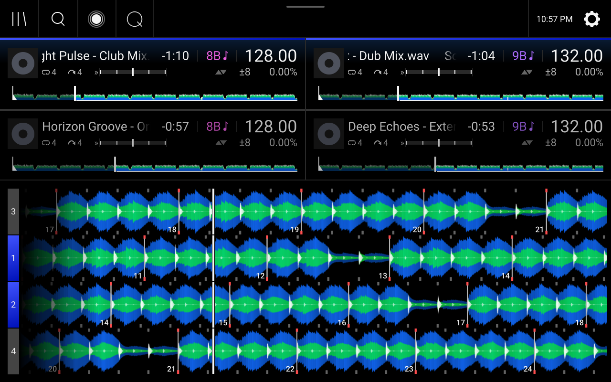
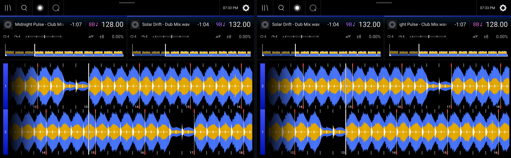
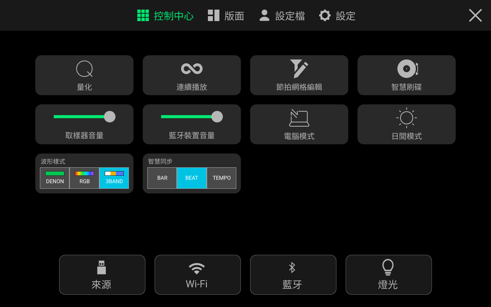
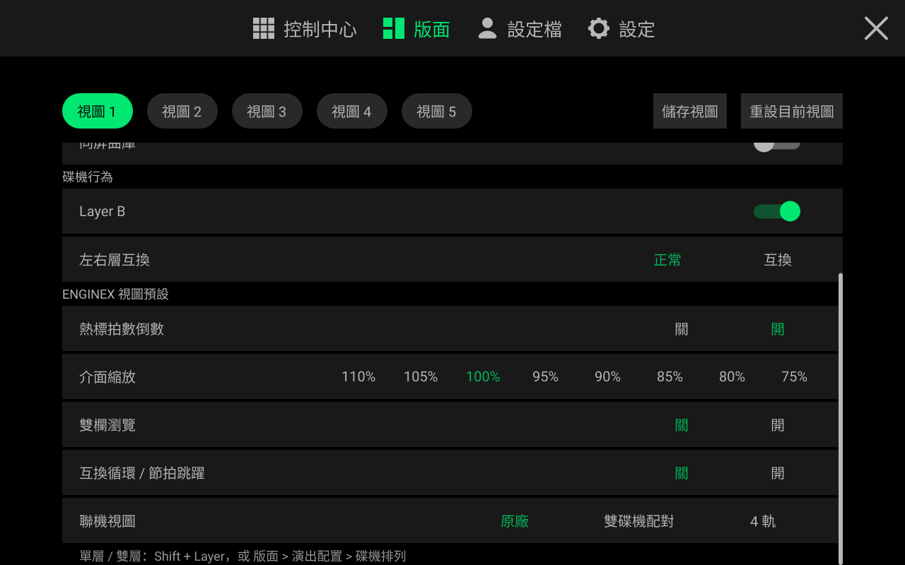
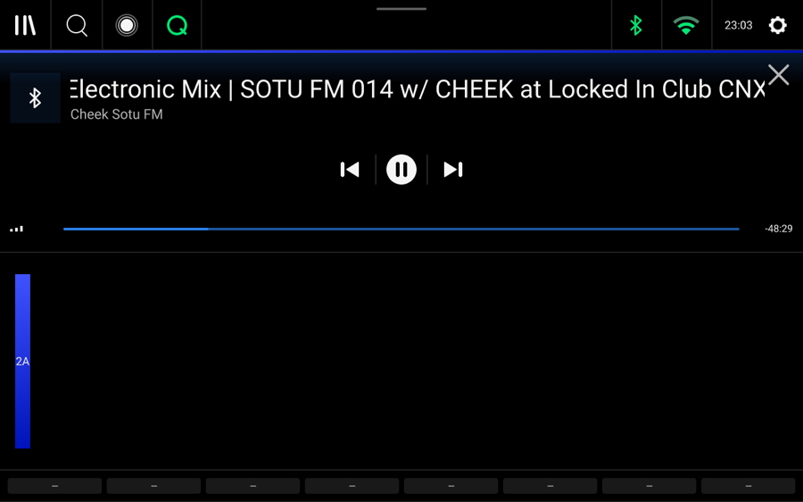
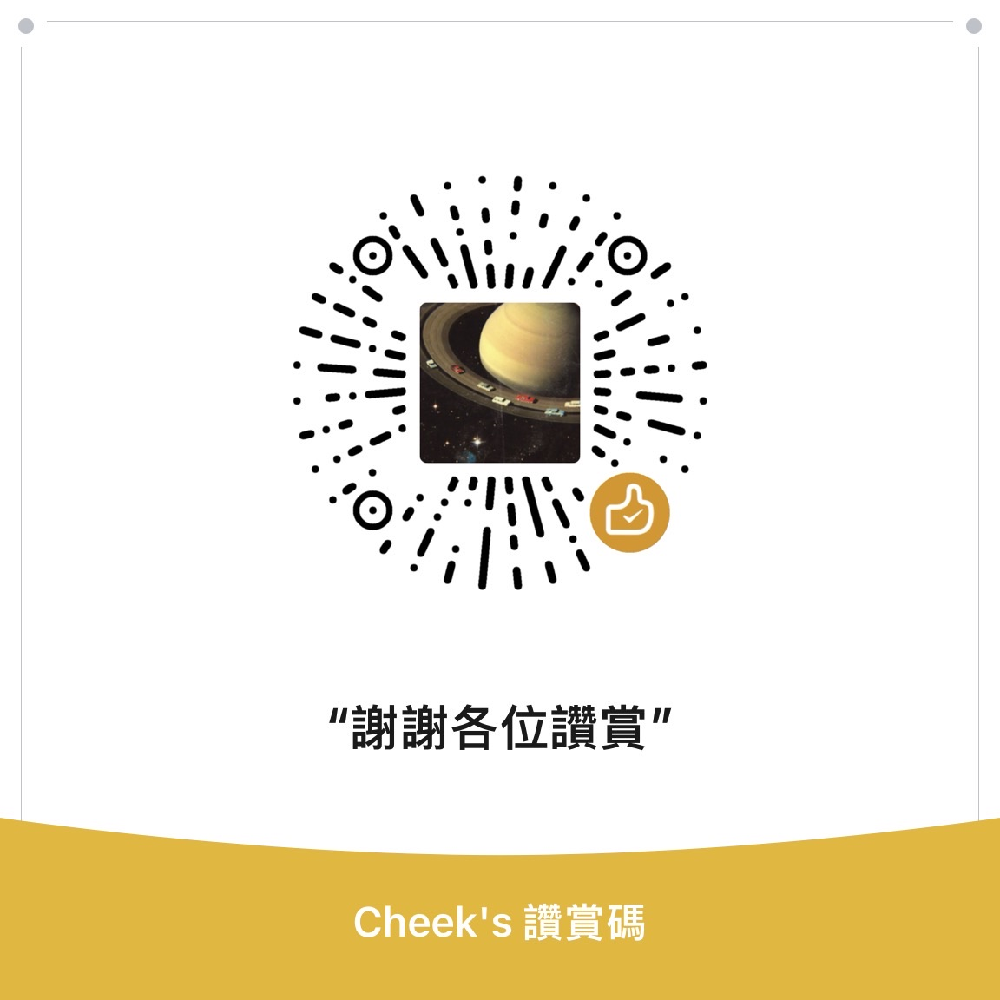

<div align="center">


<br>

<a href="./README.md"></a>
<a href="./README.zh-CN.md"></a>
<a href="./README.zh-TW.md"></a>

<br>

**[核心功能](#features)** · **[下載與安裝](#install)** · **[實機畫面](#gallery)** · **[效能對比](#benchmarks)** · **[讚賞支持](#sponsor)**

📖 **線上使用文件**：<https://enginexdj.com> · **路線圖**：<https://enginexdj.com/#roadmap>

</div>

<br>

**EngineX OS 5.3.0.4** 是基於官方 Engine OS 5.3.0+ 底層重構的客製系統，支援天龍 Denon DJ、Numark 與 Rane 全系 16 款獨立設備：
`SC5000` · `SC5000M` · `SC6000` · `SC6000M` · `PRIME 4` · `PRIME 2` · `PRIME GO` · `Mixstream Pro` · `SC LIVE 4` · `SC LIVE 2` · `PRIME 4+` · `PRIME GO+` · `Mixstream Pro+` · `Mixstream Pro Go` · `PRIME 4 G2` · `Rane SYSTEM ONE`。

全系 16 款機型現統一使用 `*-Update.img` 升級包：前八款一代機直接用隨身碟免電腦刷入；後八款二代機首次連接電腦執行一次 `EngineX-Installer` 自動完成**一鍵解鎖 `.img` 升級鏈並刷入**，之後即可像一代機一樣直接用隨身碟或螢幕一鍵線上升級（見[如何安裝與升級](#install)）。

操作介面與原廠完全一致，安裝後即可在熟悉的原廠介面裡直接使用以下全部功能。

---

<a id="features"></a>

## 核心功能

### 1. 全機型 4 軌 Stems 即時分軌（人聲 / 旋律 / 貝斯 / 鼓組）
- 在本機或串流曲目上向左滑即可拆出 **Vocal（人聲）、Melody（旋律）、Bass（貝斯）、Drums（鼓組）** 四軌，並自動歸入曲庫側邊欄 `Stems` 歌單；
- 演出時直接按打擊墊一鍵靜音人聲做 Acapella 或單留鼓點過渡；在支援分軌 EQ 的一體機上按各通道 **Shift + Cue (PFL)**（或開啟 `設定檔 → 播放 → 分軌 EQ 模式`），即可用實體 `HIGH / MID / LOW` 旋鈕流暢控制分軌音量；
- 不連電腦即可在播放機本機完成分軌；同一區域網路下執行電腦端服務時，自動呼叫顯示卡與 `htdemucs` 神經網路模型完成高音質分軌（`PRIME 4 G2` 與 `SYSTEM ONE` 維持官方 Stems 行為）。

### 2. 內建 7 大串流音源（手機掃碼與一鍵配對登入）
- 來源選單直接內建 **TIDAL、網易雲音樂、Spotify、Deezer、SoundCloud、Beatport、Apple Music**，與隨身碟、SD 卡並列顯示；
- 手機掃描播放機螢幕 QR Code（或在 Spotify Connect 裡點選 **`EngineX OS`**）即可登入帳號，直接瀏覽個人歌單、收藏夾並依 BPM、調性、評等、歌名或歌手排序；
- 支援 **無損 FLAC 與 320 kbps** 音質切換；播放過的曲目依平台各自獨立快取在播放機內部儲存，再次載入直接秒開（網易雲開啟 `Deemix 優先` 時與 Deezer 共享無損快取）；
- **OmniSource**（`設定檔 → 曲庫 → OmniSource（在串流中顯示 USB/SD）`，預設關閉）支援一次搜尋同時查找各串流平台、隨身碟 / SD 卡、djay 曲庫與網路共用，同時保持各平台自己的歌單頁乾淨不混單。

### 3. 先鋒 Rekordbox 隨身碟隨插即用與 CDJ 互聯
- 給先鋒 CDJ 匯出的 Rekordbox 隨身碟直接插上播放機，**2 秒內**讀取全部歌單、Hot Cue、Memory Cue、Loop 與拍線（含舊版 rekordbox 5 匯出的隨身碟），不必再用電腦版 Engine DJ 重新轉庫；
- 相容 `FAT32` / `exFAT` / `NTFS` 與 Mac `HFS+`（`Mac OS 擴充格式`；不支援 `APFS`，請將隨身碟格式化為 `exFAT` 或 `Mac OS 擴充格式`），自動補償 MP3 編碼起始延遲讓拍線與 Cue 精準落在鼓點上，自動修復異常拔碟造成的資料庫損毀並移除「未安全退出」彈窗；
- **Pro DJ Link（測試版，位於 `設定 → 服務`）** 支援跨網路線 / Wi-Fi 瀏覽 CDJ 上的 Rekordbox 隨身碟、向 CDJ 分享本機曲庫、雙向交接 `MASTER`，並在影子軌或一體機 `線路輸入`（`Line In`）通道即時顯示 CDJ 波形。

### 4. 四軌聯機與雙碟機配對視圖、5 組儲存版面與三語介面
- **`聯機視圖`（`版面 → ENGINEX 視圖預設 → 聯機視圖`）**：獨立播放機可在 `原廠`、`雙碟機配對`（同屏顯示兩條全高波形：本機目前 Layer 在上，另一台碟機目前 Layer 在下）與 `4 軌`（四軌波形同屏，對端軌道作為靜音影子軌即時跟隨）之間切換，4 軌一體機可在 `原廠` 與 `4 軌` 之間切換；
- **5 組預設版面與介面縮放**：支援儲存 `視圖 1`–`視圖 5` 共五組獨立版面，分別記住 `熱標拍數倒數`、`介面縮放`（`110%`–`75%`）、帶 BPM 顯示的 `雙欄瀏覽` 與 `互換循環 / 節拍跳躍`；
- **3 種波形配色與 3 種語言**：全系 16 款支援 **繁體中文 / 简体中文 / English** 免重啟切換，並於控制中心或 `設定檔 → 顯示 → 波形樣式` 一鍵切換 `Denon`、`RGB` 與先鋒風格 `3-Band` 波形。

### 5. 演出現場音質保護、一體機先鋒風格效果與 Gigabit 網路
- **21 項即時音訊保護**：消除切效果器爆音，內建零延遲 `0dB 防破音軟限幅`（峰值壓在 -0.1 dBFS 以下）、`自動增益（0 dB 正規化）`、Flanger 音量下沉補償，以及帶混音台一體機上的 `推桿回音` / `回聲淡出`；
- **一體機先鋒風格效果**：`PRIME 4` 硬體效果選擇器內建 `Spiral (PX)`、`Pitch Echo (PX)`、`Slip Roll (PX)`、`Dub Echo (PX)`、`Space (PX)`，其餘一體機提供 `設定檔 → 播放 → 先鋒風格效果 (Color FX)` 以及選配的 **10–4000 ms** 獨立毫秒延遲模式（`先鋒效果延遲模式 (PX)`；獨立播放機不提供 PX 效果，維持純淨播放機音訊路徑）；
- **智慧同步、Gigabit 網路孔與 `:8080` Web 主控台**：控制中心一鍵切換 `Bar / Beat / Tempo` 同步並在大 BPM 差距下自動擴大變速範圍，有線網路孔解鎖 **1 Gbps** 滿速，`:8080` 網頁主控台支援 Wi-Fi 拖曳傳歌、遺失曲目一鍵重新定位、Shoutcast / Icecast `直播推流`，以及按需安裝的 Mod 外掛中心（`tailscale-remote`、`dmx-studio`、`midi-controller-mapper`、`jog-logo-studio`、`sampler-pad-studio`、`minimal-club-mode`）。

---

## 5.3.0.4 更新內容

### 新功能
- **二代機全系 8 款統一 `*-Update.img` 與一鍵解鎖刷機**：全系 16 款機型現統一發佈單檔案 `*-Update.img` 升級包。原廠二代機首次只需進入 `韌體更新模式` 接 USB 執行一次 `EngineX-Installer`，自動完成 **[1/2] 一鍵解鎖 `.img` 升級鏈** 與 **[2/2] 刷入 `*-Update.img`**；解鎖後後續升級與一代機完全一致——既可將 `*-Update.img` 放進隨身碟插機升級，也可於螢幕 `設定 → 關於 / 更新` 一鍵線上 OTA，全程免電腦。
- **Spotify 原生音訊與免設定登入**：Spotify Premium 直接拉取原生 320 kbps Ogg Vorbis 音訊並自動產生 BPM、調性與波形入庫，絕不跨平台找替身；同一網路下在 Spotify Connect 選擇 **`EngineX OS`** 或掃描螢幕 QR Code 即可登入，無需自建開發者應用。
- **`聯機視圖` 三合一選擇器與 `雙碟機配對` 2 軌視圖**：`版面 → ENGINEX 視圖預設 → 聯機視圖` 在 `SC5000 / SC6000` 上整合 `原廠` / `雙碟機配對` / `4 軌`（4 軌一體機為 `原廠` / `4 軌`），一步即可切回 `原廠` 單/雙層視圖。`雙碟機配對` 為兩台聯機獨立播放機展示上下兩條全高波形（上方為本機目前 Layer，下方即時跟隨對端碟機目前 Layer），與 `4 軌` 互切無需重新啟動 Engine。
- **`影子軌模式`（`自動` / `全部 Engine 模式` / `全部 CDJ 模式`）免重啟即時切換**：預設 `自動` 下，對端 EngineX 碟機或 CDJ 隨身碟中可複製的曲目由本機靜音載入，以原廠介面完整繪製波形、拍線、滑行線、移調、循環、`Stems` 圖示、綠色 `Sync` BPM 與 `主控 (LEAD)`（載入期間顯示曲目資訊與進度環）；無法複製的 CDJ 音源自動回退顯示原廠樣式的 CDJ 波形並註明原因。切換模式即時生效，不中斷本機播放。
- **一體機 `線路輸入`（`Line In`）顯示 CDJ-3000 波形**：在 `PRIME 4` 等一體機上把通道輸入切到 `Line In`，聯機的先鋒 CDJ-3000 波形與播放進度會直接顯示在該通道上。
- **`PRIME 4` 硬體 `(PX)` 效果器與 `10–4000 ms` 毫秒延遲模式**：`PRIME 4` 硬體效果選擇器新增 5 款 `(PX)` 效果與獨立時間檔位控制；一體機 `設定檔 → 播放 → 先鋒效果延遲模式 (PX)`（及 `:8080` 主控台）支援為延遲類 PX 效果開啟獨立於 BPM 的 `10–4000 ms` 毫秒延遲。
- **`SC LIVE 4` AUX 通道混音與 `Mixstream` 實體濾波 / 跳拍打擊墊**：`SC LIVE 4` 可於 `混音器選單 → 通道 → 輸入` 將 `AUX` 送入通道 3 或 4 使用通道推桿、EQ、監聽與濾波效果並保留 `MIC 2`；`Mixstream Pro / Pro+ / Pro Go` 恢復實體 `FILTER` 旋鈕原廠濾波效果、觸控跳拍、`節拍跳躍打擊墊` 與 `EQ / 分軌` 切換。
- **電腦端高音質 `htdemucs` Stems 預設開啟與內建腳本**：電腦端區域網路分軌預設採用高音質 `htdemucs` 模型，播放機 `設定檔 → 曲庫` 與 `設定 → 關於 / 更新` 即時提示連線狀態，四個平台的 `EngineX-Installer` 壓縮檔皆內建一鍵啟動腳本。
- **USB MIDI 控制器映射 Mod、脫敏日誌下載與免網域公網通道**：Mod 社群新增 `midi-controller-mapper`（內建 Pioneer CDJ-400 預設直控內部第 3 / 4 軌），`:8080` 主控台新增 `詳細日誌` 開關與一鍵脫敏日誌下載，`enginex-relay` 新增多播放機在線總覽，並支援一鍵開啟 Cloudflare Quick Tunnel 免網域遠端掃碼登入。

### 修復與調整
- **一體機串流曲目雙向錄音**：具錄音功能的一體機現可在載入串流曲目時開始錄音，錄音過程中也能繼續載入串流曲目 *（串流服務條款可能不允許保留其曲目的錄音，請僅供個人使用）*。
- **Rekordbox MP3 拍線精準對齊與 rekordbox 5 隨身碟相容**：自動修正 MP3 編碼延遲導致的約 26–51 ms 拍線、Hot Cue、Memory Cue 與 Loop 偏移（已匯入過的隨身碟再次插入時自動重轉受影響的 MP3 一次），並支援舊版 rekordbox 5 匯出的隨身碟。
- **官方 Mod `1.1.0` 全機型免 Python 即裝即用**：全部 5 款官方 Mod 改用自帶的原生輔助程式，徹底解決播放機無 Python 無法啟動的問題；支援於 `:8080` 直接上傳 `1.1.0` 就地覆蓋升級並保留原有設定，修復區域網路存取 Mod 中心報錯及套件可執行權限遺失。
- **啟動復原安全網與斷電保護**：若開機意外卡住或連續異常退出，播放機會自動退回到原廠 Engine 並隔離外置 Mod（絕不觸發恢復原廠設定、絕不清空曲庫），插入隨身碟或 SD 卡即可自動匯出脫敏診斷報告；異常斷電重啟後自動清理殘留介面快取。
- **獨立播放機 `取樣器輸出`、四軌操控與影子軌 `Sync` 穩定性**：`SC5000 / SC6000` 在二軌與四軌下皆保留 `設定 → 混音器 → 取樣器輸出`（`Layer A` / `Layer B`）、`碟機編號 #`、`碟機顏色` 雙層選色盤、`Layer B` 開關與 `Browse` 按壓直載目前層；靜音影子軌絕不搶 `MASTER`，支援超過 `+100%` 變速的跨倍速 `Sync` 緊鎖，對端關機乾淨退歌不卡切源，緊湊軌道頂欄數字定寬不晃動。
- **設定項精簡、全介面簡繁翻譯補齊與斷電時區記憶**：全機型解鎖原廠 `設定檔 → Cue / Loop → 連動節拍跳躍與 Loop 長度` 且絕不竄改使用者開關；`打擊墊亮度` 平滑調節彩燈並維持 `SYNC`、`KEYLOCK`、`SLIP` 等單色鍵原廠亮度；轉盤、波形縮放與非主控 `MASTER` 燈恢復原廠手感與暗亮值；獨立播放機隱藏先鋒風格 PX 效果；移除無效的自動分析磁碟開關；原廠 `Engine 燈光` 預設關閉，開啟或關閉後的選擇在重新啟動、斷電後保留；補齊設定頁全部簡繁中文翻譯（`Layer A`、`Layer B` 與 `3-Band` 維持英文）；內建中國大陸與全球 NTP 時間池，斷電離線開機仍保留已選時區與時鐘進度。
- **二代機 Stems 偵測與命令列安裝器強化**：修復 `SC LIVE 4` 等二代機點 **Generate Stems** 跳回設定頁的問題並對齊圖形快取上限；一代機 `.img` 內建客製開機畫面並消除首次開機無效 Stems 下載提示；提升命令列 `EngineX-Installer` 對 `SC LIVE 4`、`Mixstream Pro+ / Pro Go`、`PRIME 4+` 及一代機 USB / 區域網路的辨識率。

> **先鋒 CDJ 連線說明**：與先鋒 CDJ-3000 的區域網路互通（曲庫分享、3-Band 波形、播放頭跟隨與 Master / Beat Sync 雙向交接）基於實機 Denon SC5000 與 [**OpenProLink**](https://github.com/Cd1s/OpenProLink) 聯調驗證，歡迎擁有先鋒 CDJ / XDJ / DJM 真機的玩家回報實測體驗！

---

<a id="gallery"></a>

## 實機畫面

<table>
<tr>
<td width="50%" align="center" valign="top">
<br>
<b>雙機互聯四軌同屏與影子波形</b><br>
<sub>本機雙層軌道與對端播放機即時同步的靜音影子軌四軌波形同屏滾動</sub>
</td>
<td width="50%" align="center" valign="top">
<br>
<b>雙碟機配對 2 軌視圖（SC5000 / SC6000）</b><br>
<sub>同屏兩條全高波形：上方為本機目前 Layer，下方即時跟隨對端碟機目前 Layer</sub>
</td>
</tr>
<tr>
<td width="50%" align="center" valign="top">
<br>
<b>原生 4 軌 Stems 分軌與 3-Band 波形</b><br>
<sub>底部顯示人聲、旋律、貝斯、鼓組四軌狀態，打擊墊一鍵靜音</sub>
</td>
<td width="50%" align="center" valign="top">
<br>
<b>曲庫側邊欄 Stems 專屬歌單</b><br>
<sub>所有已分軌曲目自動歸類，隨時篩選呼叫</sub>
</td>
</tr>
<tr>
<td width="50%" align="center" valign="top">
<br>
<b>來源頁內建 7 大音樂平台</b><br>
<sub>TIDAL · 網易雲 · Spotify · Deezer · SoundCloud · Beatport · Apple Music 與隨身碟並列</sub>
</td>
<td width="50%" align="center" valign="top">
<br>
<b>螢幕 QR Code 掃碼登入</b><br>
<sub>手機掃一掃直接同步個人歌單，免輸入密碼</sub>
</td>
</tr>
<tr>
<td width="50%" align="center" valign="top">
<br>
<b>下拉控制中心</b><br>
<sub>量化、智慧刷碟、波形樣式與智慧同步一屏直達</sub>
</td>
<td width="50%" align="center" valign="top">
<br>
<b>版面頁（視圖 1–5 與 EngineX 視圖預設）</b><br>
<sub>5 組預設視圖、熱標拍數倒數、介面縮放、聯機視圖、四軌角色與影子軌模式</sub>
</td>
</tr>
<tr>
<td width="50%" align="center" valign="top">
<br>
<b>線上歌單 BPM / 調性預覽與左滑分軌</b><br>
<sub>載入前即可查看曲目 BPM 與調性，左滑一鍵拆分 Stems</sub>
</td>
<td width="50%" align="center" valign="top">
<br>
<b>裝置設定選單</b><br>
<sub>切換語言、打擊墊亮度、碟機編號 #、時間同步與電源關機</sub>
</td>
</tr>
<tr>
<td width="50%" align="center" valign="top">
<br>
<b>設定 → 關於 / 更新：螢幕一鍵線上升級</b><br>
<sub>偵測到新版本時直接點「更新」即可線上下載升級</sub>
</td>
<td width="50%" align="center" valign="top">
<br>
<b>原生藍牙音訊輸入與播放控制</b><br>
<sub>手機藍牙串流到播放機，螢幕顯示曲目資訊，可直接播放/暫停與切歌</sub>
</td>
</tr>
</table>

---

<a id="benchmarks"></a>

## 重構前後效能與佔用對比（SC5000 實機實測）

系統經過全面精簡，所有增強功能僅佔極小空間，比原廠韌體留出更多可用記憶體：

| 對比項目 | 官方原廠 / 重構前 | 重構後（`EngineX OS 5.3.0.4` 實測） | 實際演出提升 |
| :--- | :--- | :--- | :--- |
| **刷機包體積 (`*-Update.img`)** | 官方原廠 5.3.0 `147.79 MB`<br>早期改版 `~210 MB` | **`151.44 MB`**（SC6000 `151.58 MB`，PRIME 4 `151.52 MB`） | **僅比官方原廠大 `3.64 MB`** |
| **純刷機開機硬碟佔用 (`/data`)** | 舊版殘留約 `243 MB` | **核心程式 + 三語介面僅佔 `17.2 MB`**（含擴充磁碟格式驅動共 `45.6 MB`） | 內建快閃記憶體多騰出 **近 `200 MB`** 空間 |
| **整機可用記憶體（總 `2 GB`）** | `~680 – 780 MB` | **`1,042 MB` 空閒可用**（主程式省出 `~150 MB`，背景服務合計僅佔 **`29.2 MB`**） | **多釋放 `~260 MB` 記憶體**，長時間演出不卡頓 |
| **音訊核心被背景搶佔率** | 下載或匯入時偶發佔用 `5% – 25%` | **`0.0%`**：所有下載與分軌任務隔離在獨立副核心，不碰音訊核心 | **96 kHz 聲音播放全程零斷音** |
| **先鋒 Rekordbox 隨身碟讀取速度** | 首次轉換約 `8 分鐘`，重掃 `15–24 秒` | **首次插碟 `< 2 秒`**，再次插碟 **`0.03 秒`** | 插上隨身碟即插即打，無需等待 |
| **4 分鐘歌曲 Stems 分軌耗時** | SC5000 原廠鎖死不可用 | 連電腦 / 雲端約 **`35 秒`**；播放機本機分軌比播放速度快 **`1.4 倍`** | 演出中途臨時拆人聲也能快速完成 |
| **大 BPM 差距同步** | BPM 差距超出變速範圍時 Sync 對不上，需手動調大變速範圍 | **智慧同步**自動升檔變速範圍（最高 `±100%`），控制中心一鍵切 Bar / Beat / Tempo | 速度相差很大的兩首歌也能直接同步 |
| **網路傳輸速度** | 有線網路孔限制在 `100 Mbps` | 有線網路孔 **`1 Gbps`（1000 Mbps）全雙工**；Wi-Fi 實測約 `9～10 MB/s`（受主機板匯流排頻寬限制） | 大曲庫走 Gigabit 有線網路孔高速傳輸 |

---

<a id="install"></a>

## 如何安裝與升級

### 方式零：全系 16 款命令列安裝工具 `EngineX-Installer`（原廠二代機首次必用一次）

`EngineX-Installer` 是跨平台 **命令列工具**（終端機程式，非圖形視窗軟體），支援 Windows、macOS 與 Linux。它不必輸入 IP 或手動選擇機型，可自動探索同一區域網路 / Wi-Fi 或處於 USB 韌體更新模式的播放機，下載對應的 `5.3.0.4` `*-Update.img` 升級包、校驗 SHA-256 並引導完成安裝（二代機自動執行 **[1/2] 一鍵解鎖 `.img` 升級鏈** + **[2/2] 刷入 `*-Update.img`**）。

- [Windows 10/11 x64](https://github.com/Cd1s/EngineX-OS/releases/latest/download/EngineX-Installer-5.3.0.4-windows-amd64.zip)
- [macOS Apple Silicon M1–M4](https://github.com/Cd1s/EngineX-OS/releases/latest/download/EngineX-Installer-5.3.0.4-macos-arm64.zip)
- [macOS Intel](https://github.com/Cd1s/EngineX-OS/releases/latest/download/EngineX-Installer-5.3.0.4-macos-amd64.zip)
- [Linux x86_64](https://github.com/Cd1s/EngineX-OS/releases/latest/download/EngineX-Installer-5.3.0.4-linux-amd64.tar.gz)

解壓後於終端機執行 `Install-EngineX.bat`（Windows）、`Install-EngineX.command`（macOS）或 `./install-enginex.sh`（Linux）。區域網路安裝需播放機已開啟 root SSH，可完整保留音樂與設定；USB 線刷需安裝 `fastboot` 與 Python 3（新建二代機 `/data` 映像另需 `e2fsprogs`；Windows 線刷二代機請透過 `usbipd-win` 將 USB 直通給 WSL 2，並以 `wsl -u root` 執行 Linux 版安裝器）。**請先備份播放機資料**：透過 USB 刷入全新二代機 `/data` 映像會清空內建 `/data` 分割區上的音樂、曲庫與設定（刷機前請拔除隨身碟與 SD 卡）。

### 方式一：一代機型 —— 隨身碟免電腦直接刷機
1. 點擊下方對應你機器型號的直連網址下載 `*-Update.img` 韌體（或前往 [**Releases 頁面**](https://github.com/Cd1s/EngineX-OS/releases/latest)）：
   - **Denon DJ SC5000 Prime**：[`SC5000-5.3.0.4-EngineX-OS-Denon-SC5000-Prime-JP07-Update.img`](https://github.com/Cd1s/EngineX-OS/releases/latest/download/SC5000-5.3.0.4-EngineX-OS-Denon-SC5000-Prime-JP07-Update.img)
   - **Denon DJ SC5000M Prime**：[`SC5000M-5.3.0.4-EngineX-OS-Denon-SC5000M-Prime-JP08-Update.img`](https://github.com/Cd1s/EngineX-OS/releases/latest/download/SC5000M-5.3.0.4-EngineX-OS-Denon-SC5000M-Prime-JP08-Update.img)
   - **Denon DJ SC6000 Prime**：[`SC6000-5.3.0.4-EngineX-OS-Denon-SC6000-Prime-JP13-Update.img`](https://github.com/Cd1s/EngineX-OS/releases/latest/download/SC6000-5.3.0.4-EngineX-OS-Denon-SC6000-Prime-JP13-Update.img)
   - **Denon DJ SC6000M Prime**：[`SC6000M-5.3.0.4-EngineX-OS-Denon-SC6000M-Prime-JP14-Update.img`](https://github.com/Cd1s/EngineX-OS/releases/latest/download/SC6000M-5.3.0.4-EngineX-OS-Denon-SC6000M-Prime-JP14-Update.img)
   - **Denon DJ PRIME 4**：[`PRIME4-5.3.0.4-EngineX-OS-Denon-PRIME-4-JC11-Update.img`](https://github.com/Cd1s/EngineX-OS/releases/latest/download/PRIME4-5.3.0.4-EngineX-OS-Denon-PRIME-4-JC11-Update.img)
   - **Denon DJ PRIME 2**：[`PRIME2-5.3.0.4-EngineX-OS-Denon-PRIME-2-JC16-Update.img`](https://github.com/Cd1s/EngineX-OS/releases/latest/download/PRIME2-5.3.0.4-EngineX-OS-Denon-PRIME-2-JC16-Update.img)
   - **Denon DJ PRIME GO**：[`PRIMEGO-5.3.0.4-EngineX-OS-Denon-PRIME-GO-JP11-Update.img`](https://github.com/Cd1s/EngineX-OS/releases/latest/download/PRIMEGO-5.3.0.4-EngineX-OS-Denon-PRIME-GO-JP11-Update.img)
   - **Numark Mixstream Pro**：[`MIXSTREAMPRO-5.3.0.4-EngineX-OS-Numark-Mixstream-Pro-NH08-Update.img`](https://github.com/Cd1s/EngineX-OS/releases/latest/download/MIXSTREAMPRO-5.3.0.4-EngineX-OS-Numark-Mixstream-Pro-NH08-Update.img)
2. 將 `.img` 檔案保持原檔名放進 **FAT32 或 exFAT 格式隨身碟的根目錄**。
3. 將隨身碟插入播放機（原廠 Engine OS 4.3.x 與 5.0.x+ 皆可直接刷入），開啟 **設定 → 關於 / 更新 → 韌體更新模式 → 選項**，看到 `Found 5.3.0.4 on USB/SD` 時選擇 **USB/SD**，機器會自動刷入並重新啟動。若只跳出 *Reboot into firmware update mode?*，請核對型號、確認檔案未改名且位於根目錄後重新插拔隨身碟。

### 方式一 b：二代機型 —— 首次一鍵解鎖 + 統一 `*-Update.img` 升級

二代機（**SC LIVE 4、SC LIVE 2、PRIME 4+、PRIME GO+、Mixstream Pro+、Mixstream Pro Go、PRIME 4 G2、Rane SYSTEM ONE**）沒有硬體熔斷鎖，原廠狀態下由軟體層驗證韌體簽章（未解鎖的原廠機直接刷改版 `.img` 只會在驗證階段退回，不會寫入快閃記憶體或變磚）。請先將播放機升至官方 **Engine OS 5.3.0**，再依以下兩階段安裝與升級：

1. **原廠二代機首次安裝（執行一次 `EngineX-Installer` 一鍵解鎖）**：
   - 解壓上方 **`EngineX-Installer`**，於終端機執行 `Install-EngineX.bat`（Windows）、`Install-EngineX.command`（macOS）或 `./install-enginex.sh`（Linux）。
   - 於原廠播放機螢幕開啟 **設定 → 關於 / 更新 → 韌體更新模式 → 選項** 進入 USB 更新模式並接上 USB 線——安裝器會自動執行 **[1/2] 一鍵解鎖 `.img` 升級鏈** 與 **[2/2] 刷入 `*-Update.img`**（僅寫入 `/data/enginex`，不改唯讀系統分割區；Windows 請用 `usbipd-win` 將 USB 直通給 WSL 2 並以 `wsl -u root` 執行 Linux 版安裝器；`PRIME 4 G2` 與 `SYSTEM ONE` 寫入完成後按電源鍵關機再開機即可啟用；若播放機已開 root SSH，同區域網路即可無損安裝且不清空 `/data`）。
2. **此後每次更新（隨身碟直刷或螢幕一鍵 OTA，無需電腦）**：
   - 完成首次解鎖後（先前已安裝過 EngineX 的二代機開機時也會自動解鎖），二代機的升級方式與一代機完全相同：將下方對應機型的 `*-Update.img` 保持原檔名放進 **FAT32 或 exFAT 隨身碟根目錄** 於播放機螢幕升級（**設定 → 關於 / 更新 → 韌體更新模式 → 選項 → USB/SD**），或直接點 **設定 → 關於 / 更新 → 更新** 一鍵線上 OTA！
   - **Denon DJ SC LIVE 4**：[`SCLIVE4-5.3.0.4-EngineX-OS-Denon-SC-LIVE-4-JP21-Update.img`](https://github.com/Cd1s/EngineX-OS/releases/latest/download/SCLIVE4-5.3.0.4-EngineX-OS-Denon-SC-LIVE-4-JP21-Update.img)
   - **Denon DJ SC LIVE 2**：[`SCLIVE2-5.3.0.4-EngineX-OS-Denon-SC-LIVE-2-JP20-Update.img`](https://github.com/Cd1s/EngineX-OS/releases/latest/download/SCLIVE2-5.3.0.4-EngineX-OS-Denon-SC-LIVE-2-JP20-Update.img)
   - **Denon DJ PRIME 4+**：[`PRIME4PLUS-5.3.0.4-EngineX-OS-Denon-PRIME-4-Plus-JC11S-Update.img`](https://github.com/Cd1s/EngineX-OS/releases/latest/download/PRIME4PLUS-5.3.0.4-EngineX-OS-Denon-PRIME-4-Plus-JC11S-Update.img)
   - **Denon DJ PRIME GO+**：[`PRIMEGOPLUS-5.3.0.4-EngineX-OS-Denon-PRIME-GO-Plus-JP11S-Update.img`](https://github.com/Cd1s/EngineX-OS/releases/latest/download/PRIMEGOPLUS-5.3.0.4-EngineX-OS-Denon-PRIME-GO-Plus-JP11S-Update.img)
   - **Numark Mixstream Pro+**：[`MIXSTREAMPROPLUS-5.3.0.4-EngineX-OS-Numark-Mixstream-Pro-Plus-NH08S-Update.img`](https://github.com/Cd1s/EngineX-OS/releases/latest/download/MIXSTREAMPROPLUS-5.3.0.4-EngineX-OS-Numark-Mixstream-Pro-Plus-NH08S-Update.img)
   - **Numark Mixstream Pro Go**：[`MIXSTREAMPROGO-5.3.0.4-EngineX-OS-Numark-Mixstream-Pro-Go-NH10-Update.img`](https://github.com/Cd1s/EngineX-OS/releases/latest/download/MIXSTREAMPROGO-5.3.0.4-EngineX-OS-Numark-Mixstream-Pro-Go-NH10-Update.img)
   - **Denon DJ PRIME 4 G2**：[`PRIME4G2-5.3.0.4-EngineX-OS-Denon-PRIME-4-G2-JP24-Update.img`](https://github.com/Cd1s/EngineX-OS/releases/latest/download/PRIME4G2-5.3.0.4-EngineX-OS-Denon-PRIME-4-G2-JP24-Update.img)
   - **Rane SYSTEM ONE**：[`SYSTEMONE-5.3.0.4-EngineX-OS-Rane-SYSTEM-ONE-RMZ2-Update.img`](https://github.com/Cd1s/EngineX-OS/releases/latest/download/SYSTEMONE-5.3.0.4-EngineX-OS-Rane-SYSTEM-ONE-RMZ2-Update.img)

<details>
<summary>二代機終端機手動安裝與解除安裝恢復原廠</summary>

- **於已解鎖 / 已開啟 root SSH 的播放機終端機內手動安裝 `*-Update.img`（完整保留音樂、曲庫與設定）**：
  ```sh
  sh /data/enginex/bundle/install.sh "/media/<隨身碟名稱>/<MODEL>-5.3.0.4-EngineX-OS-<Model>-Update.img"
  reboot
  ```
- **解除安裝恢復原廠**：於 `:8080` Web 主控台點擊 **「解除安裝恢復原廠」**，或同區域網路執行 `EngineX-Installer --uninstall`，或於播放機終端機執行 `sh /data/enginex/bundle/uninstall.sh && reboot`（僅移除 `/data/enginex` 與啟動掛鉤，保留曲庫與設定）。

</details>

> **PRIME 4 G2 / Rane SYSTEM ONE（64 位元機型）**：已包含三語介面、7 大串流服務（含原廠 Apple Music 解鎖、Spotify、Deezer、SoundCloud、Beatport、TIDAL、網易雲）、串流錄音、即時音質保護（`0dB 防破音軟限幅`、`自動增益`、`回聲淡出`、`先鋒風格效果 (Color FX)`、`先鋒效果延遲模式 (PX)`）、Rekordbox 隨身碟直讀與 `:8080` Web 主控台全部能力；Stems 維持官方韌體行為。

### 方式二：播放機螢幕一鍵線上升級（已安裝 EngineX OS 後）
- 連接 Wi-Fi 或網路線後開啟 **設定 → 關於 / 更新**；
- 點擊螢幕上的 **「更新」** 按鈕——全系 16 款一代與二代機型皆會自動下載、校驗並安裝 `5.3.0.4`，完整保留曲庫、串流帳號、預設視圖與已裝 Mod（GitHub Release 中同時保留 `*-Data-Bundle.tar.gz` 相容包，讓舊版 `5.3.0.2` / `5.3.0.3` 二代機也能直接於螢幕上一鍵 OTA 升級並在開機後自動解鎖 `.img` 直刷）。

### 選配：用電腦開啟高音質 `htdemucs` AI 分軌
播放機本機分軌為輕量快速模式。如需高音質神經網路分軌（預設自動啟用 `htdemucs`，支援顯示卡 / Apple Silicon MPS / CPU），在與播放機同一 Wi-Fi / 區域網路的電腦上解壓 `EngineX-Installer` 後，macOS 可直接雙擊 `stems/run-home-worker.command`，或於終端機執行一行指令（末尾加 `hpss` 可切換免 PyTorch 輕量模式）。播放機會自動探索電腦（不必輸入 IP 或密碼），並於 **設定檔 → 曲庫** 與 **設定 → 關於 / 更新** 顯示 `高音質分軌：<主機名> (htdemucs)`：
```sh
# macOS（雙擊 stems/run-home-worker.command，或於終端機執行）/ Linux
./stems/run-home-worker.sh

# Windows PowerShell（於解壓後的 EngineX-Installer 目錄內）
powershell -ExecutionPolicy Bypass -File .\stems\run-home-worker.ps1
```

### 串流掃碼登入指南
無需電腦或伺服器，手機與播放機連同一 Wi-Fi，在播放機 **來源** 選單點開平台掃碼即可：

| 平台 | 登入方式 |
| --- | --- |
| **網易雲音樂** | 用網易雲音樂 App 掃螢幕 QR Code 並確認（過期點一下換新）；於 `設定 → 服務 → 網易雲下載方式` 提供 `官方直下` 與 `Deemix 優先` 切換。 |
| **Spotify** | **音訊播放需 Spotify Premium。** 同一網路下在手機/電腦 Spotify Connect 點選 **`EngineX OS`**，或掃播放機 QR Code 於 Spotify 官方授權頁確認，無需自建 Client ID。直接拉取 320 kbps Ogg Vorbis（或 160 / 96 kbps）並自動分析 BPM、調性與波形，絕不跨平台備援。 |
| **Deezer** | 掃碼後於手機頁貼上你自己的 **ARL**（頁面附分步教學），同步歌單並解鎖無損 FLAC 下載。 |
| **SoundCloud** | 輸入使用者名稱或主頁連結即可（私人歌單在「進階」填入 `oauth_token`）。超過 10 分鐘的 DJ Set 與已綁 Go+ 帳號直連官方高音質串流；未綁 Go+ 時一般單曲自動在已登入的 Deezer / 網易雲 / Beatport 比對無損 / 320k 音訊，避開 30 秒試聽限制。 |
| **Apple Music** | 直接使用已解鎖的 Engine 5.3.0 原生 Apple Music 音源播放；手機頁可貼上公開歌單/專輯連結或登入個人資料庫。 |
| **TIDAL 與 Beatport** | 掃螢幕 QR Code 登入個人帳號即可（Beatport 僅儲存登入權杖，曲目同樣支援一鍵拆 Stems）。 |

### 選配：遠端登入中繼與免網域公網通道
當手機使用 4G/5G 行動網路掃碼登入，或需要集中查看多台播放機狀態時：
1. **播放機端免網域一鍵穿透**：開啟 `http://<播放機 IP>:8080` 點擊 **「開啟免網域公網通道 (Cloudflare Quick Tunnel)」**，數秒內產生 `https://*.trycloudflare.com` 公網位址供手機遠端存取與串流掃碼回呼。
2. **自建 `enginex-relay` 中繼**：於伺服器執行 `enginex-relay -public https://你的網域`（或 `enginex-relay -public auto` 免網域穿透），再把位址與密碼填入播放機 `:8080` 主控台。

---

## 演出現場公共網路安全防護

- **無預設 SSH 密碼、公開韌體零內建金鑰**：密碼登入徹底關閉，公開套件不內建任何人的 SSH 公鑰，未手動新增公鑰前 SSH 完全關閉。
- **內部控制介面僅限本機呼叫**：切歌、切換波形、切換語言、線上升級與分軌介面僅回應播放機本機請求，同 Wi-Fi 的其他人無法遠端操控你的播放機。
- **每台機器獨有的 8 位存取碼**：開啟 `http://<播放機 IP>:8080` 必須輸入播放機 `設定 → 關於 / 更新` 顯示的隨機存取碼 `XXXX-XXXX`（連續輸錯 5 次自動暫時鎖定）；串流 QR Code 僅用於對應平台登入，絕不開放主控台權限。

參與開發與原始碼建置說明見 [`CONTRIBUTING.md`](./CONTRIBUTING.md)。

---

<a id="sponsor"></a>

## 讚賞與支持

如果 **EngineX OS** 讓你的播放機更好用、在演出或練歌時幫到了你，歡迎讚賞支持或給專案點個 **Star**！

<table>
<tr>
<td width="33%" align="center" valign="top">
<br>
<b>微信讚賞碼</b><br>
<sub>微信掃一掃直接讚賞</sub>
</td>
<td width="33%" align="center" valign="top">
<br>
<b>幣安支付 (Binance Pay)</b><br>
<sub>幣安掃碼或轉幣安 ID：<code>565380652</code>（0 手續費）</sub>
</td>
<td width="33%" align="center" valign="top">
<br>
<b>USDT / USDC（幣安 EVM 全鏈通用）</b><br>
<sub>支援 BSC · ERC20 · Arbitrum · Optimism · Polygon · Base · opBNB</sub>
</td>
</tr>
</table>

> **幣安 ID (Binance UID，幣安內轉帳 0 手續費，點擊右側一鍵複製)：**
> ```text
> 565380652
> ```
>
> **USDT / USDC 鏈上收款位址（支援幣安所有 EVM 網路：`BSC (BEP-20)` · `Ethereum (ERC-20)` · `Arbitrum One` · `Optimism` · `Polygon` · `Base` · `opBNB` · `Avalanche C-Chain` · `zkSync Era` · `Scroll` · `Linea`）：**
> ```text
> 0x35e0c53dd887b37cd5db0064291f7c5a7442bc91
> ```

---

## Star 成長趨勢

<div align="center">
<a href="https://star-history.com/#Cd1s/EngineX-OS&Date">
  <picture>
    <source media="(prefers-color-scheme: dark)" srcset="https://api.star-history.com/svg?repos=Cd1s/EngineX-OS&type=Date&theme=dark" />
    <source media="(prefers-color-scheme: light)" srcset="https://api.star-history.com/svg?repos=Cd1s/EngineX-OS&type=Date" />
    
  </picture>
</a>
</div>

---

<div align="center">
<sub>MIT License · EngineX OS 是獨立的社群開源專案，與 inMusic Brands / Denon DJ / Numark / Rane 無關。本儲存庫僅提供開源修補與工具原始碼，不散佈任何受版權保護的原廠韌體檔案。</sub>
</div>
