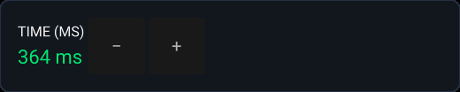

# PX delay time in milliseconds (#162, 5.3.0.4)

The optional **PX Delay Time Mode** setting under **Settings → User Profile →
Playback** defaults to **Default (Off)**. In **Milliseconds (ms)** mode, Spiral,
Pitch Echo and Dub Echo use a common **10–4000 ms** time independent of BPM.
The web console provides the same mode switch. On units without the native FX
selector, **PX Delay Time Mode** (and **PX Delay Time (ms)**) appears only while
**Color FX Style** is set to **Spiral**, **Pitch Echo** or **Dub Echo**, and
stays hidden (keeping its saved value while acting as **Off**) otherwise. The
Playback time list also controls the legacy master Color FX path, including AZ04.

On the verified PRIME 4 native PX selector, the existing Time/Rate input has
11 positions, mapped to 10, 18, 33, 60, 110, 200, 364, 663, 1207, 2197 and
4000 ms. Its readout displays the actual saved time. On-screen −/+ changes
that same value by 10 ms, clamped to the range. The setting is shared by the
PX units; adjusting either unit updates both units' time. Parameter and Wet/Dry
retain their separate roles. The stock header gains no tap action. Read-only native touch controls gain
labelled −/+ only in PX milliseconds mode; settings refreshes apply a complete
snapshot without briefly switching the mode OFF.

Stock Beat FX continue to use their stock beat controls and displays. Slip Roll
and Space retain their existing timing. Stock milliseconds support is outside
5.3.0.4's scope and is planned separately for 5.3.0.5. The older investigation
at `b6937b1` concerns stock effect-local timing; this change supplies independent
timing only for our PX emulations.

## Compatibility and implementation

The integration branch's `pioneer_fx_legacy.h`, `pioneer_master.h`, existing
Dub Echo constants and native Rate dispatcher stay intact. With the option
OFF, the new timing state is never written by the audio path and both the
master and per-unit output match the integration baseline byte for byte.
After turning OFF from ON, a short transition returns to that path.

The optional delay has a separate 393216-frame stereo ring. The callback runs
at 96 kHz: 4000 ms is 384000 frames. Integer parsing rejects suffixes, decimal
fractions, NaN, infinity and overflow; valid file integers clamp to 10–4000.
Every settings reload starts with OFF/500 ms defaults. API requests outside
the range are rejected. Removing a key cannot retain a stale enabled mode.

Time changes crossfade between read taps for 20 ms; milliseconds/default
switches crossfade with the existing PX output. Leaving a timed master style
keeps its sounding algorithm until the fade completes. Switching directly
between different legacy master Color FX styles still changes algorithms
without a crossfade and is outside this click guarantee; the native PX selector keeps
its existing effect-bank crossfades. Only after milliseconds mode is enabled does the polling worker prepare
buffer pages before publishing them to audio. Default OFF leaves the optional
ring pages untouched. The audio thread performs no allocation, locking or
large clears. No hook sites are added: `GATE_EXPECT_APPLIED` and DSP installation
counts remain unchanged.

## Regression checks

- `test_fx_ms`: strict configuration, exact 10/500/4000 ms impulses, OFF state
  identity, neighbouring Slip Roll/Space scope, switching threshold <0.08 for
  a 997 Hz/0.2-amplitude signal, ON output fingerprints, worker/audio handoff;
  plain, ASan/UBSan and TSan builds.
- `test_px_off_golden`: deterministic integration output for all five PX modes,
  changing Rate, eight seconds at 96 kHz, both floating-point contraction modes
  on armhf and AArch64. `test_master_golden` retains the existing legacy oracle.
- `test_ms_master_hook`: the actual master callback, mono/stereo 4000 ms,
  native armhf and AZ04. `test_flanger_scope` also checks that an enabled fixed
  time is independent of the native Rate position while the OFF Rate path works.
- `test_fx_ms_ui` and the native selector probe: strict reloads, stock scope,
  on-screen −/+, Rate/readout agreement, and return to native controls OFF.
- Existing selector/DSP tests, `test_az04_hook`, packer and rootfs overlay checks.

These are sandbox checks. No available physical deck has Beat FX controls.
Physical encoder/touch latency, OLED rendering, listening tests, external-input
routing, and simultaneous effects under hardware load remain unverified.
No firmware release or hardware installation is part of this change.
