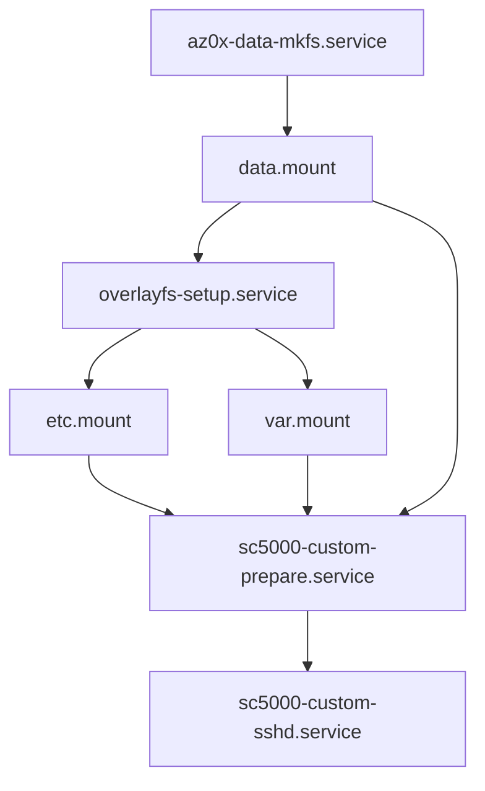

# SC5000 Engine OS 5.0.4 / 4.3.4 离线架构分析

分析日期：2026-11-02。设备：SC5000 / JP07 / RK3288 / ARMv7 hard-float。本报告区分镜像实测、公开参考与尚未验证的推断；没有连接或刷写实机。所有固件、解包树、模拟盘及外部仓库在 `/root/build/sc5000-lab`，不进入 git。

REA 关键二进制分析见 [REA-BINARY-REPORT.md](REA-BINARY-REPORT.md)。本报告的 SQLite、容器与启动脚本结论来自直接读取官方镜像，不以参考仓库的其他型号分析替代 SC5000 实测。

## 1. 输入与证据定位

| 项目 | 5.0.4 | 4.3.4 |
|---|---|---|
| 官方文件字节数 | 182,331,488 | 148,662,367 |
| 容器 magic | `41 5a 30 31` / AZ01 | `d0 0d fe ed` / FIT/FDT |
| rootfs 压缩 | XZ | XZ |
| 解压字节数 | 516,173,824 | 524,288,000 |
| rootfs 类型 | ext，无 journal，含 extents / 64bit / metadata_csum | ext，无 journal，含 extents |
| rootfs UUID | `b361379b-dfa9-4bdb-a0c8-3649abc28ced` | `4cff687e-a7e8-4f74-8752-4143e86e7d17` |
| 兼容设备 | `inmusic,jp07`, `jp08`, `jp11` | `inmusic,jp07` |

原包 SHA-256：

```text
5.0.4 52e8526bbfd273e5185b5d8c2a9cbe32436c3acd1c77dcfde97e40a34c5b24d7
4.3.4 ddcaf95100fd142c25dc6595ebf0d6b0504439c8c6baf69cdd51233133fcdc4e
```

解压 rootfs SHA-256：

```text
5.0.4 b6c73184f1dd519b16489cd3727b63529a899a10c0f97b4ddf4fc04442ec6d07
4.3.4 e683a2e002a9d302be1979ff97abecaec303e9cd2f9e8b040d601409dda8be34
```

下载源：

- [5.0.4 官方镜像](https://public.inmusiccdn.com/Engine/5.0.4/RELEASE/48fd65b16041710b/SC5000-5.0.4-Update.img)
- [4.3.4 官方镜像](https://enginedj.inmusiccdn.com/Engine/4.3.4/Release/0868152660cbb47b/SC5000-4.3.4-Update.img)

参考仓库版本：

| 仓库 | 实际检出 commit | 用途 |
|---|---|---|
| [BenevolentFutures/djinn](https://github.com/BenevolentFutures/djinn) | `3146702f7c20f9da7ac7670c66885c3cd293235a` | AZ01 / overlay 线索，原研究对象主要是 PRIME GO |
| [DeathCamel58/denon-reverse-engineering](https://github.com/DeathCamel58/denon-reverse-engineering) | `0f7966516609e3de2b71e4aef21625bd8d94c57c` | 设备树、固件与 Engine Library 文档 |
| [Peyton-C/QEngine](https://github.com/Peyton-C/QEngine) | `cf2617e2ae441466f58ee279efe62bae71de61b5` | JP07 ARMv7 实例构建与模拟 |
| [icedream/denon-prime4](https://github.com/icedream/denon-prime4) | `85bf9d31fa5bb58d009e37abf742502ada31c3c0` | 旧 FIT 解包与 Buildroot 参考 |

完整可机读容器证据：[5.0.4](ENGINE-5.0.4-container.json)、[4.3.4](ENGINE-4.3.4-container.json)。lab 路径：`fw/SC5000-<version>-Update.img`、`<version>/rootfs.ext2`、`<version>/tree/`、`<version>/kernel.config`、`<version>/kernel.raw`。

## 2. AZ01 字节布局、版本与校验

### 2.1 版本命名必须分开

5.0.4 的 `+0x04` LE u32 **实际等于 1**。更新器 `/usr/lib/libaz01-prog.so.1.3` 导出 `az01_image_fdt_ops`、`az01_image_v2_ops`、`az01_image_v3_ops`；参考研究所说的“v2”是更新器格式家族，不能直接写成文件头数值 2。4.3.4 是 FIT，FDT header version 为 17，也不是 AZ01 wire version。

REA 实际反编译进一步确认：`az01_open_image`（ELF VA `0x738c`，该会话 Ghidra VA `0x1738c`）按 magic `AZ01` / `AZ0x` 分派到 v2 / v3，两个 parser 都检查第二个 u32 为1。v3 因此也不表示磁盘字段数值3。v2 ops 的 `+0x2c` 签名回调为0；`az01_image_for_each_signature`（ELF VA `0x779c`）访问此字段，为空返回 -11。可将本次样本准确表述为“AZ01 / 更新器v2家族 / 磁盘版本1 / SHA-1一致性校验”，不能把别的型号 AZ0x 签名格式混入。

本工具将已验证的文件头明确命名为 `wire_version=1`，只允许这一布局。没有真实 wire version 2 样本，因此不宣称支持或臆造其头格式。未知版本、签名记录、未知扩展均拒绝；签名格式不做降级或绕过。REA 对更新器分派与签名函数的进一步证据见单独报告。

### 2.2 5.0.4 文件头

除 magic/tag/原始字节外，下面整数均为 little-endian。

| 偏移 | 字段 |
|---|---|
| `0x0000` | `AZ01`，4 字节 |
| `0x0004` | u32 wire version = 1 |
| `0x0008` | u32 首分区记录偏移 = `0xa0` |
| `0x000c` | u32 字符长度 = 23；随后 `SNAPSHOT-20260724110618`、NUL、4 字节对齐 |
| `0x0028` | u32 compatible count = 3 |
| `0x002c` / `0x0040` / `0x0054` | 三个字符串：`inmusic,jp07` / `jp08` / `jp11`，各 length=12 |
| `0x0068` | u32 USB device count = 3 |
| `0x006c` / `0x0070` / `0x0074` | u32 `0x15e4d006` / `0x15e4d00a` / `0x15e4d00c` |
| `0x0078` | u32 字符长度 = 32；`Planck AZ01 Player upgrade Image`、NUL、padding |
| `0x00a0` | 第一个 PART 记录 |

字符串编码：`u32 n` + `n` 个 ASCII 字节 + NUL + 零填充到 4 字节边界，所占大小 `4 + align4(n+1)`。USB device 列表是容易被旧笔记漏掉的独立字段；不能把它当描述字符串。

### 2.3 分区记录

```text
8 bytes tag       PARTP\0\0\0 / PARTX\0\0\0 / PARTL\0\0\0
u64 payload_size
string partition_name
string compression
u32 hash_count    1
string algorithm  sha1
u32 digest_size   20
20 bytes digest
payload_size bytes payload
```

下个记录紧接 payload，无额外分区对齐。blob 的填充规则与字符串不同，不应额外插入 NUL；本样本 digest 长度恰好四字节对齐。

| 分区 | 记录偏移 | payload 偏移 | payload 长度 | SHA-1 |
|---|---|---|---|---|
| splash / none | `0xa0` | `0xf0` | 4,096,000 / `0x3e8000` | `cb30d080e8661feb7d745ec55d27af4b09a8f06d` |
| recoverysplash / none | `0x3e80f0` | `0x3e8148` | 4,096,000 / `0x3e8000` | `67fb8d4b8afbe213b669fb1414f4a96a29e0f80d` |
| rootfs / xz | `0x7d0148` | `0x7d0194` | 174,139,068 / `0xa6126bc` | `c1456f89548b0b86fc65b369c14cf859147c8743` |

rootfs size 字段位于 `0x7d0150`，SHA-1 位于 `0x7d0180`。EOF 起点 `0xade2850`，完整 16 字节：

```text
45 4f 46 00 10 00 00 00 00 00 00 00 00 00 00 00
```

三个 payload SHA-1 均实测匹配。头部每个字节均由上表字段解释，未发现单独 header CRC、全包 CRC、全包哈希或签名字节。XZ 自身的 header/block/footer 校验由 liblzma 检查，与 AZ01 分区 SHA-1 是两层机制。不能因为存在 OpenSSL/RSA 库就断言此样本已签名，也不能因为样本无签名就断言整个平台没有验签能力。文件头本身没有被这些 payload SHA-1 覆盖。

`xz --robot --list --verbose --verbose` 实测：5.0.4 rootfs 是单 stream、21 blocks、LZMA2 dictionary 8 MiB，block check 为 **CRC32**；4.3.4 为单 stream、3 blocks、dictionary 64 MiB、**CRC64**。两者均另有 XZ header/footer CRC32。工具按原流的 check ID 保留 CRC32/CRC64，重压缩使用 LZMA2 8 MiB 字典；修改后的 block 数/索引会变化，厂商更新器的实际接受性尚未实机验证。

重打包只能替换 rootfs，更新其 u64 长度与 SHA-1，并逐字保留其前所有非 rootfs 字节和 EOF。工具不重新生成 splash，不增加 bootloader 分区，且拒绝未知 trailer。原样 round-trip 的 SHA-256 与官方原包完全相等。

外部编辑的候选rootfs还必须保持原始文件长度、block/inode/group几何、UUID、features及journal/descriptor/checksum身份，不能仅凭81个保护条目一致就允许扩容。原包剩余11418个1KiB块（约11.2MiB）；超出可用空间的应用需另行部署到/data，不能由此工具扩大未知设备分区边界。测试已用真实resize2fs扩容夹具和改UUID夹具验证拒绝发布输出。

### 2.4 4.3.4 FIT

FDT 为 big-endian header / token 流，根节点描述 `JP07 upgrade image`，版本属性 `4.3.4`，包含 `/images/splash`、`recoverysplash`、`rootfs` 三个 inline data 节点，各以子节点 `algo=sha1` / `value` 校验；此样本没有签名节点。

| 分区 | inline data 偏移 | 压缩字节数 |
|---|---|---|
| splash / xz | 240 | 5,252 |
| recoverysplash / xz | 5,672 | 5,504 |
| rootfs / xz | 11,344 | 148,649,904 |

三个 SHA-1 均已验证。`inspect_fit.py` 是有边界检查的只读提取辅助工具，拒绝签名、外部 data 布局及其他分区；没有 FIT 重打包入口。不可将 AZ01 记录解析器用于此文件。

## 3. 系统、内核与模块 ABI

| 项目 | 5.0.4 | 4.3.4 |
|---|---|---|
| `/etc/os-release` | az01，`5.0.14 (scarthgap)` | Buildroot `2023.02.11-5-g140647e9b3` |
| 内核 release | `6.6.119-az01-2025-12-17-rt67` | `6.1.111-inmusic-2024-09-19-rt41` |
| 构建工具链字符串 | GCC 13.4.0 / GNU ld 2.42 | GCC 12.3.0 / GNU ld 2.40 |
| Engine ELF | 32-bit ARM EABI5 PIE | 32-bit ARM EABI5 executable |
| ELF interpreter | `/usr/lib/ld-linux-armhf.so.3` | `/lib/ld-linux-armhf.so.3` |
| Qt | Qt 6.7.2 | Qt5（以 SONAME 确认） |
| Boost locale | 1.84.0 | 1.80.0 |
| OpenSSL SONAME | `.so.3` | `.so.1.1` |
| Engine 直接 NEEDED 项 | 47 | 94 |
| 独立 `.ko` 数量 | 76 | 74 |

`5.0.14` 是底层发行版版本，不能误写成应用固件 5.0.4 的错误版本。5.0.4 的 `/lib`、`/sbin` 等采用 usr 合并；模块实际在 `/usr/lib/modules/6.6.119-az01-2025-12-17-rt67/`，`/lib/modules/` 可见同一路径。4.3.4 的模块 ABI 与新版不兼容。

5.0.4 `/boot` 有 8 个 JP07/JP08/JP11 板型 DTB，`boot.scr.uimg`（535 字节），`zImage` 链接到 5,898,280 字节的带版本名内核。这些启动文件均被工具额外列为不可修改区域。

`boot.scr.uimg` 自己是 magic `0x27051956` 的 legacy uImage：64字节头与471字节脚本数据，头CRC32（将头中CRC字段清零后计算）和数据CRC32均匹配。这是 rootfs 内启动脚本的封装校验，**不等于外层 AZ01 存在 header CRC32**；重打包工具保持整个 `/boot` 不变，无需改动这两个CRC。

未在静态 rootfs 中发现现成 `/proc/config.gz`；`/proc` 是运行时文件系统。已从 zImage 中 gzip 压缩的内核提取 `IKCFG_ST ... IKCFG_ED`，解压得 **完整 154,655 字节内核配置**；4.3.4 同法得到 150,032 字节配置。5.0.4 zImage 的有效 gzip 起点为 26,141；不能将扫描到的每个 gzip magic 都当成完整内核。

完整文本附件：[5.0.4 kernel.config](ENGINE-5.0.4-kernel.config)、[4.3.4 kernel.config](ENGINE-4.3.4-kernel.config)。这些是内核配置源码文本；原始zImage/DTB/模块二进制仍只保留在lab。

关键实测配置：

```text
CONFIG_PREEMPT_RT=y
CONFIG_SMP=y
CONFIG_HZ=1000
CONFIG_IKCONFIG=y
CONFIG_IKCONFIG_PROC=y
CONFIG_MODULES=y
# CONFIG_MODVERSIONS is not set
# CONFIG_MODULE_SIG is not set
CONFIG_EXT2_FS=y
CONFIG_EXT4_FS=y
CONFIG_OVERLAY_FS=y
CONFIG_FUSE_FS=y
CONFIG_EXFAT_FS=y
CONFIG_HFS_FS=y
CONFIG_HFSPLUS_FS=y
CONFIG_SQUASHFS=y
```

**HFS/HFS+ 已编入内核（`=y`），不是缺一个 `hfsplus.ko`。** 构建替换模块之前须按完整 release、配置、编译器与符号 ABI 核对；仅找到相同主版本内核不足以保证可加载。APFS 未发现相应配置/模块。内核支持 squashfs 不表示该固件的 rootfs 就是 squashfs。

## 4. 只读 rootfs、overlay 与持久化 SSH

`/etc/fstab` 中 `/dev/root / auto ro` 明确以只读方式挂载根文件系统。两个版本都是可离线编辑的 ext 文件系统镜像，设备上通过只读挂载实现保护。

5.0.4 实际启动单元链：



`data.mount` 挂载 `PARTUUID=931ad49d-ad59-0849-833a-9bf00af5b60e` 到 `/data`。不要因为路径叫 `/data` 就认为它是外接 SD 卡；此处是固件配置指定的独立持久化分区。不要重新运行 mkfs 单元或改其 PARTUUID。

| 挂载点 | lowerdir | upperdir | workdir |
|---|---|---|---|
| `/etc` | `/etc` | `/data/system/etc/overlay` | `/data/system/etc/.work` |
| `/var` | `/var` | `/data/system/var/overlay` | `/data/system/var/.work` |

`etc.mount`、`var.mount` 依赖并晚于 `overlayfs-setup.service`。后者执行：

```text
/bin/systemd-tmpfiles --create --remove /etc/az01/overlayfs.conf
```

5.0.4 的 overlayfs.conf 除创建 upper/work 目录外，明确执行：

```text
r /data/system/etc/overlay/group - - - -
r /data/system/etc/overlay/gshadow - - - -
r /data/system/etc/overlay/passwd - - - -
r /data/system/etc/overlay/shadow - - - -
R /data/system/etc/overlay/ssh - - - -
R /data/system/var/overlay/run
```

小写 `r` 删除文件，大写 `R` 递归清理目录。这些操作发生在 overlay 挂载前，所以用户上次在合并 `/etc/shadow`、`/etc/ssh` 写下的 upper 内容会丢失，重新显露下层原厂文件。5.0.4 的下层 root 密码字段为锁定状态；只放 authorized_keys 而不考虑账号锁定不能保证 SSH 成功。

**4.3.4 的对应配置只有目录/work/run 清理，没有上述 group/shadow/ssh 清理规则。** 不能把新版的重置行为无条件推广到旧版。

`/data/system/etc/overlay/systemd/` 没有被该清理清单删除，但“磁盘上保留 unit 文件”与“PID 1 启动时已加载该 unit”不同。随包 `/boot/boot.scr.uimg` 的命令明确为 `bootz ${kernel_addr_r} - ${fdt_addr_r}`，该脚本路径不传 initrd；这是静态脚本证据，不是对实机所有 U-Boot 环境/覆盖启动路径的测量。在此启动路径中，PID 1 可能在 `/etc` overlay 完成前读取下层依赖；仅把 wants 链接放 upper 层不足以证明每次开机都会调度。工具将 target、服务及 wants 链接直接烘焙在下层 `/usr/lib/systemd/system/`，避免依赖启动后 daemon-reload。

工具选定的准确布局：

- `/usr/lib/systemd/system/sc5000-custom.target` 及 `multi-user.target.wants/sc5000-custom.target`：下层注册。
- `sc5000-custom-prepare.service`：等待 `/etc`、`/var` 和 `/data`；不篡改厂商 overlay 清理规则。
- `/usr/share/sc5000-custom/authorized_keys`：下层公钥种子；`/data/sc5000-custom/authorized_keys`：持久化授权文件。
- `/data/sc5000-custom/ssh_host_ed25519_key`：设备首次启动生成的主机私钥，不共享打包密钥。
- `/usr/share/sc5000-custom/sshd_config`：独立配置，启用 root 公钥认证，禁用密码/交互认证；独立 sshd 服务避免与原厂服务同时占用端口。
- 下层 `/etc/shadow`：随机不可知密码哈希解除 root 账号锁定；启动清理 upper 后仍显露此下层状态。不会为 root 设置通用已知密码。

首次引导生成持久化密钥；后续不会自动覆盖已有 authorized_keys。OTA 重新替换原厂 rootfs 后，下层的自定义 unit 和 shadow 会消失，`/data` 留存文件本身不能保证 SSH 仍能启动。**本实现不声称跨原厂 OTA 自动存活。** 服务实际启动、overlay whiteout 与既有 upper 层优先级仍需 QEMU/实机日志验证。

## 5. `/usr/Engine` 组件与依赖

| 路径 | 5.0.4 字节数/内容 | 作用与边界 |
|---|---|---|
| `Engine` | 44,619,440 | 主 GUI/业务程序，曲库与 Rekordbox 导入代码在此单体中可见 |
| `OfflineAnalyzer` | 1,312,972 | 独立音频分析程序，入口和格式证据见 REA 报告 |
| `MidiDeviceScanner` | 100,260 | 设备枚举/识别 |
| `Reporter` | 206,528 | 崩溃/报告 |
| `FirmwareUpdater` | 1,456,616 | 厂商设备更新器；本项目不执行或修改 |
| `Firmware/` | 23 个一级目录 / 64 个后代条目 | 包含 JP07 Controller/Display、JP08 Motor 等；完整树不可变 |
| `AssignmentFiles/` | 67 个后代条目 | 控制映射与资源 |
| `ScreenConfiguration/` | 4 个后代条目 | 显示配置 |
| `Content/` | 115 个后代条目 | DemoDevice/SamplerDemoDevice，含可读取 SQLite 样本与波形 sidecar |
| `Scripts/` | 15 个文件 | 启动、清理、屏幕、IRQ/USB 设置等 |
| `qml/` | 3 个后代条目 | 外置 QML 资源；大量 QML/路径也嵌入 ELF |

4.3.4 的主 Engine 为 42,233,308 字节。完整直接依赖见 [5.0.4 NEEDED](ENGINE-5.0.4-needed.txt)、[4.3.4 NEEDED](ENGINE-4.3.4-needed.txt)。新版包括 Qt6 Core/Gui/Qml/Quick/Widgets/Network/Xml、Core5Compat、Boost locale/filesystem、gRPC 1.60、protobuf 25.8、ALSA、FFmpeg avcodec58/avformat58、OpenSSL3、`libaz01-prog.so.0` 和 `libaz0x-info.so.0`。这些是 ELF NEEDED，不等价于所有运行时 dlopen 插件或完整传递依赖。

启动链：`engine.service`（Type=forking）→ `Scripts/runengine` → 读取 `/sys/firmware/devicetree/base/inmusic,product-code` → `setup-prerequisites.sh` → 后台 `Scripts/engine` → 主 `Engine -d0 -loggerOptions ...`。runengine 设置 `LD_LIBRARY_PATH=/usr/qt/lib`，即使新版 Qt 实体位于 `/usr/lib`，也应按实际脚本和 ELF 搜索规则分析，不能凭旧路径假设 Qt5。

`setup-prerequisites.sh` 已为 ffa30000、ffb20000、eth0、EHCI 等设置 IRQ 亲和性，并 modprobe `snd_seq_midi`。性能模块需考虑厂商启动脚本会再次设置亲和性。engine 脚本处理退出原因，其中 `UpdateFirmware` 分支会调用厂商 FirmwareUpdater；仿真/定制工具不触发此分支。

REA 恢复的 OfflineAnalyzer main 将 `argv[1]` 解析为十进制端口，QTcpSocket 连接 Qt `LocalHost`、端口取低16位，再进入 QCoreApplication 事件循环。因此它不能直接按 `OfflineAnalyzer <音频路径>` 当独立命令行分析器使用。Qt元对象字节进一步恢复 `BeatDetectionRunner`，信号8/9分别为 trackDataChunkProcessed / beatDataChunkProcessed，信号10/11为 overviewWaveChunkProcessed / overviewWaveChunkProcessedRGB；调用与信号号关联见 REA 报告。已观察到24字节IPC帧及CRC多项式 `0x04c11db7`，完整协议仍需按类型、长度、字节序和回包分支核对；这不证明该程序自己直接写m.db。

### 5.1 Rekordbox 导入模块定位

当前目录与 ELF NEEDED 未发现独立 `libRekordboxImport.so` 或同名导入可执行文件；**可定位的实现位于 `/usr/Engine/Engine` 内**，不是可直接替换的外置插件。字符串证据包括 `RekordBoxImportJobController`、`RekordBoxController`、`RekordBoxXmlController`、`RekordBoxUpdateJob::importTrack`、`RekordBoxUpdateUtilities::RekordboxLoopsCuesOption`、`air.planck.rekordbox`，以及解析 XML Track/Node/BPM/beat marker 的错误分支。

输入路径可见 `./PIONEER/rekordbox/export.pdb`、`.PIONEER/rekordbox/export.pdb`。未从该次字符串检索发现 `exportLibrary.db`；这只是静态阴性结果，不能证明程序完全不支持 Device Library Plus。REA 的引用与调用链证据及其覆盖范围见独立报告。

REA targeted 会话现已确证两条路径的静态初始化函数 `0x307088`，构造全局对象 `0x2aa1e34` / `0x2aa1e40`；真实消费函数 `0x17d520c` 按 isDir/isFile 依次尝试普通/隐藏PIONEER路径（分析VA，证据 `engine-targeted/0036`、`0065`）。这是原厂文件发现链的直接证据，不等于完整PDB/ANLZ解码链已恢复。

`export.pdb` 是 Pioneer 的分页记录格式，**不是 SQLite**，不存在可直接 `.schema` 的 SQL 表。其逻辑记录类通常包括 Track、Artist、Album、Genre、Key、Label、Artwork、Playlist tree/entries、History；这些逻辑名应由实际 PDB parser/REA 证据核对，不可当成本报告从样本中抽出的 CREATE TABLE。用户尚未提供真实 Rekordbox 导出盘，因此未验证其页型编号、ANLZ 到 Engine 波形的转换，或完整新式 `exportLibrary.db` Schema。

导入后的 Engine 数据应按本节 Database2 schema 保存，`PerformanceData.thirdPartySourceId`、`Track.originDatabaseUuid/originTrackId`、`Information.lastRekordBoxLibraryImportReadCounter` 是需要保留的关联字段。不要仅凭 `Track.id` 反推 Pioneer TrackID，或把 import read counter 当 schema 版本。

使用最低字符串长度3的补充扫描还发现精确数据库文件名 `rbm.db`、`rbp.db`，以及 `fsm.db/fsp.db`、`itm.db/itp.db`、`sm.db/sp.db`、`trm.db/trp.db`、`stm.db/stp.db`、`hm.db`。这些是二进制常量，不能因随包Demo未出现实体就否定运行时存在这些库。`rb*` 的具体用途、当前版是否仍写入独立p库、类构造/迁移映射需以 REA xref 与真实导入盘核对；没有实体库时不伪造完整 rbm/rbp DDL。

REA 已将 rbm/rbp 同时定位到 `0x1274568`，其恢复语义是目录/迁移分类检查，不能误称为数据库构造器。另从REA内存字节派生的8个模块描述记录为：`1→m.db`、`2→fsm.db`、`4→itm.db`、`8→sm.db`、`0x10→trm.db`、`0x20→stm.db`、`0x40→rbm.db`、`0x100→hm.db`。数值/mask的完整消费者语义仍未闭合。SQL注册表的两个扫描起点重叠50个12字节条目，不能将128/78条扫描窗口冒充两张独立完整Schema；完整派生记录和这些限制见REA证据附件。

## 6. SQLite：实际 Database2 Schema 与旧 `p.db`

实际随包路径：

```text
/usr/Engine/Content/DemoDevice/Engine Library/Database2/{m,sm,stm,hm}.db
/usr/Engine/Content/SamplerDemoDevice/Engine Library/Database2/{m,sm,stm,hm}.db
```

本次两个静态镜像中都没有独立 `p.db` 实体，随包 Demo 的 PerformanceData 位于 **Database2/m.db**。这不排除程序兼容旧p库或在某些运行时库类型使用它；Engine仍含 `p.db` / `rbp.db` 等常量。旧 Mixxx 文档描述的是 2017 年数据库，不能据此为 5.0.4 新建一个 p.db 并声称兼容。下面与附件均从 DemoDevice 的 SQLite `sqlite_master` 完整导出（仅规范化行尾空白），未改写字段拼写、默认值、索引、触发器和视图。

| 数据库 | 完整 SQL |
|---|---|
| 5.0.4 m.db | [ENGINE-5.0.4-m.db-schema.sql](ENGINE-5.0.4-m.db-schema.sql)；文末同时内嵌 |
| 5.0.4 sm.db / stm.db / hm.db | [sm](ENGINE-5.0.4-sm.db-schema.sql)、[stm](ENGINE-5.0.4-stm.db-schema.sql)、[hm](ENGINE-5.0.4-hm.db-schema.sql) |
| 4.3.4 m.db | [ENGINE-4.3.4-m.db-schema.sql](ENGINE-4.3.4-m.db-schema.sql) |
| 4.3.4 sm.db / stm.db / hm.db | [sm](ENGINE-4.3.4-sm.db-schema.sql)、[stm](ENGINE-4.3.4-stm.db-schema.sql)、[hm](ENGINE-4.3.4-hm.db-schema.sql) |

Demo m.db 的 Information.schemaVersion 为 5.0.4 **3.0.2**，4.3.4 **3.0.1**。DDL 直接差异是新版 Track 增加 `albumArtSourceHash CHAR(40)`，其余 Demo m.db DDL 一致；嵌入程序的建库与迁移代码仍可能覆盖 Demo 未使用的变体，见 REA 报告。Demo UUID 为 `0992b059-9b42-4a42-b840-b63e49fdf11c`，Sampler 为 `9b7a80aa-4f11-4118-a42f-d631c2dddd34`，不能在新盘上复用其身份。

m.db 实际表：Information、sqlite_sequence、AlbumArt、Pack、Playlist、PlaylistEntity、Smartlist、Track、PerformanceData、PreparelistEntity；还有 ChangeLog、PlaylistAllParent、PlaylistAllChildren 视图及多项触发器。`sqlite_sequence` 为 SQLite 内部自动生成表，附件保留其 schema 供完整核对；重建新库时让 AUTOINCREMENT 自动创建它，不执行保留名称的 CREATE TABLE。

另附 [Engine内嵌SQL常量全集](ENGINE-5.0.4-embedded-SQL.json)：87条 CREATE TABLE/INDEX/TRIGGER/VIEW 相关ASCII常量，保留原始文件偏移与完整文本。它们来自直接字节提取，不冒充REA输出；其中包括片段、模板和不同数据库变体，不能整包直接执行，也不能无调用点证据就全部归给rbm.db。REA恢复的工厂/建表调用关系应与此常量集交叉定位。

REA 对 `PerformanceData` SQL（分析VA `0x1db8a50`）找到真实引用 `0x130e3a0`，归属函数 `0x130de4c`。伪代码显示其位于迁移路径：`INSERT INTO _Track SELECT * FROM Track` → `DROP VIEW PerformanceData` / `DROP TABLE Track` → 重建Track与PerformanceData → 从_Track拷贝blob列；直接callee `0x1276ae4` 以0x20字节步长处理SQL对象列表并调用事务收尾。该证据把内嵌DDL与实际执行路径关联起来，同时说明“旧PerformanceData view”与“新版实体表”不可混同；并未证明所有外部旧库都经过同一分支。

对接注意：Track/AlbumArt/PerformanceData 的外键与唯一约束、Track/Playlist 时间戳触发器、自动插入 PerformanceData 的触发器，以及 Playlist/PlaylistEntity 的 `nextListId` / `nextEntityId` 链表语义必须共同遵守。不要只插入少数列并假设播放器会补全全部关联；用事务及 `PRAGMA foreign_keys=ON`，写后运行 `integrity_check` 与 `foreign_key_check`，并由真实 Engine 验证语义。SQL 中 `currentPlayedIndiciator` 保留原厂拼写。

### 6.1 旧版 p.db 的公开逻辑 Schema（非 5.0.4 提取物）

依据 [Mixxx Engine Library Format](https://github.com/mixxxdj/mixxx/wiki/Engine-Library-Format) 的旧 v1.6.0 文档，只有以下两类表被描述：

```sql
-- 文档字段的示意 DDL：不是从本次固件提取的完整原厂 DDL，
-- 旧库的约束/索引/触发器必须拿真实 p.db 再核对。
CREATE TABLE Information (
  id INTEGER, uuid TEXT,
  schemaVersionMajor INTEGER, schemaVersionMinor INTEGER,
  schemaVersionPatch INTEGER, currentPlayedIndicator INTEGER
);
CREATE TABLE PerformanceData (
  id INTEGER, isAnalyzed NUMERIC, isRendered NUMERIC,
  trackData BLOB, highResolutionWaveFormData BLOB,
  overviewWaveFormData BLOB, beatData BLOB, quickCues BLOB, loops BLOB
);
```

这是可明确核实的历史格式范围。本次镜像无法提供“不存在的 5.0.4 p.db 的完整建表 SQL”；不能把上述示意 DDL 交给后续模块当新版建库模板。

## 7. PerformanceData 二进制格式：实际样本与边界

已读取 DemoDevice 全部 5 条 PerformanceData 记录。以 trackId=1、2、5 的实际 blob 验证下述偏移与长度；不是仅抄旧文档。未生成或修改任何原厂数据库。`NULL` 必须保留语义，不当成空压缩流。

逐字段解析结果与原 blob SHA-256 见 [完整五条样本](ENGINE-5.0.4-performance-samples.json)。可用 `tools/az01-packer/probe_performance.py <m.db>` 只读重现；此研究解码器保留未知字段和 beatData 尾部，不提供未经验证的编码器。

### 7.1 Qt qCompress 外壳

trackData、overviewWaveFormData、beatData、quickCues 的 blob 是：

```text
u32 big-endian uncompressed_length
zlib stream
```

必须校验解压长度、限制最大大小、拒绝截断/多余数据，不能直接 `zlib.decompress(blob)`。loops 为不压缩的混合字节序结构。位置大多是 **样本数**，不是秒或毫秒；转换秒需要除以该记录采样率。

```python
size = int.from_bytes(blob[:4], 'big')
raw = zlib.decompress(blob[4:])
assert len(raw) == size  # 生产解析器还需设置大小上限和 trailing-data 检查
```

### 7.2 trackData

本次 Demo 样本解压后均为 **44 字节**，与旧文档 28 字节布局不符：

| 偏移 | 类型 | 实测解释 |
|---|---|---|
| 0 | BE float64 | 采样率，样本为 44100 |
| 8 | BE uint64 | 曲目长度（样本数） |
| 16 | BE uint32 | 观察值 1、5、19 等；候选为分析调性/枚举，不保证等同当前 Track.key |
| 20 / 28 / 36 | 三个 BE float64 | 0 或 0..1 的数值；语义尚待反编译/真实写入验证，不能命名为三个 RGB 值 |

例如 trackId=2：`(44100.0, 17866688, 5, 0.6855232119560242, 0.38459399342536926, 0.29237979650497437)`。trackId=1 的 u32 为 1，但 Track.key 为 19，因此不能用该字段覆盖显示调性。旧说明中“offset16 是 loudness double”的读法在本次样本会产生无意义小浮点数。

REA 对当前 OfflineAnalyzer 的序列化函数（Ghidra `0xe83d0` / 原ELF VA `0xd83d0`，Evidence `offline/0082-procedure_pseudo_code.evidence.json`）确证：依次写 double、qint64、qint32，以及内存偏移 `0x14/0x18/0x1c/0x20/0x24/0x28` 的 **六个 float**。这与 Demo 的44字节“三个BE double”观察尚未闭合：QDataStream 浮点精度、当前IPC/落盘路径、历史Demo内容都可能影响长度。**不要把 Demo 的44字节结构当成当前分析器新生成数据的唯一格式或直接编写生产编码器。** 两种来源均保留原始证据，后续须沿 Engine 接收/落盘与版本迁移路径确认。

### 7.3 overviewWaveFormData 与 `.rgb`

5 个 Demo blob 解压后均为 **3099 字节**：

| 偏移 | 类型 | 实测值/解释 |
|---|---|---|
| 0 | BE uint64 | 1024，候选为请求/逻辑分箱数 |
| 8 | BE uint64 | 1024，候选为实际分箱数 |
| 16 | BE float64 | 每个 bin 的采样跨度候选；trackId=1 为 16971.85546875 |
| 24 | bytes | 3075 字节 = `(1024+1)*3`，逐 bin 三通道幅值 |

三通道映射到 RGB/频段的具体顺序、缩放与最后一个 bin 的意义尚未由像素输出验证。不能直接认定其与 Pioneer PWV5/PWV6 的颜色位编码相同。

REA 对 OfflineAnalyzer `readBlock`（Ghidra `0x495dc`，Evidence `offline/0044-procedure_pseudo_code.evidence.json`）观察到 QDataStream 顺序写两个 quint64、一个 double，再 writeRawData 写三字节向量，并追加3字节尾像素。这与样本 `24 + 1024*3 + 3 = 3099` 对应；两个计数字段与跨度变量的精确业务含义仍未由运行时闭合。

同目录存在 `OverviewData/<database-uuid>/{1,2,5,6,7}.rgb`，文件也以 qCompress 外壳开头（前四字节 `00 00 0c 1b`）。它们与 SQLite 中缓存 blob 并非保证逐字相等，后续转换器需明确更新/失效策略；不要只改 DB 而保留过期 sidecar。这里没有 highResolutionWaveFormData 列，不能从旧 p.db 的字段表推断新版完整高分辨率存储格式。

### 7.4 beatData

```text
BE float64 sample_rate
BE float64 sample_length
u8 is_set
default_grid
adjusted_grid
optional/unknown tail

grid:
  BE uint64 marker_count
  repeated marker_count times:
    LE float64 sample_position
    LE int64   beat_index
    LE uint32  beats_until_next_marker
    LE uint32  unknown
```

每个 marker 24 字节。trackId=1/2/5 都有两组各两个 marker，按此结构解析到 offset129。trackId=1 和 5 还有 9 个零字节；trackId=2 还有 1 个零字节。**尾部扩展尚未定论，必须保留，不可丢弃或假设所有记录长度相同。** 最后一个 uint32 常呈现看似内存值的非零数，不能据此当 flags 或校验码。

trackId=1 的第一组：`(-79328.07706193099, -4, 838, 2953727608)` 与 `(17380104.99380421, 834, 0, 2973755000)`。BPM 可按 `sample_rate*60*(last_index-first_index)/(last_position-first_position)` 恢复约127。首 marker 可以是负位置、beat index -4；结尾 marker 可以越过实际曲尾。trackId=5 的 default 与 adjusted 网格不同，因此导入器不能只保存一个网格。

### 7.5 quickCues

```text
BE uint64 count             样本为8
repeat count:
  u8 label_length
  label_length bytes label  UTF-8候选，按字节计数，无NUL
  BE float64 sample_position
  4 bytes A,R,G,B
BE float64 main_cue_position
u8 main_cue_overridden
BE float64 default_cue_position
```

trackId=1 blob 解压152字节，8个可变长度 frame 到offset135，尾部17字节与以上主 cue 结构相符。样例 `Intro` 位置4010.4929199218604 / `fff4d345`，`Drop` 位置6671097.107093151 / `ffef8130`。未设置 cue 的位置可为 -1；标签长度为0时仍需按实际版本结构消费位置/颜色字段，不要通过字符串 terminator 搜寻下一项。

### 7.6 loops

```text
u8 count                    样本为8
7 bytes zero padding
repeat count:
  u8 label_length
  label_length bytes label
  LE float64 start_sample
  LE float64 end_sample
  u8 start_set
  u8 end_set
  4 bytes A,R,G,B
```

Demo trackId=1 loops 为212字节，开头 `08 00 00 00 00 00 00 00`。loops 不解 zlib，位置是 little-endian，不能复用 quickCues 的位置解码器。activeOnLoadLoops 是独立 INTEGER 列；样本为NULL，不足以证明其位图语义。thirdPartySourceId 同样不能凭列名臆造外部 TrackID 映射规则。

## 8. 模拟、验证与交付边界

`sim/qengine/run_qengine.sh` 包装上游真实脚本，创建时显式 `--device engine --product-code JP07`；支持无头、VNC/SDL、只读 raw 虚拟 USB、磁盘快照、有界 smoke、dry-run 和前置检查。QEngine 上游支持表中的 JP07 UI/音频项仍为 `?`，不能把实例创建成功等同于完整硬件仿真。

QEngine 是通用 QEMU virt 环境配合构建后的 ARMv7 rootfs、fake device-tree 与 shim，不是完整 RK3288/面板板级仿真；封装显式选择 TCG/Cortex-A15 与软件渲染。它不能验证原厂 bootloader、触摸控制器或马达MCU。smoke只验证 guest 内核/用户态已出现、QMP running 和只读USB设备已连接，不把这些判据等同于Engine UI或Rekordbox导入成功。只读USB可能阻止需要写入的原厂导入路径；其用途是初步启动/挂载检查，真实导入语义另行验证。

本机已完成脚本语法、ShellCheck、dry-run/参数拒绝验证。尚未实际启动 JP07 guest：缺少系统 QEMU/binwalk/实例，现有 DockerRootDir 又在授权 lab 目录之外；脚本如实报缺失并拒绝将大文件写出授权范围，没有改宿主 Docker/系统配置。REA 的静态分析环境与 QEngine guest 是不同工具链。

离线工具验证包括恶意/截断头、未知版本、错 hash、路径穿越、MCU/bootloader 禁改、symlink/hardlink 防护、真实 ext2 写入、公钥有效性、文件系统检查、服务启用及无修改字节级 round-trip。真实5.0.4还执行了测试公钥注入与保护区域比对，所有输出在lab；该测试公钥不是用户的生产密钥，不应使用该验证镜像作为最终授权固件。

修改前的官方5.0.4原包已获得远端备份ID：

```text
20261101T164023Z-hostdzire-in-16c32g-sc5000-5.0.4-official-before-offline-patch-52e8526bbfd2-SC5000-5.0.4-Update.img
```

本地完成不包含 git push、实机刷写、bootloader/MCU 改动，也不表示 OTA 接受性、设备音频时序或触摸/电机行为已验证。

## 9. 给后续模块实现者的对接边界

- **曲库桥**：以 Database2 schema3.0.2 和实际触发器/链表规则为基础；Demo只作结构与样本，不能复制UUID。rbm/rbp常量的运行时映射必须沿REA引用继续核实，不替换或执行 FirmwareUpdater。
- **PerformanceData 转换**：先支持可识别版本并保留未知尾部；44字节Demo与当前分析器六float的IPC输出分别建模。RGB输出与先锋ANLZ帧格式不是同一编码，不可按字节照搬。
- **后台音频分析**：先复现 OfflineAnalyzer 的本机TCP帧协议及信号对应关系，再进行受控模拟；不要臆造文件参数CLI或向生产Engine试发未验证帧。
- **SSH/自定义服务**：服务置下层 `/usr/lib/systemd/system/`，持久化数据置 `/data/sc5000-custom/`；以 `--service` 注册依赖准备服务的单元，考虑已有upper层优先级及原厂OTA替换下层。
- **文件系统/性能模块**：复用lab内已提取完整 kernel.config 与对应release；HFS+ 已builtin。先确认原厂IRQ脚本时序，再设置自己的调优服务顺序。
- **证据定位**：本报告的偏移表为文件偏移；REA调用图默认是分析VA。必须按每个会话image_base映射，不能把库上的`+0x10000`规律盲套主程序或运行时ASLR地址。
- Engine SQL常量与注册表窗口的具体地址映射另以原始ELF的PT_LOAD独立核查，见 [地址映射证据](ENGINE-5.0.4-ELF-ADDRESS-MAP.json)。两个rodata常量的原ELF VA恰好等于文件偏移；数据段窗口则相差`0x1000`。此核查不冒充REA输出。

## 附录 A：5.0.4 DemoDevice m.db 完整 sqlite_master SQL

以下完整导出同时保存在独立 SQL 附件，仅规范化行尾空白，包含所有非NULL SQL 的表、索引、视图、触发器。不要把 Demo 库身份/曲目数据一同复制到新盘。

<!-- BEGIN GENERATED SQLITE SCHEMA -->
```sql
CREATE TABLE AlbumArt (
	id INTEGER PRIMARY KEY AUTOINCREMENT,
	hash TEXT,
	albumArt BLOB
);

CREATE TABLE Information (
	id INTEGER PRIMARY KEY AUTOINCREMENT,
	uuid TEXT,
	schemaVersionMajor INTEGER,
	schemaVersionMinor INTEGER,
	schemaVersionPatch INTEGER,
	currentPlayedIndiciator INTEGER,
	lastRekordBoxLibraryImportReadCounter INTEGER
);

CREATE TABLE Pack (
	id INTEGER PRIMARY KEY AUTOINCREMENT,
	packId TEXT,
	changeLogDatabaseUuid TEXT,
	changeLogId INTEGER
, lastPackTime DATETIME);

CREATE TABLE PerformanceData (
	trackId INTEGER PRIMARY KEY,
	trackData BLOB,
	overviewWaveFormData BLOB,
	beatData BLOB,
	quickCues BLOB,
	loops BLOB,
	thirdPartySourceId INTEGER,
	activeOnLoadLoops INTEGER,
	FOREIGN KEY(trackId) REFERENCES Track(id) ON DELETE CASCADE ON UPDATE CASCADE
);

CREATE TABLE Playlist (
	id INTEGER PRIMARY KEY AUTOINCREMENT,
	title TEXT,
	parentListId INTEGER,
	isPersisted BOOLEAN,
	nextListId INTEGER,
	lastEditTime DATETIME, isExplicitlyExported BOOLEAN,
	CONSTRAINT C_NAME_UNIQUE_FOR_PARENT UNIQUE (title, parentListId),
	CONSTRAINT C_NEXT_LIST_ID_UNIQUE_FOR_PARENT UNIQUE (parentListId, nextListId)
);

CREATE TABLE PlaylistEntity (
	id INTEGER PRIMARY KEY AUTOINCREMENT,
	listId INTEGER,
	trackId INTEGER,
	databaseUuid TEXT,
	nextEntityId INTEGER,
	membershipReference INTEGER,
	CONSTRAINT C_NAME_UNIQUE_FOR_LIST UNIQUE (listId, databaseUuid, trackId),
	FOREIGN KEY (listId) REFERENCES Playlist (id) ON DELETE CASCADE
);

CREATE TABLE PreparelistEntity (
	id INTEGER PRIMARY KEY AUTOINCREMENT,
	trackId INTEGER,
	trackNumber INTEGER,
	FOREIGN KEY (trackId) REFERENCES Track (id) ON DELETE CASCADE
);

CREATE TABLE Smartlist (
	listUuid TEXT NOT NULL PRIMARY KEY,
	title TEXT,
	parentPlaylistPath TEXT,
	nextPlaylistPath TEXT,
	nextListUuid TEXT,
	rules TEXT,
	lastEditTime DATETIME,
	CONSTRAINT C_NAME_UNIQUE_FOR_PARENT UNIQUE (title, parentPlaylistPath),
	CONSTRAINT C_NEXT_LIST_UNIQUE_FOR_PARENT UNIQUE (parentPlaylistPath, nextPlaylistPath, nextListUuid)
);

CREATE TABLE Track (
	id INTEGER PRIMARY KEY AUTOINCREMENT,
	playOrder INTEGER,
	length INTEGER,
	bpm INTEGER,
	year INTEGER,
	path TEXT,
	filename TEXT,
	bitrate INTEGER,
	bpmAnalyzed REAL,
	albumArtId INTEGER,
	fileBytes INTEGER,
	title TEXT,
	artist TEXT,
	album TEXT,
	genre TEXT,
	comment TEXT,
	label TEXT,
	composer TEXT,
	remixer TEXT,
	key INTEGER,
	rating INTEGER,
	albumArt TEXT,
	timeLastPlayed DATETIME,
	isPlayed BOOLEAN,
	fileType TEXT,
	isAnalyzed BOOLEAN,
	dateCreated DATETIME,
	dateAdded DATETIME,
	isAvailable BOOLEAN,
	isMetadataOfPackedTrackChanged BOOLEAN,
	isPerfomanceDataOfPackedTrackChanged BOOLEAN,
	playedIndicator INTEGER,
	isMetadataImported BOOLEAN,
	pdbImportKey INTEGER,
	streamingSource TEXT,
	uri TEXT,
	isBeatGridLocked BOOLEAN,
	originDatabaseUuid TEXT,
	originTrackId INTEGER,
	streamingFlags INTEGER,
	explicitLyrics BOOLEAN,
	lastEditTime DATETIME, albumArtSourceHash CHAR(40),
	CONSTRAINT C_originDatabaseUuid_originTrackId UNIQUE (originDatabaseUuid, originTrackId),
	CONSTRAINT C_path UNIQUE (path),
	FOREIGN KEY (albumArtId) REFERENCES AlbumArt (id) ON DELETE RESTRICT
);

CREATE TABLE sqlite_sequence(name,seq);

CREATE INDEX index_AlbumArt_hash ON AlbumArt (hash);

CREATE INDEX index_PlaylistEntity_nextEntityId_listId ON PlaylistEntity(nextEntityId, listId);

CREATE INDEX index_PreparelistEntity_trackId ON PreparelistEntity (trackId);

CREATE INDEX index_Track_album ON Track(album);

CREATE INDEX index_Track_albumArtId ON Track (albumArtId);

CREATE INDEX index_Track_artist ON Track(artist);

CREATE INDEX index_Track_bpmAnalyzed ON Track(CAST(bpmAnalyzed + 0.5 AS int));

CREATE INDEX index_Track_dateAdded ON Track(dateAdded);

CREATE INDEX index_Track_filename ON Track (filename);

CREATE INDEX index_Track_genre ON Track(genre);

CREATE INDEX index_Track_key ON Track(key);

CREATE INDEX index_Track_length ON Track(length);

CREATE INDEX index_Track_rating ON Track(rating);

CREATE INDEX index_Track_title ON Track(title);

CREATE INDEX index_Track_uri ON Track (uri);

CREATE INDEX index_Track_year ON Track(year);

CREATE VIEW ChangeLog (id, trackId) AS SELECT 0, 0 WHERE FALSE;

CREATE VIEW PlaylistAllChildren AS
WITH FindAllChild AS (
SELECT id, id as childListId FROM Playlist
UNION ALL
SELECT recursiveCTE.id, Plist.id FROM Playlist Plist
INNER JOIN FindAllChild recursiveCTE
ON recursiveCTE.childListId = Plist.parentListId
)
SELECT * FROM FindAllChild WHERE id <> childListId;

CREATE VIEW PlaylistAllParent AS
WITH FindAllParent AS (
	SELECT id, parentListId FROM Playlist
	UNION ALL
	SELECT recursiveCTE.id, Plist.parentListId FROM Playlist Plist
	INNER JOIN FindAllParent recursiveCTE
	ON recursiveCTE.parentListId = Plist.id
)
SELECT * FROM FindAllParent;

CREATE VIEW PlaylistPath AS
WITH RECURSIVE Heirarchy AS
(
	SELECT id AS child, parentListId AS parent, title AS name, 1 AS depth FROM Playlist
	UNION ALL
	SELECT child, parentListId AS parent, title AS name, h.depth + 1 AS depth FROM Playlist c
	JOIN Heirarchy h ON h.parent = c.id
	ORDER BY depth DESC
),
OrderedList AS
(
	SELECT id , nextListId, 1 AS position
	FROM Playlist
	WHERE nextListId = 0
	UNION ALL
	SELECT c.id , c.nextListId , l.position + 1
	FROM Playlist c
	INNER JOIN OrderedList l
	ON c.nextListId = l.id
),
NameConcat AS
(
	SELECT
		child AS id,
		GROUP_CONCAT(name ,';') || ';' AS path
	FROM
	(
		SELECT child, name
		FROM Heirarchy
		ORDER BY depth DESC
	)
	GROUP BY child
)
SELECT
	id,
	path,
	ROW_NUMBER() OVER
	(
		ORDER BY
		(SELECT COUNT(*) FROM (SELECT * FROM Heirarchy WHERE child = id) ) DESC,
		(SELECT position FROM OrderedList ol WHERE ol.id = c.id) ASC
	) AS position
FROM Playlist c
LEFT JOIN NameConcat g USING (id);

CREATE TRIGGER trigger_PerformanceData_after_update_Track_timestamp
	AFTER UPDATE OF trackData, isAnalyzed, overviewWaveFormData, beatData, quickCues, loops, activeOnLoadLoops
	ON PerformanceData
	FOR EACH ROW
BEGIN
	UPDATE Track
	SET lastEditTime = strftime('%s')
	WHERE id = NEW.trackId;
END;

CREATE TRIGGER trigger_after_delete_List
AFTER DELETE ON Playlist
FOR EACH ROW BEGIN
	UPDATE Playlist SET
		nextListId = OLD.nextListId
	WHERE nextListId = OLD.id;
	DELETE FROM Playlist
	WHERE parentListId = OLD.id;
END;

CREATE TRIGGER trigger_after_insert_List
AFTER INSERT ON Playlist
FOR EACH ROW BEGIN
	UPDATE Playlist SET
		nextListId = NEW.id
	WHERE nextListId = -(1 + NEW.nextListId)
	AND parentListId = NEW.parentListId;
END;

CREATE TRIGGER trigger_after_insert_Pack_changeLogId
AFTER INSERT ON Pack
FOR EACH ROW WHEN NEW.changeLogId = 0
BEGIN
	UPDATE Pack SET changeLogId = 1 WHERE ROWID = NEW.ROWID;
END;

CREATE TRIGGER trigger_after_insert_Pack_timestamp
AFTER INSERT ON Pack
FOR EACH ROW WHEN NEW.lastPackTime IS NULL
BEGIN
	UPDATE Pack SET lastPackTime = strftime('%s') WHERE ROWID = NEW.ROWID;
END;

CREATE TRIGGER trigger_after_insert_Track_check_id
AFTER INSERT ON Track
	WHEN NEW.id <= (SELECT seq FROM sqlite_sequence WHERE name = 'Track')
BEGIN
	SELECT RAISE(ABORT, 'Recycling deleted track id''s are not allowed');
END;

CREATE TRIGGER trigger_after_insert_Track_fix_origin
AFTER INSERT ON Track
	WHEN IFNULL(NEW.originTrackId, 0) = 0
	OR IFNULL(NEW.originDatabaseUuid, '') = ''
BEGIN
	UPDATE Track SET
		originTrackId = NEW.id,
		originDatabaseUuid = (SELECT uuid FROM Information)
	WHERE track.id = NEW.id;
END;

CREATE TRIGGER trigger_after_insert_Track_insert_performance_data
AFTER INSERT ON Track
BEGIN
	INSERT INTO PerformanceData(trackId) VALUES(NEW.id);
END;

CREATE TRIGGER trigger_after_insert_isPersist
AFTER INSERT ON Playlist
	WHEN new.isPersisted = 1
BEGIN
	UPDATE Playlist SET
		isPersisted = 1
	WHERE id IN (SELECT parentListId FROM PlaylistAllParent WHERE id=new.id);
END;

CREATE TRIGGER trigger_after_update_Track_check_Id
BEFORE UPDATE ON Track
	WHEN NEW.id <> OLD.id
BEGIN
	SELECT RAISE(ABORT, 'Changing track id''s are not allowed');
END;

CREATE TRIGGER trigger_after_update_Track_fix_origin
AFTER UPDATE ON Track
	WHEN IFNULL(NEW.originTrackId, 0) = 0
	OR IFNULL(NEW.originDatabaseUuid, '') = ''
BEGIN
	UPDATE Track SET
		originTrackId = NEW.id,
		originDatabaseUuid = (SELECT uuid FROM Information)
	WHERE track.id = NEW.id;
END;

CREATE TRIGGER trigger_after_update_isPersistChild
AFTER UPDATE ON Playlist
	WHEN old.isPersisted = 1
	AND new.isPersisted = 0
BEGIN
	UPDATE Playlist SET
		isPersisted = 0
	WHERE id IN (SELECT childListId FROM PlaylistAllChildren WHERE id=new.id);
END;

CREATE TRIGGER trigger_after_update_isPersistParent
AFTER UPDATE ON Playlist
	WHEN (old.isPersisted = 0
	AND new.isPersisted = 1)
	OR (old.parentListId != new.parentListId
	AND new.isPersisted = 1)
BEGIN
	UPDATE Playlist SET
		isPersisted = 1
	WHERE id IN (SELECT parentListId FROM PlaylistAllParent WHERE id=new.id);
END;

CREATE TRIGGER trigger_after_update_only_Track_timestamp
	AFTER UPDATE OF	length, bpm, year, filename, bitrate, bpmAnalyzed, albumArtId,
	title, artist, album, genre, comment, label, composer, remixer, key, rating, albumArt,
	fileType, isAnalyzed, isBeatgridLocked, explicitLyrics
	ON Track
	FOR EACH ROW
BEGIN
	UPDATE Track SET lastEditTime = strftime('%s') WHERE ROWID=NEW.ROWID;
END;

CREATE TRIGGER trigger_before_delete_PlaylistEntity
BEFORE DELETE ON PlaylistEntity
WHEN OLD.trackId > 0
BEGIN
	UPDATE PlaylistEntity SET
		nextEntityId = OLD.nextEntityId
	WHERE nextEntityId = OLD.id
	AND listId = OLD.listId;
END;

CREATE TRIGGER trigger_before_insert_List
BEFORE INSERT ON Playlist
FOR EACH ROW BEGIN
	UPDATE Playlist SET
		nextListId = -(1 + nextListId)
	WHERE nextListId = NEW.nextListId
	AND parentListId = NEW.parentListId;
END;
```
<!-- END GENERATED SQLITE SCHEMA -->
